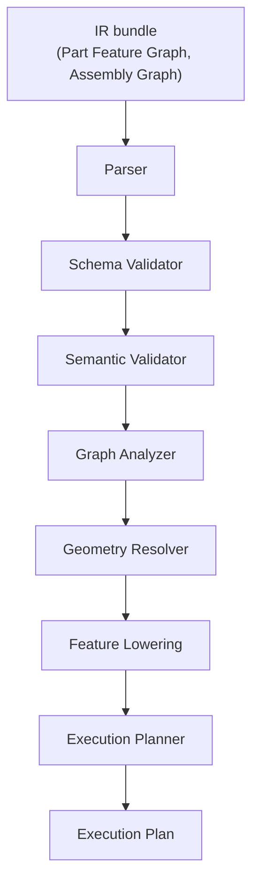

# 6. CAD Compiler

> Specification v1.45, section 6. Index and section map: [specifications/README.md](../specifications/README.md).

## 6.1 Purpose

Converts a validated IR bundle (its Part Feature Graphs and, if present, its Assembly Graph) into a deterministic Execution Plan. It does not implement a geometry kernel. It resolves dependencies, maps semantic operations to backend capabilities and produces a valid plan.

## 6.2 Pipeline



## 6.3 Modules

| Module | Responsibilities |
| --- | --- |
| Parser | Deserialize IR, check structure and schema version, normalize units and types |
| Schema Validator | Required fields, parameter types, supported feature types, reference formats |
| Semantic Validator | Feature-specific rules, dependencies, missing references, incompatible operations, sketch inputs |
| Graph Analyzer | Cycles, topological order, upstream/downstream sets, affected sets, modification analysis |
| Geometry Resolver | Semantic and persistent references, signature matching, confidence, ambiguity. Decides in Python over facts the add-in gathers in one call (ADR-049) |
| Feature Lowering | Map to backend operations (6.5), apply explicit defaults (5.7.6), translate coordinates, reject what the capability profile lacks (6.6) |
| Execution Planner | Ordered operations, postcondition names, verification points, operation IDs; produces the Execution Plan of 6.5.3. Preconditions are not plan content: they are enforced at lowering and at the handler's Admit stage (23.4.1, 8.8.6) |

The whole path from IR to a verified result, including how this section relates to verification, is [§23](../specifications/compiler-architecture-specification.md). Verification planning is deliberately not one of these stages (ADR-064).

## 6.4 Determinism

Given the same IR version, input graph, compiler version, backend capability profile and relevant document state, the compiler produces an equivalent plan. Plans record provenance and versions.

## 6.7 Stage Contract

How each compiler stage (6.2, 6.3) behaves, so stages can be built, tested and replaced independently and the compiler stays deterministic (6.4).

### 6.7.1 Every stage is a pure function

```
run(input, context) → { output | null, diagnostics[], needs[] }
```

- **No effects.** A stage does not read files, the store, the clock or the network, and does not call the backend. Everything it may use is in its input or the context (guideline G2).
- **Context** is fixed for one compilation and recorded in the plan's provenance (6.5.3): compiler version and each stage's version, the capability profile (6.6), the defaults table (5.7.6), the part fingerprints, and the geometry candidates gathered so far (ADR-049).
- **Asking instead of fetching.** The Geometry Resolver is the only stage that needs facts from SOLIDWORKS. When the context lacks candidates for some references, it returns no output and lists them in `needs`. The driver in `cad-application` fetches them all in one `geometry.candidates` call through the backend port, adds them to the context, and runs the resolver again. A second round of `needs` for the same references is an error (`REF_NOT_FOUND`), so this loop always ends.

### 6.7.2 Stages

| Stage | Input → output | Uses from context | Diagnostic codes |
| --- | --- | --- | --- |
| Parser | Stored documents of the pinned bundle → typed models (generated, ADR-035). Older majors are migrated in memory (ADR-042). Lengths in `in` documents are converted to millimetres internally by the exact factor 25.4; outputs report in the document's units again (3.4.3) | — | `IR_SCHEMA_VERSION_UNSUPPORTED` |
| Schema Validator | Typed models → the same, checked against the JSON Schemas | — | `IR_SCHEMA_INVALID` |
| Semantic Validator | Checked models → the same, with every reference resolved within and across modules (3.4.2, 3.4.5 validation order) | Feature registry | `IR_REFERENCE_UNRESOLVED`, `IR_MODULE_MISSING`, `IR_RULE_VIOLATED` |
| Graph Analyzer | Valid models → dependency graph, topological order (ties broken by ID, 5.7.1), upstream and downstream sets | — | `IR_CYCLE` |
| Geometry Resolver | Graph → every `GeometryRef` pinned to a persistent ID with its matched signature (ADR-049) | Geometry candidates | `REF_AMBIGUOUS`, `REF_NOT_FOUND`, `REF_LOW_CONFIDENCE` |
| Feature Lowering | Resolved graph → backend operations per node (6.5.2), with every default filled and recorded | Capability profile, defaults table | `COMPILE_UNSUPPORTED_FEATURE`, `BACKEND_CAPABILITY_MISSING` |
| Execution Planner | Operations → Execution Plan (6.5.3): `sequence`, `depends_on`, postconditions, verification points, provenance, content hash | — | `COMPILE_PLAN_INVALID` |

### 6.7.3 Stopping and diagnostics

- **A stage with an error stops the compilation.** Its output is discarded and later stages do not run. Warnings never stop it.
- **Within a stage, every error is reported** (3.4.7). The Semantic Validator checks every module on its own first and reports errors for all of them before it stops, so an agent can fix a whole bundle in one round.
- **Diagnostics** use the 3.4.7 form plus `stage` and the bundle `module` they concern. `compile_bundle` returns them through the ADR-037 envelope: `ok: false` with `COMPILE_FAILED` and the diagnostics list when any stage failed.

### 6.7.4 Determinism and caching

- **Same input, same plan.** The same pinned bundle with the same context produces a byte-identical canonical plan (3.4.4). The determinism tests (15.6) compile twice, in the same process and in a fresh one, and compare the plan hashes.
- **Plan key and reuse [Builder's call].** A plan is stored under the content hash of its canonical form, `<plan_hash>` (3.4.4, 13.2.1); there is no second key. A plan's `bundle` records the pinned `<id>@<revision>` of each document (6.5.3), so a plan states exactly what it was built from (owner decision, 2026-11-05). Two revisions of identical content therefore give the same `operations` but different plan hashes, and their plans are stored separately. This is rare and costs only storage, because identical content normally reuses its revision (3.4.5). A job that compiles a plan whose hash already exists in the store writes nothing and reuses the stored plan; the reuse is recorded as a `note` in the job journal. Stage versions are part of the plan's provenance, so a change to a stage's logic that changes the plan gives a new hash and is never confused with an old plan.
- **Stage versions.** Each stage has its own version string. A change to a stage's logic or rules bumps it, and the versions are recorded in the plan's provenance (6.5.3).
- **Time.** The compiler targets less than 500 ms for a typical bundle, excluding the time spent gathering candidates (16).

Incremental compilation (section 9, P2) reuses these stages, starting from the Graph Analyzer's affected sets.
