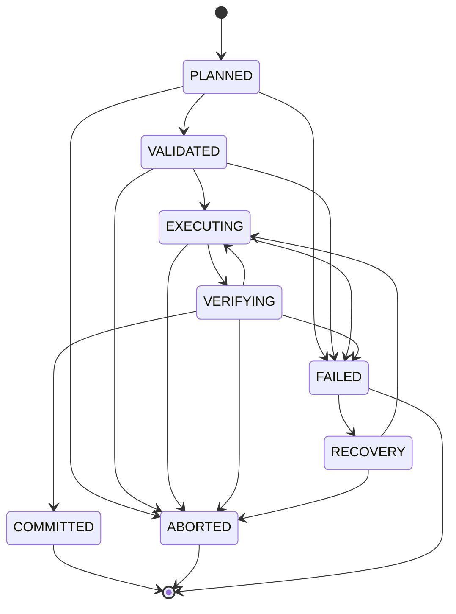

# 8. Execution Engine

> Specification v1.38, section 8. Index and section map: [specifications/README.md](../specifications/README.md).

## 8.1 Purpose

Executes compiled plans through a native backend. The AI agent never touches COM objects directly; every native operation passes through the controlled execution layer.

## 8.2 SOLIDWORKS Backend

A C# execution server: COM interop, controlled STA thread, command dispatcher, document lifecycle manager, feature and drawing operation adapters, structured errors. Python handles MCP and the compiler (ADR-001, ADR-002).

**In-process add-in (ADR-028) [Builder's call].** The execution server runs inside SOLIDWORKS as an add-in (`ISwAddin`), not as a separate process driving SOLIDWORKS over COM. Python talks to it over local IPC (named pipes). Reasons:
- Every out-of-process COM call is marshalled between processes and costs roughly a millisecond. Drawing checks read display data for hundreds of annotations and polylines for every view, which would take far longer than the targets in section 16.
- The add-in's calls run on SOLIDWORKS's own STA thread, so 8.3 rules 2–4 are met by design.
- The add-in receives document events (`RegenNotify`, `FileSavePostNotify`, `DestroyNotify2`, …), which external-edit detection (9.3) and disconnection handling (8.3 rule 5) need.

A small launcher starts SOLIDWORKS with the add-in loaded, or connects to an already-running SOLIDWORKS whose add-in is loaded. Out-of-process COM stays available as a fallback for diagnostics only.

Target: **SOLIDWORKS 2025 and newer** (owner decision). API features introduced in 2025 may be used freely.

The C# command set is designed for this system, including annotation geometry read-back.

**Division of responsibility (ADR-032) [Builder's call].**
- **Python owns state.** Jobs, their lifecycle (8.4), the execution journal, checkpoints and reports live in the Python core service (ADR-041), one per user, behind stateless MCP front-ends, and are persisted (13.1). If the Python process dies, a restarted process reads the journal and marks unfinished jobs for recovery; it never resubmits them blindly (8.3 rule 8).
- **The add-in owns no job state.** It executes commands from the queue and returns results. Each mutating command carries an operation ID; the add-in remembers the IDs it has completed for the open documents so that a repeated command is reported as a duplicate, not executed twice. If the add-in or SOLIDWORKS dies, Python sees the pipe close and fails the running job with "backend lost".
- **Coarse commands.** The IPC protocol (`packages/cad-protocol`; wire format, handshake and cancellation in ADR-036) carries coarse commands: apply an operation batch, read back a whole sheet into a Drawing Geometry Snapshot (11.5.1), read a feature tree page. Chatty per-entity calls across the pipe are not allowed; the per-entity work happens inside the add-in.
- **Pipe security.** The named pipe is created with an ACL for the current user only, and every connection must present a per-session token, which the add-in publishes in a session file only the current user can read (8.6.1). Other local processes cannot drive SOLIDWORKS through it (section 14).

## 8.3 COM Requirements

1. Explicit COM object ownership.
2. All SOLIDWORKS API calls on a controlled STA thread.
3. No concurrent access to the same document or COM object.
4. Requests marshaled through a command queue.
5. Handle disconnection and application termination.
6. Release COM references appropriately.
7. Never block the queue indefinitely.
8. Distinguish timeout from confirmed cancellation. A timeout never triggers automatic resubmission.
9. **Units boundary.** The SOLIDWORKS API works in system units (metres, radians, kilograms), whatever the document units are. However, some calls also have document-unit variants, for example the `IDimension` value getters and setters (`Value` / `GetValue3` vs `SystemValue` / `GetSystemValue3`; Phase 0 confirms which of each pair uses document units). The adapter uses only system-unit variants, and a code check bans the document-unit ones. Conversion happens in exactly one place per direction: going in, the C# translator (8.8.6); coming back, the core, which receives raw SI from read commands (8.7). So one conversion error cannot both build and measure a part wrongly and agree with itself (8.8.9). The IR, the compiler and the reports use the units declared in the IR.
10. **Visible, interactive session.** Some drawing APIs, including display-data read-back, view polylines and annotation positioning, return incomplete data when SOLIDWORKS is invisible or runs without an interactive desktop. The execution server attaches to or starts a visible SOLIDWORKS in a logged-in user session. It cannot run as a Windows service.
11. **Deterministic creation.** Interactive helpers make API-created geometry depend on screen state:
    - Sketch entities are added with `ISketchManager.AddToDB = true`, with sketch inference and snapping off, so entities are never snapped to nearby geometry.
    - Selection never uses `SelectByID2` with display names (5.3.6). Features (planes, sketches) are selected through `IFeature.Select2(append, mark)` and entities through `IEntity.Select4` with explicit `SelectData`, each with the selection marks the feature API expects. (The spike found that `IFeature` has no `Select4`.)
    - Graphics updates are turned off while building (`IModelView.EnableGraphicsUpdate`) and back on before any drawing read-back (rule 10).
12. **No modal dialogs.** A modal dialog blocks the SOLIDWORKS thread and therefore the queue (rule 7). Documents are opened with `swOpenDocOptions_Silent`. Error and warning popups on rebuild, missing-reference prompts and save-as-newer-version prompts are turned off for the session, and their information is read through the API instead. A blocked UI is detected and reported as a backend failure, never retried blindly.
13. **Sharing the session with the engineer (owner decision, ADR-050).** Rule 10 means the agent usually works in the engineer's own SOLIDWORKS. While a job runs:
    - The add-in shows a non-modal "AI job running" banner with a Stop button, which cancels the job as `cancel_execution` does (8.4). **Temporary exception for the part chain MVP (owner decision D1, 2026-11-05, ADR-050):** the banner and its Stop button are not built, and `plan` jobs (8.4.1) run without them. `cancel_execution` is the way to stop a job. The event detection in the third bullet is still built.
    - The job's documents are the only ones it touches. Document events from other documents are ignored by the job; they still feed external-edit detection (9.3).
    - If the engineer edits, closes or saves one of the job's documents, or changes the active document while the job needs it (a part operation works on a document that is not active, so an active-document change alone does not interrupt a part job, **[Builder's call]**), the add-in detects it through document events, stops the job between commands and fails it with "interrupted by user". It never continues on a document whose state it no longer knows.
    - The owner chose the shared session (ADR-050). A dedicated second instance remains only as the fallback of assumption A12; it needs a license check, since each instance may consume a seat.

## 8.4 Lifecycle

Any other transition is a programming error and raises; it is never written to the journal. `VERIFYING → EXECUTING` is for `produce_drawing` only. `FAILED → RECOVERY` exists from Phase 4 (`recover_execution`); in Phase 1, COMMITTED, ABORTED and FAILED are final **[Builder's call]**. The transition table in code keeps the edge, so it matches this diagram, but no Phase 1 code requests it (register J18).

| State | Meaning |
| --- | --- |
| PLANNED | Plan generated, or job accepted; waiting in the queue. This is the state `get_execution_status` reports for a queued job; there is no separate QUEUED state |
| VALIDATED | Preconditions and capabilities checked |
| EXECUTING | Native operations running |
| VERIFYING | Result being checked |
| COMMITTED | Completed and verified |
| FAILED | Operation or verification failed |
| RECOVERY | Recovery being evaluated |
| ABORTED | Terminated |

**One job model [Builder's call].** Every long-running operation is a **job** with an execution ID and the lifecycle above. Job types:

| Job type | Started by | EXECUTING / VERIFYING mean |
| --- | --- | --- |
| `plan` | `execute_plan`, `apply_part_graph` (8.4.1) | Run the compiled plan; API and geometry verification (10.2) |
| `produce_drawing` | `produce_drawing`, `relayout_drawing` | Apply layout and read back; drawing checks (11.5). A failed check moves the job back to EXECUTING for the next re-layout step (11.6) until the check passes or the limits in 11.6 are reached; then FAILED with the conflict list |
| `check_drawing` | `check_drawing` | Read back only; checks. Never saves the drawing. It may switch draft-quality views to high quality in memory for read-back (11.5) and reports that it did. It may rebuild in memory for D10 (11.5.3, A16) |

- Jobs run one at a time per SOLIDWORKS session (8.3 rule 13), in one queue shared by every connected agent (ADR-041). A job keeps running when the agent that started it disconnects. Further jobs wait in the queue in state PLANNED, with a `queued_position`: the number of jobs that will start before this one (the running job, if any, plus earlier PLANNED jobs). `0` means it starts next. It is absent once the job leaves PLANNED.
- `cancel_execution` takes effect between commands, never in the middle of one. A cancelled job ends in ABORTED after the current command finishes; what it changed is listed, and its partial work is removed unless the caller asks to keep it: by the undo object (8.5) where a job type uses one, by the working-file rule for `plan` jobs (8.4.1). A PLANNED job is ABORTED at once. Cancelling a finished job changes nothing and returns its final state.
- How the engine is threaded, and how long-polls wait, is ADR-053.

**`check_drawing` lifecycle [Builder's call].** The path checks (12.5), the file fingerprint (13.1) and argument validation happen in the tool call, before a job exists; a failure there is the tool's error and creates no job.

| State | `check_drawing` is |
| --- | --- |
| PLANNED | Accepted, `execution_id` returned, waiting for its turn |
| VALIDATED | Its turn came; the backend was acquired (`BackendProvider`, G2) and has the capabilities `drawing.snapshot` and `ops.apply` with `document.open` and `document.close` (6.6) |
| EXECUTING | Opening the drawing read-only if it is not open (an owned document, ADR-046), then reading it back with one `drawing.snapshot` (8.7), then storing the snapshot |
| VERIFYING | Building the report (11.5.4), storing it and updating the drawing record (13.2), then closing the drawing if the job owns it |
| COMMITTED | Report stored. This includes a report whose verdict is `fail` or `not_evaluated`: a failed check is a result (ADR-037) |
| FAILED | The job could not produce a report: `BACKEND_LOST`, `BACKEND_SESSION_AMBIGUOUS`, `BACKEND_VERSION_UNSUPPORTED`, `BACKEND_CAPABILITY_MISSING`, `BACKEND_UI_BLOCKED`, `EXEC_TIMEOUT`, `EXEC_INTERRUPTED_BY_USER`, `EXEC_INTERRUPTED` (13.2.3, and an unexpected error in the job, whose outcome is then unknown), `STORE_UNAVAILABLE` (a store file could not be written, 13.2.2), `IR_REFERENCE_UNRESOLVED` (a requested sheet does not exist), or `IR_SCHEMA_INVALID` / `IR_RULE_VIOLATED` (the add-in returned a snapshot that fails its schema or cannot be canonicalized, 11.5.4) |
| ABORTED | Cancelled (`EXEC_CANCELLED`), or never started before a core crash (`EXEC_INTERRUPTED`) |

- **Cancel boundaries.** The worker checks the cancel flag before VALIDATED, before EXECUTING, between the open batch and the snapshot, after the snapshot returns, and before writing the report. Once the report write has started, the job ends COMMITTED. A cancelled job still closes the drawing it owns. `keep_partial` has no effect: `check_drawing` changes nothing, so its list of changes is always empty.
- **Notifications on a blocking client.** `session.ui_blocked` fails the running job with `BACKEND_UI_BLOCKED` (8.6.3), and a `document.event` on the job's drawing that the job did not cause fails it with `EXEC_INTERRUPTED_BY_USER` (8.3 rule 13). Until the client has a reader thread (ADR-053), both are seen only when the current call returns; the result of that call is then discarded and nothing is stored.
- **Events the job caused [Builder's call].** While the add-in runs a command whose `_meta` has a `job_id`, it copies that `_meta` (`request_id`, `job_id`, `operation_id`) into every `document.event` it raises on the UI thread before the command's response is sent; that includes events SOLIDWORKS raises synchronously for the command (opening, the in-memory rebuild of D10, activation). An event raised at any other time has no `_meta`. The core counts an event on the job's drawing (paths compared after `ntpath.normcase`) as caused by the job only when `_meta.job_id` is the running job's ID; an event without `_meta`, or with another job's ID, fails the job. Tagging is therefore part of the add-in's contract (8.7): an add-in that does not tag would fail every job, and the C# side implements it in milestone 6 (register J16). Events after the job's own `document.close` are not checked.
- **When the drawing is not closed [Builder's call].** After `BACKEND_LOST`, `BACKEND_UI_BLOCKED`, `EXEC_TIMEOUT` or `EXEC_INTERRUPTED_BY_USER` the job sends no `document.close`: the add-in may not answer, may still be running the timed-out command, or the engineer is working in the document. If the open was sent, the drawing is listed with `state: unknown` in the job's `documents` (and `documents_unknown`, 12.4.5). After any other failure, a cancellation, an unexpected error, or COMMITTED, the job closes the drawing it owns. A close that fails adds the job warning `drawing_close_failed`, lists the drawing as `unknown`, and does not change the job's outcome (register J17).
- **No job time limit** beyond each command's own (8.6.3).
- **Job warnings.** A job may report warnings that are not facts about the snapshot: a SOLIDWORKS service pack newer than the tested one (`HelloResult.warnings`, ADR-045), and, once the snapshot can say so, a draft-quality view switched for read-back (register J11). They go in the job record and the `get_execution_status` and `get_drawing_report` outputs (12.4.5), never in the report file, which stays a pure function of its inputs (11.5.4).

## 8.4.1 The `plan` job (part chain MVP) [Builder's call]

`apply_part_graph` starts a job of type `plan` (12.4.5); `execute_plan` starts one in a later phase. The tool itself validates the IR, authorizes the target path and stores the revision (3.4.5), so a bad graph or path fails the call and creates no job. The [MVP design](../superpowers/specs/2026-11-05-part-chain-mvp-design.md) section 8 explains the reasoning.

| State | What happens |
| --- | --- |
| PLANNED | Accepted, waiting |
| VALIDATED | Backend acquired and capabilities checked. The template is resolved: the caller's, otherwise `part.template` (13.3); neither gives `CONFIG_INVALID` and a missing file `FILE_NOT_FOUND`, each with `details.setting: part.template`. Compile, store the plan (6.7.4), and re-check that the target does not exist |
| EXECUTING | Journal `document` `create`, then send `part.create` on `<name>.<job_id>.building.SLDPRT` beside the target. Then the plan's operations one batch each, journalled before sending (13.2.3), each judged against its contract before the next is sent (10.2.2). Forced rebuild, then `document.save` |
| VERIFYING | `part.measure` and compare (10.2). Take the fingerprint. Close, and confirm the document is no longer open. Reopen read-only, confirm a new `instance_id`, measure and compare again. Close. Publish |
| COMMITTED | The target exists and passed every check |
| FAILED | See below |
| ABORTED | Cancelled between commands |

**Publishing.** In this order:
1. Re-run the 12.5 path checks on the target, so a folder swapped since authorization is caught.
2. Compare the working file's fingerprint with the one taken before reopen. A mismatch fails the job.
3. Journal `publish_intent` with the path and fingerprint. This is the last cancel point.
4. Rename the working file to the target with no replace and write-through (`MoveFileExW`). If the target has appeared, the job fails with `AUTH_SOURCE_WRITE_NOT_ALLOWED`.
5. Journal `published`, store the part record (13.2.1) and enter COMMITTED.

**Cancel boundaries.** A cancel takes effect between operations, between the two measurements, and before `publish_intent`. After `publish_intent` the job finishes as COMMITTED or fails, and a cancel request has no effect.

**Ending without success.** The target is never touched.

| Case | Working file |
| --- | --- |
| Operation or verification failed (`FEATURE_VERIFICATION_FAILED`, `PART_VERIFICATION_FAILED` and others) | Best-effort save, close, and renamed `<name>.<job_id>.failed.SLDPRT` beside the target, named in the error |
| Cancelled | Closed and removed. With `keep_partial`, renamed `<name>.<job_id>.partial.SLDPRT` |
| `BACKEND_LOST`, `BACKEND_UI_BLOCKED`, `EXEC_TIMEOUT`, `EXEC_INTERRUPTED_BY_USER` | Left alone and listed as `unknown` (8.4). Nothing is resent |

The job reuses `check_drawing`'s handling of notifications, journalling and stop rules (above) through its own code. Part jobs use this working-file rule instead of undo objects (ADR-046). Crash recovery follows 13.2.3.

## 8.5 Transactions and Recovery (P2)

SOLIDWORKS has no general atomic transaction across modeling operations. It does offer undo objects: `IModelDocExtension.StartRecordingUndoObject` and `FinishRecordingUndoObject2` group a sequence of operations into one undo step. From P2, the executor can wrap a plan in an undo object, which gives a cheap rollback before the document is saved. The part chain does not: it builds on a working file and discards it (8.4.1, ADR-046). Undo objects do not survive save or close and are bounded by the undo stack, so they complement checkpoints rather than replace them. Beyond that, the system uses controlled recovery: operation IDs, execution journal, before/after inspection, checkpoints and Save Copy, retry classification, idempotency checks, compensation strategies, diagnostics. Recovery never blindly repeats operations that may have succeeded.

Example: a 10-feature graph fails at feature 7. The system must determine which features exist, whether feature 7 partially executed, whether to skip, resume or roll back to a checkpoint, and whether a retry would duplicate features.

## 8.7 IPC Messages [Builder's call]

What ADR-036 leaves open, so the Python client and C# `Core` build the same protocol. The schema is `schemas/ipc/v0.json`; each operation type adds `schemas/ipc/ops/<op>.json` (6.5.1). The protocol version is `0.1` while the schema is at major 0 (3.4.8).

**Errors.** JSON-RPC `error.code` is `-32000` for every catalogue error, with the ADR-037 error object in `error.data`. The other codes are the standard ones, used only for protocol faults: `-32700` unparsable frame, `-32600` not a valid request, `-32601` unknown method, `-32602` invalid `params`, and `-32603` for an unexpected exception in the add-in, whose stack trace goes to the log only. `error.data` is absent on those.

**Handshake.** Everything before a successful `session.hello` is checked in this order:

| Condition | Add-in's response |
| --- | --- |
| First frame is not `session.hello`, or the token is wrong | Closes the pipe without a reply, so an unauthenticated client learns nothing. The token comparison takes constant time |
| Protocol major differs | `BACKEND_VERSION_UNSUPPORTED`, then closes |
| SOLIDWORKS version unsupported (ADR-045) | `BACKEND_VERSION_UNSUPPORTED`. The pipe stays open and the session stays unauthenticated (8.6.1) |
| Otherwise | The result below; the session is ready |

The `session.hello` result holds `protocol`, `addin_version`, `solidworks` (`version`, `service_pack`, `ui_language`), `capabilities`, `operations` (`op`, `schema_version`), `licensed_modules` and `warnings` (6.6, ADR-045). The client closes the pipe if the returned major differs from its own.

**Dispatch.** The pipe thread answers `session.ping`, `session.completed_operations` and `job.cancel` itself; every other command goes on the queue (8.6.2).

**`drawing.snapshot`.** `params`: `document` (path) and optional `sheets` (names; all sheets when absent). `result`: one complete Drawing Geometry Snapshot (11.5.1) holding those sheets. It is one command across sheets, so cancellation can fall between sheets (8.6.2). A requested sheet the drawing does not have fails the command with `IR_REFERENCE_UNRESOLVED`, `details.sheets` naming the missing ones **[Builder's call]**. The document must be open: `check_drawing` sends `ops.apply` with `document.open` (`read_only: true`) first, and `document.close` after, if the open reported `owned: true` (8.4).

**`part.measure`** (MVP). `params`: `document` (the full path of an open part). `result`: `path`, `instance_id`, `solid_body_count`, `bbox_m` (`min`, `max`), `volume_m3`, `surface_area_m2`, `center_of_mass_m`, `cylinders_m` (a list of `{point, direction, radius}` for each cylindrical face), `rebuild` (`ok`, `errors`), `features` (a list of `{feature_id, native_id, type, status}`), `dirty` and `read_only`. Like `drawing.snapshot` it is a read-back command, not an operation. `rebuild` reports the document's observed state, never the return value of a rebuild; K19 settles its native source. It returns raw SI values (metres, with `IMassProperty.UseSystemUnits = true`), and the core converts them, so a conversion error cannot both build and measure a part and still agree with itself. A document opened read-only is measured without a rebuild, so `dirty` stays false. A cylinder's `point` is any point on its axis, so a comparison uses only the components perpendicular to `direction` and gives the radius a tolerance (10.2). The document must be open, and the command fails with `FILE_NOT_FOUND` when no open document has that path. `instance_id` is issued by the add-in whenever it creates or opens a document (`part.create`, `document.open`), is not persisted, and tells a document the job holds from one reopened under the same path **[Builder's call]**.

**`ops.apply`.** `params.groups` is an ordered list of `{document, operations}`. This is the batch header of 6.5.1, and it lets a batch span documents in order. Each operation is `{operation_id, op, params}`. `result.outcomes` lists the attempted operations in order, each `{operation_id, result}` or `{operation_id, error}`. Operations after the first error are not attempted and not listed (6.5.1). An operation the add-in does not know fails the batch with `BACKEND_CAPABILITY_MISSING`, is never recorded in the ledger, and never answers `applied` **[Builder's call]**. A repeated ID stops the batch like any other error: its outcome has `error` with code `DUPLICATE_OPERATION` and also `result`, the original result. If the original failed but was recorded (see the ledger below), `result` is absent and `error.details.original_error` holds the original error. If cancellation stops a batch, the next operation's outcome has `error` with code `EXEC_CANCELLED`. An unexpected exception ends the batch with a `-32603` error; operations already completed stay in the ledger, so the core can ask for them.

**Operation ledger.** The add-in records each completed operation's ID, result and document, in completion order, and forgets a document's entries when the add-in sees that document destroyed (`DestroyNotify2`, subscribed per tracked document; `FileCloseNotify` never fires for an API close, so it is not relied on). Before it trusts an entry for a part, it also checks `GetOpenDocumentByName(fullPath)` and drops the entry if the document is gone **[Builder's call]**. A `document.close` operation records its own ID after that event, so its entry stays and earlier ones go. **A failed operation that may have changed the document is recorded (owner decision, 2026-11-05; closes K17).** An error with `details.effect` of `applied` or `unknown` (8.9.5), or an unexpected exception from the operation, is recorded with its error, so its ID can never run again. An error with `effect: none`, or with no `effect`, as the frozen drawing handlers return, is not recorded. The ledger outlives a pipe connection, so a reconnecting core can ask for it. `session.completed_operations` returns `operation_ids`, the operations that succeeded, in completion order, and an additive `failed_operations`, a list of `{operation_id, code, effect}` for recorded failures, so recovery never reads a failure as a success. The add-in and the schema do not implement this yet (plan Task 7a). A command still running when the pipe closes finishes and records its result (8.6.3).

**`job.cancel`.** The add-in sets the cancel flag and removes queued commands, answering each with `EXEC_CANCELLED`. If a command is running, the cancel response waits until that command has answered. The result is `{cancelled}`: true if a command was running or queued when the request arrived. A running command may still finish normally, so its own response says what happened. The client's wait for this response therefore uses the command time limit, not the read limit. The running command checks the flag between operations or sheets (8.6.2) and, if it stops early, answers `EXEC_CANCELLED`.

**Chunks.** A response larger than the frame limit (64 MiB) is sent as notifications with method `response.chunk` and `params` `{id, index, count, data}`, where `id` is the request's and `index` counts from 0. `data` is base64 of a piece of the UTF-8 bytes of the complete response frame; joined in `index` order they give that frame. Other notifications may fall between chunks. Base64 keeps the size exact, since a JSON string's escapes could overflow a frame. A client discards a chunk or response whose `id` it is no longer waiting for.

**Client behaviour.** A command's time limit (8.6.3) covers the whole call, so progress notifications do not extend it. After a timeout the client reports `EXEC_TIMEOUT`, never resends (8.3 rule 8), and discards the late response when it arrives. When the pipe closes, every waiting call fails with `BACKEND_LOST`. Readers ignore unknown fields; an unknown error code in `error.data` is kept as text, not treated as a client error (ADR-042).

**Transcripts** (15.5) are JSON Lines in `tests/fixtures/ipc/<scenario>.jsonl`.

- The first line is a header: `{"transcript": "0.1", "scenario", "source", "sides", "config"}`. `source` is `synthetic` (hand-written) or `recorded` (from a live run). `sides` lists who replays it (`python`, `csharp`), since some faults only one side can produce. `config` holds the session settings the scenario assumes (`token`, `max_frame_bytes`, and for C# the `backend` values and version status).
- Every other line is `{"dir": "core_to_addin" | "addin_to_core", "t_ms", "frame"}` or `{"dir": "addin_to_core", "t_ms", "close": true}`.
- **Masking.** Comparison ignores `_meta` and the `message` of every error, since agents act on codes (ADR-037), and `response.chunk` frames are joined first, so comparison is on the parsed JSON of whole responses, not on bytes or on how a response was split.
- `t_ms` decides replayed timeouts: a Python call times out when the next add-in frame is later than its limit, with no real waiting.
