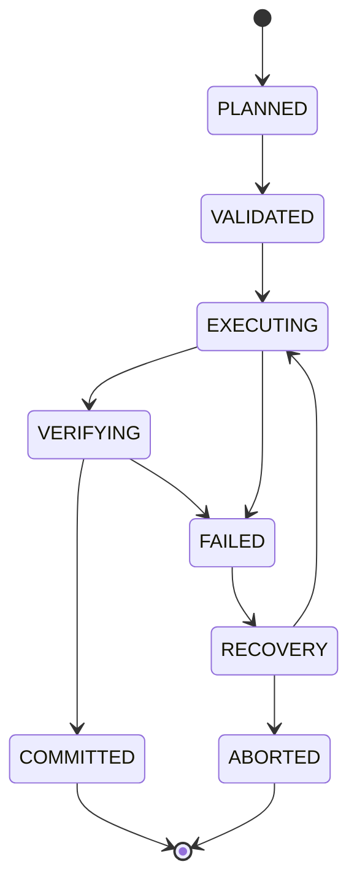

# 8. Execution Engine

> Specification v1.19, section 8. Index and section map: [specifications/README.md](../specifications/README.md).

## 8.1 Purpose

Executes compiled plans through a native backend. The AI agent never touches COM objects directly; every native operation passes through the controlled execution layer.

## 8.2 SOLIDWORKS Backend

A C# execution server: COM interop, controlled STA thread, command dispatcher, document lifecycle manager, feature and drawing operation adapters, structured errors. Python handles MCP and the compiler (ADR-001, ADR-002).

**In-process add-in (ADR-028) [Builder's call].** The execution server runs inside SOLIDWORKS as an add-in (`ISwAddin`), not as a separate process driving SOLIDWORKS over COM. Python talks to it over local IPC (named pipes). Reasons:
- Every out-of-process COM call is marshalled between processes and costs roughly a millisecond. Drawing checks read display data for hundreds of annotations and polylines for every view, which would take far longer than the targets in section 16.
- The add-in's calls run on SOLIDWORKS's own STA thread, so 8.3 rules 2–4 are met by design.
- The add-in receives document events (`RegenNotify`, `FileSaveNotify`, `DestroyNotify`, …), which external-edit detection (9.3) and disconnection handling (8.3 rule 5) need.

A small launcher starts SOLIDWORKS with the add-in loaded, or connects to an already-running SOLIDWORKS whose add-in is loaded. Out-of-process COM stays available as a fallback for diagnostics only.

Target: **SOLIDWORKS 2025 and newer** (owner decision). API features introduced in 2025 may be used freely.

The C# command set is designed for this system, including annotation geometry read-back.

**Division of responsibility (ADR-032) [Builder's call].**
- **Python owns state.** Jobs, their lifecycle (8.4), the execution journal, checkpoints and reports live in the Python core service (ADR-041), one per user, behind stateless MCP front-ends, and are persisted (13.1). If the Python process dies, a restarted process reads the journal and marks unfinished jobs for recovery; it never resubmits them blindly (8.3 rule 8).
- **The add-in owns no job state.** It executes commands from the queue and returns results. Each mutating command carries an operation ID; the add-in remembers the IDs it has completed for the open documents so that a repeated command is reported as a duplicate, not executed twice. If the add-in or SOLIDWORKS dies, Python sees the pipe close and fails the running job with "backend lost".
- **Coarse commands.** The IPC protocol (`packages/cad-protocol`; wire format, handshake and cancellation in ADR-036) carries coarse commands: apply an operation batch, read back a whole sheet into a Drawing Geometry Snapshot (11.5.1), read a feature tree page. Chatty per-entity calls across the pipe are not allowed; the per-entity work happens inside the add-in.
- **Pipe security.** The named pipe is created with an ACL for the current user only, and every connection must present a per-session token, which the add-in publishes in a session file only the current user can read (8.6.1). Other local processes cannot drive SOLIDWORKS through it (section 14).

## 8.3 COM Requirements

1. Explicit COM object ownership.
2. All SOLIDWORKS API calls on a controlled STA thread.
3. No concurrent access to the same document or COM object.
4. Requests marshaled through a command queue.
5. Handle disconnection and application termination.
6. Release COM references appropriately.
7. Never block the queue indefinitely.
8. Distinguish timeout from confirmed cancellation. A timeout never triggers automatic resubmission.
9. **Units boundary.** The SOLIDWORKS API works in system units (metres, radians, kilograms), whatever the document units are. However, some calls also have document-unit variants, for example the `IDimension` value getters and setters (`Value` / `GetValue3` vs `SystemValue` / `GetSystemValue3`; Phase 0 confirms which of each pair uses document units). The adapter uses only system-unit variants, and a code check bans the document-unit ones. Conversion happens in exactly one place: the C# adapter's parameter marshaling. The IR, the compiler and the reports use the units declared in the IR.
10. **Visible, interactive session.** Some drawing APIs, including display-data read-back, view polylines and annotation positioning, return incomplete data when SOLIDWORKS is invisible or runs without an interactive desktop. The execution server attaches to or starts a visible SOLIDWORKS in a logged-in user session. It cannot run as a Windows service.
11. **Deterministic creation.** Interactive helpers make API-created geometry depend on screen state:
    - Sketch entities are added with `ISketchManager.AddToDB = true`, with sketch inference and snapping off, so entities are never snapped to nearby geometry.
    - Selection never uses `SelectByID2` with display names (5.3.6). Entities are selected through `IEntity.Select4` with explicit `SelectData` and the selection marks each feature API expects.
    - Graphics updates are turned off while building (`IModelView.EnableGraphicsUpdate`) and back on before any drawing read-back (rule 10).
12. **No modal dialogs.** A modal dialog blocks the SOLIDWORKS thread and therefore the queue (rule 7). Documents are opened with `swOpenDocOptions_Silent`. Error and warning popups on rebuild, missing-reference prompts and save-as-newer-version prompts are turned off for the session, and their information is read through the API instead. A blocked UI is detected and reported as a backend failure, never retried blindly.
13. **Sharing the session with the engineer (owner decision, ADR-050).** Rule 10 means the agent usually works in the engineer's own SOLIDWORKS. While a job runs:
    - The add-in shows a non-modal "AI job running" banner with a Stop button, which cancels the job as `cancel_execution` does (8.4).
    - The job's documents are the only ones it touches. Document events from other documents are ignored by the job; they still feed external-edit detection (9.3).
    - If the engineer edits, closes or saves one of the job's documents, or changes the active document while the job needs it, the add-in detects it through document events, stops the job between commands and fails it with "interrupted by user". It never continues on a document whose state it no longer knows.
    - The owner chose the shared session (ADR-050). A dedicated second instance remains only as the fallback of assumption A12; it needs a license check, since each instance may consume a seat.

## 8.4 Lifecycle

| State | Meaning |
| --- | --- |
| PLANNED | Plan generated |
| VALIDATED | Preconditions and capabilities checked |
| EXECUTING | Native operations running |
| VERIFYING | Result being checked |
| COMMITTED | Completed and verified |
| FAILED | Operation or verification failed |
| RECOVERY | Recovery being evaluated |
| ABORTED | Terminated |

**One job model [Builder's call].** Every long-running operation is a **job** with an execution ID and the lifecycle above. Job types:

| Job type | Started by | EXECUTING / VERIFYING mean |
| --- | --- | --- |
| `plan` | `execute_plan` | Run the compiled plan; API and geometry verification (10.2) |
| `produce_drawing` | `produce_drawing`, `relayout_drawing` | Apply layout and read back; drawing checks (11.5). A failed check moves the job back to EXECUTING for the next re-layout step (11.6) until the check passes or the limits in 11.6 are reached; then FAILED with the conflict list |
| `check_drawing` | `check_drawing` | Read back only; checks. Never saves the drawing. It may switch draft-quality views to high quality in memory for read-back (11.5) and reports that it did |

- Jobs run one at a time per SOLIDWORKS session (8.3 rule 13), in one queue shared by every connected agent (ADR-041). A job keeps running when the agent that started it disconnects. Further jobs wait in a queue and report `queued` through `get_execution_status`.
- `cancel_execution` takes effect between commands, never in the middle of one. A cancelled job ends in ABORTED after the current command finishes; what it changed is listed, and the undo object (8.5) is rolled back unless the caller asks to keep the partial result.

## 8.5 Transactions and Recovery (P2)

SOLIDWORKS has no general atomic transaction across modeling operations. It does offer undo objects: `IModelDocExtension.StartRecordingUndoObject` and `FinishRecordingUndoObject2` group a sequence of operations into one undo step. The executor wraps each plan in an undo object, which gives a cheap rollback before the document is saved. Undo objects do not survive save or close and are bounded by the undo stack, so they complement checkpoints rather than replace them. Beyond that, the system uses controlled recovery: operation IDs, execution journal, before/after inspection, checkpoints and Save Copy, retry classification, idempotency checks, compensation strategies, diagnostics. Recovery never blindly repeats operations that may have succeeded.

Example: a 10-feature graph fails at feature 7. The system must determine which features exist, whether feature 7 partially executed, whether to skip, resume or roll back to a checkpoint, and whether a retry would duplicate features.
