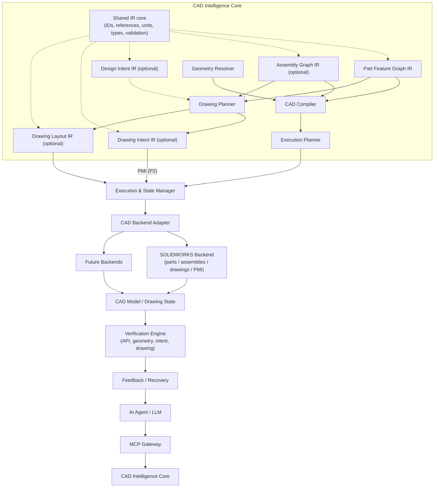

# 3. High-Level Architecture

> Specification v1.21, section 3. Index and section map: [specifications/README.md](../specifications/README.md).

## 3.1 Layers

1. AI Agent Layer
2. MCP Gateway Layer
3. CAD Intelligence Core (IR, compiler, references, drawing planner)
4. Execution and State Management Layer
5. Native CAD Backend Layer
6. Verification and Feedback Layer



## 3.2 Component Responsibilities

| Component | Responsibility |
| --- | --- |
| AI Agent | Understand requests, choose the IR modules the task needs, produce them |
| MCP Gateway | Expose capabilities to agents; no CAD logic |
| Shared IR core | IDs, cross-module references, geometry references, units and coordinate systems, parameter and tolerance types, validation |
| Part Feature Graph IR | Part geometry and modeling features |
| Assembly Graph IR (optional) | Component hierarchy, instances, mates, interfaces, motion relationships |
| Design Intent IR (optional) | Functional and manufacturing requirements, engineering constraints, inspection requirements |
| Drawing Intent IR (optional) | Dimensions, tolerances, GD&T, datums, surface finish |
| Drawing Layout IR (optional) | Views, annotations, positioning, layout, pins |
| CAD Compiler | Validate the IR bundle, analyze and lower part and assembly graphs |
| Geometry Resolver | Resolve references to CAD entities |
| Drawing Planner | Derive the dimension scheme (into the Resolved Scheme, 11.10.1) and plan views and placement (into Drawing Layout IR) |
| Execution Planner | Ordered, validated execution plans |
| Execution Manager | Execution lifecycle and state |
| Backend Adapter | Translate platform operations to native CAD |
| Verification Engine | Check API, geometry, intent and drawing correctness |
| Recovery Engine | Diagnose failures, choose safe recovery |

## 3.3 IR Modules and Task-Driven Composition

The system uses a small shared IR core plus independent domain IR modules. A task creates and requires only the modules it needs. Nothing forces a task to build an Assembly Graph, a Design Intent, a Drawing Intent or a Drawing Layout it does not use (ADR-026).

```
Shared IR core           IDs, cross-module references, geometry references, units and
                         coordinate systems, parameter types, tolerance/datum types, validation
   │
   ├── Part Feature Graph IR             part geometry and modeling features
   ├── Assembly Graph IR     (optional)  hierarchy, instances, mates, interfaces, motion
   ├── Design Intent IR      (optional)  functional / manufacturing / inspection requirements
   ├── Drawing Intent IR     (optional)  dimensions / GD&T / datums / surface finish
   └── Drawing Layout IR     (optional)  views / annotations / positioning / layout
            │
SOLIDWORKS execution backend             parts / assemblies / drawings / PMI
```

### Modules

Every module is versioned, validatable on its own without SOLIDWORKS, serializable and deterministic.

| Module | Question | Contains | Never contains | Section |
| --- | --- | --- | --- | --- |
| Part Feature Graph IR | How is the part built? | Features, sketches, parameters, dependencies, geometry references; optionally which functional features each node realizes | Tolerances, mates, drawing content | 5 |
| Assembly Graph IR | How do parts go together and move? | Component hierarchy, instances and their configurations, mates, interfaces, motion relationships | Part geometry, drawing content | 5.6 |
| Design Intent IR | What must the product do, and how is it made and inspected? | Functional features and requirements, engineering constraints, process, material, treatment, manufacturing inputs, inspection requirements, metadata | Modeling steps, mates, dimension values chosen for a drawing, views | 4 |
| Drawing Intent IR | What does the drawing specify? | Critical dimensions and scheme overrides (the authored part of the dimension scheme), tolerances incl. general tolerance, GD&T, datums, surface finish, configuration, optional `context` (process, material, metadata) when no Design Intent is attached | Views, positions, sheet coordinates, text layout | 11.10 |
| Drawing Layout IR | How is the drawing arranged? | Sheets, views, annotation placement, text layout, leaders, pins | Tolerance values, dimension values, requirements | 11.11 |

The **Part Feature Graph** is the base module for every task that creates or changes part geometry. A task that works on existing parts (drawing, assembly or edit) uses a read-only Part Feature Graph that the Read path builds from the feature tree (5.3). The user never has to write one.

### Task composition

| CAD task | Required modules | Optional |
| --- | --- | --- |
| Create a simple part | Part Feature Graph | — |
| Modify an existing part | Part Feature Graph (read, then edited) | Design Intent |
| Create a complex mechanical part | Part Feature Graph | Design Intent |
| Create an assembly | Part Feature Graph (one per unique part) + Assembly Graph | Design Intent |
| Create an assembly with motion simulation | Part + Assembly Graph + Design Intent | — |
| Generate an engineering drawing | Part Feature Graph (usually read) + Drawing Intent + Drawing Layout | Design Intent |
| Design a complete mechanical product | All relevant modules | — |

Examples:

- **Plastic housing.** Part Feature Graph (geometry). Optionally Design Intent (wall thickness, draft, material), Drawing Intent and Drawing Layout. There is no Assembly Graph.
- **Spring-driven mechanical injector.** Part Feature Graphs (housing, piston, spring, drive mechanism), Assembly Graph (hierarchy, mates, stroke limits), Design Intent (spring force, stroke, functional requirements), Drawing Intent and Drawing Layout per part.

The modules follow **progressive complexity**. Simple geometry needs only the Part Feature Graph. Engineering constraints add Design Intent. A mechanism adds the Assembly Graph. Manufacturing documentation adds Drawing Intent and Drawing Layout.

### Composition rules [Builder's call]

1. **IR bundle.** A task submits an *IR bundle*: a manifest listing the modules present, each with its ID and revision. Validation first checks each module on its own, then resolves references between modules. A reference into a module that is not in the bundle is a validation error. Modules not in the bundle are never created implicitly.
2. **Declared dependencies only.** A module may depend only on the modules in this table, and never on a module that depends on it:

   | Module | Requires | May reference, if present |
   | --- | --- | --- |
   | Part Feature Graph | — | Design Intent (`realizes`) |
   | Assembly Graph | Part Feature Graph of each component (read-only allowed) | Design Intent |
   | Design Intent | — | — (targets functional features by name, never module-internal IDs) |
   | Drawing Intent | The Part Feature Graph or Assembly Graph it documents | Design Intent (`requirement`, inspection) |
   | Drawing Layout | Drawing Intent | Part Feature Graph / Assembly Graph geometry (annotation attachment) |

3. **Stable interfaces, not internals.** Modules refer to each other only through shared-core references (3.4.2): `DocumentRef` and `ItemRef` (`<module>:<document_id>[@<revision>]/<item_id>`) for documents and items, and `GeometryRef` (section 7, stopgap in 11.1) for geometry. A module never reads another module's internal structure.
4. **One owner per value, with fallbacks.** A value lives in exactly one module. When its owner is optional and absent, a defined fallback supplies it:
   - **Process, material, treatment and part metadata.** These come from the Design Intent IR if it is in the bundle. Otherwise they come from the part itself (SOLIDWORKS material and custom properties), overridden by the Drawing Intent `context`. If a Design Intent IR is present, `context` must be empty.
   - **Inspection.** Inspection comes from the Design Intent `inspection` list if present, otherwise from `inspect: true` on Drawing Intent items.
   - **Tolerance values.** These always live in the Drawing Intent IR. If a Design Intent requirement is present, the drawing item cites it.
5. **Changes ripple to dependents only.** Changing a module can invalidate the modules that depend on it. Those are re-derived (derived items) or reported (authored items). It never changes the modules it depends on. Moving a dimension does not change what it means. Editing a part does not change its mates; mates that no longer resolve are reported.
6. **Modules evolve independently.** Adding or changing a module's schema never changes another module's schema. Shared-core types are versioned and change only in backward-compatible ways within a major version (ADR-042). The shared core itself is specified in 3.4.
7. **SOLIDWORKS is the source of truth for what was produced.** Checks run on read-back state, not on the IRs (ADR-014). The Drawing Layout IR is both the plan and the record of the last read-back.
8. **Derived artifacts are not modules.** The Resolved Scheme (11.10.1), the Drawing Geometry Snapshot (11.5.1), execution plans and reports are produced by the system from modules and CAD state. They are versioned and stored (13.1), but never authored, never submitted in a bundle, and regenerating them never changes a module's revision.
