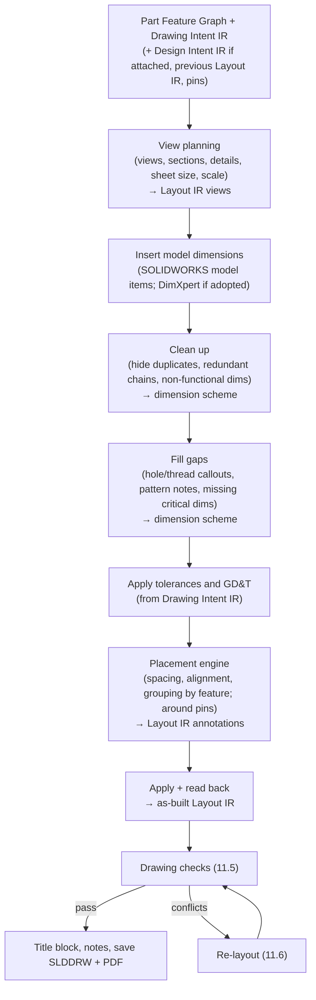

# 11. Production Drawings (P0)

> Specification v1.32, section 11.1–11.9. Index and section map: [specifications/README.md](../specifications/README.md).

## 11.1 Purpose and Bar

A drawing is **production-ready** when it can be sent to its recipient — machine shop, mold maker, sheet metal shop, or inspection/QA — **without manual cleanup**. The system never reports a drawing as done unless it passes every hard check in 11.5.

Scope: single-part drawings. Assembly drawings match the reference implementation's level and are not improved yet.

**Input parts (owner decision): both kinds.**

- **IR-built parts** — built by this system from a Feature Graph. Driving parameters and geometry come from the build record; Drawing Intent refers to Feature Graph IDs (`bore_1.diameter`).
- **Hand-modelled `.SLDPRT` parts** — made by engineers in SOLIDWORKS. Phase 1 uses a stopgap reference scheme until the semantic reference system (section 7) lands: Drawing Intent refers to geometry in one of three ways. The first is the SOLIDWORKS dimension full name, written `swdim:<full name>` (3.4.2): `swdim:D1@Sketch1` for a sketch dimension, `swdim:D1@Boss-Extrude1` for a feature dimension, with `@<file>.SLDPRT` appended where needed. The second is a persistent reference, captured when the user picks the geometry or returned by `inspect_geometry`, which lists a feature's faces and edges with key metrics and a reference ID for each (`geo:<reference_id>`), so an agent can name geometry without a pick. The third, for faces and edges (datums, GD&T targets, surface-finish exceptions), is **feature plus role**: the owning feature's ID and a role defined per feature type, for example a HoleWizard hole's `cylindrical_face`, an extrude's `start_face` / `end_face`, a revolve's faces by axial order. Roles are defined only where the feature type determines them; a role that matches more than one entity fails and asks (7.4) **[Builder's call]**. This is a small subset of section 7, which later replaces it. A full name is checked against the open model at intake. Full names contain feature names, which are localized (`D1@草图1` on a Chinese install) and user-editable. At intake, the pipeline therefore converts each full name to the feature-ID form of 5.3.6 and stores that form; the full name is kept only for reporting. If a localized or renamed name no longer resolves, the pipeline asks rather than guessing (5.3.6). Driving parameters are read from the feature tree (feature and sketch dimensions) of the configuration named in the intent. When a reference cannot be resolved to exactly one entity, the pipeline asks rather than guessing. The stopgap must be replaceable by section 7 without changing the intent schema beyond the reference format. On IR-built parts the same feature-plus-role form uses Feature Graph IDs (`bore_1.cylindrical_face`).
- **Imported bodies** (STEP, Parasolid, etc.) have no feature tree, so model-item insertion yields nothing. Their dimensions come from DimXpert (11.4) when the Phase 0 evaluation confirms that path. Until then, the pipeline reports such a part as unsupported and does not produce an empty drawing **[Builder's call]**.

**Source files are not modified without permission (owner decision pending; ADR-022 [Builder's call]).** The pipeline writes only the drawing and its exports by default.
- Title block values come from the part's existing custom properties, the Design Intent IR if attached, or else the Drawing Intent `context` (part number, revision, material, treatment), and the Drawing Intent IR (general tolerance). Values that are not in the part are written to drawing properties (`$PRPSHEET` links resolve to the referenced model, so the template mapping must say which source each field reads).
- Writing custom properties into the part requires an explicit option on the tool call, off by default (ADR-050).
- A read-only part or a part checked in to SOLIDWORKS PDM is never checked out or made writable by the system; it is reported.
- A part is never re-saved in a newer SOLIDWORKS version as a side effect.

## 11.2 Standard

ISO throughout:

| Topic | Standard |
| --- | --- |
| Projection | ISO 5456-2 first-angle |
| Lines and views | ISO 128 |
| Dimensioning | ISO 129-1 |
| Scales | ISO 5455 preferred scales only (1:1, 1:2, 1:5, 1:10, 2:1, 5:1, …) |
| General tolerances | ISO 2768-1 (default `m`). Shops still commonly read the combined `ISO 2768-mK`, but ISO 2768-2 (the `K`) has been superseded by ISO 22081. The title block carries `ISO 2768-m` with ISO 22081 (owner decision, ADR-050) **[Builder's call on class]** |
| Size and GPS principle | ISO 8015 (independence principle) referenced in the title block or general notes; ISO 14405-1 for size |
| GD&T | ISO 1101, datums ISO 5459 |
| Surface texture | ISO 21920-1 (successor to ISO 1302). Phase 0 checks that SOLIDWORKS 2025 can draw ISO 21920 symbols; if it cannot, ISO 1302-style symbols are used and the gap is recorded |
| Title block | Owner's company template (supplied by owner) or generated from Drawing Template IR (11.12, ADR-055); ISO 7200 fields as the baseline |
| Sheet sizes | ISO 5457 (A4 portrait; A3–A0 landscape) |

Implemented through a SOLIDWORKS drafting standard file (`.sldstd`), drawing templates (`.drwdot`), sheet formats (`.slddrt` or generated from Drawing Template IR, 11.12) and the hole-callout format file. The last one defines ISO thread and hole callouts such as `M6×1-6H` with depth symbols. **Sheet format and title block (owner decision): the owner's company template**, provided by the owner in Phase 0, or generated from Drawing Template IR (11.12, ADR-055). For hand-made formats, the pipeline fills it from part custom properties and the intent modules present (3.3 rule 4); the field mapping lives in configuration, not code. For generated formats, field sources are defined directly in the template IR. Other standards are out of scope but must be addable as new standard files and profiles without code changes to the core **[Builder's call]**.

## 11.3 Drawing Profiles

The `process` value selects a profile. It comes from the Design Intent IR if attached, otherwise from the Drawing Intent `context` (3.3 rule 4). QA is an overlay that can apply to any profile.

| Profile | Must include |
| --- | --- |
| All profiles | ISO 128 basics: center marks on every visible hole and circular edge, centerlines on revolved features and symmetric views, tangent edges removed or shown as phantom (a template setting), hidden lines only where they add information |
| Machined | Full dimensions, tolerances and fits, GD&T where specified, surface finish symbols (general plus `surface_finish` exceptions), thread callouts, hole callouts, edge-break note |
| Molded | Critical dimensions, draft angles, parting line, gate/ejector notes if given, material grade, texture/finish, general molding tolerance note, and a note stating where dimensions apply relative to draft (at the parting line, or the large/small end). Draft angles do not come in cleanly as model items, so they are shown as a note or as an angular dimension in a section view |
| Sheet metal | Formed views, flat pattern view (the SOLIDWORKS flat-pattern derived configuration), bend lines, bend table (direction, angle, radius), material thickness, grain direction if given |
| QA overlay | Balloons on Drawing Intent items that serve a requirement listed in the Design Intent `inspection`, or are marked `inspect: true` (4.3, 11.10), numbered consistently, inspection table on sheet or as export. In part drawings, SOLIDWORKS balloons attach to edges, not to dimensions. Numbered balloons on dimensions are note-based balloons attached to dimensions, created by the pipeline; the SOLIDWORKS Inspection add-in is not used (owner decision, ADR-050) |

## 11.4 Pipeline

**Approach (owner decision): import + clean up.** Dimensions come from the model via SOLIDWORKS model-item insertion. The system removes duplicates and redundant dimensions, adds what is missing, and then a placement engine arranges them. It does not plan every dimension from scratch.

The pipeline follows these SOLIDWORKS constraints:

- **DimXpert evaluation (Phase 0).** DimXpert recognizes manufacturing features (holes, slots, pockets, patterns). It applies ISO tolerances and GD&T against datums, and its annotations can be inserted as model items. Engineers usually dimension sketches for convenience rather than for function, so DimXpert may be a better source of functional dimensions than sketch dimensions. It is also the only native path for imported bodies. Phase 0 runs both sources on the benchmark and decides whether DimXpert is primary, complementary or unused. ADR-012 is updated with the outcome.
- **Native options first.** Use Insert Model Items' own "eliminate duplicates" option before running custom duplicate logic. Check whether SOLIDWORKS's Auto Arrange Dimensions is exposed through the API and usable as a first placement pass before building that part of the placement engine.
- **Hidden, not deleted.** Deleting a model dimension in a drawing hides it in that view, and inserting model items again brings it back. Cleanup records every dimension it hid and why (duplicate, non-functional, replaced by a reference dimension) as a `hidden` entry in the Resolved Scheme (11.10.1). Re-runs keep those dimensions hidden.
- **Functional dimensioning.** When a model dimension is not functional (for example, positioned from a construction line instead of a datum), cleanup hides it and adds a reference (driven) dimension from the datum. Both appear in the scheme, linked by `replaced_by`, and the hidden parameter counts as covered for D4. Under ISO settings, SOLIDWORKS shows driven dimensions in parentheses by default, and ISO 129-1 reads parentheses as an *auxiliary* dimension that is neither toleranced nor inspected. A functional reference dimension therefore has parentheses turned off and shows its tolerance (explicit or general). Only dimensions the scheme marks `auxiliary` keep parentheses.
- **`MarkedForDrawing`.** Insert Model Items brings in only the dimensions flagged `MarkedForDrawing` in the part, so on hand-modelled parts the flag decides what is imported. Changing it modifies the part (ADR-022). By default the pipeline leaves the flag alone, inserts what is marked, and fills gaps with reference dimensions. Changing the flag in the part needs the same explicit per-call option as writing custom properties; the owner allows both (ADR-050). Phase 0 measures how often this leaves gaps on the benchmark **[Builder's call]**.
- **What vs where.** Steps C–F write only the Resolved Scheme (11.10.1); they never change the Drawing Intent IR. Steps B and G write only the Drawing Layout IR (11.11).
- **Configuration.** Every view references the configuration named in the intent. The flat pattern view uses the flat-pattern derived configuration.
- **Scale.** View planning picks only ISO 5455 preferred scales.
- **PMI output (P2) [Builder's call].** The same Drawing Intent IR can be emitted as 3D annotations in the part (SOLIDWORKS MBD / DimXpert), for shops that work from the model. Drawing and PMI are two outputs of one specification, so they cannot disagree. Writing PMI modifies the part, so ADR-022 applies.

**Tolerances (owner decision): from Drawing Intent.** Critical dimensions and GD&T come from the intent; everything else uses the general tolerance in the title block. The agent may *propose* intent values, but they are recorded in the intent before the drawing uses them.

**Outputs:** `.SLDDRW` and PDF. DXF for sheet metal flat patterns **[Builder's call]**.

## 11.5 Hard Checks — "Done" Criteria

All are computed from drawing geometry read back from SOLIDWORKS, not assumed from the placement plan:
- Annotation geometry comes from `IAnnotation.GetDisplayData`: lines, arcs, text and text boxes.
- Visible model edges, including silhouettes, come from `IView.GetPolylines7`.
- Both are mapped to sheet coordinates through the view transform and scale.
- Read-back requires views in high quality (not draft) and a visible SOLIDWORKS session (8.3).
- Read-back requires the drawing to be opened fully resolved, with its referenced models loaded. Detailing Mode and lightweight drawings return incomplete annotation and edge data, so the pipeline never checks a drawing in those modes.
- Text extents: Phase 0 confirms that `IDisplayData` gives text-box extents for every annotation kind. Where it does not, extents are computed from font metrics and the text, and the report says which method was used.

| ID | Check | Rule |
| --- | --- | --- |
| D1 | No crossing dimensions | Zero intersections between any two dimension lines. Zero dimension lines crossing extension lines of another dimension **[Builder's call: extension-line × extension-line crossings are allowed per ISO 129-1 but counted and minimized]** |
| D2 | No overlap | Zero overlaps of dimension text / annotations with any other text, annotation or dimension line (overlap with model edges is D3) |
| D3 | No text over geometry | Dimension text and annotation text do not overlap visible model edges. Dimension *lines* crossing visible edges are often unavoidable in dense views, so they are a soft metric, not a hard check **[Builder's call]** |
| D4 | Complete (per profile — owner decision) | **Machined and sheet metal:** the shop can work out every feature's size and position from the drawing, relative to the datums where datums exist (functional dimensioning, ISO 129-1). The check has two parts. (a) *Parameter coverage (proxy):* each driving parameter is shown exactly once as a dimension, callout, note or table; or is covered by a derived/reference dimension that replaces it; or is listed as intentionally omitted with a reason. Driving parameters are feature and sketch dimensions, pattern counts/spacing, fillet/chamfer sizes (a shared note such as "all fillets R1" counts), sheet thickness and bend radius. Sketch relations are not parameters. A dimension driven by an equation, global variable or link is not a driving parameter; the value that drives it is (5.3.2). (b) *Geometric determinacy:* each recognized feature (hole, slot, pocket, boss, bend, step) has its size and its position on every in-plane axis dimensioned or implied by a note, symmetry or pattern. This catches positions held only by sketch relations or under-defined sketches, which (a) cannot see. **Molded:** every critical dimension and GD&T entry is shown, plus the note "Dimensions not shown: per 3D model, rev X" |
| D5 | No duplicates; auxiliary marking correct | No model parameter dimensioned twice; no closed dimension chains unless one is marked auxiliary (in parentheses, ISO 129-1). Parentheses appear on exactly the scheme entries marked `auxiliary`; a functional dimension, including a reference dimension that replaces a model dimension, is never shown in parentheses |
| D6 | Critical dims present | Every `critical_dimensions` entry appears with its tolerance; every `gdt` entry appears with correct datums |
| D7 | Inside sheet | All views and annotations inside the drawing border, clear of the title block |
| D8 | Title block | Every required field of the owner's template filled; at minimum part number, revision, material, finish, general tolerance, scale, projection symbol, units. If the template has a revision table, its latest entry matches the revision field |
| D9 | Profile complete | All required items for the selected profile (11.3) present, including the "All profiles" ISO 128 items (center marks, centerlines, tangent-edge display) |
| D10 | Rebuild clean | Drawing rebuilds without dangling dimensions or annotation errors; survives save/reopen. Dimensions attached to silhouette edges are reported as a warning, since they dangle easily after model changes |

Soft metrics reported but not gating: extension-line crossings, dimension lines crossing visible model edges, dimension spacing uniformity, number of views, sheet size. Extension lines shared by a chain or baseline arrangement (11.5.2) are not crossings. Only edges of kind `visible` and `silhouette` count as visible model edges, and a leader touching the edge it points at is not a crossing.

### 11.5.1 Drawing Geometry Snapshot [Builder's call]

The checks need more than annotation positions, so read-back produces a separate, versioned record, the **Drawing Geometry Snapshot** (schema in `schemas/drawing-geometry-snapshot`, ADR-031). It is not an IR module: nothing is planned in it and nobody edits it.

| Element | Contents |
| --- | --- |
| header | schema_version, drawing document ID and revision (13.1), SOLIDWORKS version and service pack, read-back method per item kind (display data or font metrics, 11.5), timestamp |
| rebuild | rebuild outcome, rebuild and annotation errors, dangling and silhouette-attached annotations, save/reopen evidence (D10, 11.5.3) |
| sheets | size, border and title-block zones in sheet mm; sheet format name, title-block field values, revision table (D8, 11.5.3) |
| views | view ID, transform and scale, outline, visible model edges as polylines (`GetPolylines7`) in sheet mm, with silhouette edges flagged |
| annotations | annotation tag and native ID, kind, attachment entities, dimension lines, extension lines, arrows, leader segments, text strings with text boxes, all in sheet mm; model parameters shown and parentheses (D5, 11.5.3) |

- The add-in produces the whole snapshot for a sheet in one IPC call (8.2), never per annotation.
- Checks D1–D3, D7 and the soft metrics are pure Python functions of the snapshot. D4–D6, D8–D10 combine it with the Resolved Scheme (11.10.1) and API state.
- The as-built Drawing Layout IR (11.11) is derived from the snapshot, so the two always agree.
- Each drawing report stores the snapshot it was computed from, so any result can be reproduced offline.
- Recorded snapshots are the fixtures for unit tests (15.1) and let the benchmark checks be replayed without SOLIDWORKS.

**Encoding [Builder's call].** The schema is `schemas/drawing-geometry-snapshot/v0.json`. As a derived artifact it is read leniently (ADR-042).

- **Keys.** Sheets, views and annotations are objects keyed by ID (3.4.1). An annotation the pipeline tagged is keyed by its tag. Every other item is keyed by a prefix (`s` sheet, `v` view, `a` annotation) plus `_` plus the first 10 hex characters of the SHA-256 of the UTF-8 native name; on a collision within one snapshot the add-in uses 16 characters. The native name is kept in `native_id`. Sheet order is the integer field `index`.
- **Coordinates.** Points are `[x, y]` in sheet millimetres, origin at the sheet's lower-left corner.
- **Curves.** Line work is stored as polylines (arrays of points) and arcs (`center`, `radius`, `start_deg`, `end_deg`, counter-clockwise). The sweep is `(end_deg − start_deg) mod 360`, except that an arc whose ends differ by a nonzero multiple of 360 is a full circle and ends that are equal are a zero-length arc, both judged with the angle quantum (1e-6°, 3.4.3) as tolerance. Arcs are stored exactly; the checks tessellate them with a chord error of at most `drawing.check.epsilon_mm` / 2 (11.5.2), so the add-in does no tessellation.
- **Text boxes** are stored as read: four corners, counter-clockwise, the text height, and the method (`display_data` or `font_metrics`). The checks apply `drawing.check.font_metric_margin` themselves, so the threshold used is recorded in the report rather than baked into the snapshot.
- **Extension lines** carry the attachment entity they start from, so chain and baseline arrangements can be recognized (11.5.2, D1).
- **Quantized.** The checks run on the snapshot as stored: every number rounded to its quantum (3.4.3) before any test, so a replay of a stored snapshot gives exactly the same verdict.
- **Center marks and centerlines.** The line work of `center_mark` and `centerline` annotations counts as model edges for the checks (D3), never as dimension lines (D1, D2).
- **Model edges** carry a kind (`visible`, `silhouette`, `hidden`, `centerline`, `center_mark`). Hidden edges are present only when the view displays them, and section hatching is never exported.
- **Hidden annotations** are not exported. A model dimension hidden in a view (11.4) is not on the drawing, so it cannot be a duplicate or a crossing.
- **Dimension data.** On an annotation, `parameters` (an unordered set of strings, in the feature-ID form of 5.3.6 where converted, otherwise the SOLIDWORKS full name) lists the model parameters it shows; a driven reference dimension has `[]`. `parenthesized` says whether it displays in parentheses. A field the add-in could not read is left out, never guessed.
- **Title block.** On a sheet, `sheet_format` is the sheet format's name or null; `title_block_fields` maps field names (13.3.4) to the resolved text as displayed, with `""` for an empty field and no key for a field the format does not have; `revision_table` is `{"entries": [...]}`, the revision of each row oldest first, or null when the sheet has none. All three are optional, and leaving one out means it was not read.
- **Rebuild.** The optional root object `rebuild` holds:
  - `completed`: the rebuild call succeeded;
  - `errors`: objects with `kind` (`dangling`, `annotation_error`, `rebuild_error`), `sheet` and `annotation` (keys, or null when not tied to one), and `message`;
  - `silhouette_attachments`: objects with `sheet` and `annotation`;
  - `reopen`: `verified`, `failed` or `not_checked` (11.5.3).

  A `sheet` or `annotation` that names no item in the snapshot is an `IR_RULE_VIOLATED` issue.

### 11.5.2 Geometric Tests for D1–D3 [Builder's call]

D1–D3 are pure functions of the snapshot (11.5.1). This section fixes what "cross", "overlap" and "over" mean, so every implementation gives the same verdict on the same snapshot. The thresholds are configuration keys (13.3.3, `drawing.check.*`) with the defaults below; the values used are recorded in each drawing report.

**Primitives.** Every test works on these shapes, in sheet millimetres:

| Primitive | Built from | Notes |
| --- | --- | --- |
| Dimension line | Dimension-line segments of one dimension, including the parts outside the extension lines; arcs of angular and arc-length dimensions tessellated with chord error ≤ `drawing.check.epsilon_mm` / 2, so tessellation alone cannot hide a touching pair | Leader lines of dimensions, hole callouts and notes count as dimension lines for D1 and D2 |
| Extension line | Segment from the gap at the feature to the overshoot end | |
| Arrowhead | Closed polygon (filled or open arrow, oblique stroke, dot) | Treated as part of its dimension line |
| Text box | Oriented rectangle around the rendered text of one annotation: value, tolerance stack, prefixes and suffixes, symbols (Ø, ⌴, ⌵), GD&T frames, datum and surface-texture symbols | Leaders and extension lines are not part of the text box. From display data where available; otherwise from font metrics, enlarged on every side by `drawing.check.font_metric_margin` × text height, and the report marks the result as estimated (11.5) |
| Model edge | Visible polyline segments from `GetPolylines7`, including silhouettes, and the centerlines and center marks of the view | Hidden lines count only when the view displays them. Section hatching is excluded |

**Distances and tolerance.** "Distance" is the minimum Euclidean distance between two primitives; overlapping primitives have distance 0. Two values are equal when they differ by less than `drawing.check.epsilon_mm` (default **0.01 mm**). This is coarser than the model-length precision in 3.4.3 because display data and polylines are approximations of the true geometry.

**D1: crossing dimensions.** A failure is a pair of primitives that belong to two different dimensions and either intersect or come within epsilon of each other (touching counts as crossing), where the pair is:
- a dimension line with a dimension line, including collinear overlap; or
- a dimension line with an extension line.

Not failures:
- primitives of the same dimension;
- a dimension line ending on a shared extension line in a chain or baseline arrangement. The extension line is shared when both dimensions attach to the same entity and their extension lines coincide within epsilon. A contact between the two dimensions' dimension lines or arrowheads, or between a dimension line and the other dimension's shared extension line, is part of the arrangement and not a crossing only when every point of each primitive that lies within epsilon of the other also lies within epsilon of the shared extension line, inside the stretch where the two coincident extension lines overlap. A collinear overlap that continues past the shared line, or a contact elsewhere along the extension line, is a failure;
- an arrowhead tip touching its own extension line or the edge it points at.

Extension-line × extension-line crossings are not D1 failures; they are counted as a soft metric (11.5).

**D2: overlap.** A failure is:
- two text boxes of different annotations closer than `drawing.check.text_clearance_mm` (default **0.5 mm**); or
- a text box closer than `drawing.check.line_clearance_mm` (default **0.25 mm**) to a dimension line, extension line, arrowhead or leader of a *different* annotation.

An annotation's own lines never fail against its own text.

**D3: text over geometry.** A failure is a text box closer than `drawing.check.edge_clearance_mm` (default **0.25 mm**) to any model edge, as defined in the primitives table. Text over section hatching and dimension lines crossing model edges are soft metrics (11.5).

**D7: inside sheet.** A view fails when its outline leaves the border or touches a title-block zone; an annotation fails when any of its primitives does. The distance reported is how far the farthest point lies outside the border, measured along x or y (whichever is larger), or 0 for a title-block overlap. One failure is reported per view or annotation, and a border failure takes precedence.

**Reporting.** Each failure records the check, the two item IDs (annotation tags, or view ID plus edge index), the measured distance, the threshold applied, the location in sheet mm and the read-back method of each item. Equal inputs give identical failure lists in a fixed order: sheet, then check, then item IDs.

**Calibration.** Phase 0 runs the tests on the owner-approved reference drawings. Any default that reports a false positive there is changed in this section before Phase 1a acceptance (18), and the change is recorded in the changelog.

### 11.5.3 Checks without a Drawing Intent: D5, D8, D10 [Builder's call]

Without a Drawing Intent (18), D5's duplicate part, D8 and D10 are pure functions of the snapshot; D8 also takes the title-block mappings (13.3.4). Each check result is `pass`, `fail` or `not_evaluated` with reason codes. A check is never `pass` when part of it did not run: a found failure gives `fail`, otherwise anything unread gives `not_evaluated`.

**D5 has two parts**, each with its own result in the report. The check's result is `fail` if a part failed, otherwise `not_evaluated` if a part did not run, otherwise `pass`.

- `auxiliary_marking` compares parentheses against the scheme's `auxiliary` entries. It needs a Resolved Scheme, so without a Drawing Intent it is `not_evaluated` (reason `drawing_intent_required`), and D5 is therefore never `pass` without one.
- `duplicates` covers both rules that need no scheme:
  - *Duplicate parameter* (code `duplicate_parameter`). A string in `parameters` of two or more annotations, across all sheets, is one failure. A parenthesized dimension gets no exemption: 11.5 allows auxiliary dimensions to close a chain, not to repeat a parameter.
  - *Closed chain* (code `closed_chain`). Candidates are `dimension` annotations with a straight dimension line, exactly two extension lines with different non-empty entities, and `parenthesized` false. Those in one view (or on the sheet, with no view) whose dimension-line direction falls in the same bin form a graph, with entities as nodes and dimensions as edges. The bin is the direction modulo 180°, rounded to a multiple of `drawing.check.parallel_deg` (default **0.01°**). Each dimension, in key order, that joins two nodes already connected closes a cycle and is one failure, naming every dimension on that cycle. Two parallel dimensions between the same two entities are the shortest such cycle. Parenthesized dimensions stay out of the graph, so one in the chain opens it.
  - A `dimension` annotation missing `parameters` or `parenthesized` gives `not_evaluated` (reason `dimension_data_missing`) unless a failure was found.

  **Known limits until a Resolved Scheme exists:** callouts and notes count only when the add-in can name their parameters; entities are compared within one view, so a chain spread across views or a reference dimension repeating a parameter in another view is missed.

**D8** runs per sheet against the mapping whose `template` equals `sheet_format`.

- The required fields are the mapping's `required` fields plus the 11.5 minimum: `part_number`, `revision`, `material`, `finish`, `general_tolerance`, `scale`, `projection_symbol`, `units`.
- A field is filled when its text, after trimming whitespace, is not empty and contains no unresolved `$PRP` link. Code `title_field_unfilled`, one failure per field. D8 checks that a field is filled, not that its value is right.
- A sheet whose mapping sets `revision_table`, or which has a revision table, must have a latest entry equal to the `revision` field, comparing trimmed NFC text exactly. Codes `revision_table_missing` (table required but null, or no entries) and `revision_table_mismatch`.
- A sheet with no matching mapping is `not_evaluated` (reason `title_block_mapping_missing`), since the system cannot know what that format requires. A sheet without `title_block_fields` is `not_evaluated` (reason `title_block_data_missing`). A snapshot with no sheets is `not_evaluated` too (same reason).
- **Generated formats (11.12):** When a sheet uses a generated format from Drawing Template IR, D8's required fields and revision table expectation are derived directly from the template IR document instead of configuration TOML mappings. *(Backend generation and read-back derivation of template mappings is not yet implemented in this increment and is tracked in open decision item K7).* Until generation lands, a generated sheet would report `not_evaluated` with `title_block_mapping_missing`.

**D10** runs on `rebuild`. Without it, D10 is `not_evaluated` (reason `rebuild_data_missing`).

- Failures: `completed` false (code `rebuild_not_completed`); one per entry in `errors` (code `dangling`, `annotation_error` or `rebuild_error`, from its `kind`); `reopen` is `failed` (code `reopen_failed`).
- `silhouette_attachments` are warnings (code `silhouette_attachment`) and never affect the result.
- **Save/reopen and `check_drawing`.** `check_drawing` never saves (8.4, ADR-046), so it cannot run a save-and-reopen itself. Its evidence is the file on disk: `reopen` is `verified` when the drawing was read back with no unsaved changes, because what was read is then what the saved file loads to. If it had unsaved changes, `reopen` is `not_checked`. Jobs that save (ADR-046) save, reopen and read back, and report `verified` or `failed`. `not_checked` gives `not_evaluated` (reason `reopen_not_checked`) unless a failure was found, so a drawing with unsaved edits is never `done`.

### 11.5.4 Drawing Report [Builder's call]

The report is the derived artifact behind `get_drawing_report` (12.4.5), schema `schemas/drawing-report/v0.json`, read leniently (ADR-042). It is a pure function of the snapshot, the thresholds and the title-block mappings: it holds no clock reading and no store IDs, so the same inputs give the same bytes. The store names the file by `report_id` and links it from the drawing record (13.2). Store IDs and job warnings (a newer service pack, a draft-view switch, 8.4) live in the report's meta file and the tool outputs, never in the report, whose `warnings` are per annotation **[Builder's call]**.

| Field | Contents |
| --- | --- |
| `schema_version` | `0.x` |
| `drawing`, `solidworks` | Copied from the snapshot |
| `snapshot` | `hash`, `schema_version`, `captured_at`. The hash is `content_hash` (RFC 8785, SHA-256) of the snapshot document as stored. It identifies that document, so no further canonical form (3.4.4) is applied. The snapshot itself stays in the store, and 13.2.4 keeps every snapshot a kept report refers to |
| `calibration` | `status` and `note`. Until Phase 0 calibration (11.5.2) is done on real drawings, `status` can only be `unverified` and the note says the checks have run only on synthetic snapshots |
| `verdict` | `fail` if any check is `fail`; otherwise `not_evaluated` if any check is `not_evaluated`; `done` only when all of D1–D10 are `pass` |
| `checks` | D1–D10, all always present, each with `status`, `failure_count`, `reasons`, and on D5 `parts` |
| `conflict_count` | Number of failures |
| `failures` | Geometric failures as in 11.5.2 Reporting (`check`, `sheet`, `items`, `distance_mm`, `threshold_mm`, `location`, `methods`), and rule failures (`check`, `sheet`, `code`, `items`, `detail`, `message`). `sheet` is null for a failure of the whole document or across sheets, and such failures come first. Order: sheet, check, then item IDs |
| `warnings` | `code`, `sheet`, `annotation`, `message` |
| `sheets` | Per sheet: `index`, `soft_metrics` and `text_extents` (count of text boxes by read-back method, which is how the report says which method was used, 11.5) |
| `thresholds` | The values used (11.5.2) |

A snapshot that passes its schema but holds a number RFC 8785 cannot serialize (an integer beyond 2^53 − 1, 3.4.8) gets no report: the result is an `IR_RULE_VIOLATED` issue.

The reason codes are `drawing_intent_required`, `dimension_data_missing`, `title_block_mapping_missing`, `title_block_data_missing`, `rebuild_data_missing` and `reopen_not_checked`. D4, D6 and D9 are `not_evaluated` with `drawing_intent_required` until the Drawing Intent path exists (Phase 1b), so a Phase 1a report cannot be `done`.

## 11.6 Conflict Handling (owner decision: re-layout, then fail)

When a hard check fails, the placement engine tries, in order:

1. Reposition, stagger, or flip the dimension to the other side of the feature.
2. Move the dimension to another view where the feature is visible and unambiguous.
3. Use ordinate or baseline dimensioning for dense hole patterns.
4. Change view scale or spacing.
5. Add a detail, section, removed-section (e.g. for a keyway) or broken-out section view, or break a long view (broken view) to free space at a larger scale.
6. Increase sheet size, or add a sheet.

SOLIDWORKS limits some of these steps:
- **Step 1.** A linear dimension's position comes from where its text is placed. "Flip" therefore means moving the text, which also moves the dimension line. The extension lines stay attached to their entities.
- **Step 2.** A model dimension is shown only in views parallel to its sketch plane, so few views can take it. Moving a dimension between views means hiding it in one view and inserting it in another, or replacing it with a reference dimension.

**Limits [Builder's call].** Re-layout is bounded: at most 8 apply-and-read-back iterations per sheet and the end-to-end time in section 16. Before each apply, the placement engine runs D1–D3 on its predicted geometry (the last snapshot plus the planned moves), so only placements that already pass the prediction are applied and read back. Read-back confirms them; a prediction that read-back contradicts is recorded in the report to calibrate the predictor.

If any hard check still fails, the drawing result is **FAIL** with a structured conflict list (check ID, dimensions involved, view, sheet coordinates). The drawing is saved beside the target as `<name>.failed.SLDDRW` for inspection, never over the target, and is never reported as done (ADR-046).

**Pinned annotations.** An engineer may move or edit annotations by hand. Annotations changed by hand after the pipeline placed them are recorded as pinned in the Drawing Layout IR (11.11), matched by the pipeline's annotation tag and compared in view coordinates relative to their attachments. `relayout_drawing` and the re-check after model changes (11.7) never move, hide or restyle a pinned annotation. If a pinned annotation causes a hard-check failure, it is reported in the conflict list, not fixed automatically **[Builder's call]**.

## 11.7 Drawings and Model Changes

When the model changes, linked drawings are re-checked against 11.5. Dimensions that SOLIDWORKS marks dangling, or whose referenced geometry is re-resolved with less than high confidence (section 7), cause a FAIL until fixed — no silent re-attachment. The Resolved Scheme is regenerated and the Drawing Intent's `scheme_overrides` are kept (11.10.1). Re-checks keep pinned annotations in place (11.6, 11.11).

## 11.8 Drawing Benchmark (owner decision)

- 10–20 reference parts covering machined, molded and sheet metal profiles, including at least: plate with hole pattern, turned shaft with threads and fits, bracket with bends, molded housing with draft and bosses, part with dense features that force re-layout.
- Mix of IR-built and hand-modelled parts. The builder models the parts and drafts reference drawings; the owner approves each reference **[Builder's call on sourcing]**.
- Each part ships with its Drawing Intent IR and its approved reference drawing. Some parts also ship with a Design Intent IR, so that both composition paths are tested.
- Automated run reports per part: pass/fail per check D1–D10, conflict count, soft metrics, and similarity to the reference. Similarity is reported only; it does not decide pass/fail **[Builder's call]**.
- **Target for the drawing phase: 100% of benchmark parts pass D1–D10** **[Builder's call on target]**. The benchmark runs as a live SOLIDWORKS integration suite (environment requirements in 15.2).
- **Holdout set [Builder's call].** The builder models the benchmark parts, drafts their references and tunes the pipeline on them, so a 100% score can reflect overfitting. The owner therefore supplies 5–10 of their own real hand-modelled parts with Drawing Intent IRs, which the builder never sees during development. They run only at increment acceptance and are reported separately. There is no pass target for the holdout set; every failure is analyzed, and a failure caused by a general flaw (not a missing feature type) blocks acceptance.

## 11.9 Fine-grained Drawing Tools

Fine-grained drawing operations are exposed in the `detail` toolset (12.3) for manual touch-up and agent-driven edits: create drawing, add view, section view, flat pattern view, add/move dimension, hole callout, center marks, analyze drawing. The production pipeline uses the same internal operations.
