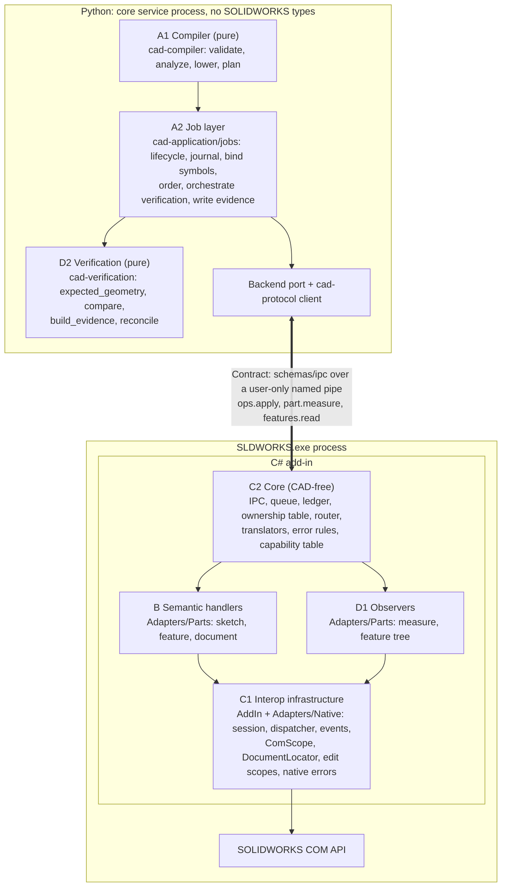
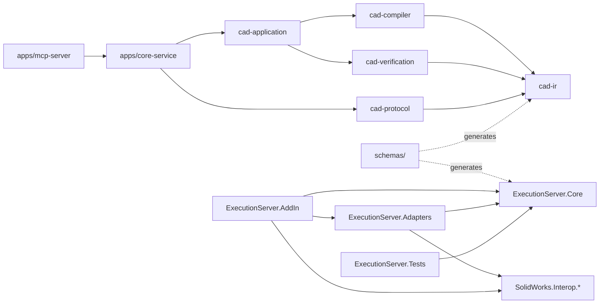
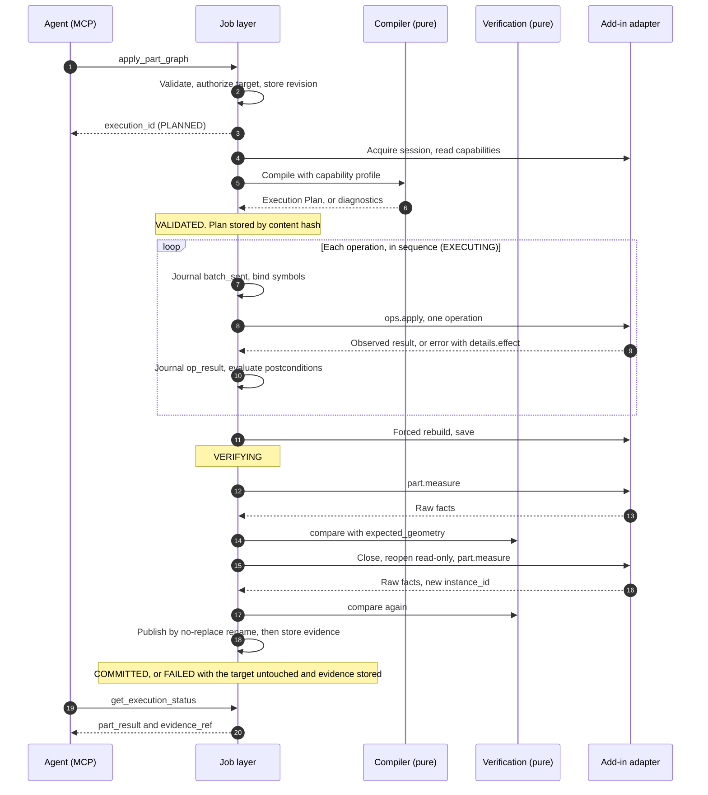
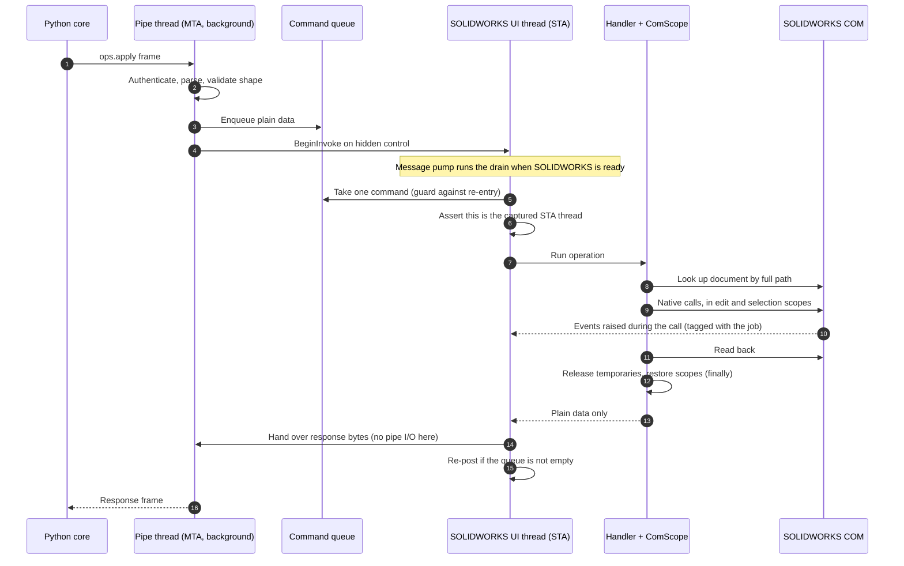
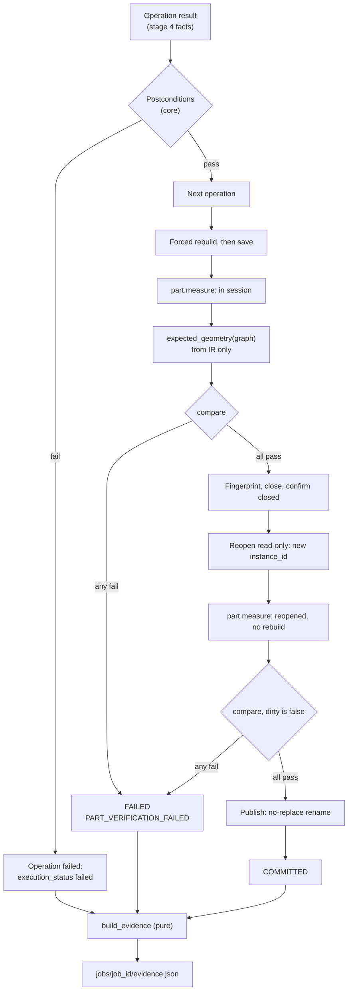

# 8.8 SOLIDWORKS Adapter Architecture

> Specification v1.32, section 8.8. Index and section map: [specifications/README.md](../specifications/README.md).

**Status: Accepted by the owner, 2026-11-05. Not built yet.** Code and schemas follow it as the roadmap delivers each part. Contracts: [8.9](../specifications/solidworks-adapter.md). Decisions: [ADR-058](../adr/ADR-058-compiler-oriented-adapter.md) to [ADR-063](../adr/ADR-063-observation-verification-boundary.md). Delivery: [roadmap](../plans/solidworks-adapter-roadmap.md).

## 8.8.1 Summary

The adapter is the execution and observation boundary between the compiler and SOLIDWORKS. It is not a wrapper of the SOLIDWORKS API. It exposes only what a compiled plan needs to run and what verification needs to read.

- **The boundary already exists, and this design keeps it.** Its compiler-facing side is the versioned operation vocabulary in `schemas/ipc/` and the Python `Backend` port, across a process and language boundary. No new compiler-facing interface layer is added.
- **What is missing is the inside of the add-in.** Its handlers need one shape: validate, translate, invoke, read back, report. They need honest results, one safe threading path, and observations that verification can trust.
- **Facts in C#, judgement in Python.** The add-in reports what SOLIDWORKS says. Pure Python compares that with values computed from the IR. The two never share a calculation.
- **Execution, rebuild and verification are separate outcomes.** Each is recorded separately, per operation, in an evidence record that traces every result to its IR node.

## 8.8.2 Goals and non-goals

**Goals**

1. Every operation is executable, observable, traceable to its IR node, and verifiable against the IR.
2. The compiler and the job logic stay free of SOLIDWORKS types, signatures and conventions.
3. Translation, error normalization and evidence can be tested without SOLIDWORKS.
4. Outcomes are honest. "Unknown" and "not evaluated" are valid answers, and a false success is the worst defect.
5. An engineer's documents and settings are unharmed in a shared session.

**Non-goals**

- Wrapping the SOLIDWORKS API, or exposing any operation no plan or check needs.
- Per-entity remote calls (ADR-032).
- A second CAD backend, or an abstraction prepared for one (principle 1.3(1): extract when it exists).
- Byte-identical native files.
- Reconstructing an arbitrary native part into an authored graph.
- Resuming a failed job (13.2.3). A retry is a new job on a new working file.
- Changing drawing adapters while drawings are frozen (ADR-057).

## 8.8.3 Where this design departs from the brief

The request for this design assumed some things the repository has decided differently. Rule 12 of that request says to keep existing decisions unless there is a documented reason to change them, so these stand:

| The brief says | The repository says | This design |
| --- | --- | --- |
| A deterministic C#/.NET compiler | The compiler is Python: ADR-001 (Accepted), `packages/cad-compiler`, already implemented on this branch | Keep Python (owner decision, 2026-11-05) |
| Compiler-facing C# interfaces such as `ICadDocument` | The contract is JSON Schema (ADR-035), consumed from Python | No C# type faces the compiler ([ADR-061](../adr/ADR-061-contract-ownership.md)). 8.8.5 assesses each suggested interface |
| The compiler orchestrates execution and collects evidence | Compiler stages are pure (6.7.1). Python's job layer owns execution (ADR-032, G2) | Layer A is split into a pure compiler and a job layer |
| `CreateLine`, `AddConstraint` as operations | Coarse commands only (ADR-032); `sketch.create` carries a whole sketch (6.5.2, 5.7.4) | They are fields of `sketch.create`, or internal adapter steps |
| The adapter compares model state with IR semantics | Expected values must come from the IR, never from SOLIDWORKS (10.2.1, design section 2) | The comparison lives in pure Python. The adapter only observes |
| Application connection handled by interop | The add-in is handed `ISldWorks` in `ConnectToSW` (ADR-028) | No connect step, only session setup |
| Phases: sketch, then features, then observation | Fillet and chamfer need geometry references (section 7, ADR-049). A feature has no done criterion without observation | Observation ships with the first feature. Fillet and chamfer wait for references. See the roadmap |

## 8.8.4 Current state

Read from the code on `feat/part-chain-mvp` at `dfbdd00`.

**Keep**

| What | Why |
| --- | --- |
| `Backend` port (`cad_application/ports.py`) | Small and neutral; already `session`, `apply_ops`, `measure_part`, `snapshot_drawing`, `completed_operations`, `cancel`, `close` |
| Operation envelope, ledger, `<job_id>:<seq>` IDs (6.5.1, 8.7) | Sound idempotency; the review rates IPC the add-in's most mature part |
| CAD-free `ExecutionServer.Core` (ADR-038) | Enforced by project references, and most of the testable code lives there |
| `SettingsGuard`, session discovery, framing, transcripts | Built and tested |
| Compiler stages, plan symbols, capability profile hash (6.5.3, 6.6, 6.7) | Implemented; the adapter only has to honour them |
| Working-file rule and no-replace publish (8.4.1, ADR-046) | Gives safe partial failure without undo |
| Spike-verified SOLIDWORKS calls ([spike](../superpowers/review/2026-11-05-part-chain-spike.md)) | The only measured API facts in the project |

**Gaps**

| Gap | Evidence | Addressed by |
| --- | --- | --- |
| Part operations are not implemented in the add-in | `part.measure` appears only in `Messages.g.cs`; `Adapters/{Features,Sketches,Geometry,Documents}` hold only `.gitkeep` | MVP Tasks 7a, 7b, 8 |
| A success can be false | `SwAddin.cs:544` answers `applied` for an unknown operation; `SwAddin.cs:442` reports `closed: true` unchecked (F6) | Handler pipeline, 8.8.6 |
| Calls may leave the STA thread | `SwAddin.cs:98` falls back to a base `SynchronizationContext`, whose `Post` runs on the thread pool (F21). A14 passed but did not show which path ran | [ADR-059](../adr/ADR-059-com-sta-execution.md) |
| A queued command can be stranded | `RunNext` returns false while another runs, and nothing re-posts (F21) | ADR-059 |
| Pipe writes may block the UI thread | `IpcSession.RunNext` writes the response on the UI thread, while 8.6.2 says the UI thread never blocks on pipe I/O | ADR-059 |
| The COM release rule conflicts with itself | G1 forbids releasing `ISldWorks` and `IModelDoc2`; `SwAddin.cs:255` and `:434` release them; AGENTS.md is broader than G1 (F29) | ADR-059 |
| Version data can be invented | `SwAddin.cs:104` falls back to `"33.0.0"`; `:129` hard-codes `en-US`; `ParseRevision` drops the third segment, and the records disagree on SP0.0 versus SP0.1 (F3, F24) | [ADR-062](../adr/ADR-062-version-isolation.md) |
| `feature.create` hides its coverage | `operations` lists one entry for every feature type, so an older add-in fails at run time, against 6.6 | Variant capabilities, 8.9.7 |
| No record joins IR to native to verification | `part_result` and the journal hold pieces (13.2.1, 13.2.3) | Evidence, 8.9.6 |

**SOLIDWORKS COM dependencies today**

| Project | Depends on COM? | Notes |
| --- | --- | --- |
| Python packages and apps | No | Vendor terms remain only in the marked places (`swdim:`, F30; `model_items.insert`) |
| `ExecutionServer.Core` | No | By project reference |
| `ExecutionServer.AddIn` | Yes | Includes business logic that does not belong there: the `if` chain and `OpenDoc6`/`CloseDoc` in `SwAddin.cs` |
| `ExecutionServer.Adapters/Drawings` | Yes | Frozen (ADR-057) |

**Simplifications available**

- A table-driven router replaces the `if` chain (already MVP Task 7a). One table feeds `session.hello`, so the two cannot drift.
- Remove the empty `Adapters/Verification` folder: the adapter never verifies. Remove the other empty folders until each has code. Parts go in `Adapters/Parts/` (Task 8), split only when a file passes the size limit.
- `ICommandHandler` needs no new method per read command. It gains one general read entry (8.9.8).

## 8.8.5 Layers and boundaries



| Layer | Lives in | Owns | Must not |
| --- | --- | --- | --- |
| **A1 Compiler** | `packages/cad-compiler` | IR checks, dependency order, lowering, plans | Do I/O; touch a backend; know a native call |
| **A2 Job layer** | `packages/cad-application/jobs` | Lifecycle (8.4), journal, symbol binding, running verification, writing evidence | Know a native call; compute expected geometry |
| **Contract** | `schemas/ipc/`, `schemas/common/errors.json` | Operations, read commands, capabilities, errors | Contain SOLIDWORKS types or positional arguments |
| **C2 Core** | `ExecutionServer.Core` | Protocol, queue, ledger, ownership, router, pure translators, error rules | Reference an interop assembly (ADR-038) |
| **B Semantic handlers** | `ExecutionServer.Adapters/Parts` | Translating a semantic operation into native calls, inside safe scopes | Compare with intent; cache COM objects; hold job state |
| **C1 Interop infrastructure** | `ExecutionServer.AddIn`, `ExecutionServer.Adapters/Native` | Session setup, UI-thread dispatch, COM lifetime, document lookup, version probe, events, settings | Contain feature logic |
| **D1 Observers** | `ExecutionServer.Adapters/Parts` | Raw facts in SI units | Decide pass or fail; rebuild or modify a document |
| **D2 Verification** | `packages/cad-verification` | Expected values, comparison, evidence assembly, drift | Do I/O; take an expected value from SOLIDWORKS |

**Dependency direction** (each arrow means "may depend on"):



Nothing below `apps/core-service` knows the pipe, and nothing in Python knows interop. `lint-imports` and project references enforce this today.

**The suggested interfaces, assessed**

| Suggested | Verdict | Reason |
| --- | --- | --- |
| `ICadApplication` | Reject | The compiler never sees an application, and the add-in is handed `ISldWorks`. A small concrete `SessionProbe` reads version and language |
| `ICadDocument` | Reject | It would wrap a COM object that must not outlive a command (G1). Documents are plain values, path plus `instance_id`, looked up per command by `DocumentLocator` |
| `ISketchAdapter`, `IFeatureAdapter` | Replace | One `IOperationHandler`. A second implementation would have no caller, so one interface per domain adds only indirection |
| `IConstraintAdapter` | Combine into `sketch.create` | Relations and dimensions apply within one sketch edit, which must open and close atomically |
| `IGeometryInspector`, `IFeatureInspector` | Combine into read commands | `part.measure` and `features.read` already are the coarse contract. Internally, concrete observers |
| `IRebuildService` | Replace | `document.rebuild` is an operation, and rebuild status is an observation |
| `ICadFileService` | Replace | `document.open`, `save`, `close` operations. Publishing is Python's (8.4.1) |
| `ICadCapabilities` | Keep as data | `CapabilityTable`, a pure function of the version in Core, testable offline |

**Result:** one new C# interface, `IOperationHandler`, plus a read-command equivalent, because the router needs them and tests can fake them. Existing `Backend`, `BackendProvider`, `ICommandHandler` and `ISettingsTarget`-style seams stay.

## 8.8.6 The operation handler

Every mutating operation runs the same five stages, which are the success stages of finding F6:

| # | Stage | Who | Question | Testable without SOLIDWORKS |
| --- | --- | --- | --- | --- |
| 1 | Admit | Core: router, ownership table | Known operation? Capability present? Does this job hold this document? | Yes |
| 2 | Translate | Core: pure translator | What exact call arguments, in system units, does this request mean? | Yes |
| 3 | Invoke | Adapter | Did the native call succeed by its own return values? | No |
| 4 | Read back | Adapter, same command | Asked again, does SOLIDWORKS report the change? | No |
| 5 | Report | Core: error rules | Plain result, or a catalogued error with `details.effect` | Yes |

**Stage 2 is the main test seam.** A translator turns `feature.create` params into a neutral record, for example `BlindExtrudeCall(depthM, draftRad, ...)`, in millimetre-to-metre terms and end-condition rules such as "a blind cut sets `Dir=true`". The adapter then maps that record onto the 23 positional arguments of `FeatureExtrusion3`. Unit, direction and default rules are thereby tested in hosted CI, and each native signature sits in one small method. That also limits the cost when a signature changes.

**Stage 4 reports; it does not judge.** It returns observed values such as the new `feature_id` and `status`. Postconditions in the plan (6.5.3) are evaluated by the core from those values. This settles the "add-in or core" choice 6.5.3 leaves open: **the add-in fails an operation only when it can see the operation did not take effect. Intent is judged in the core.**

## 8.8.7 Execution model

### Execution lifecycle

The job states are 8.4, and the `plan` job is 8.4.1. This shows who does what, for one part:



### Threads and COM

All SOLIDWORKS calls run on the SOLIDWORKS main STA thread, one command at a time, as 8.3 and 8.6.2 require. [ADR-059](../adr/ADR-059-com-sta-execution.md) closes the gaps found in the code.



**Re-entrancy.** A SOLIDWORKS call can pump messages, so a posted drain can run while a command is in progress. The existing `_running` guard refuses it safely, but the refused drain is lost. The fix re-posts when each command finishes.

**In-process hazard.** An unhandled managed exception on any add-in thread can end `SLDWORKS.exe` and take the engineer's work with it. Every thread and timer entry point therefore catches, logs and survives. This replaces the many silent `catch` blocks of F13: catch at the entry point, log, and return a code.

### Ordering and dependencies

- **The compiler decides order** (topological, ties by ID, 5.7.1). The wire carries a sequence, never a dependency graph.
- **The job binds run-time values.** A `profile` node ID becomes the `feature_id` the earlier result returned (6.5.3). The adapter never resolves a node ID.
- **The adapter does not manage feature dependencies.** SOLIDWORKS holds the native parent and child links. They are read, when needed, through `features.read`.

### Session state

An operation starts from no assumption about state it does not own, and leaves shared state as it found it.

| State | Rule | Mechanism |
| --- | --- | --- |
| Target document | Full path only; instance checked against the ownership table. Never `ActiveDoc` in part handlers | `DocumentLocator` |
| Active document | Part operations neither read nor change it (spike answer 9). Closing an owned document restores `previous_active` | Ownership table |
| Selection | Cleared on entry and exit of an owned document, using entity selection with explicit marks (8.3 rule 11). Never `SelectByID2` | `SelectionScope` |
| Sketch edit mode | Opened and closed inside one operation, even on failure | `SketchEditScope` |
| `AddToDB`, inference, graphics | Set and restored per operation | Scope objects, 8.6.4 |
| User preferences | Through `SettingsGuard` only, crash-safe | 8.6.4 |
| Open documents and dirty state | Reported by observers. The add-in never infers them from a path (F39) | `part.measure` |

### Rebuild boundaries

SOLIDWORKS regenerates as features are added (spike answer 13), so the plan does not schedule ordinary regens. Explicit rebuilds happen at named points only:

1. A `document.rebuild` (forced) before the save that precedes verification. This is the existing MVP step.
2. Each `feature.create` reads its feature's status after creation, which covers a feature that was created but failed.
3. A read-only reopen is measured **without** a rebuild, so `dirty` stays false and the file's stored state is what gets checked.
4. Observers never rebuild. A check that needs a rebuild says so as a separate step.

### Determinism levels

SOLIDWORKS is stateful and its files contain data no one controls, so "deterministic" must be stated as testable levels. Principle 1.3(3) already conditions it on the same initial state and environment.

| Level | Claim | Conditions | How it is measured | Status |
| --- | --- | --- | --- | --- |
| **R0 Plan** | Same input gives a byte-identical plan | Same bundle, compiler and profile (6.7.4) | Plan hash, offline, in two processes | Implemented |
| **R1 Commands** | Same plan gives the same command sequence, apart from bound symbols | R0, and no failure | Masked transcript comparison, offline | Planned (A2) |
| **R2 Structure** | Same features, types, order and health, by node | R1, and the environment below | Evidence comparison, live | Planned (A2) |
| **R3 Geometry** | Measurements within stated tolerances, across runs and across save and reopen | R2 | 10.2.1 checks, live | Partly specified (10.2.1) |
| **R4 Numeric repeatability** | Run-to-run spread of each measured value | R2, one machine | Recorded and reported; **not a gate** until there is data | Planned (A3) |
| Not claimed | Identical `.SLDPRT` bytes, identical `f<GetID()>` across builds, identical fingerprints | | | Non-goal |

**Environment recorded with every run:** SOLIDWORKS version and service pack, UI language, add-in and protocol versions, capability profile hash, template path and SHA-256. A claim at R2 or above holds only between runs whose environment matches, or between runs for which a difference is declared. Crossing a service pack is what the live suite and ADR-045 admission exist to check.

## 8.8.8 Failure handling

**Execution success and outcome certainty are separate.** Every failed operation states its effect: `none`, `applied` or `unknown` (8.9.5).

| Failure | Detected by | Job outcome | Target | Working file | Resend? |
| --- | --- | --- | --- | --- | --- |
| Invalid or unknown operation | Stage 1 | FAILED | Untouched | `.failed` | Never |
| Native call returned failure or null | Stage 3 | FAILED | Untouched | `.failed` | Never |
| Call returned success, read-back disagrees | Stage 4 | FAILED, `effect: applied` or `unknown` | Untouched | `.failed` | Never |
| Rebuild error, or unhealthy feature | Stage 4 or `part.measure` | FAILED | Untouched | `.failed` | Never |
| Geometry check failed | Verification | FAILED, `PART_VERIFICATION_FAILED` | Untouched | `.failed` | Never |
| Command timeout | Client | FAILED, `EXEC_TIMEOUT` | Untouched | Left, `unknown` | Never (8.3 rule 8) |
| Modal dialog | 30 s dispatch limit | FAILED, `BACKEND_UI_BLOCKED` | Untouched | Left, `unknown` | Never |
| Engineer touches a job document | Untagged event, or lazy path check | FAILED, `EXEC_INTERRUPTED_BY_USER` | Untouched | Left, `unknown` | Never |
| SOLIDWORKS or add-in crash | Pipe closes | FAILED, `BACKEND_LOST` | Untouched | Left, `unknown` | Never |
| Core crash | Journal on restart (13.2.3) | FAILED, `EXEC_INTERRUPTED` | Checked by fingerprint | Left, `unknown` | Never |
| Cancel | Between commands | ABORTED | Untouched | Removed, or `.partial` | Never |

**Retry safety and idempotency.**

- **Operation level.** The ledger stops a repeated ID from running twice while the document lives (8.7). This is protection against a duplicate send, not a retry mechanism.
- **Job level.** The only retry is a new job from the same plan, with a new ID and a new working file. Building from scratch is the safe path, because a working file with unknown contents is never repaired.
- **Reconnect.** A reconnecting core may read `session.completed_operations` and may record outcomes as `recovered`. It does not resume (13.2.3).
- **Automatic retries do not exist** anywhere: not in the adapter, the job, or tests (15.6). `BACKEND_BUSY` and `BACKEND_UI_BLOCKED` are catalogued `safe` for a caller to try later, as a new job.

**Crash and recovery.** Native state is treated as lost or unknown. The journal is authoritative, the ledger and ownership table are in memory and die with the process, the settings guard restores from its file on next load (8.6.4), and the target is safe because publishing is the last step.

## 8.8.9 Observation and verification



**Rules** ([ADR-063](../adr/ADR-063-observation-verification-boundary.md)):

1. **Three outcomes, never merged:** `execution_status`, `rebuild_status`, `verification_status`. A COM call that returned is at most `execution_status: succeeded`.
2. **Independence.** Observers share no code with handlers beyond document lookup, and they read fresh from SOLIDWORKS. Expected values come from the IR. Units are converted in the core for measurement and in the translator for building, so one conversion bug cannot both build and measure a part wrongly and still agree with itself (10.2.1).
3. **Absence is not success.** Each observation carries the review's completeness states: `present`, `empty`, `unavailable`, `unsupported` (F2). A check that lacks its data is `not_evaluated`, which never counts as passed.
4. **Observation is read-only.** An observer on a document the job does not own changes nothing: not its selection, not its dirty flag. Where a native read cannot promise that, the capability is withheld (K15). `AccessSelections` and its equivalents are never used to observe, because they put the model into a rollback state (ADR-064).
5. **Each operation is judged before the next.** Its contract comes from the IR, and its observation arrives in the operation's own result (10.2.2, ADR-064). The final checks in the diagram above still measure the whole part.

**Evidence** joins the chain `IR node → plan operation → wire operation → native feature → checks`. It is a pure projection of the plan, the journal, the operation results and the measurements. The journal stays the record of what happened, so evidence is never a second source of truth. Schema: 8.9.6. It is used for:

| Purpose | How |
| --- | --- |
| Debugging | Failing checks with expected, measured, tolerance and method, tied to the node |
| Audit replay | Rerun `compare` on stored measurements, offline. Must give the same result |
| Regression | Live runs record transcripts (15.5), so job logic replays offline |
| Re-execution | A new job from the same plan on a new working file, compared at R2 and R3. Never in place |
| Reconciliation | The `feature_ids` binding, kept in the `parts/` record because job folders expire (13.2.4) |

### Reverse inspection and reconciliation

The read path is already specified (5.8): `features.read` produces a read-only graph, `origin: read`. It does not attempt to rebuild authored intent. Reconciliation is one pure function on top of it, serving 9.3:

```
reconcile(graph, bindings, read_graph, measured, expected, tolerances) -> DriftReport
```

| Drift | Detected through | Reliability |
| --- | --- | --- |
| Missing feature | Bound `feature_id` absent | High, if the feature was not recreated |
| Unexpected feature | Tree entry with no binding | High |
| Suppressed, failed or rolled back | Status from `features.read` | High |
| Changed type | `native_type` against the node's expected type | High |
| Changed dimension | Read parameter against IR value, with the quantum (3.4.3) | High where the node has a read mapping |
| Changed feature parameter | Type-specific read schema (5.8.3) | Only for recognized types |
| Reordered features | Tree order of bound features against the plan | High. A reorder alone may not change geometry, so it is reported separately |
| Changed geometry | `part.measure` against `expected_geometry` | High for what is measured. No difference does not prove the model is the same |
| Modified externally while the add-in was off | Fingerprint differs from the `parts/` record (13.1, 9.3) | High that something changed, not what |

**Limits, stated plainly**

- **Native topology is not identity.** Face and edge indexes are at most a transient result (principle 1.3(5)). Drift is reported per feature and per measured quantity, never per face.
- **`f<GetID()>` is proven only across close and reopen** (A2, spike answer 5). Behaviour after Save As, after delete and recreate, and across a copied file is untested (K14). A recreated feature appears as one missing and one unexpected, which is correct and conservative.
- **Sketch geometry is not read in Phase 1** (5.8.3), so a moved sketch entity shows up only through measurements or dimensions.
- **Reading feature definitions is unproven.** Native definition objects can have side effects, and the safe subset must be measured first (K15).
- **Unrecognized features** are reported by type and display name, never ignored (5.3.1).
- **No reconstruction.** Sketch intent, order of authoring, and design reasons cannot be recovered from a native part. A read graph is a description, and can never be treated as an authored one.

The reporting outcome per 9.3: divergence is reported, and synchronization is required before unsafe updates. The agent or engineer decides. Nothing merges automatically.

## 8.8.10 Version isolation

[ADR-062](../adr/ADR-062-version-isolation.md) applies and extends ADR-045.

- **Compile against the oldest supported interop**, with no conditional compilation and no per-version assemblies.
- **One `CapabilityTable`** in Core maps a parsed version to named capabilities, for unit tests with any version string. Handlers read capabilities, never versions, and an analyzer or arch test bans direct version checks outside `SessionProbe`.
- **Native signatures sit behind translators' records,** in one method per call. A changed signature touches one method.
- **Behaviour differences** found in live testing become named facts in the table, for example the blind-cut direction, and are re-checked when a version is admitted.
- **Version-specific adapter assemblies are not built** unless a required member is removed from a newer version with no replacement. That has not been observed, and it would need its own ADR.
- **The compiler is unaffected.** It sees operations, variants and profile hash only (6.6).
- **Open risk, K13.** `SolidWorks.Interop.props` sets `Private=false`, and `OnAssemblyResolve` looks only in the add-in folder. How a 2025-built add-in binds interop on 2026 is unproven. ADR-045's "build against the oldest" depends on this answer.
- **.NET runtime.** .NET Framework 4.8 inside `SLDWORKS.exe` (ADR-002). C# language features needing runtime types, such as `init` and records, need a small internal polyfill, because `IsExternalInit` is absent on net48 and from the code today.

## 8.8.11 Security and resources

- **No new attack surface.** The pipe remains user-only with a session token (8.2, section 14). No macro calls (banned). No operation takes code or a script.
- **Custody** (ADR-022, ADR-046). The ownership table in Core refuses saves and closes on parts the job does not own, even if the core asks. Existing paths are refused because silent `SaveAs4` overwrites (spike answer 10).
- **Strict input.** The add-in validates the shape of each request. A missing required parameter is `IR_SCHEMA_INVALID`, never a default (F14). Paths come from a core that authorized them (12.5), and the add-in re-checks ownership.
- **Logging** (G3). JSON Lines from the add-in with correlation IDs. No geometry or file contents. Evidence holds measurements and native IDs, and stays inside the project store.
- **Resources.** Temporary COM objects are released per iteration (G1) and checked by the 1,000-command leak test. Working files stay beside the target and are named in errors. Commands are coarse but pages are bounded: `features.read` pages, and chunks for large responses (8.7).
- **Analyzer bans to add:** document-unit dimension calls, direct preference setters (both already required by ADR-038 and 8.6.4, but not in `BannedSymbols.txt`), and `FinalReleaseComObject`. `ActiveDoc` is banned in `Adapters/Parts` by an architecture test, since frozen drawing code still uses it.

## 8.8.12 Alternatives

Evidence levels: **R** repository or spike, **D** public documentation, **O** observed tool descriptions only, **J** judgement.

| Approach | Strengths | Weaknesses | Maintenance | Verdict |
| --- | --- | --- | --- | --- |
| **1. Compiler calls SOLIDWORKS directly** | Fewest layers | Breaks purity (G2, 6.7.1) and determinism tests. Not possible from Python without COM automation, which is slow and off the STA path (R) | High: every API change reaches the compiler | Rejected |
| **2. General-purpose API wrapper** | Reusable, broad | Thousands of members with no caller; hides but keeps positional detail; does nothing for evidence (J) | Very high: grows with the API | Rejected |
| **3. Thin COM abstraction** | Simple, mockable | Moves names around and leaks selection, marks and edit-mode rules upward. Mocks prove nothing about SOLIDWORKS (J) | Medium, with little return | Rejected |
| **4. Compiler-oriented semantic adapter** | Small surface follows plans. Honest results. Offline tests via translators | Each feature needs handler, translator, observer and live test. Observed facts need real API work (J) | Grows only with features actually supported | **Chosen** |
| **5. Separate out-of-process execution service** | A crash in the service spares SOLIDWORKS, and the reverse | Marshalled calls per entity (A1 still unmeasured here; third-party reports give "hundreds to thousands" of times slower for many calls, D). Loses document events and the STA path. Two spike runs out of process still ended with SOLIDWORKS exiting, cause unproven (R) | High: needs its own threading | Rejected for execution, see below |

**The chosen form combines 4 and 5.** The job logic and compiler are out of process, the semantic adapter in process, joined by coarse commands. That gives Python crash isolation from SOLIDWORKS, and in-process speed and events for native work. [ADR-060](../adr/ADR-060-in-process-execution.md) sets out what evidence would reopen this.

**Other implementations.** Only what public or observable sources show is stated. Their internals are not assumed.

| Project | Visible approach | Lesson taken | Difference here |
| --- | --- | --- | --- |
| **Reference implementation** (ADR-010). Basis: its MCP tool descriptions only, read in this session. No code read, and no tool called (O) | One forward graph submission plus many low-level per-feature tools. Metres and radians at the IR. Reports per node, says "CAD ops are NOT transactional", and tells the caller to verify separately. Several read tools address the active document | Per-node reports and honest partial failure are useful behaviour. Attribution by feature is valuable to agents | Addressed by path, not active document. Millimetre IR with conversion at one boundary (3.4.3). Verification is in the job, not left to the caller. Target is written only after checks pass. Its rollback-walk attribution is a possible later read mode, not adopted because it rebuilds the model |
| **xCAD.NET** (D) | Base `IX*` interfaces free of CAD references, with SOLIDWORKS and Inventor implementations | Confirms the value of a vendor-free core | A general framework for many add-ins, with broad interfaces. Here the neutral contract is a much smaller wire schema, and a second backend is not designed in advance |
| **SolidDNA** (D) | A friendlier wrapper around the core API for add-ins. Its notes say add-ins share one thread, and it dropped separate app-domain execution | Warns against app-domain isolation inside SOLIDWORKS; confirms the shared-thread reality | A wrapper by purpose, so option 2's breadth. COM lifetime handling was not confirmed from sources, and no claim is made |

No dependency on xCAD.NET or SolidDNA is proposed: ADR-052 limits what may load inside `SLDWORKS.exe`, and each general framework would bring surface no plan needs.

Sources: [xCAD.NET](https://github.com/xarial/xcad); [SolidDNA](https://github.com/CAD-Booster/solidworks-api); [SOLIDWORKS: COM vs Dispatch](https://help.solidworks.com/2011/English/api/sldworksapiprogguide/Overview/COM_vs_Dispatch.htm); [SOLIDWORKS: `CommandInProgress`](https://help.solidworks.com/2016/English/api/sldworksapi/SolidWorks.Interop.sldworks~SolidWorks.Interop.sldworks.ISldWorks~CommandInProgress.html); [third-party note on stand-alone call cost](https://jiaqiwang969.github.io/solidworks-GPT/docs/codestack/solidworks-api/troubleshooting/macros/windows-api-functions-incorrect-use/in-process-invoking).

## 8.8.13 Unresolved questions

Logged in the [register](../specifications/open-decisions.md): **K13** interop binding on a newer major; **K14** native feature identity beyond reopen; **K15** reading feature definitions without side effects; **K16** expected geometry beyond the analytic subset. K11 (engineer's UI events) and K12 (curved measurement) also bear on this design.

## 8.8.14 Consistency check

Reviewed against the existing decisions when written.

| Check | Result |
| --- | --- |
| ADR-001, ADR-002, ADR-028, ADR-032, ADR-035 | Preserved |
| ADR-038 (Core CAD-free) | Translators use neutral records, no interop |
| ADR-045 | Extended, not changed. The startup table remains |
| ADR-046, 8.4.1 | Reused unchanged |
| ADR-049 | Geometry references stay Python-resolved. The add-in only gathers candidates |
| ADR-057 | Drawing adapters unchanged until the freeze lifts. The MVP plan's tasks are not replaced |
| 8.7 ledger | Changed by owner decision (K17, closed). The code does not follow it yet: MVP Task 7a |
| G1 and AGENTS.md | Updated to the release rule in ADR-059 (owner decision, 2026-11-05). The code does not follow it yet: MVP Task 7c fixes `SwAddin.cs:255` and `:434` |
| New error code | Accepted addition, placeholder `PROPOSED_OPERATION_FAILED` until roadmap A0 adds it (8.9.5) |
| Live evidence | **None gathered for this design.** API facts marked unverified in 8.9 must pass a spike before use |
