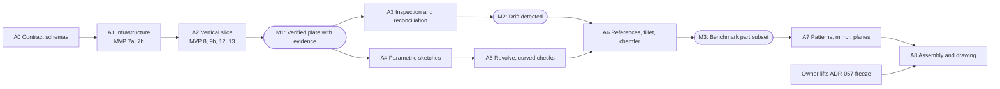

# SOLIDWORKS Adapter Implementation Roadmap

**Date:** 2026-11-05. **Status:** The owner accepted ADR-058 to ADR-063 on 2026-11-05. No phase has started. It adds to the [part chain MVP plan](../superpowers/plans/2026-11-05-part-chain-mvp.md) and does not replace it. Section 18 remains the product roadmap.

**Sources:** [8.8 architecture](../architecture/solidworks-adapter.md), [8.9 interface specification](../specifications/solidworks-adapter.md), [ADR-058](../adr/ADR-058-compiler-oriented-adapter.md) to [ADR-063](../adr/ADR-063-observation-verification-boundary.md).

## How this differs from the suggested phases

| Suggested | Here | Why |
| --- | --- | --- |
| Observation as Phase 4 | Ships with the first feature (A2), extended in A3 | A feature has no done criterion without measurement, and observation is the MVP's point |
| All sketch work before any feature | Lines and circles in A2; arcs, relations, dimensions in A4 | The MVP's fixed-coordinate sketches are enough to prove the chain |
| Fillet and chamfer with extrude and cut | Moved to A6, after references | They target edges, which need section 7 and ADR-049 |
| Revolve with extrude | A5, gated on curved measurement | K12 is unsolved, and analytic checks must extend first |
| Reference geometry and patterns last | Unchanged | Added only when a benchmark part needs them (ADR-018) |
| Separate infrastructure phase | A1 **is** MVP Tasks 7a and 7b plus three small additions | Avoids two competing plans |

## Dependencies

## Phases

Complexity: **S** a few files, **M** one component, **L** several components.

### A0: Contract schemas. S

**Scope.** Schemas: `PROPOSED_OPERATION_FAILED`, `details.effect`, `schemas/execution-evidence/v0.json` with fixtures. From ADR-064: `VerificationContract` and check results in the evidence schema, `failure_class` and `blocked_by`, `observation` on `sketch.create` and `feature.create` results, `schemas/ipc/ops/document.rebuild.json`, the `op_verified` journal record, `PROPOSED_FEATURE_VERIFICATION_FAILED`, removing `dir` from `feature.create` and the compiler, and `warning` and `not_applicable` in `CheckResult`.

**Acceptance.** Generated contracts show no drift. The schema has valid and invalid fixtures. No production behaviour changes.

**Risk.** Low. The MVP's Tasks 3 to 6 are committed, and later tasks build on these contracts, so schema changes must be coordinated with that work.

### A1: Infrastructure. M

**Scope.** MVP Task 7a (router, ownership table, document operations), 7c (hidden-control dispatcher, re-post after each command, pipe-side writes, `CapabilityTable` and `SessionProbe`; ADR-059, ADR-062) and 7b (events, instance IDs). Added here: the JSON Lines log (G3). `ComScope` and `DocumentLocator` arrive with their first users in MVP Task 8.

**Depends on.** A0, with no frozen file edited except where the plan already allows for shared code.

**Risks.** Dispatcher change affects frozen drawing flows: the Task 0 live baseline must match. Pipe write path needs care for ordering. K11 (UI events).

**Tests.** Unit: thread guard with a fake, queue re-post, router, ownership, capability table with real revision strings. Live: session log proves the STA path; 1,000-command leak test; settings restore.

**Acceptance.**
- An unknown operation fails and is not in the ledger.
- A queued command is never stranded, under a test that posts during a running command.
- `session.hello` lists only registered handlers, with the real UI language and a read version.
- Drawing live baseline unchanged.
- Thread and apartment evidence recorded, closing F21.

### A2: Vertical slice. L

**Scope.** MVP Tasks 8, 9a, 9b, 12 and 13, with handlers in the five-stage form. Translators for sketch and extrude. `part.measure` with completeness. Evidence written by the `plan` job. `feature_contracts`, `evaluate` and the gate after each operation (ADR-064, T0 only). K19 before the reopen rebuild check. Variant capabilities. Determinism R1, R2 and R3 tests.

**Depends on.** A1; the MVP's `cad-verification` task (Task 5).

**Risks.** Template differences (known, `part.template`). Positional API calls (measured by the spike). Scope growth.

**Tests.** Unit: translator rules for each plane and end condition, `build_evidence` for each outcome, including recovered jobs. Contract: transcripts, including a failed operation with `effect`. Live: design section 12, and every seeded defect in 8.9.10.

**Acceptance.**
- Design section 12 acceptance passes, and the owner signs off.
- Each seeded defect ends FAILED with no target file.
- Evidence traces each check and operation to its IR node.
- Two builds from one plan, same environment, agree at R2 and R3 (M1).

### A3: Inspection and reconciliation. M

**Scope.** Spike K14 and K15, with K15's extrude subset first, directly after M1, then K18, K20 and K21. T1 parameter checks become required as each read clears (ADR-064). `features.read` (5.8) with paging. `reconcile`. `read_features` on the port. Store `feature_ids` and `measured` in `parts/` records. R4 numeric spread recording.

**Depends on.** A2.

**Risks.** Definition access may dirty documents (K15), in which case parameters stay unread and report `not_comparable`. Native IDs may not survive a copy (K14). Scope creep toward reconstruction.

**Tests.** Unit: every drift kind, from fixtures. Live: scratch parts edited through a separate COM client for each drift row of 8.8.9; a read leaves dirty flag and selection unchanged; a Chinese-UI read.

**Acceptance.** Each drift row is detected or reported `not_comparable`, with no false `in_sync`. Reading a borrowed document changes nothing (M2).

### A4: Parametric sketches. M to L

**Scope.** Arcs, then `relations` and `dimensions` (5.7.4), and `fully_defined` read-back. IR rules and `expected_geometry` extend in step.

**Depends on.** M1. Independent of A3.

**Risks.** Solver results may move geometry from the requested coordinates, needing clear rules on which value wins (driving dimensions). Over-defined states need catalogued errors. Dimension API behaviour is unverified: spike first.

**Tests.** Unit: translator and IR rules. Live: over-defined and under-defined sketches, relation failures, a parametric change, and a seeded wrong dimension.

**Acceptance.** A fully defined sketch reports so, its measured geometry matches the IR, and an over-defined one fails with a catalogued error, not a silent solve.

### A5: Revolve and curved checks. M

**Scope.** Close K12. Revolve and cut revolve. Decide K16 for what can be computed analytically.

**Depends on.** A4 for axis definition by centerline, or an explicit sketch line.

**Risks.** `GetBodyBox` looseness on curved bodies. Expected geometry is harder.

**Acceptance.** Cylinder and stepped shaft from 15.4 pass, with a seeded defect each.

### A6: References, fillet, chamfer, sketch on face. L

**Scope.** `geometry.candidates` and the ADR-049 resolver. Fillet (constant radius), chamfer, sketching on a pinned face. K16 is settled before this phase closes.

**Depends on.** A3, A5, section 7 work.

**Risks.** Highest in the roadmap. References are a project in their own right (Phase 2, section 18). Analytic expected geometry stops being practical. Topology changes.

**Tests.** Ambiguous-reference failure, reference re-check at execution, measured checks at the level K16 sets, and non-English UI.

**Acceptance.** Parts from 15.4 that need fillets and chamfers pass at their declared verification level. Ambiguity fails with `REF_AMBIGUOUS`, never a guess (M3).

### A7: Patterns, mirror, reference planes. M each

**Scope.** Added only as benchmark parts require (ADR-018).

**Acceptance.** Each new feature has its translator, handler, observer, seeded defect, and capability variant.

### A8: Assembly and drawing. L

**Scope.** Assembly operations per 5.6. Drawing adapters migrate to the handler form, with fixes for F1 to F6, once the freeze lifts. No part of this phase starts before the owner's decision and the resolution of O1.

**Risks.** See the [architecture review](../superpowers/review/2026-11-05-architecture-review.md).

## Milestones

| Milestone | Reached when | Shows |
| --- | --- | --- |
| **M0 Contracts written** | A0 done | Agreed contracts exist as schemas |
| **M1 Verified plate with evidence** | A2 done | The whole chain, with trustworthy results |
| **M2 Drift detected** | A3 done | Reverse inspection works, with stated limits |
| **M3 Benchmark subset** | A6 done | Semantic references work on real features |
| **M4 Release candidates** | Section 18 and 20 acceptance | The product definition |

(These "M" numbers are local to this file. The review roadmap and ADR-056 each use their own.)

## Technical risks

| Risk | Likelihood | Impact | Response |
| --- | --- | --- | --- |
| Interop does not bind on a newer major (K13) | Unknown | High for 2026 support | Test on a 2026 install before claiming support |
| Add-in fault ends the engineer's SOLIDWORKS | Medium | High | Entry-point rules; throwaway instance for live tests |
| Analytic verification stops scaling (K16) | High | High | Declare the level per node. Never call a shape verified with weak checks |
| Reference system is larger than planned | High | High | Phase 2 work, kept out of the MVP. A6 waits for it |
| Definition reads have side effects (K15) | Medium | Medium | Spike first; withhold the capability if unsafe |
| Unverified API facts | High | Medium | ? items in 8.9 need a spike before use |
| Two plans drift apart | Medium | Medium | A1 and A2 point to MVP tasks, with no duplicate task list |

## Testing requirements in every phase

- Spec and schema first. TDD where offline.
- Full Python and C# verification suites (AGENTS.md section 4), and the live baseline when shared add-in code changes.
- Live tests only on a throwaway instance. Builds need SOLIDWORKS closed, which the owner does.
- No automatic retries (15.6). A check without a seeded failure does not count.

## Owner decisions

Decided on 2026-11-05: the compiler stays Python (ADR-001), A1's dispatcher and capability work joins the MVP as [Task 7c](../superpowers/plans/2026-11-05-part-chain-mvp.md), and the COM release rule in ADR-059 is adopted in G1 and AGENTS.md, with `ComScope` and `DocumentLocator` built in MVP Task 8. The ledger rule (K17, closed) is in 8.7, built in MVP Task 7a. ADR-058 to ADR-063 are accepted. No owner decision on this design is open. K13 to K16 are settled by spikes in their phases.