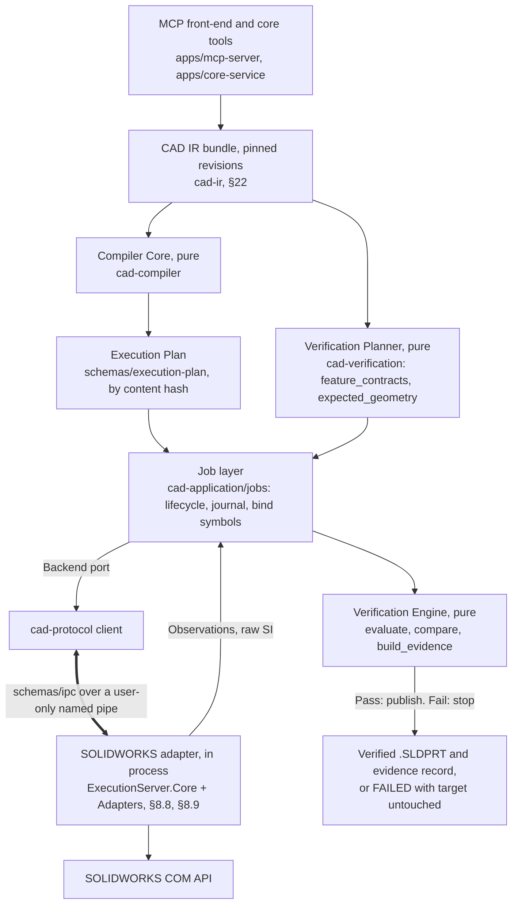
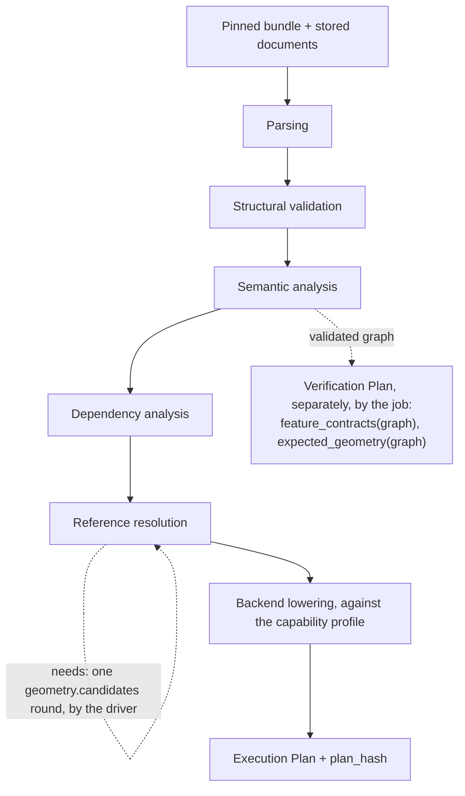
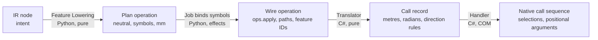
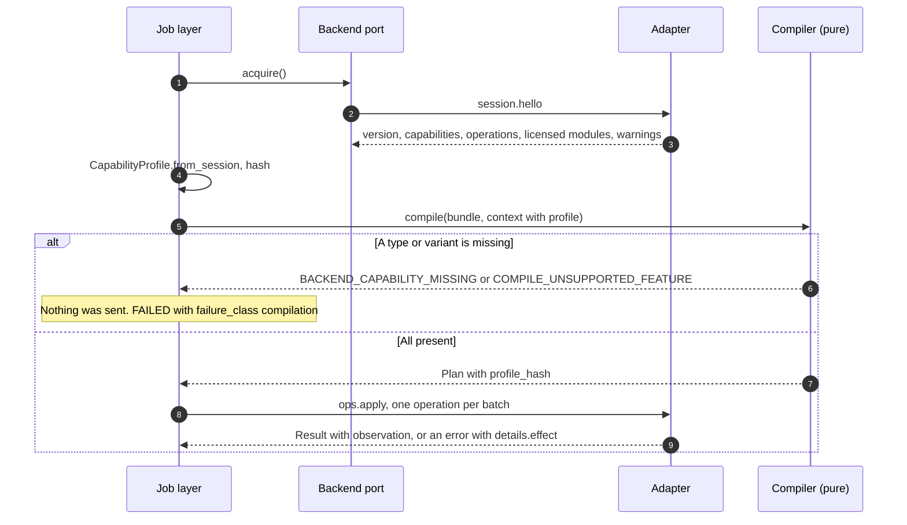
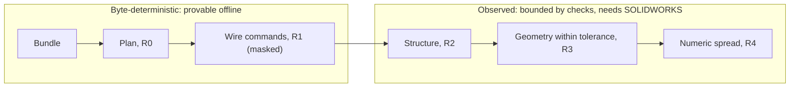
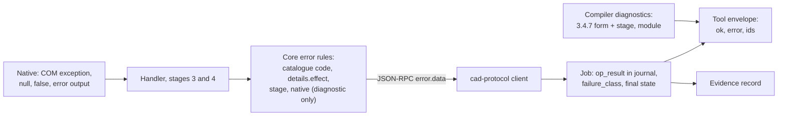
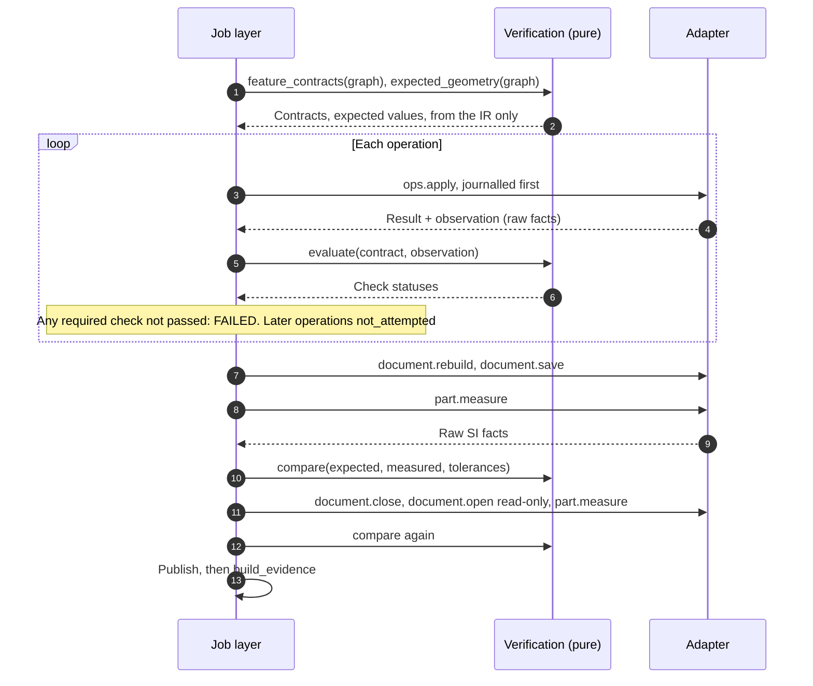

# 23. Compiler Architecture Specification

> Specification v1.44, section 23. Index and section map: [README.md](README.md).

**Status: Proposed, awaiting the owner.** This section describes the compiler and the path from IR to a verified result as one architecture. It changes no schema and no code. Companions: [§22 IR](ir-specification.md) and [§8.9 Adapter Interface](solidworks-adapter.md). Labels **N**, **B**, **P** and **O** mean what they mean in [22.0](ir-specification.md#220-how-to-read-this-section). The topic sections [6](../architecture/cad-compiler.md), [6.5 to 6.6](../architecture/backend-operations.md) and [10](../architecture/verification-engine.md) stay authoritative wherever they already decide.

## 23.1 Architecture: verifiable compilation

**Verifiable compilation** means that a compile result counts as correct only when the built artifact has been checked, by independent evidence, against values derived from the IR alone. A plan that lowered, an API call that returned and a rebuild that finished are not the result. The principle is 1.3 principle 6, ADR-007, ADR-063 and ADR-064.



The verification engine sits after execution in the data flow but is planned before it, and it shares no calculation with the compiler. **The Verification Planner is deliberately not a compiler stage** (ADR-064): if lowering wrote both a parameter and its expected value, a lowering error would agree with itself.

### 23.1.1 Components and boundaries

Names on the left are common compiler vocabulary. The repository's names are authoritative.

| Component | Repository name | Package | Responsibility | Must not |
| --- | --- | --- | --- | --- |
| IR Parser | Parser (6.7.2) | `cad-ir`, `cad-compiler` | Stored documents to typed models; migrate older majors in memory; normalize units | Fill defaults |
| IR Validator | Schema Validator | `cad-ir` | JSON Schema check | Check meaning |
| Semantic Analyzer | Semantic Validator | `cad-compiler/validator` | Feature rules, graph references, cross-module references | Call a backend |
| Dependency Graph Builder | Graph Analyzer | `cad-compiler/graph` | Implied edges, cycles, order, upstream and downstream sets | Choose by anything but IDs |
| Reference Resolver | Geometry Resolver | `cad-compiler` + `cad-references` | Pin each `GeometryRef` from gathered candidates (ADR-049) | Fetch: it returns `needs` |
| Feature Planner | Part of Feature Lowering | `cad-compiler/lowering` | Choose the operation shape per node | Know native calls |
| Lowering Pipeline | Feature Lowering | `cad-compiler/lowering` | Nodes to backend operations; defaults; capability checks | Compute expected values |
| Execution Plan Generator | Execution Planner | `cad-compiler/planner` | Plan document, provenance, hash | Bind run-time values |
| Verification Planner | `feature_contracts`, `expected_geometry` | `cad-verification` | Contracts and expected values from the IR | Read the plan's params or the backend |

**A separate Feature Planner stage is not proposed.** One node lowers to one operation today, and `sketch.create` already carries a whole sketch. If a node ever needs several operations, Feature Lowering returns several. A new stage would have no independent output to test.

**Dependency direction (N, G2):** `apps/core-service` → `cad-application` → pure packages. `cad-compiler` and `cad-verification` both depend on `cad-ir`, and **neither depends on the other**, which `lint-imports` can enforce.

### 23.1.2 Separation of planning and execution

| | Compiler | Job layer | Adapter |
| --- | --- | --- | --- |
| Pure | Yes | No: effects through ports | No |
| Sees SOLIDWORKS | Never | Never (wire terms only) | Yes |
| Knows the plan | Produces it | Runs it | One operation at a time |
| Knows the IR | Yes | By reference, for contracts | `node_id` as a join key |
| Knows expected values | **No** | Passes them to the evaluator | **No** |

## 23.2 Compilation lifecycle

N: [6.7.2](../architecture/cad-compiler.md#672-stages) defines each stage's input, output and codes. Every stage is `run(input, context) → { output | null, diagnostics[], needs[] }`. An error stops the compilation and later stages do not run (6.7.3).



**Order note.** Some references to the pipeline list reference resolution before dependency analysis. 6.2 and 6.7.2 put the Graph Analyzer first, and the code agrees. Graph analysis needs only graph references, and the resolver then knows which part state a geometry reference belongs to.

| Stage | Input | Output | Fails when | Codes |
| --- | --- | --- | --- | --- |
| Parsing | Manifest, documents | Typed `PartGraph` | Unknown major, missing document, more than one part, an assembly | `IR_SCHEMA_VERSION_UNSUPPORTED`, `IR_MODULE_MISSING`, `COMPILE_UNSUPPORTED_FEATURE` |
| Structural validation | Raw document | Same, checked | Fails the schema | `IR_SCHEMA_INVALID` |
| Semantic analysis | Typed graph | Same, checked | A rule or reference fails | `IR_RULE_VIOLATED`, `IR_REFERENCE_UNRESOLVED` |
| Dependency analysis | Valid graph | `GraphAnalysis`: order, both adjacency maps | A cycle | `IR_CYCLE` |
| Reference resolution | Graph, candidates | Graph with pinned references, or `needs` | No match, several, low confidence, or a second `needs` for the same reference | `REF_NOT_FOUND`, `REF_AMBIGUOUS`, `REF_LOW_CONFIDENCE` |
| Backend lowering | Resolved graph, analysis, profile, defaults | Operations, verification points, defaults applied | Type or variant absent from the profile | `COMPILE_UNSUPPORTED_FEATURE`, `BACKEND_CAPABILITY_MISSING` |
| Plan generation | Operations, manifest, context | Plan, hash | Plan fails its own schema | `COMPILE_PLAN_INVALID` |
| Verification planning (not a stage) | Validated graph | Contracts, expected geometry | A type has no contract rule: a required check `not_evaluated`, which ends the job | `FEATURE_VERIFICATION_FAILED` at the first node that needs it |

**Driver.** `cad-application` owns the only loop: `compile → needs? → geometry.candidates → compile`. A compile with no geometry references never contacts the backend, and the profile is already in the context.

## 23.3 Intermediate representations

**Decision (P, matches the code): no additional persisted IR.** The only persisted artifacts are the IR documents and the Execution Plan. Intermediate results are private, in-memory, typed values that a stage may change without a version bump beyond its stage version.

| Candidate | Verdict | Reason |
| --- | --- | --- |
| Typed IR | **Yes, in memory.** `PartGraph` | Parsing into frozen dataclasses is the only way to type-check rules |
| Resolved IR | **Only when geometry references exist.** In memory, the same graph with a `pinned` map from reference to `{persistent_id, signature}` | Not a new tree. The recorded candidates in the plan's provenance make it reproducible |
| Backend-neutral Execution IR | **Yes, and it is the Plan.** No separate form | Plan operations are already neutral: no positional arguments, selection marks or vendor constants (8.9.3 rule 4) |
| Backend-specific Lowered Plan | **Reject, as a compiler output.** | The native call sequence is decided by a pure translator in `ExecutionServer.Core`, one operation at a time, and is testable there (8.8.6). Two forms of the plan would be two things to keep consistent (ADR-061). A second backend would implement its own translator from the same vocabulary, or the vocabulary gains a variant |

So "backend lowering" happens in two places with different jobs. `cad-compiler` lowers *semantics to operations*, and the add-in's translator lowers *one operation to native calls*. The first is byte-deterministic. The second is deterministic as a pure function, and its effect in SOLIDWORKS is not.



## 23.4 Execution Plan

N: [6.5.3](../architecture/backend-operations.md#653-execution-plan). B: `schemas/execution-plan/v0.json`. The golden plan is `tests/fixtures/plans/plate_4h.json`.

### 23.4.1 Required capabilities, and where each lives

| Capability | Field or mechanism | Label |
| --- | --- | --- |
| Explicit ordering | `sequence`, integer, the execution order | B |
| Operation dependencies | `depends_on`, plan-local IDs. Used for `blocked_by` in evidence, not for scheduling (ADR-064) | B |
| Input references | `params`, with node IDs as symbols (`profile`, 6.5.3) and pinned reference IDs (ADR-049) | B |
| Output references | The operation's result schema (`feature_id`, `native_id`). Bound by the job at run time into `feature_ids` | B |
| Preconditions | **Not stored per operation.** They are uniform and enforced elsewhere: capability at lowering and at Admit, ownership and instance at Admit (8.8.6), earlier operations by sequential fail-fast | N, see below |
| Postconditions | `postconditions`, names only (`feature_exists`, `feature_status_ok`, `rebuild_ok`, `entity_count`, `parameter_equals`) | B |
| Expected results | Absent, on purpose. In the contract from `feature_contracts(graph)`, joined by `source` | N, ADR-064 |
| Verification requirements | `postconditions` plus `verification_points` | B |
| Error handling | Fail-fast is the only policy: the first failure ends the batch and the job (6.5.1, ADR-064). So there is no per-operation policy field | N |
| Execution metadata | `provenance`: compiler and stage versions, profile hash, fingerprints, candidates. `defaults`. `bundle` | B |
| Inspectable before execution | `compile_bundle` returns it without running anything, and it is stored by hash (13.2.1) | N |

**Preconditions.** 6.3 used to list them as a plan content, but the schema has no such field. Per-operation preconditions would either duplicate Admit or state something new, and no case for the second has been found. If a case appears, an additive `preconditions` array of names follows the pattern of `postconditions`. The 6.3 wording is corrected in this version.

### 23.4.2 Example (B, real output)

From the golden plate plan, with the sketch entities and two operations removed for length:

```json
{
  "plan_schema_version": "0.1",
  "bundle": { "bundle_schema_version": "1.0", "modules": ["part:plate_4h@1"] },
  "provenance": {
    "compiler_version": "0.1.0",
    "profile_hash": "sha256:cd069d6336aeab8d84cd057a3a55923567a277d3e1d9cbc40d816eb7cbd67a11",
    "stage_versions": {
      "execution_planner": "0.1.0",
      "feature_lowering": "0.3.0",
      "geometry_resolver": "0.1.0",
      "graph_analyzer": "0.1.0",
      "parser": "0.1.0",
      "schema_validator": "0.1.0",
      "semantic_validator": "0.1.0"
    }
  },
  "defaults": {},
  "operations": {
    "op_1": {
      "sequence": 1, "document": "$working", "op": "part.create", "params": {},
      "source": null, "depends_on": [], "postconditions": []
    },
    "op_3": {
      "sequence": 3, "document": "$working", "op": "feature.create",
      "params": {
        "node_id": "extrude_base",
        "type": "extrude",
        "profile": "sketch_base",
        "end_condition": { "type": "blind", "depth": 10.0 }
      },
      "source": "extrude_base", "depends_on": ["op_2"],
      "postconditions": ["feature_exists", "feature_status_ok", "rebuild_ok"]
    }
  },
  "verification_points": ["op_3", "op_5"]
}
```

`$working`, `profile` and the absent `template` are symbols the job binds (6.5.3).

### 23.4.3 Typing

Params are checked against `schemas/ipc/ops/<op>.json` by a test on every golden plan. The plan schema itself holds `params` as an object, because a discriminated union across all operations would duplicate those files. **P:** the Execution Planner validates each operation against its operation schema and reports `COMPILE_PLAN_INVALID`. A stage has no I/O, so the schemas reach it as a table in the context. No loose operation dictionary crosses into the add-in: it deserializes into generated types (ADR-035, ADR-051), and it rejects a bad shape with `IR_SCHEMA_INVALID`.

### 23.4.4 Stable operation identifiers

Plan-local IDs are `op_<sequence>` today. Adding one node renumbers every later operation, which adds noise to plan diffs and would break any incremental plan. The evidence example in 8.9.6 already assumes `op_<node>`. **P ([ADR-069](../adr/ADR-069-stable-operation-ids.md)):** IDs become `op_<node_id>`, with `op_part_create` for the non-node operation. At major 0 this is a stage-version bump and a golden-plan update.

## 23.5 Backend interface

N: the port is [8.9.2](solidworks-adapter.md#892-backend-port), the capability profile is [6.6](../architecture/backend-operations.md#66-backend-capability-profile), and ownership is ADR-061. No C# type, COM name or positional argument crosses it.



| Question | Answer | Label |
| --- | --- | --- |
| How is a capability discovered? | `session.hello` at connection; no probing per operation | N |
| What is checked? | Operation, variant (`op:feature.create:extrude`, 8.9.7), feature coverage (Create or Read), licensed module | N. The variant check is not built: `profile.py` checks the operation only |
| When is unsupported reported? | At compile time. Run-time rejection is a backstop for an out-of-date plan | N |
| Which code? | `COMPILE_UNSUPPORTED_FEATURE`: the compiler itself has no lowering. `BACKEND_CAPABILITY_MISSING`: the lowering exists, this backend lacks it | N |
| What invalidates a plan? | A new profile hash, because a new hash means a different plan (6.6) | N |
| Who else implements the port? | `ReplayBackend` (transcripts) and `cad_application.testing.fakes` (scripted) | B |
| A second CAD backend? | Implements the same port and reports its own profile. Nothing is prepared for it in advance (8.8.2, principle 1) | N |

**What a neutral vocabulary must not leak.** A reviewer checks each new operation against these: units in SI at the wire, an API-call shape, selection order, a vendor enum, a default that only one backend needs. Vendor-specific terms remain only where marked (`swdim:`, `model_items.insert`; 8.8.4).

## 23.6 Determinism and reproducibility

N: [6.4](../architecture/cad-compiler.md#64-determinism), [6.7.4](../architecture/cad-compiler.md#674-determinism-and-caching), [8.8.7 determinism levels](../architecture/solidworks-adapter.md#determinism-levels).

| Term | Definition | Where |
| --- | --- | --- |
| Deterministic compilation | Same pinned bundle and context give a byte-identical canonical plan (R0) | 6.7.4; tested in two processes |
| Stable operation identifiers | `<job_id>:<sequence>` on the wire; plan-local IDs (23.4.4) | 6.5.3, 13.2.3 |
| Canonical serialization | 3.4.4 | `cad_ir.core.canonical` |
| Compiler versioning | `compiler_version` plus one version per stage, and the defaults table per compiler version | 6.7.4, 5.7.6 |
| Plan fingerprint | `plan_hash`: the content hash of the canonical plan, the only key | 6.7.4, 13.2.1 |
| Profile hash | The capability profile's content hash, inside the plan | 6.6 |
| File fingerprint | SHA-256 of a saved file. Identity of a part, never compared across builds | 13.1 |

**Sources of nondeterminism, and what happens to each.**

| Source | Treatment |
| --- | --- |
| Clock, ULIDs | Through ports; never in a plan (G2) |
| Dictionary order | Canonical form; sorted iteration |
| Tie order among nodes | Node ID. Body order is explicit under ADR-066 |
| Float formatting | RFC 8785 after quantization |
| Defaults | Versioned table, recorded in the plan |
| Live model state (references) | Recorded candidates in `provenance`, so a recompile from them is identical (ADR-049) |
| Paths, feature IDs | Symbols in the plan, bound by the job (6.5.3) |
| SOLIDWORKS kernel, solver, tessellation | **Not controlled.** Observed, with tolerances |
| Native files | Not byte-identical, and never claimed to be |
| UI state, snapping, active document | Eliminated by 8.3 rule 11 and addressing by path, within SOLIDWORKS's own behaviour |
| The engineer | Detected by events, ending the job (8.3 rule 13) |

**Reproducibility boundary.** Compilation is R0, and the plan hash proves it. Execution is not deterministic in that sense: levels R1 to R4 (8.8.7) say exactly what can be claimed, under which environment match, and how each is measured.



## 23.7 Error model

N: [ADR-037](../adr/ADR-037-error-model.md) and [`schemas/common/errors.json`](../../schemas/common/errors.json). Failure class: ADR-064. Effect: [8.9.5](solidworks-adapter.md#895-error-contract). **No new error code is proposed.**

| Kind | Stage | Codes | `failure_class` | Reaches the agent as |
| --- | --- | --- | --- | --- |
| Parsing | Parser | `IR_SCHEMA_VERSION_UNSUPPORTED`, `IR_MODULE_MISSING` | `compilation` | `COMPILE_FAILED` with diagnostics |
| Validation | Schema Validator | `IR_SCHEMA_INVALID` | `compilation` | Same. Also at tool intake, with no job |
| Semantic analysis | Semantic Validator | `IR_RULE_VIOLATED`, `IR_REFERENCE_UNRESOLVED` | `compilation` | Same |
| Dependency resolution | Graph Analyzer | `IR_CYCLE` | `compilation` | Same |
| Reference resolution | Geometry Resolver | `REF_AMBIGUOUS`, `REF_NOT_FOUND`, `REF_LOW_CONFIDENCE` | `compilation` | Same, listing candidates |
| Lowering | Feature Lowering, Planner | `COMPILE_UNSUPPORTED_FEATURE`, `COMPILE_PLAN_INVALID` | `compilation` | Same |
| Backend capability | Lowering; Admit as backstop | `BACKEND_CAPABILITY_MISSING`, `BACKEND_VERSION_UNSUPPORTED` | `compilation`, or `execution` from Admit | Same, or job error |
| Execution | Add-in | `BACKEND_OPERATION_FAILED`, `BACKEND_REBUILD_ERROR`, `REF_SIGNATURE_MISMATCH`, `BACKEND_LOST`, `BACKEND_UI_BLOCKED`, `EXEC_TIMEOUT`, `EXEC_INTERRUPTED_BY_USER` | `execution` | Job FAILED, with `details.effect` |
| Feature verification | Job, after each operation | `FEATURE_VERIFICATION_FAILED` | `feature_verification` | Job FAILED, naming node and checks |
| Final verification | Job, VERIFYING | `PART_VERIFICATION_FAILED` | `final_verification` | Job FAILED, listing failed checks |



**Rules across the boundary (N).**

1. Agents branch on `code`, never on `message` or `native` (ADR-037).
2. Native detail is not lost: it stays in `details.native` and in logs. It never appears in compiler diagnostics.
3. `retryable` follows the catalogue. A timeout or lost connection is `after_fix`, never `safe`, because the operation may have run (3.4.8).
4. A failed check on a plan job is an error, because the job's purpose was the verified part. A failed check on a `check_drawing` job is a result, because the job's purpose was the report (ADR-037).
5. Nothing retries automatically (8.8.8, 15.6).

## 23.8 Incremental compilation

N: section 9 (P2) states the goal. Not built. **Evaluation (P):**

### 23.8.1 Why it cannot be a plan diff alone

The compiler limits what it *submits*, and SOLIDWORKS may still rebuild the whole downstream chain (9.1). A plan for a changed part has to be built from intended state and actual state together, and a clean plan assumes the document matches what the last job left.

| State (9.3) | Source | Trust |
| --- | --- | --- |
| Intended | Latest IR revision | Authoritative for intent |
| Last compiled | Stored plan | Exact |
| Last executed | Journal, `parts/` record | Exact as history |
| Actual | `features.read`, `part.measure`, fingerprint | Authoritative for what exists |

### 23.8.2 Change classes

Computed by a pure `diff_graphs(old, new, analysis)`.

| Class | Example | Minimum operation | Downstream |
| --- | --- | --- | --- |
| Parameter only | Depth 10 to 12 | `feature.update`, or a dimension write for a sketch | Native rebuild handles it; contracts for the dependents run again |
| Sketch geometry | A circle moves | Sketch edit | Same, plus re-resolve references on dependents |
| Suppression | `suppressed` toggled | `feature.suppress` | Rebuild |
| Add at the end | New last node | `feature.create` | None |
| Insert in the middle | New node before others | Needs rollback control, or a full rebuild | Everything after |
| Delete a leaf | No dependents | `feature.delete` | None |
| Reorder or dependency change | Body order changes | Full rebuild | Everything |
| Type change | `extrude` to `revolve` | Delete and add: full rebuild unless a leaf | Everything after |

### 23.8.3 Recommended order

1. **Full rebuild on a new working file stays the default and the fallback.** It is what the MVP does, and is correct whatever the diff says.
2. **Add the pure diff first** in `cad-compiler`, because reports can show what changed without touching a document.
3. **Then the "Parameter only" and "Add at the end" classes** as real incremental plans, after A3 (`features.read`, reconciliation) proves actual state can be read, and K15 clears definition reads.
4. **Insert, reorder and rollback are not planned.** They wait for Phase 4 editing (5.3.4).

**Prerequisites and open risks.**

- `IFeature.ModifyDefinition` can return true and still leave a new rebuild error or an unpredictable feature, per its help text. A `feature.update` therefore has to read status back and treat the document as `unknown` on doubt.
- `AccessSelections`, needed to change references, rolls the model back until released, which is allowed for an edit and banned for an observer (ADR-064).
- An incremental job edits a part in place, unlike the MVP's working-file rule. It needs a decision on custody: copy, edit, verify, then publish (ADR-046) seems the natural extension, and gives the same safety at the cost of a fingerprint change. Not decided here; logged in the ADR that opens the phase.
- Verification must still measure the whole part. A change limited to one node never limits what is checked (10.2.1).

## 23.9 Verification architecture

N: [10.2](../architecture/verification-engine.md#102-layers), ADR-063, ADR-064.

### 23.9.1 Five different claims

A successful API call is not a successful compilation. These are checked separately, and each can pass while the next fails. The right column is where the repository keeps each one, using its existing outcome fields rather than five new ones.

| Claim | Question | Evidence | Who judges | Recorded as |
| --- | --- | --- | --- | --- |
| **Execution success** | Did the native call take effect? | Return values and read-back in the same command | Add-in sees "did not take effect"; core sees the rest | `execution_status` per operation and overall |
| **Rebuild success** | Does the document rebuild without error? | Observed state from `GetWhatsWrong` and `NeedsRebuild2` (K19), not `ForceRebuild3`'s return | Core | `rebuild_status` |
| **Feature validity** | Is each feature healthy and the right kind? | `GetErrorCode2`, type, suppression, parents (T0) | Contract evaluator | Postconditions in `operations[]`, `failure_class: feature_verification` |
| **Geometric correctness** | Is the shape what the IR computes? | `part.measure` against `expected_geometry` (T3) | `compare` | `checks[]`, `verification_status`, `final_verification` |
| **Design-intent correctness** | Does it meet the requirements? | Requirement checks on measurements (layer 3, P2) | Pure checks over the Design Intent IR. **Not built** | Future `checks[]` with `requirement` |

**Example.** Plan depth 9 against graph depth 10: execution succeeds, rebuild succeeds, feature is healthy, volume fails. Correct depth with a 0.8 mm local wall against a 2 mm requirement: all four pass, design intent fails (10.2).

**Stated limit.** Verification cannot catch a valid graph that is not the part the user meant (10.2.1), which is why the final response lists measured size, volume and feature count.

### 23.9.2 Pre-, during and post-execution

| Phase | What runs | Without SOLIDWORKS? | Ends the job with |
| --- | --- | --- | --- |
| **Pre: compile** | Schema, semantic, reference, capability checks. Contracts and expected geometry derived | Yes | `COMPILE_FAILED` (no job at intake, or FAILED at VALIDATED) |
| **Pre: start** | Backend acquired, profile matches, template resolved, target absent (8.4.1) | No | `CONFIG_INVALID`, `FILE_NOT_FOUND`, `AUTH_SOURCE_WRITE_NOT_ALLOWED` |
| **During: Admit** | Known operation, capability, ownership, instance (8.8.6) | Yes, for the logic | `BACKEND_CAPABILITY_MISSING`, `AUTH_SOURCE_WRITE_NOT_ALLOWED`, `EXEC_INTERRUPTED_BY_USER` |
| **During: per operation** | Observation in the result, `evaluate(contract, observation)`, journal `op_verified`. Tiers T0 to T2 | Evaluate yes; observation no | `FEATURE_VERIFICATION_FAILED` |
| **During: events** | Untagged document events (8.4) | No | `EXEC_INTERRUPTED_BY_USER` |
| **Post: in session** | Forced rebuild, save, `part.measure`, `compare` | Compare yes | `PART_VERIFICATION_FAILED` |
| **Post: after reopen** | Close, reopen read-only, measure without rebuild, `compare`, `dirty` false | Compare yes | `PART_VERIFICATION_FAILED` |
| **Post: publish** | Fingerprint, no-replace rename | Yes | `AUTH_SOURCE_WRITE_NOT_ALLOWED` |



### 23.9.3 Verification levels per feature

A contract states `level`: `exact`, `bounded`, `declared` or `structural` (ADR-064, K16). Only `exact` is used today. The honest consequence for later feature types, pending K16:

| Type | Likely level | Why |
| --- | --- | --- |
| Sketch, extrude, cut on prismatic profiles | `exact` | Closed-form volume, area, box, center of mass |
| Revolve | `exact` for simple profiles | Pappus; needs K12 |
| Linear and circular pattern, mirror | `exact` when the seed is exact and instances do not interact | Multiply and transform |
| Chamfer on a straight edge | `exact` in simple cases, else `bounded` | Depends on neighbours |
| Fillet | `bounded` | Volume lies between known limits |
| Sweep, loft | `bounded` or `declared` | No general closed form |

A `declared` level needs expected values in the IR, which is the author stating them. A part never looks verified on weaker evidence than it has: level is reported in the evidence and the final response.

## 23.10 Testing without SOLIDWORKS

| Level | Uses | Proves | Status |
| --- | --- | --- | --- |
| Stage unit | Pure inputs | Each rule, each code | B |
| Golden plan | `tests/fixtures/plans/` | R0, byte-identical in two processes | B |
| Schema contract | `schemas/`, fixtures | Plan and op params agree both ways | B |
| Backend double | `cad_application.testing.fakes`, `ReplayBackend` | Job logic, journal, recovery, for each failure kind | B for existing jobs; `plan` job in MVP Task 9a and 9b |
| Seeded defect, offline | Recorded observations | Each check can fail (8.9.10) | Planned A2 |
| Transcript | `tests/fixtures/ipc/` | R1; both languages agree | B |
| Translator, C# | `ExecutionServer.Tests` | Unit and direction rules per plane | Planned MVP Task 8 |
| Live | Throwaway SOLIDWORKS only (ADR-039, `-m live`) | What no double can show | Runs only when asked |

## 23.11 Acceptance criteria

1. The same pinned bundle and context give the same `plan_hash` in the same process and in a fresh one (existing test).
2. A plan contains no expected value, no native name and no run-time value (a schema-walking test).
3. `cad-compiler` does not import `cad-verification`, or the reverse (an import contract).
4. A graph with a missing variant fails at compile time, and the fake backend records zero sent operations.
5. Each row of the 23.7 table has one test producing that code and failure class.
6. A plan depth of 9 mm against a graph depth of 10 mm: `compile` is not involved in catching it, the contract or the final check is, and the job ends FAILED with no target.
7. A second `needs` round for the same reference ends with `REF_NOT_FOUND` (6.7.1).
8. A compile with no geometry references makes no backend call.

## 23.12 Implementation status

| Item | Spec | Today |
| --- | --- | --- |
| Stages | 7 (6.7.2) | 6 classes. `Parser` runs schema validation too; `schema_validator` is a version entry without its own class. Behaviour conforms, the seam does not |
| Geometry Resolver | Pin references, `needs` loop | Rejects non-standard planes with `COMPILE_UNSUPPORTED_FEATURE`, a code its 6.7.2 row does not list. `needs` is never produced |
| Context | Stage versions, profile, defaults, fingerprints, candidates (6.7.1) | `compiler_version`, `profile`, `defaults` |
| Plan `defaults` | Defaults applied, by node and parameter (6.5.3) | Copies the context's whole table; `defaults_applied` is computed and unused. Harmless while empty, a defect when the table has entries |
| Variant capabilities | 8.9.7 | `supports_operation` only. `CapabilityTable` lists no `op:` names yet |
| `verification_points` | 6.5.3 | Every solid. T2 is off by default, so they have no effect yet |
| Operation IDs | Plan-local | `op_<seq>`; see 23.4.4 |
| `feature_contracts`, `evaluate`, `build_evidence` | 10.2.2, 8.9.6 | Not built (A2, MVP Tasks 8 to 9b) |
| `compile_bundle` as an MCP tool | 12.4 | Not exposed; `apply_part_graph` runs it within a job |

## 23.13 Cross-specification contracts

**One authoritative place per contract.** Everything else points to it.

| # | Contract | Authority | IR view (§22) | Compiler view (§23) | Adapter view (§8.8, §8.9) |
| --- | --- | --- | --- | --- | --- |
| 1 | IR types and meaning | `schemas/part-feature-graph/`, 3.4, 5.7 | 22.3 to 22.5 | Typed by the Parser; rules in the Semantic Validator | Never sees the IR. `node_id` only |
| 2 | Operations | `schemas/ipc/ops/`, 6.5 | Not visible | Output of lowering | Input to a handler (8.9.3); route in 8.9.11 |
| 3 | Capabilities | 6.6, 8.9.7; `CapabilityTable` | The IR holds no capability or version | Lowering checks them | Reports them; handlers read them, never versions (ADR-062) |
| 4 | References | 3.4.2, 7, ADR-049 | Authored forms, 22.6 | Pins them, 23.2 | Gathers candidates, dereferences, re-checks, 8.9.12 |
| 5 | Errors | `schemas/common/errors.json`, ADR-037 | 22.9 | 23.7 | Normalizes native signals, 8.9.5 |
| 6 | Verification | 10.2, ADR-063, ADR-064; evidence schema | Is the only source of expected values | Names postconditions; holds no values | Observes, never judges, 8.9.3 rule 7, 8.9.13 |
| 7 | Versions | ADR-042, ADR-045, ADR-062 | `schema_version` | Compiler and stage versions, profile hash | Protocol version, `session.hello`, version table |

**Versioning responsibility by layer.**

| Layer | Version | Changed when | Effect |
| --- | --- | --- | --- |
| IR schema | `schema_version` | The schema changes | Migration by major (ADR-042) |
| Compiler | `compiler_version`, stage versions, defaults table | Logic or defaults change | A different plan means a new hash |
| Plan | `plan_schema_version` | Plan shape changes | Stored plans stay readable (ADR-042) |
| IPC | `protocol` | Wire changes | Same major required at handshake |
| Operation | `schema_version`, `x-since` per op | An op's shape changes | Reported in `operations` |
| Backend | SOLIDWORKS version and service pack | Install changes | Different profile hash; `BACKEND_VERSION_UNSUPPORTED` if not admitted |

**Terms.** *Operation* always means a wire or plan operation in 6.5, never a modelling step. *Node* is an IR item, *feature* a native SOLIDWORKS object. `node_id`, `feature_id` (`f<GetID()>`), `native_id` and `operation_id` (`<job_id>:<seq>`) are four distinct identifiers. *Plan-local ID* is the key in `operations`. *Contract* is the per-node verification record of ADR-064; *schema contract* is a JSON Schema boundary.

## 23.14 Risks and open items

| Risk or item | Impact | Response |
| --- | --- | --- |
| Expected geometry stops being exact (K16) | High from A6 | Level per node. Never look verified on weaker evidence |
| Reference resolution is larger than planned | High | Phase 2 work (roadmap A6). The compiler stage exists with a narrow behaviour until then |
| Feature order is decided by ID spelling | Medium until ADR-066 | Rule in 22.7.2; the MVP's rules mask it now |
| Observation costs are unmeasured (K18) | Medium | Tiers default low |
| Selection route for later features is undocumented (K26) | Medium | Spike before each phase. 8.9.11 records what is known |
| Plan cache sensitivity to the pinned revision | Low | Accepted (6.7.4) |
| Inch documents (K24) | Low | Schema refuses them today |

Open: [K12](open-decisions.md#k12-measurement-on-curved-bodies), [K15](open-decisions.md#k15-reading-feature-definitions-without-side-effects), [K16](open-decisions.md#k16-expected-geometry-beyond-exact-calculation), [K18](open-decisions.md#k18-what-per-feature-observation-costs), [K19](open-decisions.md#k19-what-rebuild-state-means-on-a-document-that-was-not-rebuilt), [K23](open-decisions.md#k23-reference-grammar-beyond-two-segments), [K24](open-decisions.md#k24-which-length-unit-operation-params-use), [K26](open-decisions.md#k26-selection-for-feature-calls-without-selectbyid2). Decisions needing approval: ADR-065 to ADR-069.
