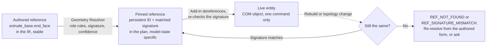

# 22. CAD IR Specification

> Specification v1.42, section 22. Index and section map: [README.md](README.md).

**Status: Proposed, awaiting the owner.** This section gathers the IR into one reference and specifies what the topic sections leave open. It changes no schema and no code. Companion sections: [§23 Compiler Architecture](compiler-architecture-specification.md) and [§8.9 SOLIDWORKS Adapter Interface](solidworks-adapter.md). Contract ownership across all three is in [23.13](compiler-architecture-specification.md#2313-cross-specification-contracts).

## 22.0 How to read this section

Every rule carries one of four labels. Nothing labelled **P** or **O** may be implemented as if it were decided.

| Label | Meaning | Where the authority is |
| --- | --- | --- |
| **N** | Normative and already decided. Repeated here only as a pointer | The linked topic section. If this file and the topic section disagree, the topic section wins and this file is a defect |
| **B** | Normative and built: the schema and code follow it today | `schemas/` (ADR-035) |
| **P** | Proposed here. Needs the named ADR or owner decision | This file, until accepted and moved to its topic section |
| **O** | Open. Logged in the [register](open-decisions.md) | The register |

**What "the IR" is in this repository.** It is not one document. It is a shared core plus six module kinds composed per task (ADR-003, ADR-026, [3.3](../architecture/overview.md)). This section specifies modelling semantics, which mainly means the Part Feature Graph. The drawing and intent modules keep their own sections and are unaffected.

## 22.1 Design principles

| Principle | Rule | Label |
| --- | --- | --- |
| IR is the source of truth for intent | Engineering meaning lives in the IR. A backend is a replaceable consumer (1.3 principle 12, ADR-054). SOLIDWORKS is the source of truth only for *what was produced* (3.3 rule 7) | N |
| Intent, not implementation | A node states the result wanted, never the API route. No `T1`, selection marks, `Dir` flags or radians (8.9.3 rule 4). Backend data appears only in the optional `x_solidworks` object, and a node must work without it (5.5, 5.7.1) | N |
| Final state, not edit steps | Sketches state resulting geometry. Trim and extend are not IR (5.3.1) | N |
| Strongly typed | The kind of a value or reference is fixed by the schema of its field, never guessed from its shape (3.4.2). Numbers carry `x-quantity` (3.4.8) | N |
| Explicit semantics | Defaults are never filled silently. Omitted fields stay omitted, and the compiler records what it applied (3.4.4, 5.7.6) | N |
| Versioned | Every document has `schema_version`, and the policy is ADR-042 | N |
| Deterministic serialization | RFC 8785 after rounding to the quantum (3.4.4) | N, B |
| Unsupported means error | An unsupported type is an explicit compiler error, never approximate geometry (5.3.6) | N |

## 22.2 Document model

Headers, IDs, revisions and bundles are [3.4.1](../architecture/shared-ir-core.md#341-identifiers) and [3.4.5](../architecture/shared-ir-core.md#345-documents-revisions-and-bundles).

| Document | Module key | Section | Status | Compiler support today |
| --- | --- | --- | --- | --- |
| Part | `part` | 5, 5.7 | Schema covers `sketch`, `extrude`, `cut_extrude` with `line` and `circle` only | One part per bundle |
| Part, read from an existing file | `part`, `origin: read` | 5.8 | Specified. Schema v0 accepts `built` only | Never compiled or executed |
| Assembly | `assembly` | 5.6 | Specified, schema folder empty, Phase 2 | Refused with `COMPILE_UNSUPPORTED_FEATURE` |
| Drawing | `drawing_intent`, `drawing_layout`, `drawing_template` | 11.10 to 11.12 | Schemas exist. Frozen (ADR-057) | Not compiled. The drawing pipeline emits operations by stage (6.5.3) |

**Extensibility rule (N).** A new document kind is a new module key on the shared core, with declared dependencies (3.3 rule 2). A module never reads another module's internals (3.3 rule 3). There is no base "document" class to extend.

**A built part, as it validates today (B).** This is the shape of `tests/fixtures/schemas/part-feature-graph/valid/plate_4h.json`, shortened to a single hole:

```json
{
  "module": "part",
  "id": "plate_1h",
  "schema_version": "0.1",
  "units": "mm",
  "origin": "built",
  "nodes": {
    "sketch_base": {
      "type": "sketch",
      "plane": "plane:front",
      "entities": {
        "l1": { "type": "line", "start": [-50, -30], "end": [50, -30] },
        "l2": { "type": "line", "start": [50, -30], "end": [50, 30] },
        "l3": { "type": "line", "start": [50, 30], "end": [-50, 30] },
        "l4": { "type": "line", "start": [-50, 30], "end": [-50, -30] }
      }
    },
    "extrude_base": {
      "type": "extrude",
      "dependencies": ["sketch_base"],
      "profile": "sketch_base",
      "end_condition": { "type": "blind", "depth": 10 }
    },
    "sketch_hole": {
      "type": "sketch",
      "plane": "plane:front",
      "entities": { "c1": { "type": "circle", "center": [0, 0], "diameter": 8 } }
    },
    "cut_hole": {
      "type": "cut_extrude",
      "dependencies": ["sketch_hole", "extrude_base"],
      "profile": "sketch_hole",
      "end_condition": { "type": "through_all_both" }
    }
  }
}
```

## 22.3 Geometry model

The IR has no geometry kernel (ADR-006). It holds only values the compiler and checks can reason about, in plain JSON.

### 22.3.1 Value types

| Type | JSON form | Quantity kind | Label |
| --- | --- | --- | --- |
| `Length`, `Angle`, `Ratio`, `Count` | Number. Angles are always degrees | `x-quantity` | N, B (3.4.3, 3.4.8) |
| `Point2` | `[x, y]` of `Length`, in sketch coordinates | length | B |
| `Point3` | `[x, y, z]` of `Length`, in model coordinates | length | P, first needed by `point` and `coordinate_system` |
| `Vector3` | `[x, y, z]`, dimensionless and non-zero; not required to be unit length. The compiler normalizes it | ratio | P, same need |
| `Line` | Sketch entity: `start`, `end` | | B |
| `Circle` | Sketch entity: `center`, `diameter`. **Diameter, not radius**, so that the parameter an engineer dimensions is the stored value | | B |
| `Arc` | Sketch entity: `center`, `start`, `end`, `direction` (`ccw`, `cw`) | | N (5.7.4), not in schema |
| Curves | `spline` is Read-only in Tier 1, Create in Tier 2 (5.3). `ellipse` is the same. Their field shape is not specified, and is deferred until a benchmark part needs them (ADR-018) | | O, deferred |

There are no free-standing geometric objects. Points, lines and circles exist only inside a sketch, and planes and axes only as reference nodes or references.

### 22.3.2 Frames

| Frame | Definition | Who converts |
| --- | --- | --- |
| **Model frame** | The part's right-handed coordinate system. Origin is `origin` | Nobody: the IR's root frame |
| **Sketch frame** | 2D, on the sketch's plane. On the standard planes the axes follow the measured table in [5.7.4](../architecture/feature-schema-guide.md#574-sketches) | `expected_geometry` in Python, independently of the adapter (10.2.1) |
| **Sketch normal** | `x × y` of the sketch frame. The positive direction of `blind` end conditions | The add-in's translator, per plane and per feature type (5.7.4) |
| **Sheet frame** | Drawing only: millimetres from the lower-left sheet corner (11.11) | Adapter |

**Direction semantics (P, makes 5.7.4 explicit).** A `blind` end condition means *along the sketch normal, or against it if `reverse` is true*, for extrudes and cuts alike. That SOLIDWORKS's default blind cut goes the other way is the translator's concern (8.9.3 rule 4) and never appears in the IR.

### 22.3.3 Units

Units are document-level, not per value (3.4.3). A part in schema v0 is `mm` only. `in` is specified, but the parser's conversion is not built; see [K24](open-decisions.md#k24-which-length-unit-operation-params-use). Dimensional values carry no unit field, so a mixed-unit document cannot be written.

### 22.3.4 Reference geometry nodes

Registry names follow 5.7.1: the snake case of the 5.3.2 table. All **P**, for roadmap A7, and written to a schema only when a benchmark part needs them (ADR-018).

| Type | Fields | Roles it defines |
| --- | --- | --- |
| `plane` | `definition`: `{ "type": "offset", "from": GeometryRef, "distance": Length, "reverse": bool }`, `{ "type": "angle", "from": GeometryRef, "about": GeometryRef, "angle": Angle }` or `{ "type": "through", "entities": [GeometryRef, ...] }` | `face` |
| `axis` | `definition`: `{ "type": "two_points", "entities": [...] }`, `{ "type": "cylinder", "face": GeometryRef }` or `{ "type": "two_planes", "entities": [...] }` | `axis` |
| `point` | `position`: `Point3` | `point` |
| `coordinate_system` | `origin`: GeometryRef, optional `x_axis`, `y_axis` (GeometryRef) | `x_axis`, `y_axis`, `z_axis`, `origin` |

A sketch may use a `plane` node by `<node>.face`. Standard planes stay role references, `plane:front` and the rest (6.5.2).

## 22.4 Sketch model

Field shapes are [5.7.4](../architecture/feature-schema-guide.md#574-sketches) (N). This adds the semantics needed before relations ship in roadmap A4.

### 22.4.1 Entities

| Entity | Fields | DOF | Status |
| --- | --- | --- | --- |
| `point` | `position` | 2 | N, not in schema |
| `line` | `start`, `end` | 4 | B |
| `circle` | `center`, `diameter` | 3 | B |
| `arc` | `center`, `start`, `end`, `direction` | 5 | B (ADR-071) |
| `corner_rectangle` | `corner1`, `corner2` | 4 | B (ADR-072) |
| `center_rectangle` | `center`, `width`, `height` | 4 | B (ADR-072) |
| `straight_slot` | `start_point`, `end_point`, `width` | 5 | B (ADR-073) |
| `slot` | Stored as lines and arcs plus an entity group, or lowered from `straight_slot` | Sum of parts | B (ADR-073) |
| `spline`, `ellipse` | Read only in Tier 1 | | N |

`construction: true` marks construction geometry (5.7.4). Construction entities take part in relations and dimensions and never in a profile.

**Name uniqueness (P).** `entities`, `relations` and `dimensions` IDs in one sketch share a namespace. `sketch_a.x` must resolve to exactly one thing whichever map it is in, which extends 3.4.2 rule 2 to sketches.

### 22.4.2 Geometric constraints

Relation types are named in 5.7.4 without a closed list. **P:** the closed list for A4 is below. It is smaller than what SOLIDWORKS offers on purpose, and it grows by need. The DOF column is what a relation removes when it is not redundant.

| `type` | Applies to | DOF removed | Backend mapping (8.9.11) |
| --- | --- | --- | --- |
| `coincident` | Point and point; point and line, arc or circle | 2; 1 | `swConstraintType_COINCIDENT` |
| `horizontal`, `vertical` | Line, or two points | 1 | `HORIZONTAL`, `VERTICAL` |
| `parallel`, `perpendicular` | Two lines | 1 | `PARALLEL`, `PERPENDICULAR` |
| `tangent` | Line and arc, or two arcs | 1 | `TANGENT` |
| `concentric` | Two arcs or circles | 2 | `CONCENTRIC` |
| `equal` | Two lines (length) or two arcs or circles (radius) | 1 | `SAMELENGTH` |
| `midpoint` | Point and line | 2 | `ATMIDDLE` |
| `symmetric` | Two points and a line | 2 | `SYMMETRIC` |
| `fix` | Any entity | All of its DOF | `FIXED` |

Point references within an entity are `<entity>.start`, `<entity>.end` and `<entity>.center` (N). The origin is `origin`.

### 22.4.3 Dimensional constraints

`dimensions` are keyed by ID, with `type` (`distance`, `horizontal`, `vertical`, `diameter`, `radius`, `angle`), `entities` and `value` (N). Each is a driving parameter, addressed `<sketch_id>.<dimension_id>`. Each removes one DOF when not redundant. Driven (reference) dimensions are not in the IR, because they carry no intent; drawings handle them (11.10.1).

### 22.4.4 Seed consistency: which value wins

SOLIDWORKS's solver moves geometry to satisfy constraints, so a sketch's coordinates and its dimensions could disagree silently. Roadmap A4 names this risk. **P (with [K27](open-decisions.md#k27-sketch-solver-and-seed-geometry)):**

1. **Coordinates must already satisfy every relation and dimension, within the quantum (3.4.3).** The validator checks this from the IR alone and reports `IR_RULE_VIOLATED`.
2. So the solver has nothing to move. A read-back that differs from the IR means something went wrong, and the check fails.
3. Driving dimensions are the parametric truth for later edits (section 9), and coordinates are re-derived by the same pure rule.

This keeps the "final geometry" rule (5.3.1) and keeps `expected_geometry` analytic. It costs agents more precision up front, which the validator's message makes cheap to correct.

### 22.4.5 Degrees of freedom and constraint state

The IR does not contain a solver, and pure code cannot prove a sketch fully defined, because redundant relations hide in a count.

| Value | Source | Use |
| --- | --- | --- |
| `dof_estimate` | Pure: sum of entity DOF minus the sum of relation and dimension DOF. **Advisory** | Negative gives a warning (likely over-defined). Never a pass condition |
| `constraint_state` (observed) | The backend's report, in the operation's observation | The authoritative answer |
| `expected_state` | Authored, optional field on the sketch (**P**): `any` (default) or `fully_defined` | What the contract requires |

| `constraint_state` | Meaning | SOLIDWORKS source (documented, unrun) | Contract result |
| --- | --- | --- | --- |
| `under_defined` | Geometry can still move | `swUnderConstrained` | `passed` if `expected_state` is `any`, otherwise `failed` |
| `fully_defined` | Nothing can move | `swFullyConstrained` | `passed` |
| `over_defined` | Conflicting constraints | `swOverConstrained` | `failed`, always |
| `no_solution`, `invalid_solution` | Solver failed | `swNoSolution`, `swInvalidSolution` | `failed`, always |
| `unknown` | Not determined | `swUnknownConstraint`, `swAutosolveOff` | `not_evaluated`, reason `unsupported`. Required checks end the job (ADR-064) |

**An MVP sketch is under-defined natively,** because it has no relations and its position rests on the entered coordinates with `AddToDB` on. That is acceptable under `any`, since measurement checks position.

**Example (P, sketch with relations and one dimension):**

```json
{
  "type": "sketch",
  "plane": "plane:front",
  "expected_state": "fully_defined",
  "entities": {
    "c1": { "type": "circle", "center": [20, 0], "diameter": 8 }
  },
  "relations": {
    "r1": { "type": "horizontal", "entities": ["c1.center", "origin"] }
  },
  "dimensions": {
    "dia": { "type": "diameter", "entities": ["c1"], "value": 8 },
    "x": { "type": "horizontal", "entities": ["origin", "c1.center"], "value": 20 }
  }
}
```

The estimate is 3 − 1 − 1 − 1 = 0, and the entered coordinates already satisfy all three, so seed consistency passes.

### 22.4.6 Sketch validation

| Rule | Code | Label |
| --- | --- | --- |
| A sketch has at least one entity | `IR_SCHEMA_INVALID` | B |
| Line length above the quantum; circle diameter at least 0.01 mm | `IR_RULE_VIOLATED` | B |
| A closed profile's lines chain into one loop without self-crossing | `IR_RULE_VIOLATED` | B |
| Plane is a standard plane (MVP) | `COMPILE_UNSUPPORTED_FEATURE` | B |
| Relations and dimensions refer only to existing entities and points | `IR_REFERENCE_UNRESOLVED` | P |
| Entity, relation and dimension IDs do not collide | `IR_RULE_VIOLATED` | P |
| Seed consistency (22.4.4) | `IR_RULE_VIOLATED` | P |
| `dof_estimate` negative | Warning (`IR_RULE_VIOLATED`, `severity: warning`) | P |

## 22.5 Feature model

### 22.5.1 The five facets of a node

Every feature type's schema separates these, and the validator treats them differently.

| Facet | Meaning | Where it is | Example, for `extrude` |
| --- | --- | --- | --- |
| **Intent** | What the node is for | `type`, optional `realizes`, optional `display_name` | Add material from a profile |
| **Parameters** | Values with a quantity | Named fields and shared objects (5.7.2, 5.7.3). `ParamRef` addresses them | `end_condition.depth` |
| **Inputs** | Other nodes or geometry it consumes | Typed reference fields | `profile`, `end_condition.target` |
| **Outputs** | What later nodes may refer to | Roles in the type's schema (5.7.5). Never stored in the instance | `start_face`, `end_face`, `side_faces`, `body` |
| **Dependencies** | Build order | Implied by inputs, plus the explicit `dependencies` set (22.7) | `sketch_base` |

Adding a type adds a schema entry, a lowering rule, a contract rule, an adapter handler and a seeded-defect test. It never adds an MCP tool (5.3.6, ADR-019, ADR-064).

### 22.5.2 Type catalogue

Tier and phase are from [5.3](../architecture/part-feature-graph-ir.md#53-feature-taxonomy-and-coverage) and the [adapter roadmap](../plans/solidworks-adapter-roadmap.md). Fields beyond the shared objects of 5.7.3 are **P** until each type's schema is written. Each schema is written before its phase (6.5.2).

| Type | Tier, phase | Required inputs and parameters | Optional | Output roles |
| --- | --- | --- | --- | --- |
| `extrude` | 1, MVP **(B)** | `profile`, `end_condition` | `end_condition_2`, `thin`, `merge_result` | `start_face`, `end_face`, `side_faces`, `body` |
| `cut_extrude` | 1, MVP **(B)** | `profile`, `end_condition` | `end_condition_2`, `thin` | `end_face`, `side_faces` |
| `revolve`, `cut_revolve` | 1, A5 | `profile`, `axis`, `angle` (above 0, up to 360) | `mid_plane`, `reverse`, `thin`, `merge_result` | `faces_by_axial_order`, `body` |
| `sweep`, `swept_cut` | Create Tier 2 | `profile`, `path` | `guides`, `twist`, `thin`, `merge_result` | `start_face`, `end_face`, `body` |
| `loft`, `lofted_cut` | Create Tier 2 | `profiles` (ordered, at least 2) | `guides`, `centerline`, `closed`, `thin`, `merge_result` | `start_face`, `end_face`, `body` |
| `fillet` | 1 (constant radius), A6 | `edges` (GeometryRef set), `radius` | `propagate` | `faces` |
| `chamfer` | 1, A6 | `edges`, `chamfer` (below) | `propagate` | `faces` |
| `linear_pattern` | 1, A7 | `pattern` with `seeds`, `direction`, `spacing`, `count` | `direction_2`, `skip`, `geometry_pattern` | `instances` |
| `circular_pattern` | 1, A7 | `pattern` with `seeds`, `direction` (the axis), `spacing` (degrees), `count` | `skip`, `equal_spacing` | `instances` |
| `mirror` | 1, A7 | `seeds`, `plane` | `merge_result` | `instances` |
| `plane`, `axis`, `point`, `coordinate_system` | 1, A7 | 22.3.4 | | 22.3.4 |

`chamfer` is a tagged object: `{ "type": "distance_distance", "distance": L, "distance_2": L }` or `{ "type": "angle_distance", "angle": A, "distance": L }` (5.3.2). Vertex chamfers are not in Tier 1.

**Alignment with 5.7.3 (P).** That table lists mirror under the `pattern` object, whose `direction` is not a natural plane. A mirror has a `plane` field here. `spacing` holds a length in a linear pattern and an angle in a circular one, so each type's schema gives it the right `x-quantity`: it is two `$defs`, not one polymorphic number.

**A cut is not a boss with a flag (N).** They are separate types, because their contracts differ (a cut must remove volume) even though SOLIDWORKS sometimes routes both through one call (8.9.11). Other Tier 1 types (`hole_wizard`, `shell`, `draft`, `rib`, sheet metal) keep their 5.3 and 5.7.3 definitions and are not repeated here.

**Example (P, revolve then fillet):**

```json
{
  "shaft_body": {
    "type": "revolve",
    "profile": "sketch_shaft",
    "axis": "sketch_shaft.cl",
    "angle": 360,
    "realizes": ["shaft"]
  },
  "edge_round": {
    "type": "fillet",
    "dependencies": ["shaft_body"],
    "edges": ["shaft_body.end_edges"],
    "radius": 1
  }
}
```

Here `sketch_shaft.cl` uses the sketch's entity ID in a `GeometryRef` position, and `shaft_body.end_edges` assumes an edge role; both are subject to 22.6 and K23.

## 22.6 Reference model

The grammar is [3.4.2](../architecture/shared-ir-core.md#342-references), the resolution policy section 7, and the split ADR-049 (all N). Native face and edge indexes are never identity (1.3 principle 5).

### 22.6.1 What can be referred to

| Target | Form in the IR | Resolved by | Status |
| --- | --- | --- | --- |
| Feature, sketch (whole node) | `LocalRef`: `sketch_base`. Field `profile`, `seeds` | Semantic Validator, in the graph alone | B for `profile` |
| Sketch entity or point | `<sketch>.<entity>` in another node; `<entity>.start` inside the sketch | Semantic Validator | N inside; **P** across nodes |
| Parameter | `ParamRef`: `<node>.<field>`, `<sketch>.<dimension>` | Semantic Validator | N. Grammar gap: K23 |
| Body | `<node>.body` role | Geometry Resolver | **P** |
| Face, edge, vertex, by role | `<node>.<role>` | Geometry Resolver, role rules over gathered facts (5.7.5, ADR-049) | N, not built |
| Stored reference | `geo:<reference_id>` | Geometry Resolver and store | N, not built |
| Standard planes, origin | `plane:front`, `plane:top`, `plane:right`, `origin` | Adapter, by order and normal (5.7.4) | B |
| Datum geometry | `datum:<label>` | Via the Drawing Intent | N, drawing only |

**Role references are the normal way to name geometry.** They are stable because they mean something: the end face of this extrude stays that even if its depth changes. `geo:` exists for geometry no role reaches (for example, a read-only part's face picked through `inspect_geometry`).

### 22.6.2 Persistent and regenerated

These are different things held in different places, and the IR never mixes them.



| Level | Lives in | Survives rebuild | Survives file reopen | May be stored |
| --- | --- | --- | --- | --- |
| Authored (role, `LocalRef`) | IR document | Yes, by meaning | Yes | Yes: it is the intent |
| Stored reference (7.2 record) | `geo:` in the store | Checked on use | Checked on use | Yes |
| Pinned persistent ID + signature | Plan (`provenance.geometry_candidates`, operation params) | Checked on use | Checked on use, reference survives by documented behaviour; unmeasured beyond the plate | Only in derived artifacts, keyed by part fingerprint (ADR-049) |
| Live entity | Add-in, within one command | Never relied on | No | Never (G1) |

**Which native identifiers are acceptable** is [ADR-067](../adr/ADR-067-entity-identity-ladder.md) (P) and [8.9.12](solidworks-adapter.md#8912-reference-resolution-in-the-adapter). The help text rules out face IDs, tracking IDs and safe entities for this purpose.

### 22.6.3 Sets and ordering

A role that is a set is used as a whole or, only where the type defines a stable order, with an index: `extrude_base.side_faces.0` (5.7.5). A role that matches more than one entity when one is expected fails with `REF_AMBIGUOUS`. Neither is ever guessed (3.4.2 rule 6). The schema's `GeometryRef` pattern does not accept an index yet: K23.

### 22.6.4 Stored reference record

A `geo:` reference, from the fields of 7.2. **P** on concrete names and on signature rounding; 7.2 and 7.3 are N.

```json
{
  "reference_id": "g7f3a21c0",
  "owner_feature_id": "extrude_base",
  "entity_type": "face",
  "semantic_role": "end_face",
  "geometric_signature": {
    "surface_type": "plane",
    "area_mm2": 6000.0,
    "normal": [0, 0, 1],
    "centroid_mm": [0, 0, 10],
    "bbox_mm": { "min": [-50, -30, 10], "max": [50, 30, 10] }
  },
  "persistent_reference": "UEYAAAEAAAA=",
  "resolution_policy": "fail_on_ambiguous",
  "confidence": "high",
  "revision": 1
}
```

## 22.7 Feature graph

Structure is 5.2 and field rules are 5.7.1 (N).

### 22.7.1 Nodes and edges

| Edge kind | From | Example | Explicit? |
| --- | --- | --- | --- |
| Input | A node's reference fields | `cut_hole` → `sketch_hole` through `profile` | Implied. The compiler adds it |
| Geometry | A role or sketch-entity reference names its owner | `edge_round` → `shaft_body` through `shaft_body.end_edges` | Implied. **P**: the code adds only `profile` today |
| Parameter | An expression's variables (22.8) | Not a node edge. Variables are ordered separately | **P** |
| Body state | The node modifies a body an earlier node made | `cut_hole` → `extrude_base` | **Must be stated** (22.7.2) |
| Declared | Author's `dependencies` | Any extra ordering | Explicit |

The `dependencies` field holds only what references do not already imply, but listing an implied one is allowed and harmless (the plate fixture does).

### 22.7.2 Execution ordering

**N (5.7.1, built):** topological order, with ties broken by node-ID sort order, so one graph always builds one tree.

**A problem this exposes.** Feature order changes geometry, and references do not capture that. A through-all cut on `plane:front` references only its sketch. Without a declared edge to the boss, the tie-break could order the cut first, and the result depends on the *spelling of IDs*. The MVP masks it with two ad-hoc rules (one extrude only; a cut must depend on it).

**P ([ADR-066](../adr/ADR-066-body-order-is-explicit.md)):** generalize the rule. Nodes whose types change bodies (`extrude`, `cut_*`, `revolve`, `sweep`, `loft`, `fillet`, `chamfer`, patterns, `mirror`) form a **total order through the graph**: for any two, a directed path must exist one way or the other. Otherwise `IR_RULE_VIOLATED`, naming both. Sketches and reference nodes are free. The tie-break then only ever orders sketches and reference geometry, which cannot change a body.

### 22.7.3 Cycles

`IR_CYCLE`, one diagnostic per node in the unresolved set, by pointer `/nodes/<id>/dependencies` (N, B: `analyze_graph`). The pure analyzer reports the set of nodes it could not order, which contains the cycle and anything downstream of it. Reporting a minimal cycle path would help agents and is a small improvement, not a contract change.

### 22.7.4 Identity and lifecycle

| Event | Rule | Label |
| --- | --- | --- |
| Create | Author picks the item ID. Never reused, even after deletion (3.4.1) | N |
| Change parameters | Same ID, new document revision | N |
| Change type | Treated as delete and add: role references to it must resolve again or fail | P |
| Rename | Not an operation. An ID change is delete plus add, so a graph diff shows both | P |
| Suppress | `suppressed: true`. The node stays in the graph, and its dependents must tolerate it or fail | N (field); P (dependent rule) |
| Delete | Allowed only if no remaining node refers to it. `IR_REFERENCE_UNRESOLVED` otherwise. The ID is retired | N |
| Bind to native | Job's `feature_ids` map: node ID to `f<GetID()>` (6.5.3, 12.4.5). Not stored in the IR | N |
| Read-only nodes | `origin: read`: IDs `f<GetID()>`, or `p<hash>` in a fallback case. Never edited (5.8) | N |

A retired ID has nothing to record it today. **P:** the store derives retired IDs from revision history when validating a patch, so no schema field is needed.

### 22.7.5 Incremental modification

The IR's duty is small: a stable node identity and a pure graph diff. Change classes, plans and state tracking are [23.8](compiler-architecture-specification.md#238-incremental-compilation) and section 9. Documents change through RFC 6902 patches validated as the document they produce (ADR-048, 3.4.7).

## 22.8 Parameters and expressions

### 22.8.1 Numeric values (N, B)

Finite JSON numbers only. `NaN`, infinities and numeric strings are rejected. Integers have no fraction and fit 2^53 − 1. Quanta and equality are 3.4.3, and geometric tolerances are separate (10.2.1).

### 22.8.2 Parameter addressing (N)

A parameter is a named field, addressed by `ParamRef`, with no separate registry. Sketch dimensions are parameters. **Today no IR document can make one value depend on another.** Equations are Read-only in Tier 1 and Create in Tier 2 (5.3.2, 5.3.3), and 4.6 defers expressions.

### 22.8.3 Proposed: variables and expressions (P, [ADR-065](../adr/ADR-065-part-parameters-and-expressions.md))

Not admitted to any schema until a benchmark part needs it (ADR-018) and the ADR is accepted.

```json
{
  "module": "part",
  "id": "bracket",
  "schema_version": "0.2",
  "units": "mm",
  "origin": "built",
  "variables": {
    "width": { "kind": "length", "value": 100 },
    "hole_inset": { "kind": "length", "value": 10 },
    "hole_x": { "kind": "length", "expr": "width / 2 - hole_inset" }
  },
  "nodes": {
    "sketch_hole": {
      "type": "sketch",
      "plane": "plane:front",
      "entities": {
        "c1": { "type": "circle", "center": [{ "expr": "hole_x" }, 0], "diameter": 8 }
      }
    }
  }
}
```

The collection is `variables` because 5.7.1 already uses `parameters` for a node-level field.

| Rule | Detail |
| --- | --- |
| Grammar | `+ - * / ^`, parentheses, unary minus, number literals, variable names, and `min`, `max`, `abs`, `sqrt`, `sin`, `cos`, `tan`, `pi`. Trigonometry takes degrees (3.4.3). There is no other function, and no conditional or string |
| Scope | Variables only. An expression may not read a node field in this version, so variables never create node edges |
| Dependencies | Variables form their own DAG, with cycles giving `IR_CYCLE` at `/variables/<name>/expr` |
| Kinds | Dimensional check: `length ± length`, `length * ratio`, `length / length = ratio`, `sin(angle) = ratio`. A mismatch gives `IR_RULE_VIOLATED`. A field's `x-quantity` must match the expression's kind |
| Evaluation | Pure, in `cad-ir`, in IEEE 754 binary64, in a defined order. Results go through the normal quantum (3.4.4) |
| Where evaluated | **At compile time only.** The plan and the wire carry numbers. Native equations are not created, so a part built this way holds plain values |
| Errors | Division by zero, a domain error or a non-finite result gives `IR_RULE_VIOLATED` |
| Hashing | The expression text is part of the document's hash, as written after NFC. `2*x` and `x*2` hash differently |
| Contracts | `feature_contracts` and `expected_geometry` use the evaluated values. Evaluator and contract share code, so the evaluator needs its own golden-value tests |

Creating SOLIDWORKS equations and global variables stays a separate Tier 2 decision (5.3.3). Compile-time evaluation does not preclude it.

### 22.8.4 Parameter validation

Range and relation checks live in each type's schema and in the Semantic Validator: depth above 0, cut inside base, and so on. Values that fail produce `IR_RULE_VIOLATED`, or `IR_SCHEMA_INVALID` for a schema bound, with the pointer of the offending field (3.4.7).

## 22.9 Validation and diagnostics

### 22.9.1 Levels

Form, ordering and limits are [3.4.7](../architecture/shared-ir-core.md#347-validation-errors); the stage contract is [6.7](../architecture/cad-compiler.md#67-stage-contract) (N).

| Level | Question | Without SOLIDWORKS? | Stage | Codes |
| --- | --- | --- | --- | --- |
| Structural | Does it match the schema? | Yes | Parser, Schema Validator | `IR_SCHEMA_INVALID`, `IR_SCHEMA_VERSION_UNSUPPORTED` |
| Semantic | Does it mean something buildable? | Yes | Semantic Validator, Graph Analyzer | `IR_RULE_VIOLATED`, `IR_CYCLE`, `IR_MODULE_MISSING` |
| Reference | Does every reference have exactly one target? | Graph references yes; geometry through recorded candidates | Semantic Validator, Geometry Resolver | `IR_REFERENCE_UNRESOLVED`, `REF_NOT_FOUND`, `REF_AMBIGUOUS`, `REF_LOW_CONFIDENCE` |
| Backend fit | Can this backend do it? | Yes, against a recorded profile | Feature Lowering | `COMPILE_UNSUPPORTED_FEATURE`, `BACKEND_CAPABILITY_MISSING` |

IR validation deliberately ends before the backend-fit level. An IR document can be valid and still not buildable on a given backend.

### 22.9.2 Graph rules

| Rule | Code | Label |
| --- | --- | --- |
| `profile` names an existing node, and that node is a sketch | `IR_REFERENCE_UNRESOLVED`, `IR_RULE_VIOLATED` | B |
| Every `dependencies` entry exists | `IR_REFERENCE_UNRESOLVED` | B |
| No cycle | `IR_CYCLE` | B |
| At most one `extrude`; each cut depends on it | `IR_RULE_VIOLATED` | B. Replaced by the rule below |
| Body-changing nodes are totally ordered (22.7.2) | `IR_RULE_VIOLATED` | P |
| A cut's profile lies inside its base, and cuts do not overlap | `IR_RULE_VIOLATED` | B, MVP-specific so that `expected_geometry` stays exact |
| Blind cut depth is below the base's depth | `IR_RULE_VIOLATED` | B, MVP-specific |
| A role name exists in the owner's type schema | `IR_REFERENCE_UNRESOLVED` | P |
| A role resolves to the entity kind the field wants (an `edges` entry is an edge role) | `IR_RULE_VIOLATED` | P |
| No reference points forward past a body-order position it depends on | `IR_CYCLE`, when it closes a loop | P |

MVP-specific rules exist because exact expected values need them. They relax per K16, as each type gets a stated verification level, and never silently.

### 22.9.3 Actionable diagnostics

```json
{
  "stage": "semantic_validator",
  "module": "part",
  "code": "IR_REFERENCE_UNRESOLVED",
  "pointer": "/nodes/cut_hole/profile",
  "message": "Profile 'sketch_hol' not found in graph",
  "ref": "sketch_hol",
  "expected": ["sketch_base", "sketch_hole"]
}
```

| Requirement | Detail |
| --- | --- |
| Locates | `pointer` names the item, by ID, not by array position (3.4.7) |
| Tells the fix | `expected` lists valid values wherever a closed set exists. **P:** the validator fills it for unresolved `LocalRef`s, with the code providing only `ref` today |
| Complete | All errors of a stage, up to 50, with a count of the rest (3.4.7) |
| Deterministic | Sorted by pointer then code. The same document gives the same list |
| Vendor-free | IR diagnostics never mention SOLIDWORKS (1.3 principle 1) |

## 22.10 Serialization and compatibility

All N. Pointers, not restatements.

| Topic | Rule | Section |
| --- | --- | --- |
| Canonical form | Validate, fill nothing, quantize, sort unordered arrays, RFC 8785 | 3.4.4 |
| Content hash | `sha256:` plus lowercase hex | 3.4.4 |
| Collections | Objects keyed by ID, never arrays with an `id` | 3.4.1, ADR-048 |
| Schema annotations | `x-quantity`, `x-unordered`, `propertyNames`, anchored patterns | 3.4.8 |
| Versions | `<major>.<minor>`. Major 0 is unstable and any change is allowed | 3.4.8, ADR-042 |
| Minor versions | Additive only. Authored input rejects unknown fields | ADR-042 |
| Migration | Pure function per major, on read, in memory. Stored revisions are never rewritten | ADR-042 |
| Revisions | Immutable with content hash and parent. Content-identical `apply` reuses a revision | 3.4.5 |
| Extension data | `x_solidworks`, never required | 5.5, 5.7.1 |

**Round-trip requirements (P, testable).**

| Property | Test |
| --- | --- |
| Parse then serialize preserves content | `parse(doc).to_dict()`, canonicalized, equals `doc`, canonicalized, for every valid fixture |
| Omitted stays omitted | A document without an optional field never serializes with it |
| Order independence | Any permutation of keys and of unordered arrays gives the same hash |
| Quantization is idempotent | `q(q(x)) == q(x)` for every kind |
| Equivalence is by hash | Never by comparing numbers one by one (3.4.3) |
| Old fixtures still parse | Each supported older major migrates to the current form, with fixtures (ADR-042) |

**Backward compatibility of this section's proposals.** `expected_state`, `variables` and new node types are additive, and need a minor bump once schemas are at major 1. At major 0 they need only regenerated contracts and fixtures.

## 22.11 Acceptance criteria

A proposal in this section is done when these hold, offline, through `uv run pytest`:

1. Every JSON example marked B validates against `schemas/`.
2. Each new type has a schema, one valid fixture, invalid fixtures per rule, one minimal example under 400 tokens (5.7) and a registry entry.
3. A permutation test proves the same hash for reordered documents.
4. A graph with an unordered pair of body-changing nodes fails with both IDs named, whatever the IDs are.
5. An inconsistent seed (a dimension of 20 on coordinates that give 19) fails with `IR_RULE_VIOLATED` at the dimension's pointer.
6. `dof_estimate` negative warns, and never blocks.
7. The expression evaluator matches golden values, rejects unit mismatches, and two evaluations are byte-identical across processes.
8. No IR schema or diagnostic contains a SOLIDWORKS term outside `x_solidworks`.

## 22.12 Implementation status

Capability status (schema types, dependencies, `ParamRef`, roles, references) is tracked per option in the [implementation checklists](../implementation/README.md), not here. This table holds only what they do not track. Read from the code on 2026-11-05. "Spec" is what the topic sections already require.

| Item | Spec | Today |
| --- | --- | --- |
| `in` units | 3.4.3, 6.7.2 | Schema `units` is `const: mm`, so unconverted inch input cannot arrive |
| `origin: read` | 5.8 | Schema `const: built` |
| Model | Generated (ADR-035) | Hand-written dataclasses for the part graph, with tests against the schema (ADR-061 records the precedent) |

## 22.13 Unresolved

| ID | Question |
| --- | --- |
| [K23](open-decisions.md#k23-reference-grammar-beyond-two-segments) | `ParamRef` and `GeometryRef` grammar beyond two segments |
| [K24](open-decisions.md#k24-which-length-unit-operation-params-use) | Which length unit operation params use once inch documents exist |
| [K25](open-decisions.md#k25-nested-assemblies-in-a-bundle) | Nested assemblies against the one-assembly bundle rule |
| [K27](open-decisions.md#k27-sketch-solver-and-seed-geometry) | Whether the solver leaves consistent seed geometry unmoved, and how relations and dimensions attach without banned selection |
| [K16](open-decisions.md#k16-expected-geometry-beyond-exact-calculation) | Expected geometry beyond exact calculation, which decides what fillet and sweep contracts can state |
| [K12](open-decisions.md#k12-measurement-on-curved-bodies) | Measurement on curved bodies |
