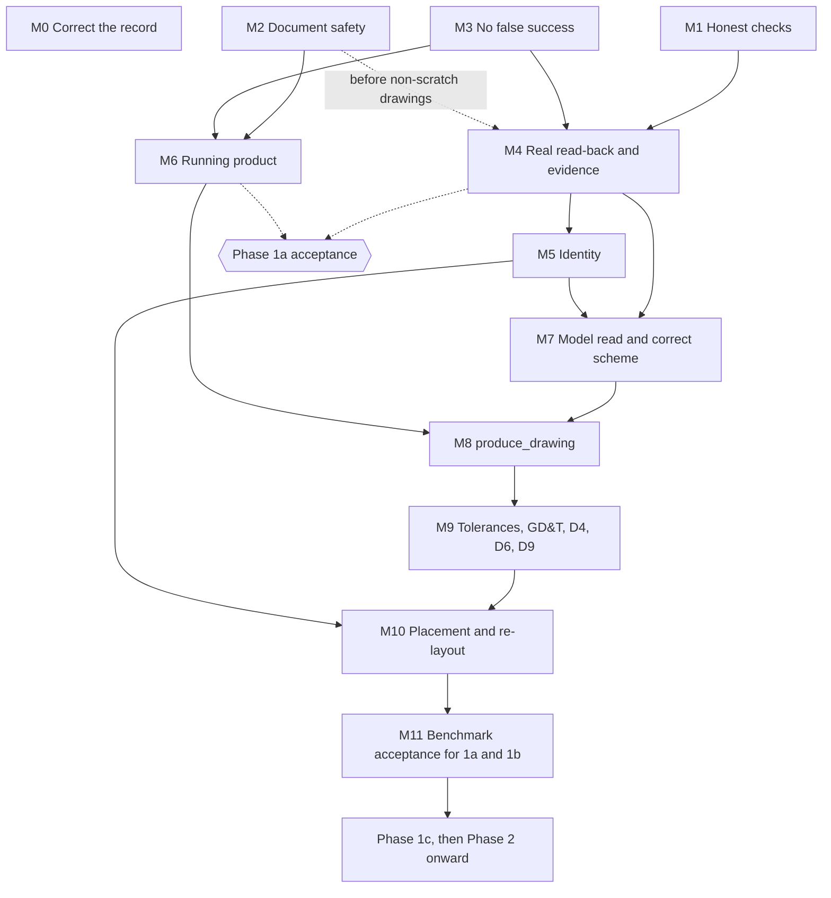

# 18. Roadmap

> Specification v1.40, section 18. Index and section map: [specifications/README.md](../specifications/README.md).

This section says what each phase delivers, how it is accepted and, for Phase 1, in what order the work runs. Current status is in [`HANDOFF.md`](../../HANDOFF.md).

## Current focus: the part chain (ADR-057)

**Owner decision, 2026-11-05.** Drawing work is frozen at commit `eea9389` ([freeze record](../superpowers/review/2026-11-05-drawing-freeze.md)). Development has moved to the Part Feature Graph IR and an end-to-end MVP:

Part Feature Graph IR → compiler → Execution Plan → executor → verified `.SLDPRT`.

- **This changes the order only.** The phases and their acceptance below are unchanged, and the MVP alone does not complete Phase 1c, which also requires benchmark parts and drawings passing D1–D10.
- **While frozen:** no new drawing features. Shared code may change when the part chain needs it, and the drawing tests must keep passing.
- **Phase 1 work order:** paused, except for M0 and the parts of M2 and M3 the part chain needs. The rest resumes when the owner lifts the freeze.

**The MVP** ([design](../superpowers/specs/2026-11-05-part-chain-mvp-design.md), [plan](../superpowers/plans/2026-11-05-part-chain-mvp.md); approved by the owner). You ask Claude for a part over MCP, and a `.SLDPRT` appears only if measurements in SOLIDWORKS match the IR. Its first part is a 100 × 60 × 10 mm plate with four Ø8 mm through holes.

| Stage | Delivers | Done when |
| --- | --- | --- |
| 1. API spike | Recorded SOLIDWORKS behaviour | Sketch axes, feature calls, feature ID stability and close behaviour are all answered |
| 2. Contracts | Spec changes, Part Feature Graph, operation and plan schemas | Schemas and fixtures pass, and the spec is bumped |
| 3. Pure core | Compiler and expected geometry | The same graph gives a byte-identical plan, and the plate's expected values are correct |
| 4. Add-in | Ownership enforcement, part operations, `part.measure` | The plate builds by operations on scratch files, and engineers' documents stay untouched |
| 5. `plan` job | Build, verify, save and rename | A wrong measurement never produces the target file |
| 6. MCP and runtime | Part tools, entry points, official SDK front-end | An MCP client lists and calls the tools against a real core |
| 7. Live acceptance | The chain on real SOLIDWORKS | The plate commits, and a deliberately wrong plan fails with no target |
| 8. Run from Claude | The finish line | You ask Claude for two different parts, open them, and sign off |

**Status: done, signed off by the owner on 2026-11-06.** The owner confirmed the 100 × 60 × 10 plate in SOLIDWORKS. Claude then built both plates over MCP (the 60 × 40 × 5 mm plate with one Ø20 mm hole as well) and every check passed, in the session and after reopening. A fillet request was refused by validation with no file written. The owner did not open the second plate in SOLIDWORKS; its volume (10,429.20 mm³) matches the expected value.

The MVP leaves out other feature types, sketch relations and dimensions, editing a built part, reading existing parts, and overwriting files. Drawing tools stay out of Claude's default tool list while the freeze lasts.

## Phases at a glance

| Phase | Goal | Accepted when |
| --- | --- | --- |
| [0](#phase-0--audit-and-contracts) | Fix the contracts and prove the API assumptions | Study notes, schemas, benchmark set and assumption register are complete |
| [1a](#phase-1a--drawing-checks-on-existing-drawings) | Check any existing drawing | Every seeded defect is found, with no false positives on approved drawings |
| [1b](#phase-1b--drawing-pipeline-on-hand-modelled-parts) | Produce drawings for hand-modelled parts | Every hand-modelled benchmark part passes D1–D10 |
| [1c](#phase-1c--ir-built-parts) | Build parts from IR, then draw them | Every IR-built benchmark part builds, verifies and passes D1–D10 |
| [2](#phase-2--geometry-references-and-verification-foundation) | Semantic references, wider feature coverage, reference parity | The reference implementation can be retired |
| [3](#phase-3--requirement-checks) | Check designs against requirements | Violations are reported with measured and expected values |
| [4](#phase-4--incremental-editing-and-recovery) | Edit incrementally and recover safely | Upstream changes are handled predictably, and failures are diagnosed |
| [5](#phase-5--platform-expansion) | Expand the platform | No acceptance defined yet |

## Phase 0 — Audit and Contracts

**Deliverables:** reference study notes, schemas, benchmark set, the completed assumption register.

**Repository and CI**

- Set up the repository and CI per ADR-034 to ADR-039: `git init`, uv workspace, C# solution, hosted CI, and the self-hosted runner on the SOLIDWORKS machine.

**Study of the reference implementation**

This is read-only study: no code is copied, and its source is not in this repository.

- Study it against section 2.3. Record its behavior, tool contracts and known failures, including why its drawings cross dimensions.
- Map its feature support onto the tiers in 5.3, and its tools onto the toolsets in 12.3.
- Record its full tool list for the name-clash CI check, and produce the mapping table from its tool names to this system's (12.1).
- Measure its token baseline (tool-definition size, responses on a few sample parts) as the bar to beat.

**Schemas**

Define the schemas (section 3.3) as JSON Schema files in `schemas/` (ADR-035):

- the IPC messages (ADR-036) and the error catalogue (ADR-037)
- the shared IR core and the IR bundle
- additions to the Part Feature Graph (`realizes`, `origin`)
- the Drawing Intent IR, including `scheme_overrides` and `context`, and the Resolved Scheme
- the Drawing Layout IR
- the Drawing Template IR (section 11.12, ADR-055)
- the drawing report
- the Design Intent minimum and Assembly Graph v0 schemas, so their references stay stable before they are implemented

**Benchmark and owner inputs**

- Build the drawing benchmark parts and owner-approved reference drawings.
- Obtain the owner's company sheet format and title block; map its fields (and their source: part property, drawing property or intent).
- Decide with the owner: the holdout parts they supply (11.8).

**Evaluations and API proofs**

- Evaluate DimXpert vs model-item insertion on the benchmark parts and on one imported body; record the outcome in ADR-012.
- Check API availability of Auto Arrange Dimensions, and SOLIDWORKS 2025 support for ISO 21920 surface texture symbols.
- Prove each SOLIDWORKS API assumption in the register below with a small live test, and record the outcome there.

**Decisions**

- Write ADRs for decisions in section 19.
- Already decided in [ADR-050](../adr/ADR-050-phase-0-owner-decisions.md):
  - shared SOLIDWORKS session
  - `ISO 2768-m` with ISO 22081
  - note-based QA balloons
  - custom-property and `MarkedForDrawing` writes allowed by explicit per-call option
  - no PDM
  - the owner supplies the company sheet format

### Assumption register [Builder's call]

The design rests on API behavior not yet proven. Each assumption has a live test, a fallback, and the increment that cannot start until it is settled.

- An assumption whose test fails switches to its fallback, and the spec section it names is updated in the same change.
- The register lives in `docs/specifications/assumptions.md` and is kept current. That file does not exist yet; milestone M0 creates it.

| # | Assumption | Fallback if it fails | Spec impact | Needed by |
| --- | --- | --- | --- | --- |
| A1 | An in-process add-in with named-pipe IPC is stable, and read-back meets section 16 (ADR-028) | Read back only views changed since the last snapshot; if still too slow, revise the target in 16 with the owner | 8.2, 16 | 1a |
| A2 | `IFeature.GetID()` is stable across save/reopen, rename and rebuild | `GetPersistReference3` (5.3.6) | 5.3.6 | 1b |
| A3 | A durable annotation tag survives save/reopen and hide/re-insert (pipeline-set name or attribute) | Match by kind plus attachment entities; any annotation that cannot be matched uniquely is treated as pinned (13.1) | 11.11 | 1b |
| A4 | `IDisplayData` gives text-box extents for every annotation kind | Font metrics, marked in the report (11.5) | 11.5, 11.5.1 | 1a |
| A5 | It is known which `IDimension` value calls use document units | — (this only decides which calls the code check bans) | 8.3 rule 9 | 1a |
| A6 | Undo objects wrap a multi-feature plan and roll it back | Checkpoints with Save Copy only (8.5) | 8.4, 8.5 | 1c |
| A7 | Parentheses can be turned off on a toleranced reference dimension under the ISO standard file | Do not replace non-functional model dimensions; keep them shown and report them as a soft metric until the owner decides | 11.4, D5 | 1b |
| A8 | `MarkedForDrawing` leaves few enough gaps on hand-modelled parts that gap filling stays small | Ask the owner to allow the flag-change option (ADR-022) for the benchmark parts | 11.4 | 1b |
| A9 | SOLIDWORKS 2025 draws ISO 21920 surface texture symbols | ISO 1302-style symbols, gap recorded (11.2) | 11.2 | 1b |
| A10 | Auto Arrange Dimensions is usable through the API as a first placement pass | Placement engine does the first pass itself | 11.4 | 1b |
| A11 | DimXpert gives usable functional dimensions, including on imported bodies | Model items only; imported bodies reported unsupported (11.1) | 11.1, 11.4, ADR-012 | 1b |
| A12 | The agent can share the engineer's SOLIDWORKS session under 8.3 rule 13 | Dedicated second SOLIDWORKS instance, subject to the license check | 8.3 | 1a |
| A13 | SOLIDWORKS 2025 loads an add-in registered for the current user only (`HKCU`) (ADR-038) | Elevated machine-wide `RegAsm /codebase` registration script | 8.2 | 1a |
| A14 | Commands posted from the add-in's pipe thread through the UI thread's synchronization context run reliably, and are deferred, not lost, while SOLIDWORKS is busy or showing a modal dialog (8.6.2) | Drive the queue from a SOLIDWORKS idle-notification handler instead | 8.6.2 | 1a |
| A15 | The API gives what 11.5.1 needs for D5 and D10: a dimension's model parameter full name, its parentheses state, dangling state (`IAnnotation.IsDangling`), and whether an attachment is a silhouette edge | Field left out, so the check reports `not_evaluated` (11.5.3) until another source is found | 11.5.1, 11.5.3 | 1a |
| A16 | `check_drawing` can rebuild a borrowed drawing in memory and read its unsaved-changes state without leaving it changed for the engineer (ADR-046) | Read the last rebuild state without forcing a rebuild, and record that in the report | 8.4, 11.5.3 | 1a |
| A17 | `Newtonsoft.Json`, deployed beside the add-in, loads and works inside `SLDWORKS.exe` next to whatever version SOLIDWORKS itself loads (ADR-052) | Merge it into the add-in assembly with ILRepack | ADR-052 | 1a |

## Phase 1 — Production Drawings

Phase 1 ships in three increments, each usable on its own (ADR-030) **[Builder's call]**. The reference implementation keeps serving everything else meanwhile (2.4).

### Phase 1a — Drawing checks on existing drawings

**Goal:** check any drawing, including hand-made ones.

- **Runtime:** execution server (add-in, IPC, job model, session rules: 8.2–8.4), launcher, structured logs.
- **Read-back:** drawing read-back into the Drawing Geometry Snapshot (11.5.1) and the as-built Layout IR (11.11).
- **Checks:** hard checks D1–D3, D5 (duplicates only), D7, D8 and D10 on any drawing, through `check_drawing` and `get_drawing_report`.
  - D4, D6, D9 and the auxiliary-marking part of D5 need a Drawing Intent IR and report "not evaluated" without one.
  - A report with unevaluated checks is never "done".
- **Storage and fixtures:** storage and document identity (13.1). Snapshot fixtures recorded from the benchmark drawings for offline tests.

**Acceptance:**

- The checks find every known defect seeded in the reference drawings.
- The checks report no false positives on the owner-approved drawings.
- Read-back meets section 16 on the benchmark.

### Phase 1b — Drawing pipeline on hand-modelled parts

**Goal:** produce a checked drawing for a hand-modelled part. No Design Intent or Assembly Graph IR is required.

- **IRs:**
  - shared IR core and bundle validation
  - Drawing Intent IR (with `context` fallback)
  - Resolved Scheme (11.10.1)
  - Drawing Layout IR (planned/as-built, pins)
  - Drawing Template IR (11.12, ADR-055) for generated sheet formats alongside owner-supplied `.slddrt` formats
  - read-only Part Feature Graph
- **Standards:** ISO standard file, templates and profiles.
- **Model read:** Tier 1 Read for every feature plus generic dimension read (5.3.2, ADR-029). Phase 1 geometry references (11.1).
- **Pipeline 11.4:** view planning, model-item insertion, cleanup, gap filling, tolerances/GD&T, placement engine, bounded re-layout (11.6). All of D1–D10.
- **MCP:**
  - tools 12.2 G, the document tools (12.2 A), `get_feature_tree`, `inspect_geometry`
  - toolsets, summary-first responses, CI token budget check (12.3)
  - fine-grained drawing tools in `detail` (11.9)

**Acceptance:**

- Every hand-modelled benchmark part produces a drawing passing D1–D10.
- The holdout set is reported (11.8).
- Failures report exact conflicts.
- No drawing with a failing check is reported done.
- Every Tier 1 feature has a Read test.
- Token budgets in 12.3 are met.

### Phase 1c — IR-built parts

**Goal:** build parts from IR through the compiler, then draw them.

- Compiler (section 6) and Create for the Tier 1 features the IR-built benchmark parts use; API verification (10.2 layer 1).
- `*_part_graph` tools, `list_feature_types` / `get_feature_schema`, `compile_bundle`, `execute_plan`.

**Acceptance:**

- Every IR-built benchmark part builds, passes API verification and produces a drawing passing D1–D10.
- Every Tier 1 feature it uses has a Create test.

### Phase 1 work order [Builder's call]

**Paused by ADR-057**, as described under [Current focus](#current-focus-the-part-chain-adr-057). This is the order to resume from.

Each milestone produces evidence the next one needs: **nothing is built on data that has not been seen coming from real SOLIDWORKS.** This order comes from the [2026-11-05 architecture roadmap](../superpowers/review/2026-11-05-architecture-roadmap.md), which holds the detailed work lists and tests. It sets the order only; the scope and acceptance of each phase are the ones above.

These milestone numbers are not ADR-056's M1 to M6, or the numbered milestones in earlier implementation plans.

Solid arrows are mandatory. Dotted arrows are conditions or inputs to acceptance. M0 has no technical dependents and can run alongside anything.

**Restore trust.** These come before further drawing work.

| Milestone | Size | Needs | Done when |
| --- | --- | --- | --- |
| **M0** Correct the record | S | Nothing | A reader of `HANDOFF.md` can tell what has been verified, and every assumption has a status in the register |
| **M1** Honest checks | S | Nothing | Data that was not read reports `not_evaluated`, not `pass`; complete data still passes, and a found failure still fails |
| **M2** Document safety | M | Nothing | On scratch copies, an open unsaved drawing stays open and unsaved after `check_drawing`, and operations affect only the addressed document |
| **M3** No false success | M | Nothing | Unknown operations and missing targets fail, and a `hidden: false` result cannot appear as success |

**Real evidence, then a real pipeline.**

| Milestone | Size | Needs | Done when |
| --- | --- | --- | --- |
| **M4** Real read-back and evidence | L | M1, M3's error handling; M2 before non-scratch drawings | Seeded defects fail D1, D2, D3 and D7; a clean reference drawing has no false positives; a forced read failure gives `not_evaluated`; two reads of one drawing give identical keys (K8) |
| **M5** Identity | M | M4; its spike (A3) can start any time | The mechanism chosen in an ADR (K9) passes its live tests, and a recreated annotation does not inherit a deleted one's identity |
| **M6** Running product | M | M2, M3 | An MCP client runs `check_drawing` twice against live SOLIDWORKS and retrieves the report, and a core restart recovers |
| **M7** Model read and correct scheme | L | M4 for parameter names; M5 for recording hides | Scheme entry IDs match across a rename and a localized install, a critical dimension matches its annotation, and a hide is recorded with its reason |
| **M8** `produce_drawing` | L | M6, M7; form settled by K10 | A hand-modelled part gives a drawing or a FAIL through MCP, a crash mid-job recovers, and D1, D2, D3, D5, D7 and D10 are genuinely evaluated |

**Complete the drawing.**

| Milestone | Size | Needs | Done when |
| --- | --- | --- | --- |
| **M9** Tolerances, GD&T, D4, D6, D9 | L | M8; D8 also needs K3 | Every check can evaluate, so one drawing can reach `done`; that alone is not phase acceptance |
| **M10** Placement and re-layout | L | M5, M9 | Re-layout follows 11.6 within its limits and never moves a pinned annotation |
| **M11** Benchmark acceptance for 1a and 1b | Not sized | M10 | The full benchmark and the holdout set give the evidence for acceptance; the owner's acceptance is a separate act |

**What can run together**

- M1, M2 and M3 can run in parallel, coordinating edits to `SwAddin.cs` between M2 and M3.
- The spikes for A1, A3, A4, A14 and A15 can start any time, on scratch copies only. Run A14 early, because a wrong thread invalidates other live results.
- M4, M5 and M6 can overlap, within the dependencies above. M4 shows the checks are correct, and M6 shows the real path runs; neither replaces the other.

**How phases are accepted**

- **Phase 1a** needs M4 and M6 together, plus D5, D8 and D10 on real drawings (K3, A16) and owner-approved reference drawings. Its acceptance is evidenced at M11.
- **Phase 1b** is evidenced at M11.
- **Phase 1** as a whole is not complete until Phase 1c is.

**Open owner decisions that can change this order** ([details](../superpowers/review/2026-11-05-architecture-roadmap.md#owner-decisions-needed-first))

- **O1:** whether and when ADR-056's plan runs. ADR-056 stays Proposed, and this order is the recommendation until O1 is decided.
- **O5:** whether to pause `check_drawing` on real drawings in shared sessions until M2.
- **O6:** whether `model_items.insert` imports marked items only or everything, decided from the A8 measurement in M4.

## Phase 2 — Geometry References and Verification Foundation

**Goal:** semantic references, the rest of the feature coverage, and parity with the reference implementation.

- Semantic reference system (section 7), calibrated thresholds.
- Create for the rest of Tier 1 (5.3.2), with a Create test for every Tier 1 feature.
- Tier 2 feature coverage (5.3.3), each type tied to a CAD benchmark part.
- Assembly Graph IR v0 (5.6): components, hierarchy, standard mates; assembly cases in the CAD benchmark.
- API and geometry verification reports.
- CAD benchmark (30+ models); save/reopen/rebuild validation.
- Reference parity (2.4): the reference implementation's test scenarios rewritten as new tests; the remaining part and assembly tools.

**Acceptance:**

- Ambiguous references are reported, never silently resolved.
- Drawings are re-checked correctly after model edits (11.7).
- Invalid graphs are rejected before execution.
- All rewritten reference scenarios pass, and the reference implementation can be retired.

## Phase 3 — Requirement Checks

**Goal:** check designs against their requirements.

- Implement the Design Intent IR minimum (4.3), then extend it toward the constraints needed for checks (4.4–4.5): requirement `limits`, and checking Drawing Intent specifications against them.
- Wall thickness, hole spacing, draft angle, clearance, interference checks.
- Verification reports with measured values per requirement.

**Acceptance:**

- Violated requirements are identified with measured vs expected values.
- Unsupported analyses are explicitly reported.

## Phase 4 — Incremental Editing and Recovery

**Goal:** edit existing models incrementally and recover from failed executions.

- Graph diff, incremental compilation, CAD/IR synchronization, external-edit detection.
- Execution recovery (section 8.5).

**Acceptance:**

- Upstream dimension changes are handled predictably.
- Unaffected features are not resubmitted.
- External edits are detected.
- Failed executions are diagnosed and safely recovered where possible.

## Phase 5 — Platform Expansion

- Full Design Intent IR and natural-language interface
- Manufacturing intelligence
- Assembly/BOM expansion (mechanical mates, interfaces)
- Motion studies
- Assembly drawings
- Additional drafting standards
- Additional CAD backends
