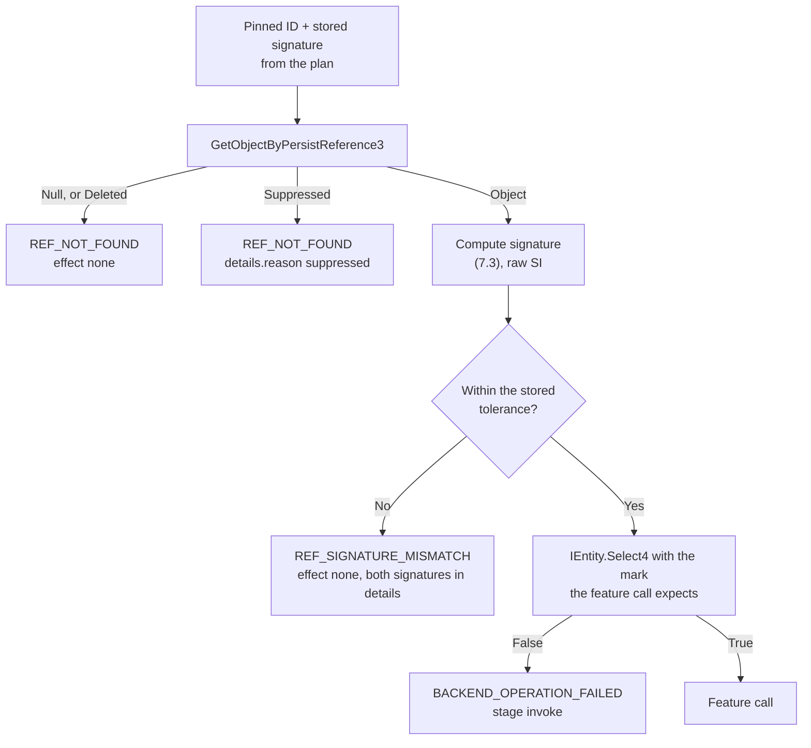

# 8.9 SOLIDWORKS Adapter Interface Specification

> Specification v1.42, section 8.9. Index and section map: [README.md](README.md).

**Status: Accepted by the owner, 2026-11-05. Not built yet.** Architecture: [8.8](../architecture/solidworks-adapter.md). This section extends 6.5, 6.6 and 8.7 and repeats none of their rules. Until the roadmap delivers each part, the schemas and code stay as they are, and the [ADRs](../adr/README.md) say where they must change. JSON here is illustrative. **`schemas/` is the normative form once written (ADR-035).**

**How API facts are marked.** ✔ means measured in the [2026-11-05 spike](../superpowers/review/2026-11-05-part-chain-spike.md). ◐ means the member and its signature were read from the installed interop assembly and its remarks from the installed API help (8.9.11), but it has never been run here. ? means from general API knowledge and unverified. ◐ and ? must both pass a spike before use.

## 8.9.1 Contract map

| Contract | Owner | Consumers | Location | Status |
| --- | --- | --- | --- | --- |
| Operations and read commands | Schemas | Compiler output, job, add-in | `schemas/ipc/` | Exists; extended below |
| `Backend` port | Python application layer | Job layer; `cad-protocol` implements it | `cad_application/ports.py` | Exists |
| Capability profile | Add-in reports it; compiler consumes it | Lowering, job | 6.6, `cad_compiler/profile.py` | Exists; extended in 8.9.7 |
| Error catalogue | Schemas | Everyone | `schemas/common/errors.json` | Exists |
| Execution evidence | Python verification | Job, MCP, humans | `schemas/execution-evidence/v0.json` | Schema exists; the `plan` job writes it from A2 |
| `IOperationHandler`, read handlers | C# Core | Router; Adapters implement | `ExecutionServer.Core/Dispatch` | New, add-in internal |
| Translators and call records | C# Core | Adapters | `ExecutionServer.Core/Parts` | New, add-in internal |
| `ComScope`, `DocumentLocator`, scopes | C# Adapters | Handlers, observers | `ExecutionServer.Adapters/Native` | New, implementation-specific |

The compiler depends only on the first three rows. C# types are never part of the compiler's contract ([ADR-061](../adr/ADR-061-contract-ownership.md)).

## 8.9.2 Backend port

Stays small. No per-feature method is added, since features are data in `ops.apply`.

```python
class Backend(Protocol):
    @property
    def session(self) -> HelloResult: ...
    def apply_ops(
        self, groups: Sequence[OperationGroup], *, meta: Meta | None = None
    ) -> OpsApplyResult: ...
    def measure_part(self, document: str, *, meta: Meta | None = None) -> JsonValue: ...
    def snapshot_drawing(
        self, document: str, sheets: Sequence[str] | None = None, *, meta: Meta | None = None
    ) -> JsonValue: ...
    def completed_operations(self) -> tuple[str, ...]: ...
    def cancel(self, *, meta: Meta | None = None) -> bool: ...
    def close(self) -> None: ...

    # Added in the phase that needs each (both are already named by G2):
    def read_features(
        self, document: str, *, page: str | None = None, meta: Meta | None = None
    ) -> JsonValue: ...  # A3
    def geometry_candidates(
        self, document: str, requests: JsonValue, *, meta: Meta | None = None
    ) -> JsonValue: ...  # A6
```

## 8.9.3 Operations

General rules are 6.5.1. This section adds:

1. **Five stages.** A handler admits, translates, invokes, reads back and reports (8.8.6).
2. **Results are observed.** Every value in `result` comes from SOLIDWORKS after the call, never from the request.
3. **`source` stays in the plan.** The wire carries `node_id` where a native object is created, which is enough to join to the plan's `source`.
4. **No positional or vendor terms in params.** No `T1`, `Sd`, `swEndCondThroughAll` or selection marks.
5. **Lengths in the document's IR unit** in params (mm in the MVP, 6.5.2). The translator converts them once. Read commands return raw SI (8.7).
6. **Standard result fields** for an operation creating a native feature: `native_id`, `feature_id`, `status`, and `node_id` echoed only as the join key. `status` values: `ok`, `warning`, `error`, `suppressed`.
7. **Observation in the result (ADR-064).** An operation that creates a native object also returns `observation`: `native_type`, neutral `type`, `error_code`, `is_warning`, `suppressed`, `parents`, `parameters`, `solid_body_count`, `needs_rebuild`, `update_stamp` and `completeness`, as far as its tier reads them (10.2.2). Reading them must not change the document. A fact that was not read is absent, and `completeness` says why. The schema is `Observation` in `schemas/ipc/v0.json`; parameters are raw SI (`depth_m`).

**Vocabulary by phase.** Names and parameters beyond the MVP are proposals, written to schemas before their phase. Feature names follow 5.3.2 and 5.7. Where a route below says ?, the current evidence for it is in 8.9.11.

| Phase | Operation | Key params | Observed result | Native route |
| --- | --- | --- | --- | --- |
| A1 | `document.open` | `read_only` | `owned`, `instance_id`, `read_only`, `was_open` | `OpenDoc6` ✔, `GetOpenDocumentByName` ✔ |
| A1 | `document.close` | | `closed`, confirmed by lookup | `CloseDoc` ✔ then `GetOpenDocumentByName` ✔ |
| A1 | `document.save` | `target_path` | `path`, `size_bytes`, `dirty` | `SaveAs4` ✔, with its error outputs |
| A2 | `part.create` | `template`, working path | `native_id`, `path`, `instance_id`, `previous_active`, `template` | `NewDocument` ✔, `SaveAs4` ✔ |
| A2 | `sketch.create` | `node_id`, `plane`, `entities` | `native_id`, `feature_id`, `entity_count` | `Select2`, `InsertSketch`, `CreateLine`, `CreateCircleByRadius` ✔ |
| A2 | `feature.create` `extrude`, `cut_extrude` | `node_id`, `type`, `profile`, `end_condition` | `native_id`, `feature_id`, `status` | `FeatureExtrusion3`, `FeatureCut4` ✔ |
| A2 | `document.rebuild` | `force` | `rebuilt` (the call's own return, which does not mean error-free), then `ok` and `errors` (observed afterwards) | `ForceRebuild3` ✔ |
| A4 | `sketch.create` adds `arc` | `center`, `start`, `end` | Same, plus `solved` | ? |
| A4 | `sketch.create` adds `relations`, `dimensions` (5.7.4) | Keyed by ID | `fully_defined`, per-relation result, `dimension_values` | ? |
| A5 | `feature.create` `revolve`, `cut_revolve` | `profile`, `axis`, `angle` | As above | ? |
| A6 | `feature.create` `fillet`, `chamfer` | Pinned `edges`, `radius` or `distance`, `angle` | As above, plus `edge_count` | ? |
| A6 | `sketch.create` on a pinned face | `plane` as a pinned reference | As above | ? |
| A7 | `reference_plane.create` | Offset or angle definition | `native_id`, `feature_id`, `status` | ? |
| A7 | `feature.create` `linear_pattern`, `circular_pattern`, `mirror` | Seed features, direction, count, spacing | Plus `instance_count` | ? |
| A8 | Assembly and drawing groups | 6.5.2, 5.6 | Reviewed when the freeze lifts | Existing, frozen |

**Postconditions** are evaluated by the core from these results (8.8.6), against a contract derived from the IR (10.2.2). The existing names in 6.5.3 are enough to start: `feature_exists`, `feature_status_ok`, `rebuild_ok`, `entity_count`, `parameter_equals`.

## 8.9.4 Read commands

Reads are commands, not operations (6.5.2). They mutate nothing, take no operation ID, and do not touch the ledger.

**`part.measure`** is as specified in 8.7. Addition, roadmap A2: `completeness`, one state per collection (8.9.6).

**`features.read`** implements 5.8, paged. Intended shape, fixed when its schema is written in roadmap A3:

```json
{
  "path": "D:/parts/plate.SLDPRT",
  "instance_id": "i_01J...",
  "configuration": "Default",
  "dirty": false,
  "completeness": { "features": "present", "dimensions": "present", "sketch_geometry": "unsupported" },
  "features": [
    { "feature_id": "f79", "native_type": "Extrusion", "type": "extrude", "tree_order": 21,
      "display_name": "Boss-Extrude1", "status": "ok", "suppressed": false,
      "parents": ["f73"], "dimensions": { "d1": { "value_si": 0.01, "kind": "linear", "full_name": "D1@Boss-Extrude1" } } }
  ],
  "next_page": null
}
```

✔ `GetID`, `GetTypeName2`, and the `RefPlane` order. ? `parents` through `IFeature.GetParents`, the dimension enumeration, suppression state, per-configuration read. Those need a spike (K15) that also proves the document's dirty flag and selection do not change.

**`geometry.candidates`** is as in ADR-049. It is out of this design's scope apart from its phase.

## 8.9.5 Error contract

Errors use the ADR-037 catalogue. A handler either returns a result or throws one catalogued error. A silent catch is a defect.

```json
{ "code": "BACKEND_OPERATION_FAILED",
  "message": "Extrude created no feature",
  "details": {
    "effect": "none",
    "stage": "invoke",
    "native": { "call": "FeatureExtrusion3", "returned": "null" }
  } }
```

| `details` field | Values | Purpose |
| --- | --- | --- |
| `effect` | `none`, `applied`, `unknown` | Whether the document may have changed. **Required on every operation failure from stage 3 on** |
| `stage` | `admit`, `translate`, `invoke`, `read_back`, `report` | Where it failed |
| `native` | `call`, `returned`, `hresult`, `error_code`, each absent when unknown | Diagnostics only. **Agents never branch on it** (ADR-037) |

**Normalization.**

| Native signal | Code | `effect` |
| --- | --- | --- |
| Operation not in the router | `BACKEND_CAPABILITY_MISSING` | `none` |
| Capability absent for this variant | `BACKEND_CAPABILITY_MISSING` | `none` |
| Params fail shape or range checks | `IR_SCHEMA_INVALID` | `none` |
| Part not owned, or path already exists | `AUTH_SOURCE_WRITE_NOT_ALLOWED` | `none` |
| Document not open at that path, or template missing | `FILE_NOT_FOUND` | `none` |
| Document instance is not the one recorded | `EXEC_INTERRUPTED_BY_USER` | `none` |
| Writing to a read-only document | `BACKEND_READ_ONLY` | `none` |
| Feature call returned null ✔ | `BACKEND_REBUILD_ERROR` (6.5.2) | `none`, after confirming the feature count did not change, otherwise `unknown` |
| Feature created with an error status | `BACKEND_REBUILD_ERROR` | `applied` |
| Rebuild reports errors | `BACKEND_REBUILD_ERROR` | `applied` |
| Native call returned false, or its error output is non-zero | `BACKEND_OPERATION_FAILED` | `unknown`, unless proven |
| `COMException` from a native call | `BACKEND_OPERATION_FAILED`, with `hresult` | `unknown` |
| Read-back disagrees with the call's claim | `BACKEND_OPERATION_FAILED` | `applied` or `unknown` |
| A selection call returned false, before any feature call | `BACKEND_OPERATION_FAILED`, `stage: invoke`, `native.call` names it | `none`, once the selection is cleared |
| Sketch left in an over-defined or no-solution state | `BACKEND_OPERATION_FAILED` | `applied` |
| Pinned reference no longer resolves (8.9.12) | `REF_NOT_FOUND` | `none` |
| Pinned reference resolves, signature differs (8.9.12) | `REF_SIGNATURE_MISMATCH` | `none` |
| Modal dialog or blocked UI thread | `BACKEND_UI_BLOCKED` (8.6.3) | `unknown` |
| Cancellation between steps | `EXEC_CANCELLED` | `none` |
| Any other exception (a bug) | JSON-RPC `-32603`, logged with a stack (8.7) | `unknown` |

**Catalogue entry** (`schemas/common/errors.json`, added in roadmap A0). `details` follows `OperationFailureDetails` in `schemas/ipc/v0.json`.

```json
{ "const": "BACKEND_OPERATION_FAILED",
  "description": "A native call failed or its read-back disagreed; details.effect says whether the document may have changed.",
  "x-retryable": "after_fix" }
```

It stops codes such as `BACKEND_LOST` being misused for an ordinary failure (`ViewCreationAdapter.cs:124`, F13), which clients read as a dead session.

**Failed contract (ADR-064).** The add-in does not know contracts, so this is not an operation error and has no `effect` of its own. The core ends the job with `FEATURE_VERIFICATION_FAILED`, with `details.node` and `details.checks`.

**Ledger (owner decision, 2026-11-05; rule in 8.7).** Any operation whose `effect` is `applied` or `unknown` is recorded with its error, so a repeat answers `DUPLICATE_OPERATION` with the original error and never runs again. `session.completed_operations` keeps failures out of `operation_ids` and lists them in `failed_operations`, so crash recovery cannot read one as a success. Jobs already never resend, so this closes a gap in the protective layer and changes no job's normal path.

## 8.9.6 Execution evidence

One file per `plan` job, `jobs/<job_id>/evidence.json`, written once before the final state is reported, and retained with the job (13.2.4). It is built by a pure function:

```python
def build_evidence(
    plan, journal, results, observations, checks, environment
) -> ExecutionEvidence: ...
```

The `parts/` record gains `feature_ids` (already in `part_result`) and `measured`, so reconciliation outlives job retention. `part_result` stays as the summary `get_execution_status` returns. A new optional `evidence_ref` links to the full record.

**Illustrative record: the plate, with the middle shortened.**

```json
{
  "evidence_schema_version": "0.1",
  "job_id": "job_01J...",
  "graph": "part:plate_4h@1",
  "plan_hash": "sha256:3f...",
  "recovered": false,
  "environment": {
    "solidworks": { "version": "2025", "service_pack": "SP0.0", "ui_language": "zh-CN" },
    "addin_version": "0.1.0",
    "protocol": "0.1",
    "profile_hash": "sha256:a1...",
    "template": { "path": "D:/templates/ISO-mm.prtdot", "sha256": "9c..." }
  },
  "outcome": {
    "job_state": "COMMITTED",
    "execution_status": "succeeded",
    "rebuild_status": "ok",
    "verification_status": "passed"
  },
  "contracts": [
    { "node": "extrude_base", "level": "exact", "hash": "sha256:5c...",
      "checks": [{ "name": "feature_exists", "required": true, "expected": true }] }
  ],
  "operations": [
    {
      "plan_op": "op_extrude_base",
      "operation_id": "job_01J...:3",
      "op": "feature.create",
      "source": "extrude_base",
      "execution_status": "succeeded",
      "effect": "applied",
      "native": { "feature_id": "f79", "native_id": 79, "native_type": "Extrusion", "status": "ok" },
      "observation": { "native_type": "Extrusion", "type": "extrude", "completeness": { "type": "present" } },
      "postconditions": [
        { "name": "feature_exists", "status": "passed", "required": true },
        { "name": "feature_status_ok", "status": "passed", "required": true }
      ],
      "error": null
    }
  ],
  "observations": [
    {
      "stage": "in_session",
      "instance_id": "i_01J...",
      "read_only": false,
      "dirty": false,
      "completeness": { "bodies": "present", "cylinders": "present", "features": "present", "mass": "present" },
      "measured": { "solid_body_count": 1, "volume_m3": 5.798938e-05, "bbox_m": { "min": [-0.05, -0.03, 0], "max": [0.05, 0.03, 0.01] } }
    },
    { "stage": "reopened", "instance_id": "i_01K...", "read_only": true, "dirty": false, "completeness": {}, "measured": {} }
  ],
  "checks": [
    {
      "check": "volume",
      "stage": "reopened",
      "requirement": "Part volume equals the IR's",
      "source": ["extrude_base", "cut_holes"],
      "expected": 57989.38,
      "measured": 57989.38,
      "unit": "mm3",
      "tolerance": { "kind": "relative", "value": 0.0001 },
      "method": "IMassProperty, system units",
      "status": "passed"
    }
  ],
  "warnings": [],
  "artifact": { "path": "D:/parts/plate.SLDPRT", "fingerprint": "sha256:77...", "published": true },
  "failed_artifact": null
}
```

**Status values and rules.**

| Field | Values | Rule |
| --- | --- | --- |
| Operation `execution_status` | `not_attempted`, `succeeded`, `failed`, `cancelled`, `unknown` | `unknown` when sent without an answer (13.2.3) |
| Outcome `execution_status` | Same values | `succeeded` only if every planned operation succeeded |
| `rebuild_status` | `ok`, `errors`, `not_evaluated` | From the last `part.measure` of the stage that counted |
| Check and postcondition `status` | `passed`, `failed`, `warning`, `not_applicable`, `not_evaluated` | `not_evaluated` and `not_applicable` need a `reason`. `not_evaluated` reasons: `not_executed`, `unsupported`, `missing_data`, `malformed_data`. Only the IR can make a check `not_applicable`, never the backend (ADR-064) |
| Outcome `failure_class` | `compilation`, `execution`, `feature_verification`, `final_verification`, or absent on success | The stage that ended the job (ADR-064) |
| Operation `blocked_by` | Plan-local ID | On a `not_attempted` operation, the failed operation it depends on, from `depends_on` |
| Outcome `verification_status` | `passed`, `failed`, `not_evaluated` | `failed` if any failed or, in the MVP, is a `warning` (ADR-064, K22), else `not_evaluated` if any required check is, else `passed`. `not_applicable` is ignored. **`passed` requires at least one check for each 10.2.1 row and both observation stages** |
| `completeness` value | `present`, `empty`, `unavailable`, `unsupported` | Missing means `unavailable`. `empty` is never evidence of success by itself (F2) |
| Contract `checks[].not_applicable_reason` | Text | Set from the IR alone, which is how a check becomes `not_applicable` (ADR-064) |

A job reaches COMMITTED only when `execution_status` is `succeeded`, `rebuild_status` is `ok` and `verification_status` is `passed`. A required check that is `not_evaluated` ends the job FAILED.

**After a crash,** recovery writes the record from the journal alone, with `recovered: true`. Operations with no result are `unknown`, and verification is `not_evaluated`. It never invents a result.

**Privacy.** The record holds measurements, IDs and paths, but no sketch or face geometry dump. The `measured` values are the same quantities `part_result` already stores. Nothing here goes to logs (G3).

**Tolerances** are those of 10.2.1, recorded per check. Floats are never compared for exact equality, apart from counts.

## 8.9.7 Capabilities

`HelloResult` keeps its shape. Only the contents of `capabilities`, already an array of strings, gain structure, so no schema change is needed. Names are matched as exact strings:

| Pattern | Meaning | Example |
| --- | --- | --- |
| `<command>` | A read or batch command | `ops.apply`, `part.measure`, `features.read` |
| `op:<op>:<variant>` | One variant of an operation | `op:feature.create:extrude`, `op:sketch.create:arc`, `op:sketch.create:relations` |
| `api.<name>` | An API member newer than the oldest supported version (ADR-045) | `api.annotation_display_data_v2` |

- **Lowering checks the variant** as well as the operation, so a missing feature fails at compile time with `BACKEND_CAPABILITY_MISSING`, as 6.6 requires.
- **`operations`** remains the list of `{op, schema_version}`.
- **`solidworks`** is read, never defaulted. A value that cannot be read fails `ConnectToSW`'s version check, and is never replaced by a guess (F3). ? `ISldWorks.GetBuildNumbers2` may give a more precise service pack than `RevisionNumber`, and resolves the SP0.0 versus SP0.1 disagreement in the records.
- **Router and table.** `session.hello` is built from the registered handlers and `CapabilityTable`, so an operation cannot be listed without a handler, or the reverse (F24).

```csharp
public sealed class CapabilityTable
{
    // Pure and CAD-free: unit-tested with any version.
    public static CapabilityTable For(SolidWorksVersion running);
    public VersionSupport Support { get; }          // Supported, NewerServicePack, Unsupported (ADR-045)
    public IReadOnlyCollection<string> Names { get; }
    public bool Has(string capability);
}
```

## 8.9.8 Add-in interfaces

These are add-in internals, shown as the representative shape. They may change without touching the compiler.

**In `ExecutionServer.Core/Dispatch` (CAD-free).**

```csharp
/// <summary>One operation. Runs on the UI thread; returns plain data; never retains COM objects.</summary>
public interface IOperationHandler
{
    string Op { get; }
    string SchemaVersion { get; }
    IReadOnlyList<string> Variants { get; }

    /// <summary>Throws IpcException with a catalogued code and details.effect on failure.</summary>
    JToken Execute(OperationRequest request);
}

/// <summary>A read-back command, such as part.measure or features.read. Must not change the document.</summary>
public interface IReadCommandHandler
{
    string Method { get; }
    string RequiredCapability { get; }
    JToken Read(JObject parameters, CommandContext context);
}

public sealed class CommandContext
{
    public string? JobId { get; }
    public string? RequestId { get; }
    public CancellationToken Cancellation { get; }
}

public sealed class OperationRequest
{
    public string Document { get; }       // Full path. Bound by the job, never a symbol
    public string OperationId { get; }
    public string Op { get; }
    public JObject Parameters { get; }
    public CommandContext Context { get; }
}

public sealed class OperationRouter : ICommandHandler
{
    public void Register(IOperationHandler handler);
    public void Register(IReadCommandHandler handler);
    public IReadOnlyList<OperationInfo> Operations { get; }   // Feeds session.hello
    // Unknown op: BACKEND_CAPABILITY_MISSING, never recorded in the ledger.
}
```

`ICommandHandler` today has `Snapshot` and `Execute`. It gains `JToken Read(string method, JObject parameters, CommandContext context)`, routed the same way, and `Snapshot` is kept until the freeze lifts. This is compatible with MVP Task 7a's `OperationRouter`.

**Translators, in `ExecutionServer.Core/Parts` (CAD-free).**

```csharp
public sealed class ExtrudeCall
{
    public bool IsCut { get; }
    public EndConditionKind EndCondition { get; }  // This project's enum, not swEndConditions_e
    public double DepthM { get; }
    public bool ReverseDirection { get; }          // Blind cut: true (spike answer 4)
}

public static class FeatureTranslator
{
    /// <summary>Pure. Converts units and applies direction and default rules.</summary>
    public static ExtrudeCall Translate(FeatureCreateParams p);
}
```

Records may replace these classes once an `IsExternalInit` polyfill exists on net48. That is a code style choice, not a contract.

**Native helpers, in `ExecutionServer.Adapters/Native` (implementation-specific, no interface).**

```csharp
/// <summary>Owns temporary COM objects for one scope (G1, ADR-059).</summary>
public sealed class ComScope : IDisposable
{
    public T Own<T>(T comObject) where T : class;  // Enumerators, faces, edges, surfaces, selection data
    public void Dispose();                         // Marshal.ReleaseComObject in reverse order; never FinalRelease
}

public sealed class DocumentLocator
{
    /// <summary>GetOpenDocumentByName by full path ✔. Never ActiveDoc. Throws FILE_NOT_FOUND. Not retained.</summary>
    public IModelDoc2 Require(string fullPath);
}

public sealed class SketchEditScope : IDisposable { /* AddToDB, inference; always leaves sketch mode */ }
public sealed class SelectionScope : IDisposable { /* Clears on entry and exit, owned documents only */ }
```

`IModelDoc2`, `ISldWorks` and manager objects are not put in `ComScope` (ADR-059).

**A handler, in `ExecutionServer.Adapters/Parts`.**

```csharp
public sealed class FeatureCreateHandler : IOperationHandler
{
    public string Op => "feature.create";
    public string SchemaVersion => "0.1";
    public IReadOnlyList<string> Variants { get; } = new[] { "extrude", "cut_extrude" };

    public JToken Execute(OperationRequest request)
    {
        var parameters = request.Parameters.ToObject<FeatureCreateParams>()
            ?? throw new IpcException(ErrorCodes.IR_SCHEMA_INVALID, "Invalid params for feature.create");
        var call = FeatureTranslator.Translate(parameters);          // Stage 2: pure

        var document = _documents.Require(request.Document);
        using var com = new ComScope();
        using var selection = new SelectionScope(document);

        var profile = _features.RequireSketch(document, parameters.Profile);
        var feature = com.Own(_native.Extrude(document, profile, call));  // Stage 3: the one positional call

        if (feature is null)
        {
            throw BackendErrors.FeatureNotCreated(document, parameters.NodeId);
        }

        return FeatureResult.ReadFrom(feature);                      // Stage 4: observed
    }
}
```

**Read command in Python's terms.** The core converts SI at the boundary (8.7), so C# observers perform no unit conversion.

## 8.9.9 Reconciliation contract

```python
class DriftKind(StrEnum):
    MISSING_FEATURE = "missing_feature"
    UNEXPECTED_FEATURE = "unexpected_feature"
    STATUS_CHANGED = "status_changed"  # Suppressed, failed, rolled back
    TYPE_CHANGED = "type_changed"
    PARAMETER_CHANGED = "parameter_changed"
    ORDER_CHANGED = "order_changed"
    GEOMETRY_CHANGED = "geometry_changed"
    FINGERPRINT_CHANGED = "fingerprint_changed"  # File differs; contents not yet read
    NOT_COMPARABLE = "not_comparable"  # Unrecognized type or unavailable data


@dataclass(frozen=True, slots=True)
class Drift:
    kind: DriftKind
    node: str | None  # IR node, when bound
    feature_id: str | None  # Native, when present
    expected: JsonValue
    actual: JsonValue
    method: str


def reconcile(graph, bindings, read_graph, measured, expected, tolerances) -> DriftReport: ...
```

Pure, in `cad-verification`. `DriftReport.state` is one of `in_sync`, `diverged`, `not_comparable`. `in_sync` requires every comparison to have run, so `NOT_COMPARABLE` prevents it. Limits are 8.8.9.

## 8.9.10 Test contract

| Level | Runs where | Covers | Must show |
| --- | --- | --- | --- |
| **Unit** | Hosted CI, no SOLIDWORKS | Translators, router, ownership, capability table, version parsing, error rules, `build_evidence`, `reconcile`, `expected_geometry`, `compare` | Blind cut direction per plane; `ParseRevision` for real revision strings; an unknown operation is an error; `not_evaluated` never becomes `passed`; drift kinds from fixtures |
| **Contract** | Hosted CI | Schema fixtures, transcripts (15.5), a fake `IOperationHandler` through `IpcSession` | Both languages agree; `details.effect` present; R1 by masked transcript comparison |
| **Integration** | Live: a throwaway SOLIDWORKS instance, never the owner's working session | Document lifecycle, each handler, read-back, events, settings restore, COM leak test, error mapping with real failures | Each row of 8.9.3 and 8.9.5 is exercised, and the suite reports which ones ran (15.6) |
| **Verification** | Live | Real models measured against IR values | See below |

**Verification cases.** Each feature ships with these, and each has a seeded defect, so the checks are proven to fail. A verification test with no seeded failure proves nothing.

| Check | Tolerance | Seeded defect |
| --- | --- | --- |
| Feature exists and type matches, by `feature_id` | Exact | Extra sketch or feature; missing cut |
| Extrude depth | Through bbox ±0.01 mm, and volume | Plan depth 9 mm, graph 10 mm |
| Solid body count | Exact | Cut that splits the body |
| Bounding box | ±0.01 mm per axis | Moved profile |
| Volume, surface area | ±0.01% | Missing hole |
| Center of mass | ±0.01 mm per axis | Asymmetric hole |
| Cylinders | Axis position and radius ±0.01 mm; direction parallel | Moved holes with the same volume and box |
| Rebuild | No errors | Feature forced into an error state, if a repeatable way exists |
| Failed or suppressed features | None unexpected | Suppressed feature |
| Save and reopen | All the above on a new `instance_id`, `dirty` false | File replaced while closed (spike answer 12) |

Each check in a per-operation contract (10.2.2) also has a seeded failure, offline, against a recorded observation. Tolerances come from 10.2.1. Curved bodies need K12 before any curved feature ships. Parts whose expected values cannot be computed exactly need K16.

## 8.9.11 API capability mapping

**Status: Proposed for phases A4 to A7.** Operation names and phases are 8.9.3. This adds the native route, the evidence for it, and what the IR's meaning costs at that route.

**Sources and their limits.** All read on 2026-11-05 without starting SOLIDWORKS:

- **Signatures** come from reflecting `SolidWorks.Interop.sldworks.dll` and `SolidWorks.Interop.swconst.dll`, file version 33.0.0.5050, from the local install of SOLIDWORKS 2025. This confirms that the member exists and its parameter list, on this install.
- **Remarks and obsolete status** come from `sldworksapi.chm` and `sldworksapiprogguide.chm` of the same install. The public equivalents are `https://help.solidworks.com/2025/english/api/sldworksapi/SolidWorks.Interop.sldworks~SolidWorks.Interop.sldworks.<Interface>~<Member>.html`.
- **The installed help matches that install, and the public site is later (2025 SP05).** They were not compared. Help text says what a member is documented to do, not that this project's call sequence works. Nothing marked ◐ has been run.

| IR (§22) | Operation | Native route | Steps and selections, per the help | Evidence |
| --- | --- | --- | --- | --- |
| `sketch` on a standard plane | `sketch.create` | `IFeature.Select2`, `ISketchManager.InsertSketch`, `CreateLine`, `CreateCircleByRadius` | Plane selected; `AddToDB` and `AutoInference` scoped; leave sketch mode in `finally` | ✔ |
| Sketch `arc` | `sketch.create` | `ISketchManager.CreateArc`, 10 parameters | Centre, start, end, `Int16 Direction`: +1 counter-clockwise, -1 clockwise | ◐ |
| Construction line | `sketch.create` | `ISketchManager.CreateCenterLine`, 6 parameters | | ◐ |
| Sketch `point` | `sketch.create` | `ISketchManager.CreatePoint`, 3 parameters | Returns `SketchPoint` | ◐ |
| Sketch relation | `sketch.create` | `ISketch.RelationManager` (a property; there is no `GetRelationManager`), then `ISketchRelationManager.AddRelation(object Entities, int RelationType)` with `swConstraintType_e` | **A sketch must be active.** Takes entities directly, so it needs no selection. `IModelDoc2.SketchAddConstraints` also exists, but works from a selection and a string name, and is not used | ◐ |
| Sketch dimension | `sketch.create` | `IModelDocExtension.AddDimension(x, y, z, direction)`, or `IModelDoc2.AddDimension2`. Value through `IDimension.SetSystemValue3` | **Multi-step.** Pre-select the entities, place the text by coordinates, then set the value. The help tells callers to select by location, not by name. See K27 | ◐ |
| Constraint state | Observation | `ISketch.GetConstrainedStatus`, `swConstrainedStatus_e` | No parameters | ◐ |
| `extrude` | `feature.create` | `IFeatureManager.FeatureExtrusion3`, 23 parameters | Sketch selected with `Select2(false, 0)` | ✔ |
| `cut_extrude` | `feature.create` | `IFeatureManager.FeatureCut4`, 27 parameters | Same. Blind needs `Dir=true` (5.7.4) | ✔ |
| `revolve`, `cut_revolve` | `feature.create` | `IFeatureManager.FeatureRevolve2`, 20 parameters; `IsCut` selects a cut | Sketch mark 0, axis mark 4 or 16, up-to entity mark 32. Angles in radians | ◐ |
| `sweep`, `swept_cut` | `feature.create` | `IFeatureManager.CreateDefinition(swFmSweep` or `swFmSweepCut)`, `ISweepFeatureData`, `CreateFeature` | Profile mark 1, path mark 4, guide mark 2, direction mark 128. The programming guide selects with `SelectByRay`. **`InsertProtrusionSwept4` and `InsertCutSwept5` are obsolete** as of the 2018 sweep architecture | ◐ |
| `loft`, `lofted_cut` | `feature.create` | `IFeatureManager.InsertProtrusionBlend2`, 18 parameters; `InsertCutBlend`, 12 parameters | Profile mark 1, guide mark 2, centerline mark 4. **Selection order sets the loft direction.** Profiles must be closed for a solid. Not marked obsolete, and not in `CreateDefinition`'s list of default-initialized types | ◐ |
| `fillet` (constant radius) | `feature.create` | `CreateDefinition(swFmFillet)`, `ISimpleFilletFeatureData2.Initialize(swSimpleFilletType_e)`, `DefaultRadius`, `Edges`, `CreateFeature` | **`FeatureFillet3` is obsolete for constant-radius fillets as of 2020.** `Initialize` is required, and the help says the type is then narrowed through `ConicTypeForCrossSectionProfile` | ◐ |
| `chamfer` | `feature.create` | `IFeatureManager.InsertFeatureChamfer`, 8 parameters; `swChamferType_e`: `AngleDistance`, `DistanceDistance`, `EqualDistance`, `Vertex` | Edges pre-selected; the remarks read do not state the marks. Vertex distances on a non-linear edge are arc lengths | ◐ |
| `linear_pattern` | `feature.create` | `CreateDefinition(swFmLPattern)`, `ILinearPatternFeatureData` (`D1TotalInstances`, `D1Spacing` in metres, `D1Axis`, `PatternFeatureArray`), `CreateFeature` | **`FeatureLinearPattern5` is obsolete.** Its help documents direction mark 1 and features mark 4, with `IEntity.Select4` and `IFeature.Select2` allowed. Whether the data-object route needs them is unverified | ◐ |
| `circular_pattern` | `feature.create` | `CreateDefinition(swFmCirPattern)`, `ICircularPatternFeatureData` (`TotalInstances`, `Spacing`, `Axis`, `EqualSpacing`), `CreateFeature` | **`FeatureCircularPattern5` is obsolete.** Same note | ◐ |
| `mirror` | `feature.create` | `IFeatureManager.InsertMirrorFeature2`, 5 parameters | Features mark 1, bodies mark 256, plane or planar face mark 2 | ◐ |
| `plane` | `reference_plane.create` | `IFeatureManager.InsertRefPlane`, 6 parameters; `swRefPlaneReferenceConstraints_e` | Entities marks 0, 1, 2. Returns an untyped object | ◐ |
| `axis` | `reference_axis.create` (name proposed) | **`IModelDoc2.InsertAxis2(bool)`**, not on `IFeatureManager` | Returns only a boolean, so the handler must find the new feature afterwards (`FeatureByPositionReverse(0)` found sketches ✔) | ◐ |
| `coordinate_system` | `coordinate_system.create` (name proposed) | `IFeatureManager.InsertCoordinateSystem`, 3 parameters | Remarks not read | ? |
| `hole_wizard` | `feature.create` | `IFeatureManager.HoleWizard5`, 27 parameters | Signature only | ? |
| Forced rebuild | `document.rebuild` | `IModelDoc2.ForceRebuild3(bool TopOnly)` | The return value is not a health verdict (10.2.2) | ✔ |

**Names this project must not assume.** Reflection showed these do not exist on the 2025 interop, though they look plausible: `IFeatureManager.FeatureCut5` and `InsertAxis2`, `ISketch.GetRelationManager`, `ISafeEntity`, `IMassProperty.SelectedItems` (it is on `IMassProperty2`) and `IModelDocExtension.GetLastError2`.

### Route choice

[ADR-068](../adr/ADR-068-native-feature-call-routes.md) (Proposed) sets the rule: **use the feature-data route where the help marks the positional call obsolete, and the positional call otherwise,** behind one method per native call (8.8.10). A feature-data route has a cost. Defaults come from SOLIDWORKS rather than from the argument list, so every property the IR relies on must be set explicitly and read back, or a change of defaults on a later version is silent.

### Gaps between IR meaning and the API

| IR says | SOLIDWORKS does | Who closes the gap |
| --- | --- | --- |
| `blind` runs along the sketch normal, for both types | A blind cut defaults the other way ✔ | Translator, per type |
| Selection through entities only (8.3 rule 11) | Most feature help documents `SelectByID2` | K26: the same marks with `Select2` and `Select4`. Only sketches and extrudes are proven |
| A sketch dimension is one value | Needs pre-selection, a text position and a value set | Handler. The text position is derived and carries no meaning. K27 |
| A sketch stores final geometry | The solver may move it | Seed consistency (22.4.4). K27 |
| Angles in degrees | Radians | Translator (8.3 rule 9) |
| `cut_revolve` is its own type | One call with `IsCut` | Translator |
| A reference plane or axis is a typed node | `InsertRefPlane` returns an object, and `InsertAxis2` a boolean | Handler finds and returns the feature, or fails |
| A feature is created or not | A call can return null, or create a feature with errors under `AllowFailedFeatureCreation` | Handler, 8.9.5 |
| Changing a parameter (section 9) | `ModifyDefinition` may return true and leave a rebuild error or unpredictable state | `feature.update` reads back, and treats doubt as `unknown` (23.8) |

## 8.9.12 Reference resolution in the adapter

The split is ADR-049: the add-in gathers and dereferences, and Python decides. This specifies the add-in's half.

**No handles are held.** A command looks up what it needs and drops it (G1). Between commands, the adapter's "handles" are plain values:

| Handle | Form | Valid for | Evidence |
| --- | --- | --- | --- |
| Document | Full path plus `instance_id` | While open; a reopen gets a new `instance_id` | ✔ |
| Feature | `f<IFeature.GetID()>` | Across close and reopen on the plate. Further cases: K14 | ✔ |
| Standard plane | Role, by `RefPlane` order and checked normal | The document | ✔ |
| Face, edge, vertex | Base64 of `GetPersistReference3` bytes, plus the signature it matched | Until use proves otherwise | ◐ |

**Native identifiers, from the help.** The verdicts are [ADR-067](../adr/ADR-067-entity-identity-ladder.md) (Proposed).

| Identifier | Documented behaviour | Verdict |
| --- | --- | --- |
| `IModelDocExtension.GetPersistReference3` | Persists across sessions, and is portable. The internal bytes may change from rebuild to rebuild or between releases, while finding the right entity stays consistent | **Use, for pinning.** Never compare bytes: the spike's identical feature references do not make that safe |
| `GetObjectByPersistReference3` | Out error code; `swPersistReferencedObject_Suppressed` and `_Deleted` apply to topological entities. Often returns a feature base class | **Use, at execution.** Mapped below |
| `IEntity.GetSafeEntity` | Valid after rebuilds until the entity is deleted, and does not persist between sessions | **Only within one command,** across a rebuild inside that command |
| `IFace2.SetFaceId`, `GetFaceId` | Saved with the document, but **removed whenever the document is rebuilt** | **Never** |
| Tracking IDs (`IFace2.GetTrackingIDs`) | Live until a rebuild. They propagate across splits, unlike the others. Persisting them needs a macro feature | **Never.** Macros are out (section 14) |
| `IPartDoc.SetEntityName`, `GetEntityByName` | Stored in the part, and will not rename a named entity | **Not by default.** It writes to the document, so never on a source part (ADR-022). A possible option on a job-owned working part, unmeasured |
| Attributes (`IAttributeDef.CreateInstance5`) | The guide says they behave like features | **Not for parts,** for the same reason. K9 evaluates them for drawings |
| Face or edge index in an enumeration | No promise | **Never** (1.3 principle 5) |

**Using a pinned reference, inside an operation:**



**Invalidation and re-resolution.**

- The add-in **never re-resolves.** A failed reference fails the operation. Choosing a replacement is a decision, and decisions are Python's (ADR-049, 7.4).
- After a rebuild, a pinned ID is checked again on next use, never assumed. There is no cache to invalidate, because nothing is held between commands.
- Re-resolution is a new `geometry.candidates` round and a new compile, with a new plan hash, from the authored role. A running job does not do this: it fails (8.8.8).
- **Ambiguity** is decided in Python only (`REF_AMBIGUOUS`, 7.4). `GetObjectByPersistReference3` answers with one object, so the add-in cannot see ambiguity at use. The signature re-check is what catches a wrong one.

**Limits of topological naming, stated plainly.** A persistent reference and a matching signature show that an entity is plausibly the same, not that it means the same (7.5). A split face may resolve to one part of itself. Two symmetric faces have equal signatures apart from position. How persistent references behave across a topology-changing rebuild has not been measured on any entity: K28. Measuring the result (10.2.1) is the backstop for what references cannot promise.

## 8.9.13 Verification evidence the adapter exposes

The adapter reports **raw observations** only. Conclusions are pure Python's (ADR-063). Observers never rebuild, modify, or use `AccessSelections` (ADR-064).

| Fact | Field | Native source | Evidence | Tier or command |
| --- | --- | --- | --- | --- |
| Feature exists, its type | `feature_id`, `native_type` | `IFeature.GetID`, `GetTypeName2` | ✔ (K21 for variants) | T0 |
| Feature health | `error_code`, `is_warning` | `IFeature.GetErrorCode2` | ◐ | T0 |
| Suppression | `suppressed` | `IFeature.IsSuppressed2` | ◐ | T0 |
| Direct parents | `parents` | `IFeature.GetParents` | ◐ | T0 |
| Feature tree | `features` | Traversal from `IPartDoc.FirstFeature` | ◐ | `part.measure`, `features.read` |
| Change stamp | `update_stamp` | `IModelDoc2.GetUpdateStamp` | ◐ | T0 |
| Rebuild status | `rebuild`, `needs_rebuild` | `IModelDocExtension.GetWhatsWrong`, `NeedsRebuild2` | ◐ (K19) | T1, `part.measure` |
| Sketch entity count | `entity_count` | `ISketch.GetSketchSegments` | ◐ | T0 |
| Sketch constraint state | `constraint_state` | `ISketch.GetConstrainedStatus` | ◐ | T0, from A4 |
| Feature parameters | `parameters` (`depth_m`) | `IFeature.GetDefinition`, then typed getters, or `IDimension.GetSystemValue3` | ◐ (K15) | T1 |
| Body count | `solid_body_count` | `IPartDoc.GetBodies2` | ✔ | T1, `part.measure` |
| Bounding box | `bbox_m` | `IBody2.GetBodyBox` | ✔ prismatic only (K12) | T3 |
| Volume, area, center of mass | `volume_m3`, `surface_area_m2`, `center_of_mass_m` | `IModelDocExtension.CreateMassProperty`, `UseSystemUnits = true` | ✔ (K20: marked obsolete) | T2, T3 |
| Cylindrical faces | `cylinders_m` | `IBody2.GetFaces`, `ISurface.IsCylinder`, `CylinderParams` | ✔ | T3 |
| Other face and edge data | `geometry.candidates` signature (7.3) | `IFace2`, `IEdge`, `ISurface`, `ICurve` | ◐ | A6 |
| Body validity | Not yet requested | `IBody2.Check3` | ◐ | Later |
| Measurement between entities | Not yet requested | `IModelDocExtension.CreateMeasure`, `IMeasure.Calculate` (`Distance`, `Angle`, `Radius`) | ◐ | Later, if a contract needs it |
| Persistent reference | Handle in 8.9.12 | `GetPersistReference3` | ✔ features; ◐ entities | `geometry.candidates` |
| Document state | `dirty`, `read_only`, `instance_id` | `IModelDoc2.GetSaveFlag`, `IsOpenedReadOnly`, the add-in | ✔ | Every read command |

**Observation is not conclusion.**

| Adapter reports | Pure Python concludes |
| --- | --- |
| `volume_m3: 5.798938e-05` | "Volume within ±0.01% of 57989.38 mm³: passed" |
| `error_code: 0`, `is_warning: false` | "`feature_status_ok`: passed" |
| `solid_body_count: 2` | "Bodies: expected 1: failed" |
| `completeness: { "parameters": "unsupported" }` | "`parameter_equals`: `not_evaluated`, `unsupported`" |
| `rebuild: { "ok": true, "errors": [] }` | "Rebuild: passed". The field means "no errors reported", not that the model is right |

## 8.9.14 Where the adapter's concerns are specified

The adapter design is split across existing sections. This maps common questions to the rule that answers them, so nothing needs restating.

| Concern | Authority |
| --- | --- |
| Boundaries and layers | [8.8.5](../architecture/solidworks-adapter.md#885-layers-and-boundaries), ADR-058, ADR-061 |
| Application host, COM interop, document lookup, selection and sketch scopes | 8.8.5, 8.8.7 (Session state), 8.9.8 |
| Rebuild points | 8.8.7 (Rebuild boundaries) |
| STA thread and affinity, dispatch, re-entrancy | 8.3, 8.6.2, 8.8.7, ADR-059 |
| Application and document lifecycle | 8.6.1, 8.6.5, ADR-028, ADR-046 |
| COM ownership and release | G1, ADR-059, `ComScope` in 8.9.8 |
| Exceptions at entry points | ADR-059, 8.8.7 |
| Timeouts and cancellation | 8.6.3, 8.4, 8.3 rule 8 |
| Recovery from a failed operation | 8.8.8, 13.2.3. A working file with unknown contents is never repaired |
| Error categories | 8.9.5 |
| Version differences | 8.8.10, ADR-045, ADR-062. Nothing version-specific reaches the IR or the compiler beyond a capability name |

**The operation lifecycle** is the five stages of [8.8.6](../architecture/solidworks-adapter.md#886-the-operation-handler):

| Step | Stage |
| --- | --- |
| Receive; check capabilities; validate inputs | 1 Admit. Shape and range also in 2 |
| Resolve references | 3 Invoke, as its first native step (8.9.12). Python already pinned them |
| Prepare state; execute API calls; check the API result | 3 Invoke, inside scopes |
| Rebuild if required | Only as a named step (8.8.7), never implicit. Native regeneration happens by itself |
| Collect result handles | 4 Read back |
| Return a structured result | 5 Report |
