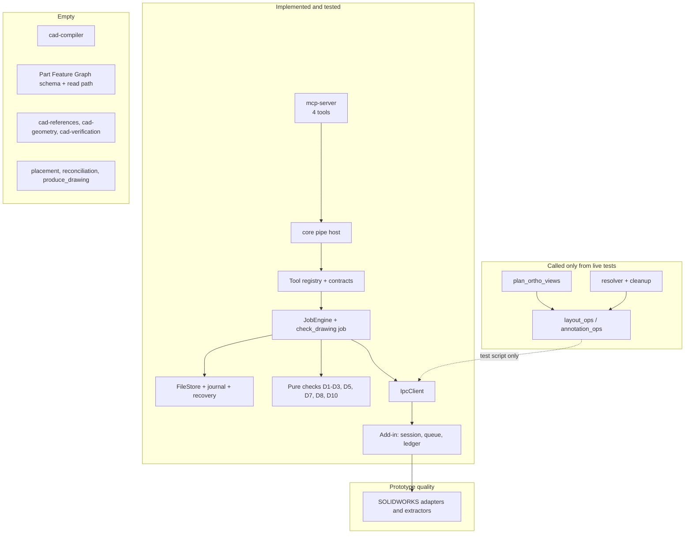

# sw-mcp Architecture Review

**Date:** 2026-11-05
**Reviewed:** branch `feat/drawing-annotation-pipeline` at commit `eea9389`, specification v1.27, ADR-001 to ADR-055, plus the uncommitted ADR-056 and spec edits described in section 7.
**Scope:** whole system: IRs, compiler, backend, add-in, IPC, execution, verification, persistence, MCP, testing, extensibility.
**Companion:** [2026-11-05-architecture-roadmap.md](2026-11-05-architecture-roadmap.md).
**Status:** Findings for owner review. No decision here is approved, and no ADR or specification was changed by this review.
**Revision:** Revision 2, 2026-11-05 (same commit; see section 2.3). F1 to F38 and P1 to P15 keep their IDs. Revision history is in section 11.

Evidence labels:

- **Confirmed:** read in the code or spec, or reproduced by running it.
- **Inferred:** follows from confirmed code, but the runtime effect was not observed.
- **Requires Validation:** depends on SOLIDWORKS behaviour or evidence this review could not obtain.

Text marked **Recommendation** or **Fix** is a proposal, not a fact, and has not been implemented. No finding in this document has been fixed unless it says so; none has at this revision. No statement here rests on a live SOLIDWORKS run made by this review.

---

## 1. Verdict

The architecture on paper is sound and worth keeping. The contract layer, job engine, journal, store and pure check logic are well built. The problem is narrower and more urgent: **the add-in adapters do not yet deliver what those layers assume, and the project's status reports do not reflect that.**

Three facts decide what to do next:

1. **The drawing checks do not currently test real drawing geometry.** The add-in never calls `GetDisplayData` or `GetPolylines7`, so D1, D2 and D3 pass on empty data. The "0 violations" live result in `HANDOFF.md` is true but carries no information about those three checks.
2. **The add-in can act on the wrong document and can close an engineer's open drawing.** It ignores the document named in a batch, ignores `read_only`, and always reports `owned: true`.
3. **Operations can report success without doing anything.** An unknown operation returns `status: applied` and is recorded as completed.

No report can reach the `done` verdict today, because D4, D6 and D9 are always `not_evaluated`. So nothing has yet been falsely certified. That protection disappears as soon as those checks are implemented, which is the current "Next Steps" direction. **These defects must be fixed before more drawing features are built on them.**

The fixes are evolutionary. No rewrite, new service, or new IR is needed.

---

## 2. Evidence

### 2.1 Verification suite, run during the original review

| Command | Result |
| --- | --- |
| `uv run python scripts/generate_contracts.py --check` | Pass |
| `uv run ruff check` | Pass |
| `uv run ruff format --check` | **Fail, on one file only:** `docs/superpowers/review/2026-11-05-drawing-execution-pipeline-review.md`, which is untracked and was written by another author during this review. No code is affected |
| `uv run pyright` | 0 errors, 0 warnings |
| `uv run lint-imports` | 5 contracts kept, 0 broken |
| `uv run pytest -m "not live"` | 2,712 passed, 6 deselected |
| `dotnet test .../ExecutionServer.Tests.csproj` | 241 passed, 0 failed |
| `dotnet build .../ExecutionServer.sln` | **Not verified.** MSB3027: the running SOLIDWORKS (PID 8548) has the add-in DLLs locked. This says nothing about the code. SOLIDWORKS was deliberately left running |
| `uv run pytest tests/live -m live` | **Not run.** It would drive the engineer's live SOLIDWORKS session. The live results cited here come from `HANDOFF.md` |

### 2.2 Probes

Read-only scripts ran the pure packages on snapshots shaped exactly as `AnnotationExtractor.cs` and `ViewExtractor.cs` produce them. They live outside the repository. Results are observed behaviour of the Python packages, not of SOLIDWORKS. Revision 1 renamed these from `P1`-`P7` to `Probe 1`-`Probe 7`, because the old labels clashed with proposals P1 to P15.

| # | Input | Observed |
| --- | --- | --- |
| Probe 1 | Dimensions with no lines or text; views with no edges | D1, D2, D3, D7 all `pass` |
| Probe 2 | Ten dimensions, none with geometry | D1, D2, D3, D7 all `pass` |
| Probe 3 | One parameter dimensioned in two views | One hide action planned, but **0 scheme entries become `hidden`** |
| Probe 4 | Critical dimension `param: bore_1.diameter`, annotation parameter `D1@Sketch1@part.SLDPRT` | No match; tolerance stays `general` |
| Probe 5 | Localized parameter `D1@草图1@部件.SLDPRT`; a dimension with no parameter | Entry IDs `ds__1___1___________04ca72` and `ds___2_d91f93`; the second is derived from the native name `RD2` |
| Probe 6 | `plan_annotation_insertion_ops` called twice with defaults | Identical operation IDs (`ann:model_items:0`) |
| Probe 7 | Planned layout and scheme checked against their schemas | 0 issues, although the layout breaks the 11.11 rule that a sheet has exactly one of `template` or `sheet_format` |
| Probe 8 | Snapshot with no sheets | D1, D2, D3, D7 all `pass`; verdict `not_evaluated` only because other checks are |
| Probe 9 | Sheet with no views or annotations, as produced if `GetViews` fails | D1, D2, D3, D7 all `pass` |
| Probe 10 | Identical document, `captured_at` one second apart | `content_hash` values differ |
| Probe 11 | Same native name hashed twice, at 10 and 16 characters | Equal at both lengths, so widening cannot separate them |
| Probe 12 | Dimension with line-work lists omitted | Parses to empty tuples, the same as lists read and found empty |
| Probe 13 | Dimension with `parameters` omitted | Parses to `None`, which keeps "unread" distinct |

Probes 8 to 13 were added and run for Revision 1.

### 2.3 State at Revision 1 (verified 2026-11-05)

| Item | Result |
| --- | --- |
| `HEAD` | Still `eea9389`; `git diff eea9389 HEAD` is empty |
| `packages`, `apps`, `schemas`, `tests`, `scripts` | No uncommitted changes, so every code observation in this review still applies |
| `GetDisplayData` or `GetPolylines` in adapters | Still none |
| `Guid.NewGuid` keys, `owned = true`, `status = applied`, `ActiveDoc` in adapters | Still present |
| `docs/specifications/assumptions.md` | Still absent |
| Uncommitted other-author documents (section 7) | Still uncommitted; the pipeline review still says "Approved for Implementation" |
| `uv run pytest -m "not live"` | 2,712 passed, 6 deselected (re-run) |
| `dotnet test .../ExecutionServer.Tests.csproj` | 241 passed, 0 failed (re-run) |
| `uv run ruff format --check` | Same single failure as 2.1; the two review documents are not flagged (re-run after these edits) |
| `dotnet build .../ExecutionServer.sln` | **Not re-run.** SOLIDWORKS PID 8548 is still running and the original lock is expected to apply |
| Live suite | **Not run.** No live SOLIDWORKS verification was performed for this revision |

---

## 3. Current Architecture

### Assessment by area

| Area | Current design and responsibility | Boundaries | Assessment |
| --- | --- | --- | --- |
| Layering | `apps → cad-application → pure packages`, ports for effects, enforced by `lint-imports` | Correct and enforced | **Strong** |
| Contracts | `schemas/` generates Python and C# IPC types through a project generator (ADR-051) | Correct for IPC. IR models are hand-written (F14) | **Strong, with one gap** |
| IR modules | Drawing Template is deep (rules, parsing). Intent, Layout and Scheme are thin. Part Feature Graph, Assembly and Design Intent are absent | The module separation in 3.3 is right | **Good design, one-third built** |
| Compiler | Empty package, specified carefully in 6.7 | Stage contract is well defined | **Correctly deferred** |
| Drawing pipeline | Pure functions plus lowering, sequenced by a test script | No orchestrator; intent is not used | **Prototype** |
| Backend port | `snapshot_drawing`, `apply_ops`, `completed_operations`, `cancel` | Neutral and small; no `close` (F7), no model read (F11) | **Good shape, incomplete** |
| Add-in core | `IpcSession`, `OperationLedger`, framing, dispatcher, all CAD-free | Clean, tested through transcripts | **Strong** |
| Add-in adapters | Direct SOLIDWORKS calls | Isolated correctly; contents are not trustworthy (F1, F3 to F6) | **Weakest part of the system** |
| Job engine and journal | State machine, write-ahead `batch_sent`, journal-wins recovery | Exactly matches ADR-032 and 13.2.3 | **Strong** |
| Verification | Pure functions of a snapshot | Independent of execution, as intended | **Strong logic, starved of data** |
| MCP layer | Thin stateless front-end over a core pipe | Correct shape; protocol details diverge (F15) | **Right design, weak conformance** |
| Observability | Python JSONL with correlation; add-in has one load log | Python good, add-in absent (F13) | **Half built** |
| Testing | 2,950+ fast tests, contract fixtures, transcripts | Very strong below the adapters; blind at them (F16) | **Strong, with one blind spot** |

---

## 4. Findings

Each finding gives its location, current behaviour, the problem, consequences, the recommended fix, and timing.

### Critical

#### F1. The snapshot contains no drawing geometry

- **Evidence:** Confirmed. `GetDisplayData` and `GetPolylines` have zero occurrences in the adapters.
- **Location:** `ExecutionServer.Adapters/Drawings/ViewExtractor.cs:73` (`edges` is always an empty array), `AnnotationExtractor.cs:110-152` (a dimension gets only `kind`, `native_id`, `view`, `parenthesized`, `parameters`).
- **Spec:** 11.5 requires `IAnnotation.GetDisplayData` and `IView.GetPolylines7`; ADR-014, ADR-031.
- **Problem:** Dimensions have no lines, arrowheads or text boxes, and views have no edges. D1, D2, D3 and all soft metrics have nothing to test. D7 tests only view outlines.
- **Consequences:** The P0 capability is unverified. The anti-goal "a drawing reported as done that has crossing dimensions" becomes reachable once the remaining checks exist. Assumptions A1 and A4 (read-back performance and text extents) have never been exercised, so the core design bet of ADR-028 is unproven.
- **Fix:** Implement real read-back in the adapters, record snapshots from real drawings as fixtures, and add a live negative test with a seeded crossing. Nothing above the adapter changes.
- **Timing:** **Now.**

#### F2. Geometry checks report `pass` for data that was never read

- **Evidence:** Confirmed, Probes 1, 2, 8, 9, 12.
- **Location:** `cad_drawing/checks/runner.py:34-37`; spec 11.5.2.
- **Current behaviour:** `status()` returns `pass` whenever no failure exists. D5, D8 and D10 have `not_evaluated` paths and 11.5.3 states "a check is never `pass` when part of it did not run", but that rule sits in the section about checks without a Drawing Intent. D1 to D3 and D7 have no such path.
- **Problem:** The snapshot contract says a field the add-in could not read is left out. The checks read absence as absence of a defect.
- **Consequences:** Any future extraction failure, including one of the 21 swallowed exceptions in the adapters (F13), silently produces a pass. The fix to F1 alone would not close this.
- **Fix:** Make the rule global in 11.5. A `dimension` without lines and text boxes, or a sheet whose views report no read edges, yields `not_evaluated` with a new reason such as `geometry_data_missing`. This is a small pure change with a spec update.
- **Timing:** **Now, first.** It is cheap and immediately makes every report honest.

**Revision 1: snapshot completeness contract.** The fix above is necessary but not sufficient, because the snapshot cannot express whether a collection was read.

- **Finding:** An empty collection is ambiguous. Today it can mean "read, and nothing there", "the read failed", or "never attempted".
- **Evidence (Confirmed):**
  - `schemas/drawing-geometry-snapshot/v0.json` has no completeness field, and requires `edges` on every view, so the add-in must write `[]` even when it read nothing (X31).
  - `parse_snapshot` turns omitted line-work lists into empty tuples (Probe 12).
  - `ViewExtractor.cs:33-40` swallows a `GetViews` failure and returns no views. `AnnotationExtractor.cs:25-29` does the same for annotations. `DrawingSnapshotAdapter.cs:135` silently skips a sheet it cannot get.
  - These failures give a clean-looking result, and all four geometry checks pass (Probes 8, 9).
  - A precedent exists: `parameters`, `parenthesized`, `rebuild` and `title_block_fields` already use absence for "unread" (Probe 13, 11.5.3). The gap is that line work, edges, views and annotations have no such state.
- **Definition to adopt:**

  | State | Meaning | Example | Effect on checks that need it |
  | --- | --- | --- | --- |
  | `PRESENT` | Read successfully; contains items | A view with polylines | The check runs |
  | `EMPTY` | Read successfully; genuinely contains nothing | A sheet with no annotations, reported by a call that succeeded | The check runs and can pass for that item. Another check, such as D4, may still fail the drawing |
  | `UNAVAILABLE` | The read failed or could not be done | API exception, lightweight or draft view, a skipped sheet | `not_evaluated`, with a reason |
  | `UNSUPPORTED` | This backend does not provide this data type | A capability absent from the profile (6.6) | `not_evaluated`, with a distinct reason, because repeating the read will not help |

- **Rules for verification:**
  1. **An empty collection is never evidence of a successful read.** Only an explicit state is.
  2. **No declared state means `UNAVAILABLE`.** This fails safe, keeps old snapshots readable, and fits ADR-042's additive changes.
  3. **A found failure still wins.** A real crossing among `PRESENT` items is `fail`, even if another view is `UNAVAILABLE`. This is the existing 11.5.3 precedence: `fail`, then `not_evaluated`, then `pass`.
  4. **State applies where data can fail separately:** the sheet list; each sheet's views, annotations, border and title block; each view's edges; each annotation's geometry. One unreadable view must not hide results for the others.
  5. **A text box measured by `font_metrics` is `PRESENT`.** Its `method` already records how it was obtained (11.5).
  6. **Sheets excluded by the `sheets` argument are out of scope**, not `UNAVAILABLE`. A requested sheet that is missing stays an error (8.7).
  7. **A drawing with no sheets is `UNAVAILABLE`**, since a SOLIDWORKS drawing always has at least one.
- **Which check needs what:**

  | Check | Requires |
  | --- | --- |
  | D1 | Annotation line work: dimension lines, extension lines, arrowheads, leaders |
  | D2 | Line work and text boxes |
  | D3 | Text boxes, view edges, center marks and centerlines |
  | D7 | Border, title block, view outlines, annotation primitives |
  | D5, D8, D10 | Keep their existing absence rules (11.5.3) |

- **Impact:** Without this, F1 can be fixed and a later swallowed exception still produces a false pass. With it, F3's removed placeholders and F13's failures route to `not_evaluated` automatically.
- **Recommendation:** Specify these states in 11.5.1 and 11.5.2 as metadata on the existing snapshot, a derived artifact. This is not a new IR type. Exact field shape belongs to the spec change. `EMPTY` needs an extraction path that distinguishes success from failure, so this depends on narrowing the `catch` blocks in F13.
- **Priority:** Critical (part of F2).
- **Dependencies:** Enables F1 and F3; requires F13 at the extractor; affects P1, P4; interim rule in roadmap M1, full behaviour in M4.

#### F3. Read-back values are fabricated

- **Evidence:** Confirmed.
- **Location:** `DrawingSnapshotAdapter.cs:159-171` (border and title block are fixed formulas), `:189-195` (revision `1`, version `"2025"`, service pack `"SP3.0"`, while `HANDOFF.md` records SP0.1 on this machine), `AnnotationExtractor.cs:162-177` (every note gets the box (0,0)-(10,5), height 3.5 mm, labelled `method: display_data`), `SwAddin.cs:129` (`UiLanguage = "en-US"`).
- **Problem:** This contradicts 11.5.1 ("left out, never guessed"). D7 checks views against an invented rectangle that matches neither the generated template nor the planner's own title block (F18). The `method` field states a provenance that is false.
- **Consequences:** D7's pass is not evidence. Two or more real notes would stack at the origin and create false failures. A report records the wrong SOLIDWORKS version, which undermines ADR-045.
- **Fix:** Read real values or omit the field. Remove every placeholder. Omitted fields then route to `not_evaluated` through F2.
- **Timing:** **Now**, with F1.

#### F4. Document custody is not enforced in the add-in

- **Evidence:** Code Confirmed. The effect on unsaved work Requires Validation.
- **Location:**
  - `SwAddin.cs:423-435`: `document.open` ignores `read_only` and `fully_resolved`, and always returns `owned: true`.
  - `SwAddin.cs:440-441`: `document.close` closes by file name.
  - `check_drawing.py:142, 277`: the job trusts `owned` and closes.
  - `DrawingSnapshotAdapter.cs:85-96`: a snapshot opens a closed drawing writable, with no ownership record, although 8.7 says the document must already be open.
  - `DrawingCreationAdapter.cs:146-204`: `document.save` saves any open document to any path with no type or path check.
- **Spec:** ADR-046, ADR-022, 8.6.5, 12.5.
- **Problem:** `tests/fixtures/ipc/check_drawing_borrowed.jsonl` expects `owned: false`, but the real add-in can never send it, so the tested behaviour is unreachable in production.
- **Consequences:** `check_drawing` on a drawing the engineer already has open will close it. Whether unsaved changes are lost depends on `CloseDoc` behaviour and must be tested live. A drawing is opened writable during a read-only check. A source part can be overwritten through `document.save`. These are the promises the owner relies on most.
- **Fix:** Record ownership in the adapter from whether the document was open before the call. Honour `read_only`. Refuse `document.save` on non-drawings. Fail a snapshot on a closed document. Pass the check with a live test against a dirty, already-open drawing, on scratch copies only.
- **Timing:** **Now.** Until fixed, `check_drawing` should not be run on real work in a shared session.

#### F5. Operations ignore the document they are addressed to

- **Evidence:** Code Confirmed. Wrong-document effect Inferred.
- **Location:** `OpsBatchRunner.cs:53` passes `group.Document`, but `SwAddin.cs:454-541` drops it. All adapters use `_sw.ActiveDoc` (for example `AnnotationPlacementAdapter.cs:31`, `ViewCreationAdapter.cs:88`).
- **Spec:** 6.5.1 "One document per operation"; 8.3 rule 13 (shared session, owner decision in ADR-050).
- **Problem:** The addressed document is decorative. The monitor sends only active-document-changed and close events (`SldWorksDocumentEventMonitor`), and the Python side reads notifications only after a call returns.
- **Consequences:** If the engineer switches documents during a batch, the remaining operations act on whichever drawing is active. Combined with F6 this may not even be reported.
- **Fix:** Resolve the addressed document at the start of each operation by path and act on that object, activating only where the API requires it. Fail with `EXEC_INTERRUPTED_BY_USER` when it is not open.
- **Timing:** **Now.**

#### F6. Operations can report success without having worked

- **Evidence:** Confirmed.
- **Location:**
  - `SwAddin.cs:544`: an unknown `op` returns `status: applied`, and `OpsBatchRunner.cs:64` records it as completed.
  - `AnnotationPlacementAdapter.cs:250-262, 335-348`: a missing annotation is not an error; hide returns `hidden: false`, and move echoes the requested position.
  - `annotation_ops` callers and `tests/live/test_live_annotation_pipeline.py:190-191` check only `outcome.error`.
  - `AnnotationPlacementAdapter.cs:88`: `insertedCount = 1` whatever happened, and the annotation list is empty.
  - `:126-150`: a view that is not found still reports `Success = true`; the `AlignDimensions` result is discarded.
- **Spec:** ADR-007, 10.1, principle 6, the anti-goal "reporting success when a required check failed".
- **Consequences:** A version-skewed core can send an operation the add-in lacks and get success. Duplicate cleanup can silently do nothing. Recovery reconciles against a ledger of operations that may never have run.
- **Fix:** Reject unknown operations with `BACKEND_CAPABILITY_MISSING`, ideally through a table shared with the `HelloResult.operations` list so the two cannot drift. A target that is not found is a catalogued error. Return real counts. Read back moves.
- **Timing:** **Now.**

**Revision 1: operation success contract.**

- **Finding:** The system has one notion of success, `outcome.error` being absent, covering several different claims. An API call returning without an exception does not show that the requested change happened.
- **Evidence (Confirmed), beyond the list above:**
  - `SwAddin.cs:441-442`: `CloseDoc` returns nothing, and the result is always `closed: true`.
  - `DrawingCreationAdapter.cs:118-129`: a failed `SaveAs4` during `drawing.create` is ignored, and the document stays under its title.
  - `DrawingCreationAdapter.cs:92-97`: sheet-format calls have their results ignored.
  - `ViewCreationAdapter.cs:182`: `position_mm` echoes the input, and `:272` does the same for `view.update`.
  - `AnnotationPlacementAdapterContractTests.cs:113-120` asserts `Hidden = true` on a result object built by the test itself. It tests serialization, not behaviour.
- **Stages to distinguish:**

  | Stage | Claim | Who establishes it | Today |
  | --- | --- | --- | --- |
  | 1. Received | The frame arrived on an authenticated session | `IpcSession` | Implemented |
  | 2. Validated | Operation known, parameters match its schema, target exists, document matches | Add-in, before any change | **Partial.** Envelope only: unknown operations pass, and `ToObject` is non-strict (F14) |
  | 3. Executed | The API call finished, and its return value indicates success | Adapter | **Partial.** Many return values are discarded |
  | 4. Read back | SOLIDWORKS, asked again, reports the expected state | Adapter, same command | **Absent** for almost all operations |
  | 5. Verified | The result is correct against the intent, independently of the code that made the change | Core: postconditions, drawing checks | Only through snapshots and checks, starved by F1 |

- **Evidence required per operation.** Direct means read inside the command. Snapshot means confirmed later by read-back and checks. SOLIDWORKS return shapes need validating when implemented.

  | Operation | At stage 3 | Read back (stage 4) | Other evidence | Verified by |
  | --- | --- | --- | --- | --- |
  | `dimension.move` | Call return | **Direct required:** position, compared within a tolerance, since SOLIDWORKS may re-snap text (11.11) | Snapshot text box position | D1, D2, D3, D7 |
  | `dimension.hide`, `dimension.show` | Target found | **Direct required:** `Visible` state. A snapshot is weak evidence for hide, since a hidden annotation and a deleted one are both absent (11.5.1, X30) | Snapshot absence or presence | D5, D4 against the scheme |
  | `model_items.insert` | Return value | **Required:** which annotations were added, from before and after enumeration. `count: 0` can be a valid `EMPTY` result (nothing marked), so it must be reported, not assumed a failure or a success | Snapshot delta | D4, D5 |
  | Delete (`view.delete`, in 6.5.2 but not implemented; dimensions are hidden, not deleted, per 11.4) | Call return | **Direct required:** lookup no longer finds it | Dependent annotations gone in snapshot | D4 |
  | `center_mark.add` | Returned array | Count from the return; `count = 1` fallback must go | Snapshot annotations of kind `center_mark` | D9 |
  | `dimensions.auto_arrange` | Return value; selection was not empty | No direct postcondition is meaningful | Snapshot positions | D1, D2 |
  | `view.create`, `view.update` | Non-null view | **Direct required:** real position, scale, outline, name, projection parent | Snapshot view | D7 |
  | `document.open` | Non-null document | **Direct required:** was it already open, read-only state, path (F4, F39) | None | Ownership record |
  | `document.close` | No return value, so the call alone proves nothing | **Direct required:** document no longer open | Close event | Journal `close` |
  | `document.save`, `drawing.create` | `SaveAs4` result and error codes | **Required:** file exists, non-empty | Core fingerprint through `FileSystem`; reopen per 11.5.3 | D10 |

- **Consequences for the ledger, an open question:** 8.7 says "a failed operation is not recorded". If an operation executes but read-back then disagrees, its effect exists while the ledger says nothing happened, and recovery step 2 (13.2.3) learns the wrong thing. The spec must define what the ledger records in this case. A reasonable reading is that the ledger records stage 3 ("the API call completed"), while `error` reports the failed read-back. This is not resolved here.
- **Recommendation:** Adopt the stages in 6.5.1. Reuse the `postconditions` already defined in 6.5.3, rather than adding a new mechanism. Results carry read-back values, not echoes of the input. A false result such as `hidden: false` becomes an error. Callers must not rely on the absence of an error alone until that is done.
- **Priority:** Critical (part of F6).
- **Dependencies:** Requires F5 and F39 (correct document) and F9 (correct annotation). Affects P3; roadmap M3, with direct read-back of geometry-bearing results completed in M4.

### Major

#### F7. Backend connections are never closed

- **Evidence:** Leak Confirmed. Second-job failure Inferred, Requires Validation live.
- **Location:** `ports.py:56-72` has no `close`; `engine.py:133-135` only drops the reference; `check_drawing.py` never closes. `NamedPipeServer.cs:98-161` serves one client and creates the next pipe instance only after that client disconnects. `HANDOFF.md` notes this fix was applied only to the live tests.
- **Consequences:** Each job leaks a client with reader and heartbeat threads. The second job will probably fail to connect, as `BACKEND_LOST`.
- **Fix:** Decide the connection lifetime (ADR-041 implies one long-lived connection per session), and put it behind `BackendProvider`.
- **Timing:** **Before `produce_drawing`.**

#### F8. The product has no runnable production path

- **Evidence:** Confirmed.
- **Location:** No `[project.scripts]` in `apps/core-service` or `apps/mcp-server`. `CoreService.start` and `PipeHost(...)` are called only from tests. `NamedPipeBackendProvider` is created only in live tests. `apps/execution-server/launcher/` is empty. The drawing operations are called only from `tests/live/`.
- **Spec:** ADR-041, 8.6.1, 18.
- **Problem:** `HANDOFF.md` says "Phase 1c complete", but an agent cannot produce a drawing, and cannot even run `check_drawing` through a shipped entry point.
- **Fix:** Add a composition root and entry points, then a real end-to-end `check_drawing` from an MCP client against SOLIDWORKS.
- **Timing:** **Before further features.** Small, and it exposes integration faults early.

#### F9. No durable identity for annotations; views are identified by an editable name

- **Evidence:** Absence Confirmed. Wrong-copy behaviour Requires Validation.
- **Location:** `annotation.tag` is not implemented, although 6.5.1 and 11.11 require it. `annotation_ops.py:137` hides by `native_id`. `AnnotationPlacementAdapter.cs:380-466` also matches on the dimension's `FullName`, which is the same for every copy of a parameter, and returns the first hit across all views. The pipeline review quotes a native ID of `D1@Sketch1@adapter plate.SLDPRT`; if `IAnnotation.GetName` really returns that form, every hide targets the first copy found. Views are found through `SetName2("v_front")` (`ViewCreationAdapter.cs:155`), a name the engineer can edit.
- **Consequences:** Hiding a duplicate may hide the copy that was meant to stay. Pins, manual-edit detection, `scheme_overrides` and re-layout (11.6, 11.11) all need identity and cannot be built. Assumption A3, which decides this, has not been tested.
- **Fix:** Run the A3 spike first. Compare an annotation attribute, a pipeline-set name, and the document map proposed in ADR-056, then record the outcome. Until then, address a dimension by view plus annotation, never by `FullName`.
- **Timing:** **Spike now; build before re-layout.**

**Revision 1: annotation identity evaluation.** No mechanism below has been tested. The strengths and weaknesses are hypotheses for the spike, except where marked Confirmed. Whether each API works on display dimensions Requires Validation.

| Mechanism | Works by | Possible strengths | Known or suspected weaknesses | Standing |
| --- | --- | --- | --- | --- |
| **SOLIDWORKS attributes** | Attribute attached to the annotation | Not user-visible; travels with the object | Unknown whether annotations can own one. The pipeline review considers it only for view features. Likely lost when an object is re-created. Copy behaviour unknown | Named in 11.11 and A3 |
| **Pipeline-generated names** | Pipeline sets the annotation's name | Simple; readable in reports | Editable by users; uniqueness and scope unknown. 11.11 reports that native names change on hide and re-insert | Named in 11.11 and A3 |
| **Document-level identity map** | Custom property maps semantic ID to native name | Survives save and reopen for the map itself | Only as good as the native name it stores; goes stale on rename or re-insert. Writes to the drawing, so it is allowed only on the system's own output (13.1, Confirmed). Proposed by the pipeline review for views only | Proposed in uncommitted ADR-056 |
| **Composite reference** | View identity + kind + attachment entities + parameters | Writes nothing, so it works on drawings the system did not produce. It is the only one of the four that `check_drawing` can use, since it writes nothing to such drawings (13.1, Confirmed) | Changes with model edits. Can be ambiguous, and then must be treated as pinned (A3 fallback). Needs `attachments`, which `parse_snapshot` supports but the extractor never writes (Confirmed) | A3 fallback, 11.11 |

These are not necessarily exclusive: the 13.1 constraint means a composite reference may be needed for read-only drawings, whichever mechanism tags produced drawings. **That choice belongs in the ADR, and is not made here.**

**Required tests.** Run each against each candidate, live, on scratch copies:

| Event | What the test must establish |
| --- | --- |
| Save and reopen | The same annotation resolves to the same identity; nothing else matches |
| Rename | Survives renaming the view, the feature, and the annotation where possible, and works on a localized install (15.2) |
| Hide and show | Identity is unchanged after showing again. A hidden annotation is distinguishable from a deleted one (X30) |
| Duplicate | A copied annotation, and the same parameter in two views, never share one identity. A shared tag is reported, not guessed |
| Delete and recreate | A new annotation **does not** inherit the deleted one's identity, even if SOLIDWORKS reuses the native name |
| Reinsert | Identity after running model-item insertion again: whether it is preserved, and whether re-inserted items are recognized as already known |

**What depends on the result:**

| Capability | Why identity matters | If identity is wrong |
| --- | --- | --- |
| Duplicate cleanup | The kept and hidden copies must be told apart | The kept copy is hidden, and D5 can still pass (F6) |
| Pinned annotations | A pin belongs to one object for ever (11.11) | A pin is lost, and the engineer's placement is moved |
| Manual edits | A manual edit is detected by comparing the same annotation across runs | Edits are missed, or a pipeline change is read as a manual edit |
| Reconciliation | A correction must target one annotation, and the next read-back must confirm it | The loop acts on the wrong object or cannot tell whether it converged |
| Snapshot comparison | Planned vs as-built and run-to-run diffs match items | With keys alone this fails on rename and re-insert (F40) |

- **Priority:** Major. **Dependencies:** F40; F39; blocks F10's hide record, F12, P13. Affects P7; roadmap M5.

#### F10. The Resolved Scheme is not correct yet

- **Evidence:** Confirmed, Probes 3, 4, 5.
- **Location and defects:**
  - `cleanup.py:87-94` compares native IDs to `covers`, which holds parameters, so hides never reach the scheme (Probe 3). This breaks the 11.4 rule "cleanup records every dimension it hid".
  - `cleanup.py:57-64` looks for "front" in `annotation.view`, but the live value is a snapshot key, so view preference is dead code. The kept copy is decided by alphabetical `native_id`, so `v_right` beats `v_top`, the reverse of the intended order.
  - `resolver.py:78` keeps raw SOLIDWORKS full names in `covers`, where 11.10.1 requires `ParamRef`s, and falls back to the native name. Entry IDs therefore vary with UI language and renames, breaking 3.4.4 (Probe 5).
  - `resolver.py:25-30` compares `param` with those raw names, so a critical dimension can never match on a hand-modelled part (Probe 4).
  - `resolver.py:12-22` infers `kind` from displayed text, so the ID depends on formatting.
  - `resolver.py:100-101` writes `drawing_intent:default` and stores the intent's revision as `part_revision`.
  - `apply_cleanup_to_scheme` keys on one entry per parameter, while the scheme has no way to say which view's copy survived.
- **Consequences:** D4, D5 auxiliary marking and D6 cannot be built on this. The existing unit tests pass on inputs that do not match real add-in output. Note that ADR-056 lists these functions as preserved "with zero throwaway".
- **Fix:** Convert full names to feature-ID form at intake (needs F11). Correct the key used to link hides. Take `kind` from the API.
- **Timing:** **Before D4/D6.**

#### F11. The pipeline has no way to read the model

- **Evidence:** Confirmed.
- **Location:** `cad_ir/part_feature_graph/` and `schemas/part-feature-graph/` are empty. The `Backend` port has no `read_features` or `geometry_candidates` (G2 lists them). `plan_ortho_views` takes `part_extents` as an argument. `tests/live/test_live_annotation_pipeline.py:128` hard-codes `(100.0, 50.0, 30.0)` for a real inch-based sample part.
- **Spec:** 3.3 ("Generate an engineering drawing" requires a read Part Feature Graph), 5.8, ADR-029 (Read-first).
- **Problem:** The IR-first chain is broken at its root. Scale and placement ignore the part being drawn, `DrawingIntent.documents` cannot be resolved, and `ParamRef` has nothing to resolve against.
- **Consequences:** The live D7 result does not show the planner works on a real part. The Drawing Intent IR is carried but not consumed (F12).
- **Fix:** Implement the minimal Read slice from 5.8 and the `features.read` command. Do not implement the compiler for this.
- **Timing:** **Before `produce_drawing`.** This is the specified Phase 1b prerequisite that was skipped.

#### F12. Drawing Intent and Layout annotations have no consumers

- **Evidence:** Confirmed.
- **Location:** `plan_annotation_insertion_ops` accepts `intent` and never reads it (`annotation_ops.py:32-104`). No operations exist for `dimension.set_tolerance`, `gdt.add`, `datum.add`, `surface_finish.add` or `dimension.add_reference`. `cad_drawing/placement` is empty. `DrawingLayout.annotations` is never populated. `derive_as_built_layout` has no production caller, compares IR sheet IDs with native names (`layout_ops.py:115`), matches views by substring (`:95-100`), and works on raw dictionaries rather than the parsed snapshot.
- **Problem:** Pipeline steps E, F and G of 11.4 do not exist. "Phase 1c complete" means steps B, part of C, and part of D.
- **Timing:** **In sequence, after F10 and F11.**

#### F13. Add-in failures disappear

- **Evidence:** Confirmed.
- **Location:** 21 bare `catch` blocks in the drawing adapters and 11 in `SwAddin.cs`. `SwAddin.cs:162` does not pass `onUnexpected`, so the stack traces 8.7 promises reach no log. The add-in has no JSONL log or correlation, contrary to G3 and section 14. Errors are also mis-coded: failure to create a view returns `BACKEND_LOST` (`ViewCreationAdapter.cs:124`), which a client reads as a dead session, and `InvalidOperationException` for "no active drawing" becomes `-32603`, ending the batch as a defect.
- **Consequences:** A failed API call inside extraction drops the field and looks like a clean drawing (F2). Field problems cannot be diagnosed.
- **Fix:** Add the G3 sink. Narrow each `catch` to what it expects, and log the rest. Use catalogue codes.
- **Timing:** **With F1 and F6.**

#### F14. IR models bypass the schema-first rule

- **Evidence:** Confirmed.
- **Location:** `cad_ir/drawing_intent/model.py`, `drawing_layout/model.py`, `resolved_scheme/model.py` are hand-written, with `Any` on `tolerance`, `scheme_overrides`, `measures`, and hand-written `to_dict`. Operation `params` are built as untyped dictionaries in Python and read with a non-strict `ToObject` in `SwAddin.cs`, although typed classes are generated. A hand-built `DrawingIntent` in the live test sets `documents` to a file path, skipping validation.
- **Spec:** ADR-034 and ADR-035 say types are generated. ADR-051 covers IPC only. 3.3 rule 1 and 3.4.5 require bundle validation of references between modules; `parse_drawing_intent` checks only the schema.
- **Consequences:** Models and schemas can drift, with only fixture tests to catch it. Tolerance semantics stay `Any` just as D4 and D6 need them. Schema evolution has no guard at the point where it matters.
- **Fix:** Extend the generator to IR modules, or record the choice of hand-written models as an ADR and add round-trip tests. Use generated `*Params` types when building operations. Add semantic validation for Intent and Layout before `produce_drawing` accepts them.
- **Timing:** **Before Drawing Intent tools ship (schema change cost rises sharply after that).**

#### F15. The MCP front-end diverges from its ADRs

- **Evidence:** Confirmed.
- **Location:** `apps/mcp-server/src/mcp_server/server/app.py:48` declares protocol `2024-11-05` (ADR-044 minimum is `2025-06-18`). The server is hand-rolled while `mcp>=1.10` is declared and unused (ADR-034). `pipe_host.py:169-175` omits `outputSchema` and annotations (12.4.1). `:181` drops the `summary`, so the required one-line text and `structuredContent` are missing (12.4.2, ADR-044). `client.py:115-116` turns any protocol error into `{}`. An `UnknownTool` is raised in the pipe worker, closing the connection instead of returning `-32602`. `get_drawing_report` returns `cad://` links, but no resources capability exists. There is no reconnect when the core restarts.
- **Assessment:** The architecture is right. Tools are user-level capabilities, handlers live in `cad-application`, and another client could use the core pipe without duplicating logic. Only the transport layer is off.
- **Fix:** Replace `app.py` with the official SDK, or amend ADR-034 and implement the same protocol surface. A contract test should compare `tools/list` with the contract files.
- **Timing:** **With F8.**

#### F16. Tests cannot see adapter defects

- **Evidence:** Confirmed for CI and fixtures. Deeper adapter-test coverage not exhaustively read.
- **Location:** `.github/workflows/ci.yml` has no self-hosted live job, and its comment states adapters are outside hosted CI. No job enforces the 80% coverage in `pyproject.toml`, and no C# coverage runs. None of the 22 IPC transcripts declares `source: recorded`; 15.5 requires recording from live runs. `tests/drawing-benchmark`, `tests/e2e`, `tests/integration` and `tests/regression` are empty. Live tests bypass the job engine, journal and store, and contain no negative case.
- **Problem:** Tests encode what the add-in should send, so both sides pass while the real add-in sends something else. F1, F3 and F4 are all this one failure.
- **Fix:** Record transcripts and snapshots from live runs (15.5). Add one live test that seeds a known defect for each check. Run the live suite through `check_drawing`, not around it.
- **Timing:** **With F1.**

#### F17. Status, phase names and governance have drifted from the specification

- **Evidence:** Confirmed.
- **Details:**
  - `HANDOFF.md` calls the annotation work "Phase 1c" and plans "Phase 2a: D4, D6". In the roadmap (18), Phase 1c is IR-built parts through the compiler, and Phase 2 is semantic references. D4 and D6 belong to 1b.
  - Phase 0 deliverables are unmet: `docs/specifications/assumptions.md` does not exist, so A1 to A17 have no recorded outcomes, and the benchmark is empty.
  - Phase 1a acceptance ("the checks find every known defect seeded... on reference drawings") has not been met.
  - Uncommitted edits to 6.5.3 and 8.4 reference ADR-056 without the version bump and changelog entry AGENTS.md section 1 requires. *Later: reverted by owner decision O2 (section 11).*
  - `docs/superpowers/review/2026-11-05-drawing-execution-pipeline-review.md` is marked "Approved for Implementation" with no recorded owner approval.
- **Consequences:** Future agents reading `HANDOFF.md` will build on false premises.
- **Fix:** Correct the status, adopt roadmap names, and create the assumption register.
- **Timing:** **Now.**

#### F39. Live document identity has no contract (added in Revision 1)

- **Finding:** Several different things are all addressed by one string, which is sometimes a path and sometimes a window title. Nothing represents "this open document instance", so the system cannot tell whether the document it addressed is the one it opened.
- **Priority:** Major. Its worst effects are already Critical under F4 and F5.
- **Evidence (Confirmed unless marked):**
  - `DrawingCreationAdapter.cs:108-112`: an unsaved drawing is identified by its title, and the live test then uses that title as `document`.
  - `SwAddin.cs:440`: `document.close` reduces the address to a file name. After a `SaveAs`, the title it holds may be stale, and `CloseDoc` returns nothing while the result says `closed: true`. The live test also wraps this close in `contextlib.suppress`, so a failure would be invisible. Whether the close then misses the document Requires Validation.
  - `OperationLedger.cs`: entries are keyed by that same string, and `ForgetDocument` compares it, so a document whose name changed on save would not be forgotten. This is Inferred, because nothing calls `ForgetDocument` yet (F23).
  - `SldWorksDocumentEventMonitor`: events report path or else title. `check_drawing.py:371-382` compares only paths, so an event carrying a title never matches.
  - `tools/check_drawing.py:35-41`: the fingerprint comes from the file on disk at submit time. The snapshot reads the in-memory document later, and neither `dirty` state nor a change of file while queued is recorded. A report can therefore be stored against a fingerprint describing different content (Inferred). 13.1 says a dirty part is "allowed for inspection", but no equivalent exists for drawings beyond 11.5.3's reopen rule.
  - `journal_records`: `DocumentRecord` has a single `path`, with no way to record that a title became a path on save.
- **Layers that must be kept apart:**

  | Layer | What it is | Lifetime | Current state | Must not be used for |
  | --- | --- | --- | --- | --- |
  | Session document instance | One open document in one SOLIDWORKS session | Open to destruction | Not represented | Anything after destruction |
  | Runtime COM reference | Proxy for a command's work | One command (G1; never cached) | Correct where used | Persistence, or crossing threads |
  | Canonical path | Normalized file location | The file's, and absent until first save | Mixed with titles | Sole identity of a live instance |
  | Persistent drawing identity | `drawing_id`, path and fingerprint (13.1, 13.2.1) | Store retention | Implemented and sound | Addressing a live document |
  | Ownership and read/write state | Owned or borrowed, read-only, dirty | Per job | Field exists; value always `true` (F4) | Inferring from path |
  | Execution journal | Append-only history of what happened | Job retention (13.2.4) | Implemented and sound | Current state of a document |

- **Why a path is not enough for a live instance:**
  1. An unsaved document has none.
  2. `SaveAs` changes it during the document's life.
  3. Closing and reopening gives a new instance with the same path, whose state may differ, including changes on disk by another user. The job's assumption "I opened this" is then false, yet the path matches.
  4. It says nothing about ownership, read-only state, or unsaved changes.
- **Destruction rule:** When a document is destroyed, **runtime state is invalidated and history is kept.** Any in-flight assumption about that instance ends: the job stops with `EXEC_INTERRUPTED_BY_USER` if it did not cause this (8.3 rule 13). Ledger entries may be forgotten, as 8.7 specifies, and `session.completed_operations` then no longer lists them. **The journal, reports and store records are never removed by destruction** and follow retention only (13.2.4). A `batch_sent` with no answer stays unknown and is reported that way (13.2.3), which is safe. Forgetting a ledger entry also removes duplicate protection for that ID, and that remains acceptable only because IDs are never reused (13.2.3).
- **Impact:** Operations may act on the wrong instance after a close and reopen; a report may be attributed to the wrong content; cleanup may miss entries; an engineer's edits may not be noticed.
- **Recommendation:** Write this layering into 8.6.5. The add-in records per job, at open, what was already open and which document instances it holds, as 8.6.5 and ADR-046 already require. An operation addresses a document and fails if the instance is no longer the one recorded. Record `dirty` and read-only state with each read-back. Record path changes in the existing `document` journal record. How to detect that an instance is the same one needs a spike, using document-level destroy notifications; the API's support for this Requires Validation. No new IR or service is involved.
- **Dependencies:** With F4, F5, F23 (P2, roadmap M2). Affects F6 (document check) and the fingerprint attribution in D10 and reports.

#### F40. Snapshot keys are not identity, and the specified key rule has gaps (added in Revision 1)

- **Finding:** Replacing GUIDs with SHA-256 (X2) is required and already specified, but it provides read-to-read repeatability, not persistent object identity. Uncommitted ADR-056 ("snapshots become 100% deterministic") can be read as promising more. The pipeline review's own rule at section 3.1 correctly warns that hashing a native name does not give stable identity, and its section 3 tiers keep keys separate from semantic IDs. This review agrees with that rule. The disagreement is over its tuple derivation (below).
- **Priority:** Major.
- **Evidence (Confirmed unless marked):**
  - Today: `ViewExtractor.cs:86`, `AnnotationExtractor.cs:48`, `DrawingSnapshotAdapter.cs:176` use random GUIDs, so two reads of one drawing never share a key.
  - 11.5.1 specifies a key as the prefix plus the first 10 hex characters of the SHA-256 of the native name, widening to 16 "on a collision". **Widening resolves a hash collision, but not two items with the same native name**, since the same input gives the same hash at any length (Probe 11). The pipeline review quotes a native ID in the parameter-name form, which, if accurate, would be shared by copies across views. That form Requires Validation.
  - `AnnotationExtractor.cs:49` and `ViewExtractor.cs:94` write results into dictionaries by key. Once keys are deterministic, a duplicate name will **silently overwrite** an annotation, so a dropped item could hide a defect (Inferred).
  - `content_hash` covers `captured_at` (Probe 10). So fixing keys does not make two snapshots hash the same, and ADR-056's "100% deterministic" snapshots would need that qualified. Correction: the original X2 said GUIDs make hashes unstable; `captured_at` does too, by design (11.5.4).
  - The pipeline review section 3.1 replaces the native-name rule with identity tuples, contradicting 11.5.1 (X29). Its sheet tuple contains `document_fingerprint`, so every key would change on every save. Its view tuple contains scale, and annotation tuples contain the view key, so one rescale changes the keys of everything in that view. Its note tuple contains text, so those keys change with exactly the edits a comparison needs to detect.
- **Three kinds of identifier:**

  | | Snapshot key | Persistent semantic ID | Native SOLIDWORKS reference |
  | --- | --- | --- | --- |
  | Examples | `v_3f8b1c4e20`, `a_9e2d10a4bc` | `v_front` (Layout), `ds_...` scheme entry, annotation `tag` | `RD3@Drawing View2`, a COM proxy |
  | Purpose | Name items inside one snapshot; compare repeat reads | Say which engineering item is meant, across runs | Find an object in SOLIDWORKS now |
  | Scope | One drawing state | Project store and IRs | Session or document |
  | Can guarantee | Same inputs give the same key | Stable meaning, if the binding holds | Direct access now |
  | Cannot guarantee | That two equal keys are the same object, or that an object keeps its key | That the binding still resolves, so this must be checked | Survival across rename, language, re-insert |

- **What a SHA-256 key can and cannot guarantee:** It guarantees a deterministic function of its input. Equal inputs give equal keys, and accidental collisions are improbable. It cannot make its input stable or unique, and it adds no memory of an object's history. If a name is reused after delete and recreate, the new object gets the old key: **false identity**. If a name changes, the same object gets a new key: **false difference**.
- **Expected key stability** (under 11.5.1, for untagged items; SOLIDWORKS naming behaviour Requires Validation):

  | Change between reads | Key | Note |
  | --- | --- | --- |
  | Nothing | **Must be identical** | This is the testable requirement; `captured_at` may differ |
  | Save and reopen | Identical if native names persist | To be tested |
  | Annotation or view moved; view rescaled | Identical | Content differs, and that is a real difference |
  | Model edit, annotation still attached | Identical | Geometry differs, which is why keys alone cannot detect manual edits |
  | Native name changed: rename, re-insert | **Changes** | Same object, new key |
  | Hidden | Item absent (11.5.1) | Not distinguishable from deleted in the snapshot |
  | Deleted and recreated, name reused | **May be identical** | Different object, same key |
  | SOLIDWORKS UI language | Unknown | To be tested; 11.11 says native names contain localized view names |

  A **tagged** annotation is keyed by its tag (11.5.1), so its key inherits the tag's persistence (F9).
- **Impact:** Pins, overrides and comparisons built on keys will fail silently on rename and re-insert. A deterministic key must not be presented as solving identity. It satisfies M4's repeat-read test and nothing more.
- **Recommendation:** Keep 11.5.1's purpose. Fix its duplicate-name rule by defining a deterministic disambiguator, or by raising an issue on duplicates rather than overwriting, once real name behaviour is known. Keep comparison across runs on semantic identity (tag, scheme entry), never on keys. Define the snapshot hash's scope in writing, including whether a content-only comparison needs `captured_at` excluded.
- **Dependencies:** Part of P4 (keys) and P7 (identity); roadmap M4 and M5. Conflicts with the pipeline review section 3.1, which is unresolved (X29, O1).

### Moderate

| ID | Location | Problem and consequence | Recommendation | Timing | Evidence |
| --- | --- | --- | --- | --- | --- |
| F18 | `planner.py:56-57` (180×65), `DrawingSnapshotAdapter.cs:168-169` (85×40), Drawing Template IR | Three disagreeing title-block definitions. Margins and sheet sizes are hard-coded in two languages. A4 is emitted landscape, against ISO 5457 in 11.2. The isometric position ignores its size | Template IR or the read-back format is the one source; the planner takes it as input | With F1 | Confirmed |
| F19 | `model_items.insert` schema, `annotation_ops.py:49-57` vs 6.5.2 and 11.4 | The schema mirrors COM flags, not the spec's `source: model or dimxpert, eliminate duplicates`. Python sends `duplicate_dims: true` and `not_marked_for_drawing: true`, contrary to "native options first" and "inserts what is marked". `dimension.hide` passes a native name where 6.5.1 requires a tag | Reconcile the schema with 6.5.2, or update the spec with the reason. Run the A8 measurement that decides this | Before `produce_drawing` | Confirmed |
| F20 | `ViewCreationAdapter.cs:121` | `view_type` and `parent_view` are sent but ignored; every view is an independent model view (0 uses of `ParentView`). "Projected" views have no projection link and do not follow their parent | Use the real projected-view API, or record the limit in the spec | With view fixes | Confirmed |
| F21 | `SwAddin.cs:95-100` vs 8.6.2 | With no sync context, the add-in creates a base `SynchronizationContext`, whose `Post` runs on the thread pool. The spec requires a hidden WinForms control. If taken, calls leave the STA thread, and `RunNext` returning false can strand a queued command | Log which path runs; implement the specified control (A14) | Spike now | Divergence Confirmed; whether taken Requires Validation |
| F22 | `SettingsGuard` usage in `SwAddin.cs` | Only `RestoreAll` is ever called, so nothing suppresses popups or inference. 8.3 rules 11 and 12 are unmet; a modal dialog can block the queue. Restoring after each command conflicts with "at the end of every job" | Apply the guard, and scope it per job | With custody work | Confirmed |
| F23 | `OperationLedger.ForgetDocument`, `SldWorksDocumentEventMonitor`, 8.6.5 | Only tests call `ForgetDocument`, so the ledger grows without bound. `RegenNotify`, `FileSaveNotify`, `DestroyNotify` and the job banner are absent, so an engineer's edit is not detected (8.3 rule 13) | Wire events at document level and forget on destroy. Forgetting affects the ledger only, never the journal (F39) | With custody work | Confirmed |
| F24 | `SwAddin.cs:106`, ADR-016, ADR-045, 15.2 | Only exactly `2025` is accepted, while the spec says 2025 and newer. Operation list, capabilities and modules are hard-coded (6.6); no profile hash reaches reports | Version policy from ADR-045; build the profile from one table | Before release | Confirmed |
| F25 | `pipe_host.py:108-117, 214`, `:68` | The core pipe has a default DACL, no first-instance flag, a non-constant-time token compare and a non-atomic session file, against section 14. The add-in pipe does this correctly. Token still gates access, so risk is local only | Match `NamedPipeServer` behaviour; explicit ACL on session files | With F8 | Confirmed; exploitability Inferred |
| F26 | `annotation_ops.py:34`, `layout_ops.py:53`, `SwAddin.cs:400-404` | Default IDs such as `ann:model_items:0` break `<job_id>:<seq>`. They collide (Probe 6) and would return `DUPLICATE_OPERATION` on a second job in a session. The add-in infers job ID by parsing the operation ID because `_meta` does not reach the handler | Require job-issued IDs; pass `_meta` to the handler | With `produce_drawing` | Confirmed |
| F27 | `AnnotationPlacementMath.cs` | Only `MmToMeters` and `MetersToMm` run in production. Offset, overlap and centroid logic is test-only and duplicates what spec assigns to Python placement (`cad_drawing/placement`), which also keeps the add-in stateless | Remove or move at placement time | Deferrable | Confirmed |
| F28 | `layout_ops.py:49`, `planner.py` | `"Default"` is treated as a sentinel configuration name, though config names are user-editable and localized; 11.10 says default to the active configuration | Use absence, not a name | With F20 | Confirmed |
| F29 | `G1` vs `SwAddin.cs:255`, all adapters | G1 forbids releasing `ISldWorks` and `IModelDoc2`. The code does both, and comments cite G1 as the reason. Also the AGENTS.md rule ("release in finally") is broader than G1. Could destabilize shared RCWs in a shared session | Decide the rule, align G1 and code, run the 1,000-command stress test G1 requires | With F1 | Conflict Confirmed; crash risk Requires Validation |
| F30 | `cad_drawing/solidworks/` (empty), `dimension_scheme/`, `annotation_ops.py` | Principle 1.3(1) says SOLIDWORKS-specific cleanup sits in that module. It sits in neutral-named modules instead | Move when scheme code is reworked in F10 | With F10 | Confirmed |

### Minor

| ID | Item | Evidence |
| --- | --- | --- |
| F31 | Version strings are stale: `docs/README.md` says v1.24, `SPEC.md` says v1.16, and `docs/adr/README.md`'s intro omits ADR-050 onwards | Confirmed |
| F32 | 11.5.3 says K7 is open, while `open-decisions.md` says closed. Its summary line says "v1.11 review, updated for v1.23" | Confirmed |
| F33 | G2 names the port method `apply_batch`, while the code has `apply_ops`. 8.6.1's example shows protocol `1.0` and service pack `5.0`, while the code writes `0.1` and `SP0.0` | Confirmed |
| F34 | Many implemented decisions remain `Proposed` (ADR-028, 032, 035, 036, 037). Some ADRs are stubs (ADR-009's rationale is "Future backends") | Confirmed |
| F35 | `.gitkeep` files sit beside real files in `schemas/drawing-intent` and others. `DocumentEventMonitor` exists in Core and a same-file-named subclass in AddIn | Confirmed |
| F36 | `plan_dimension_cleanup_ops` takes `Snapshot` or a dict and raises `ValueError`, so failure is not a catalogued result | Confirmed |
| F37 | Entry ID slugs are unreadable for typical names (Probe 5), which harms reports though not correctness | Confirmed |
| F38 | `_settings_for` in `service.py:173-174` silently falls back to global settings if project config is invalid during a job; whether the tool call rejects it earlier was not traced | Requires Validation |

---

## 5. Answers to the Review Questions

### IR and compiler

- **Are the IR types expressive enough?** The designs are. The implemented Drawing Intent types are not, since `tolerance` and `scheme_overrides` are `Any` (F14). Part and assembly types cannot be judged: they do not exist.
- **Are IRs separated by responsibility?** Yes. Intent says what, Layout says where, and Template says sheet. The Resolved Scheme and snapshot are correctly derived artifacts, not modules. **Keep this.**
- **Is the Feature Graph, Intent and Layout relationship well defined?** In the spec, yes (3.3 rule 2). In code, no: nothing connects them (F11, F12).
- **Are planning, lowering, compilation and execution separated?** For drawings, planning and lowering are separate functions, with sequencing in a test (F8). Part compilation is well specified but absent.
- **Are feature dependencies represented correctly?** Cannot be assessed; no implementation.
- **Schema evolution?** ADR-042 is a good policy. `schema_version` and major-version handling exist. No compatibility diff in CI was found, and hand-written models weaken it (F14).
- **Is the compiler over-complicated?** The 7-stage contract is justified by determinism and testing, and is correctly unbuilt. No stage is missing. One watch item: its plan vocabulary (`postconditions`) should be reused for drawings rather than a new one being invented (section 7).

### CAD backend

- **Is the backend interface right?** Yes. A small coarse port is the right call, and it should stay small.
- **Is SOLIDWORKS isolated?** In Python, mostly (F30, and the deliberate `swdim:` stopgap in `refs.py`). In C#, yes. `ExecutionServer.Core` is CAD-free as ADR-038 requires, enforced by project references. `BannedSymbols.txt` bans macros and `SelectByID2`, though not the document-unit `IDimension` calls of 8.3 rule 9 or the direct preference setters of 8.6.4.
- **Can a backend be added without changing IR semantics?** Drawing IRs, mostly yes. Part semantics are unproven because the schema is unwritten and feature tiers derive from SOLIDWORKS. See 5.6.
- **Universal vs backend-specific?** Universal: IDs, references, units, tolerances, job lifecycle, the operation envelope, capability profile, snapshot format, and D1-D3 and D7. Backend-specific: model-item insertion, `MarkedForDrawing`, DimXpert, `swdim:`, sheet format files, and undo.
- **Is the C# add-in appropriate?** Yes: in-process, plain-data boundary, CAD-free core (ADR-028, ADR-038). The structure stands; the adapter bodies need work. Dispatch should be data-driven; `SwAddin.Execute` is a 150-line `if` chain, which is how F6 happened. A1 still needs evidence.

### MCP

- **User-level capabilities?** Yes. ADR-019 (features as IR data) is one of the best decisions in the project.
- **Stable, understandable contracts?** The four contract files and `tools/` handlers are excellent, and CI checks the tool table.
- **Separated from application logic?** Yes, enforced by lint-imports.
- **Other clients?** Yes, through the core pipe, without duplicating logic. Conformance needs work (F15).

### Execution and reliability

- **Is the lifecycle defined?** Yes, and `TRANSITIONS` matches 8.4 exactly. Only `check_drawing` uses it.
- **Dependencies, ordering, idempotency, retries?** The ledger and `<job>:<seq>` scheme are sound, and "never resend" is correct. `depends_on` is rightly absent from wire operations: ordered batches suffice, and dependencies belong in the plan (6.5.3). Weakness: idempotency records false successes (F6) and drawing IDs ignore the rule (F26). A repeated operation stops the batch with `DUPLICATE_OPERATION`, which callers must handle during resume.
- **Is IPC robust?** Yes: framing, chunking, handshake, constant-time token check, timeouts, heartbeat, and masked transcripts. It is the most mature part of the add-in. The gap is connection lifetime (F7).
- **Cancellation, timeout, partial failure?** Well specified, and correct in `check_drawing`. There is no rollback yet for producing jobs. A6 (undo) is unproven; ADR-046 sensibly avoids undo for drawings.
- **Recovery from a SOLIDWORKS crash?** Python side: yes, tested. The journal is authoritative, and jobs are marked FAILED, never resumed. The add-in ledger is in memory, so after a SOLIDWORKS crash its answer is empty and operations stay unknown, which is safe. Settings restore is implemented but has nothing to restore (F22). Unexpected document changes are only partly detected (F23).

### Verification and reconciliation

- **Independent of execution?** Yes, structurally, and this is right: pure functions over read-back data (ADR-014, ADR-031). The independence is undermined only by the adapter supplying the data (F1, F3).
- **Rules at the right level?** Yes. D1-D3 and D7 are geometric and pure; those needing intent are declared so. Only `not_evaluated` semantics need extending (F2).
- **Can it detect wrong results when the API reports success?** By design, yes. Today: duplicates only.
- **Is reconciliation separated?** There is no implementation. The spec puts it in the placement engine (11.6), and the proposal of a pure solver is sound. The priority order preserves meaning: steps change placement, while pins and tolerances stay out of reach.
- **Are intent and correctness protected during corrections?** The spec's rule ("what vs where", pins never moved) is strong. One gap to resolve before building: step 2 of 11.6 hides a dimension and inserts it elsewhere, which changes the Resolved Scheme's `covers` link and depends on F9.

### Extensibility, particularly Blender

- **Likely fit:** Job engine, store, MCP, checks' geometry library and most of the Drawing IR semantics carry over. The add-in pattern (coarse commands, plain data, session file) works for a Blender Python add-on.
- **Real obstacles:** Blender has no feature tree, parametric dimensions, or drafting views. Part Feature Graph features, `ParamRef`, drawings and model-item insertion do not map onto it. So Blender would be a backend with a very different capability profile, not a drop-in.
- **Recommendation:** Do **not** add abstractions for this now. Principle 1.3(1) ("extract when a second backend exists") is correct. Do one inexpensive thing: before freezing the Part Feature Graph schema, write a one-page exercise mapping a simple part onto a second backend, to catch accidental SOLIDWORKS terms in the neutral schema. The `capabilities`/`operations` handshake (6.6) already provides the negotiation mechanism.

---

## 6. Contradictions Across the Project

Reported, not resolved. "Impact" says what breaks if left.

| # | Between | Contradiction | Impact |
| --- | --- | --- | --- |
| X1 | 11.5 vs code | Spec requires display data and polylines; add-in reads neither | D1-D3 vacuous (F1) |
| X2 | 11.5.1 vs code | Keys are SHA-256 of native names; code uses `Guid.NewGuid` (`ViewExtractor.cs:86`, `AnnotationExtractor.cs:48`, `DrawingSnapshotAdapter.cs:176`) with prefix `ann_`, not `a_` | Two reads differ, hashes and failure order are unstable, diffs and pins impossible. **Corrected in Revision 1:** the hash also differs through `captured_at` (Probe 10), and deterministic keys would not make pins possible (F40) |
| X3 | 11.5.1 vs code | "Hidden annotations are not exported", with no visibility filter in the extractor | Requires Validation whether SOLIDWORKS enumeration skips them |
| X4 | ADR-046 vs code | Borrowed documents are never closed; add-in always says owned | F4 |
| X5 | 6.5.1 vs code | One addressed document per operation vs `ActiveDoc` | F5 |
| X6 | 6.5.1, 11.11 vs code | Annotations addressed by pipeline tag vs native name; `annotation.tag` missing | F9 |
| X7 | 6.5.2 vs schemas | `model_items.insert` parameters differ. Ops `document.rebuild`, `sheet.add`, and others are "1b" but absent, while 1b is treated as done | F19 |
| X8 | 11.4 vs code | "Inserts what is marked" and native eliminate-duplicates vs importing everything with duplicates on | F19 |
| X9 | 11.10.1 vs code | `covers` holds `ParamRef`s; IDs never from native data | F10 |
| X10 | 11.11 vs schema vs its own example | "Exactly one of template or sheet_format"; the 11.11 example and planner have neither, and the schema accepts both | Rule is unenforced; template link is lost |
| X11 | 3.3 vs code | Drawing tasks require read Part Feature Graph; annotation pipeline has none | F11 |
| X12 | ADR-034, ADR-044 vs code | Official SDK and revision `2025-06-18` vs hand-rolled and `2024-11-05` | F15 |
| X13 | 12.4.2 vs code | Unknown tool returns `-32602`; summary carried; actual behaviour differs | F15 |
| X14 | Section 14 vs `pipe_host.py` | Both pipes user-restricted; core pipe is not | F25 |
| X15 | ADR-016, 8.2 vs `SwAddin.cs:106` | "2025 and newer" vs exactly 2025 | F24 |
| X16 | 8.6.2 vs `SwAddin.cs:98` | Hidden WinForms control vs plain context | F21 |
| X17 | 8.6.4 vs code | Guard records and restores per job; never applied, restores per command | F22 |
| X18 | 8.6.5, 8.3 rule 13 vs code | Regen, save and destroy events plus banner; only two events exist | F23 |
| X19 | 13.2.3, 6.5.1 vs live path | Operation IDs and journalling; live path has neither | F26 |
| X20 | G1 vs code and AGENTS.md | Whether documents and `ISldWorks` may be released | F29 |
| X21 | G3, section 14 vs add-in | Correlated JSONL logs; add-in has one text load log | F13 |
| X22 | 18 vs `HANDOFF.md` | Phase names differ; Phase 2a does not exist | F17 |
| X23 | 18 vs repository | `assumptions.md` required once Phase 0 starts; absent | F17 |
| X24 | 11.5.3 vs open-decisions | K7 open vs closed | F32 |
| X25 | `overview.md` diagram vs code | Shows `DP → D` and `DP → DL` with `E → DP`; only Layout is planned, from extents alone, without Graph | Diagram describes the target, not the current state |
| X26 | AGENTS.md vs ADR-056 edits | Spec change rule vs no version bump | F17 |
| X27 | 11.5.1 vs schema | The header is to hold "read-back method per item kind"; the schema has `method` only on text boxes | Provenance of edges and line work cannot be reported (F2) |
| X28 | 11.5.1 internal | Widening a hash cannot resolve two items with one native name | Silent overwrite once keys are deterministic (F40) |
| X29 | 11.5.1 vs pipeline review 3.1 | Key from native name vs key from identity tuple, cited as "per Spec 11.5.1" | Two key rules are in circulation; unresolved (F40) |
| X30 | 11.5.1 vs 11.11 | Hidden annotations are not exported, but 11.11 requires telling a manual deletion apart, and pin rules need hidden items | A `shown` entry that is absent may be hidden or deleted (F9) |
| X31 | 11.5.1 vs schema | "A field the add-in could not read is left out", yet the schema requires `edges` on every view | "Unread" cannot be expressed; must be `[]` (F2) |

**Duplicated concepts:** paper sizes (Python and C#); snapshot parsing (typed `parse_snapshot` and raw dict in `layout_ops`); placement math (C#, future Python); title-block geometry (F18).

**Inconsistent terminology:** `view_id`, `view_name`, `native_id` are used for one value; `Phase 1c`; `key` and `ID`; `ds_` entries and `crit`.

**Missing contracts:** view and annotation identity (F9); live document identity (F39); snapshot key scope (F40); connection lifetime (F7); a read-back completeness rule (F2); the stages of operation success (F6); which `IDimension` units are used (A5); the shape of drawing stage records.

---

## 7. Assessment of ADR-056 and the Drawing Execution Pipeline Review

Another author wrote `docs/adr/ADR-056-multi-stage-drawing-pipeline.md` and revised `docs/superpowers/review/2026-11-05-drawing-execution-pipeline-review.md` while this review ran. Both also changed `HANDOFF.md`, `docs/adr/README.md`, and spec sections 6.5.3 and 8.4. All are uncommitted. This review did not alter them. The 6.5.3 and 8.4 edits were later reverted by owner decision O2 (section 11).

| Proposal | Assessment |
| --- | --- |
| No monolithic drawing plan | **Agree.** Already in 6.5.3 |
| `ProduceDrawingRunner` as a job in `cad-application` | **Agree.** Already implied by 8.4 |
| SHA-256 snapshot keys | **Agree with repeatable keys.** Already required by 11.5.1; needs no ADR. **Revision 1:** its identity-tuple derivation differs from 11.5.1, and keys do not provide identity (F40, X29) |
| Pure verification vs pure reconciliation | **Agree in principle.** Build after real data exists |
| Save only on COMMITTED, `.failed` quarantine | **Agree.** Already ADR-046 |
| `StagePlan`, `StageExecution`, `ExecutionContext`, new journal records | **Not yet demonstrated.** `JobHandle`, `JobRecord`, `batch_sent` and `op_result` already journal every batch, and 6.5.3 says steps emit "batches of the same operations". Start with functions in the job, and add a persisted type only when a real need (such as audit of a reconciliation decision) appears |
| `annotations.import_model`, `vendor_extensions` | **Recommend rejecting.** Operations are an internal backend vocabulary (6.5.1), so renaming buys nothing, and F19 is better fixed by matching 6.5.2. A speculative extension block is a new abstraction with no second backend (1.3 principle 1) |
| `sw_mcp_view_map` document property labelled "Confirmed" | **Requires Validation, not Confirmed.** It must be compared in the A3 spike. It also doesn't address annotations, and it stores semantics in a user-visible property |
| "Zero throwaway: verified C# execution adapters and pure planners" | **Not supported by this audit** (F1, F3 to F6, F10) |
| Context claim: operations rely on `"Drawing View1"` | **Partly stale.** `SetName2` already renames views to `v_front`; the live-test map returns that |
| Status "Approved for Implementation" | **No recorded owner approval.** ADR-056 itself says Proposed |

**That review's sound findings stand.** GUID keys, native names in `dimension.hide`, the in-memory ledger, and the missing production orchestrator are all confirmed here too.

**The main concern is sequencing, not design.** Its M1 to M6 would build a runner and reconciliation loop on a snapshot with no geometry. Its text never mentions `GetDisplayData` or `GetPolylines`, its custody rules describe a target design without noting that the add-in breaks them today (F4), and it does not identify the false-success defects (F6). Its D1-D10 table lists D1, D2, D3 and D7 as `pass` or `fail` only, computed from text boxes and polylines the add-in does not produce. A reconciliation loop fed empty data will converge instantly and declare success.

### 7.1 Detailed check of the pipeline review (added in Revision 2)

The whole document, as last written at 09:45 on 2026-11-05, was checked against the code, schemas, specification and ADRs. It was not edited. None of the classes it proposes exist in the repository (`ExecutionContext`, `StagePlan`, `sw_mcp_view_map` and `annotations.import_model` have 0 occurrences in code and schemas).

**Confirmed correct, and worth keeping:**

- GUID keys (section 2.2 item 5), native names in `dimension.hide` (item 4), and no production orchestrator (item 7).
- `CustomPropertyManager` applies to a document, not to a view, per its self-correction in 3.2 (consistent with the code; not separately API-tested here).
- The separation of audit replay, deterministic replanning and live retry as concepts (6.1).
- "Do not assume arbitrary API actions can be undone" (section 7), and that the ledger must not be the only evidence when resuming (6.3).
- The invariant that reconciliation never alters values, tolerances or datums (9.3).

**Contradicts the specification, an ADR, or itself (Confirmed):**

| # | Location | Says | Conflict |
| --- | --- | --- | --- |
| C1 | Header | "Approved for Implementation" | No recorded owner approval; ADR-056 itself says Proposed (O3) |
| C2 | 6.1, 6.2 | "Resuming or retrying an interrupted job against an active SOLIDWORKS session" | 13.2.3: Phase 1 "never resumes or resends anything". 8.4: recovery is Phase 4. 8.3 rule 8: no automatic resubmission |
| C3 | 7.2, against 10.1 | A failed owned drawing is closed with discard; 10.1 saves it as `.failed.SLDDRW` | Internally inconsistent. ADR-046 requires the `.failed` copy, and `document.close` has no discard parameter |
| C4 | 7.2 | Owned means created by this job; a drawing opened from a file is pre-existing | ADR-046: a job owns documents **it opened**; only documents already open are borrowed |
| C5 | 7.1, Spike S2 | Undo and `<doc>.checkpoint.SLDDRW` beside the drawing | ADR-046: drawings are not rolled back through undo; backups go in `.cad/backups/`, and only for overwrites |
| C6 | 7.2 | "Zero user data loss is possible" | Unsupported, and untrue of today's add-in (F4) |
| C7 | 7.3, 4.2 | `StageExecution` marked `ABORTED` | `StageStatus` has no `ABORTED` value |
| C8 | 7.3, 10.1 | Cancels mid-batch; also "at stage boundaries" | Two different boundaries. 8.4 says between commands |
| C9 | 10.1 | IDs `<job_id>:<stage_seq>:<op_seq>` | 13.2.3 and 6.5.1: `<job_id>:<seq>` |
| C10 | 10.1 | A repeated ID returns the original "without re-executing" | Partly: 8.7 and `ops_duplicate.jsonl` show it also returns `DUPLICATE_OPERATION` and **stops the batch** |
| C11 | 10.1, against section 11 M6 | Commit only if all D1 to D10 pass; M6 accepts D1, D2, D3, D5, D7 | D4, D6 and D9 stay `not_evaluated`, so under its own rule M6 could never commit. D5 as a whole is not `pass` either: the live test asserts only its `duplicates` part |
| C12 | 9.2 | "Preserve `NOT_EVALUATED`", yet D1, D2, D3, D7 are `pass` or `fail` only | Contradicts its own rule and 11.5.3's principle (F2) |
| C13 | 5 | `reconcile_iteration` per job | 11.6: at most 8 iterations **per sheet** |
| C14 | 5 | `backend_session_id` holds "PID and token" | G3: session tokens are never logged. If persisted with the job, this would leak a credential to the store. `reconcile_iteration` and `active_stage_id` also change while the class is frozen |
| C15 | 3.1 | Tuple keys "per Spec 11.5.1" | 11.5.1 hashes the native name (X29) |
| C16 | 8.1 | `dimension.hide` accepts `param:<name>` | A parameter names every copy, and a hide must target one (F9). The form is not in the 3.4.2 grammar |
| C17 | 8.1, M1 | The C# adapter resolves semantic IDs | ADR-032 and ADR-049 keep decisions in Python; the add-in dereferences |
| C18 | 9.3 | `HideDimensionAction` and action set as reconciliation | 11.6's steps do not include hiding (cleanup does, 11.4). Steps 3, 5 and 6 have no action type |
| C19 | Whole document | Pins are never mentioned (0 occurrences) | 11.6 and 11.11: pinned annotations are never moved, hidden or restyled. The corrective actions have no such constraint |
| C20 | M3 | New journal records | `schemas/store/v0.json` is not in its affected files. Schema-first (ADR-035) requires it, and it holds only the six existing record types |

**Stated as fact, without evidence:**

| # | Location | Claim | Status |
| --- | --- | --- | --- |
| E1 | 1.1, 3.2 | Document view map "Confirmed", "100% verified COM API support", written in the present tense | Not implemented, not tested. "Confirmed" there means decided, not shown |
| E2 | 3.2 | Role binding "uniquely resolves" views, as a "Confirmed Fallback" | Holds for the four standard views. Sections, details and auxiliary views (11.11, 11.6 step 5) can share roles, and 3.4.2 forbids guessing. The API members named were not verified |
| E3 | 6.2 | `center_mark.add`, `dimensions.auto_arrange`, `sheet_format.generate`, `document.save` are idempotent and "safe to re-execute" | No test exists. `document.save` also falls under ADR-046's overwrite rule |
| E4 | Spike S3 | "Initial evidence shows D2 passes on benchmark adapter plate" | D2 passes on empty data (F1, Probe 1). `tests/drawing-benchmark` is empty, and the part is a sample with hard-coded extents (F11) |
| E5 | Spikes S1, S2 | "Zero risk" | Their fallbacks are themselves unproven |

**Stale or wrong descriptions of current code:**

| # | Location | Says | Code |
| --- | --- | --- | --- |
| S1 | 2.1, 2.2 item 3 | `native_id` is `'Drawing View1'`, and the mapping dictionary is required | `SetName2` already sets the name to `v_front` (`ViewCreationAdapter.cs:155`), and `view_names` is optional (`annotation_ops.py:36`). F20's unused `parent_view` is not mentioned |
| S2 | 2.2 item 6, 6.3 | The ledger is lost on document close and reopen | That is specified (8.7), but nothing calls `ForgetDocument` yet (F23), so today it isn't |
| S3 | 2.2 item 1 | Planner "adheres strictly" and outputs a "clean" layout | Emits A4 landscape and neither `template` nor `sheet_format` (F18, X10) |
| S4 | 2.2 item 7 | Label `JobEngine.cs` | The file is `engine.py` |

**Not identified at all:** F1, F2, F3, F5, F6, F7, F8, F10, F11, F12's missing steps, and F4 as a present defect. These are the findings that decide sequencing.

**Editorial:** Its `file:///d:/` links work on one machine only; repository documents use relative links. Its Python block at line 224 is what fails `ruff format --check`, so it fails CI if committed as is.

**Assessment.** Its core direction is sound and largely matches this review. It should not be treated as approved or as a verified baseline. C2 to C5 and C14 would need correcting before anyone implements from it, whatever O1 decides.

---

## 8. Improvement Proposals

Full sequencing and acceptance criteria are in the [roadmap](2026-11-05-architecture-roadmap.md). Complexity: S (a few files), M (one component), L (several components).

**Class** is one of: *Correctness* (required), *Maintainability*, *Future* (do not build yet).

| # | Problem | Change | Benefit | Affects | Depends on | Size | Risks and trade-offs | Spec/ADR | Class |
| --- | --- | --- | --- | --- | --- | --- | --- | --- | --- |
| P1 | F2 | Global "unread is `not_evaluated`" rule, and the completeness states (F2, Revision 1). Declared states come with P4; until then no declared state means `UNAVAILABLE` | Honest reports immediately | `checks/runner.py`, 11.5, 11.5.1, snapshot and report schemas | None | S | More `not_evaluated` until P4; synthetic fixtures must declare states | Spec | Correctness |
| P2 | F4, F5, F22, F23, F39 | Enforce custody in the add-in: addressed document, real ownership, read-only, save guard, guard, events, instance checks | Engineer's work is safe | `SwAddin.cs`, adapters, monitor, 8.6.5 | None | M | Needs careful live tests on scratch copies; instance detection needs a spike | Spec note on 8.6.5 (implements ADR-046) | Correctness |
| P3 | F6, F13 | No false success: table-driven dispatch, catalogued errors, real results, logging, the five success stages | Results can be believed | `SwAddin.cs`, adapters, ledger, 6.5.1, 8.7 | None | M | Stricter errors surface existing faults; ledger meaning must be settled | Spec (6.5.1, 8.7) | Correctness |
| P4 | F1, F3, F40, X2, X3 | Real read-back, declared completeness, deterministic keys with a duplicate-name rule | Checks start working; A1, A4, A15 get evidence | Extractors, snapshot adapter, schema | P1, P3 | L | Performance unknown (A1 fallback exists); may force threshold calibration | Assumption register; spec (11.5.1) | Correctness |
| P5 | F16 | Recorded fixtures; seeded-defect live tests; self-hosted job | Closes the blind spot | `tests/`, CI | P4 | M | Needs machine custody per ADR-047 | None | Correctness |
| P6 | F17, F31 to F35 | Correct status, phases, register, versions | Agents stop building on false premises | `HANDOFF.md`, docs | None | S | None | Spec housekeeping | Maintainability |
| P7 | F9, F40 | Identity spike against the six events in F9, then `annotation.tag`. The spike needs no P4 result and can run in parallel; implementation depends on P4 | Enables pins, re-layout, overrides | Adapters, 11.11 | P4 (implementation) | M | A3 may fail; 11.11 fallback exists | **ADR needed** | Correctness |
| P8 | F7, F8, F15, F25 | Assemble runtime: entry points, connection lifetime, MCP conformance | Product can actually run | `core-service`, `mcp-server` | P2, P3 | M | SDK may constrain stdio handling | ADR-041 note; ADR-034 decision | Correctness |
| P9 | F10, F11, F30 | Minimal model Read and a corrected scheme | Intent and scheme connect to the part | `Backend` port, `cad-ir`, `dimension_scheme` | P4, P7 | L | Read path scope creep; keep to Tier 1 Read per ADR-029 | 5.8 already specifies | Correctness |
| P10 | F14 | Generated or tested IR models, plus Intent and Layout semantic validation | Contract safety | `cad-ir`, generator | None | M | Generator must grow beyond "closed set of shapes" | **ADR needed or ADR-051 amendment** | Maintainability |
| P11 | F12, F19, F20, F26 | `produce_drawing` runner without placement | First real pipeline | `cad-application/jobs`, ops | P7, P8, P9 | L | Avoid new types until needed | **Resolve ADR-056** | Correctness |
| P12 | F12 | Tolerances, GD&T, gap fill; D4, D6, D9 | Reaches Phase 1b acceptance | Ops, adapters, checks | P11 | L | A7, A9 may need fallbacks | Existing spec | Correctness |
| P13 | F12, F27 | Placement and bounded re-layout | Real conflict handling | `cad_drawing/placement` | P4, P7, P12 | L | Prediction may disagree with read-back (11.6 plans for it) | Existing spec | Correctness |
| P14 | F18, F24, F28, F29 | Moderate clean-ups | Less coupling | Various | As noted | S each | Low | ADR-045 note; G1 change | Maintainability |
| P15 | Later | Compiler, part create, semantic references, assemblies, design intent, Blender | Long-term platform | Empty packages | Phase 1 done | L | None now | Existing | Future |

### Mapping to the roadmap

Added in Revision 1. Findings without their own proposal are mapped too, so that every finding has a home. Milestone numbers are those of [2026-11-05-architecture-roadmap.md](2026-11-05-architecture-roadmap.md), not the different M1 to M6 of ADR-056.

| Proposal | Milestone | Notes |
| --- | --- | --- |
| P1 | M1, completed in M4 | M1 applies the fail-safe default; M4 supplies declared states |
| P2 | M2 | |
| P3 | M3, completed in M4 | Read-back of geometry-bearing results needs M4's extraction |
| P4 | M4 | |
| P5 | M4 for recording and seeded tests; M11 for automated self-hosted CI | |
| P6 | M0 | |
| P7 | M5 | Spike may start any time |
| P8 | M6 | |
| P9 | M7 | |
| P10 | M7 | No technical dependency on M4 or M5; must finish before M8 ships Intent tools |
| P11 | M8 | |
| P12 | M9 | |
| P13 | M10 | |
| P14 | Per finding: F18, F29 in M4; F24 in M3 and M11; F28 in M8 | |
| P15 | After M11 | |

Other findings: F21 in M4 (spike any time); F27 in M10; F30 in M7; F36, F37 in M7; F38 in M6; F26 in M8 (a job-issued ID needs a job that sends these operations; `_meta` to the handler can be done in M3).

### Decisions that need an ADR (none created here)

| Decision | Why an ADR | Alternatives |
| --- | --- | --- |
| Annotation and view identity mechanism | Real alternatives; hard to reverse; every pin depends on it | Annotation attribute; pipeline-set name; document map; attachment matching |
| Revise, split or supersede ADR-056 | It bundles settled items with unproven ones; needs an owner decision | Accept as is; accept the runner only; supersede |
| Connection lifetime between core and add-in | Refines ADR-032 and ADR-041 | Per job with close; one long-lived connection |
| IR model generation vs hand-written models | ADR-034/035 say generated; ADR-051 covers IPC only; code differs | Extend generator; amend ADRs and add round-trip tests |
| MCP SDK vs hand-rolled | Departure from ADR-034 needs a record if kept | Adopt SDK; amend ADR |
| COM release rule (G1) | The guideline and practice conflict in a shared process | Never release documents; release proxies you obtained |
| Model-items source and flags | ADR-012 was to record the Phase 0 DimXpert outcome, which is missing | Marked only; everything then hide; DimXpert primary |

---

## 9. Final Assessment

### 9.1 Overall maturity

| Layer | Maturity |
| --- | --- |
| Specification and decisions | **High.** Unusually complete, some drift |
| Contracts, IPC core, job engine, journal, store, pure checks | **High.** Near production quality |
| Python drawing planning and lowering | **Early.** Correct shape, known defects |
| SOLIDWORKS adapters | **Prototype.** Enough to demonstrate calls, not trustworthy |
| End-to-end product | **Not yet usable.** No entry point, no `produce_drawing` |

Phase 1a's acceptance is not met, and Phases 1b and 1c are not complete by the roadmap's definition.

### 9.2 Five strongest points

1. **Schema-first contracts** with generation, drift checks and 333 schema fixtures across two languages.
2. **Job engine, write-ahead journal and crash recovery:** never resends, journal wins, tested with crash simulation.
3. **Pure verification over read-back data**, with precise geometric definitions, `not_evaluated`, and a `done` verdict that requires all ten checks.
4. **Enforced layering and a CAD-free C# core**, with ports for all effects, which is why these findings can be fixed locally.
5. **Task-driven IR modules with clear ownership** (what, where, derived vs authored), and features as data rather than tools.

### 9.3 Five greatest risks

1. **A verification gate that passes without evidence** (F1, F2, F3).
2. **Harm to an engineer's documents** in the shared session (F4, F5).
3. **False success below the journal** (F6, F13), which corrupts recovery as well as results.
4. **Identity and intent chain not connected** (F9, F10, F11): the pipeline cannot yet tie a line on a sheet back to a requirement.
5. **Reports and plans that overstate progress**, so new work compounds on unproven adapters and assumptions (F16, F17, ADR-056 sequencing).

### 9.4 Make these changes before further feature development

P6 first, then P1, P2 and P3, which can run in parallel, then P4 and P5, along with spikes for A3 and A14, which can start at any time. (Revision 1: the earlier wording "in that order" overstated the dependencies. See section 10.) Hold new checks (D4, D6, D9), `ProduceDrawingRunner`, reconciliation and the ADR-056 contract normalization until P4 has produced real snapshots.

### 9.5 Explicitly defer

- Compiler, part creation, execution plans, undo-based rollback.
- Semantic reference system (section 7) beyond the stopgap.
- Assembly Graph and Design Intent IRs.
- `vendor_extensions` and any neutral interface for cleanup steps.
- Blender or any second backend, apart from the one-page exercise.
- `StagePlan` and `StageExecution` as persisted types, until a concrete need exists.
- Incremental sync, PMI, the `detail` toolset, MCP tasks.
- Removing empty skeleton packages: harmless, and they match section 17.

### 9.6 Is it suitable for a multi-backend platform?

**Yes, conditionally.** The dependency direction, coarse port, capability handshake, plain-data IPC and IR separation are what such a platform needs, and no rewrite is required. Two conditions: the Part Feature Graph schema must be written in neutral terms and checked with the exercise above, and multi-backend must remain a property to preserve rather than a feature to build. A non-parametric backend such as Blender would support a subset, advertised through capabilities.

### 9.7 Recommended implementation order

1. Correct the record and decide on ADR-056 (P6).
2. Make checks honest (P1).
3. Protect documents (P2) and stop false success (P3).
4. Real read-back with recorded evidence (P4, P5), with spikes for A3, A14 and A1.
5. Identity (P7) and a running product (P8), which can run in parallel with step 4 except where noted in section 10.
6. Model read and a correct scheme (P9), with typed IR (P10).
7. `produce_drawing` (P11), tolerances and D4/D6/D9 (P12), then placement and re-layout (P13).
8. Benchmark and holdout acceptance for Phases 1a and 1b, then the compiler for Phase 1c, then Phase 2. (Revision 1: Phase 1c belongs to Phase 1 under section 18, so "Phase 1 acceptance" before the compiler was imprecise.)

---

## 10. Reconciliation With the Roadmap (added in Revision 1)

Review and roadmap were compared proposal by proposal and milestone by milestone. Items in 10.1 were documentation contradictions, corrected in the roadmap on 2026-11-05. No owner decision was changed.

### 10.1 Resolved

| # | Contradiction | Resolution |
| --- | --- | --- |
| R1 | The roadmap diagram draws M0 → M1, M2, M3, while M1, M2 and M3 say "Depends on: nothing" | M0 is documentation and has no technical dependents. Arrows removed |
| R2 | M0 "addresses O1 to O4", implying it closes owner decisions | M0 presents them. They stay open |
| R3 | F9 and 9.4 say spike A3 now; the roadmap puts it after M4 | Spike needs only direct API calls and may start any time; implementing tags depends on M4 |
| R4 | F21 and 9.4 say spike A14 now; the roadmap lists it inside M4 | Same treatment. Run early: a wrong thread invalidates other live results |
| R5 | M4 called itself "the true completion of Phase 1a", though section 18 also requires the MCP tools (M6), D5, D8, D10, and benchmark acceptance | Removed. See 10.3 |
| R6 | No milestone produced `rebuild` read-back or title-block fields, yet M8 expects D10 evaluated and 18 expects D8 and D10 in Phase 1a | Added to M4, with D8 still subject to K3 |
| R7 | M7 is one block, but its parts have different dependencies | Model read and P10 can proceed without M5; only hide recording needs it |
| R8 | M8 "needs the ADR-056 decision", which can read as depending on its proposed types | M8 has no technical dependency on `StagePlan`, `vendor_extensions`, or reconciliation. See 10.2 for what stays open |
| R9 | M11 said "only here can a drawing reach `done`", but the verdict is a pure function, reachable after M9 | A drawing can reach `done` after M9. M11 is benchmark and holdout acceptance |
| R10 | The roadmap lists Phase 1c "after Phase 1", while section 18 places it inside Phase 1 | M11 renamed for Phases 1a and 1b; 1c is separate, and Phase 1 completes with it |
| R11 | F26 was in both M6 and M8 | M8 for job-issued IDs; `_meta` passing can go with M3 |
| R12 | M1's rule alone cannot tell `EMPTY` from `UNAVAILABLE`, since only the add-in knows | M1 applies the fail-safe default; M4 adds declared states |
| R13 | F36, F37, F38 had no milestone | Mapped in section 8 |

### 10.2 Still outstanding

Identified, not resolved. These need the owner.

| # | Disagreement | Positions | Owner decision |
| --- | --- | --- | --- |
| U1 | Order of work | This review: M0 to M4 first. ADR-056 and current `HANDOFF.md` plan: identity contract, operation renames, `StagePlan`, runner | O1 |
| U2 | Status of spec edits at 6.5.3 and 8.4 | **Resolved 2026-11-05:** reverted; gaps logged as K8 to K10 | O2 (decided) |
| U3 | Pipeline review's approval label | Says Approved; no record of approval | O3 |
| U4 | Phase names | Section 18 vs `HANDOFF.md` headings | O4 |
| U5 | Use of `check_drawing` on real drawings before M2 | Review recommends a pause | O5 |
| U6 | Marked-only vs import-all | 11.4 vs code | O6, from A8 |
| U7 | If the owner accepts ADR-056 as written | `StagePlan` and `vendor_extensions` would become requirements of M8, contrary to this review's section 7. M8 here assumes no such types. This is a real conflict that O1 must settle | O1 |
| U8 | Snapshot key derivation | 11.5.1 vs pipeline review 3.1 (X29) | Follows O1; spec change needed either way |
| U9 | M number clash between ADR-056's roadmap and this one | Both use M1 to M6 for different work | Follows O1 |

### 10.3 M4, M6 and acceptance

- **M4 is real-data verification.** It shows that real SOLIDWORKS data reaches the checks and that seeded defects fail. It may use `IpcBackend` directly, or `check_drawing` in process.
- **M6 is product and runtime acceptance.** It shows that an MCP client can run the real path, repeatedly, with recovery. It does not prove checks are correct: on its own it can properly return `not_evaluated`.
- **They are independent and can run in parallel,** provided M2 and M3 are in place. Neither substitutes for the other.
- **Phase 1a acceptance (section 18) needs both,** plus D5, D8 and D10 on real drawings, a settled K3, A16, the read-back target in section 16, and owner-approved reference drawings. It is a gate, not a milestone.
- **Phase acceptance stays separate from milestones.** Finishing a milestone never by itself claims a phase is accepted. Phase 1b acceptance is M11. Phase 1c and overall Phase 1 acceptance follow from the compiler work.

---

## 11. Revision History and Evidence

| Revision | Date | Change |
| --- | --- | --- |
| Original | 2026-11-05 | Reviewed `eea9389`. F1 to F38, X1 to X26, P1 to P15 |
| 1 | 2026-11-05 | Same commit. Added F39, F40, X27 to X31, Probes 8 to 13, sections 2.3, 10, 11 and the roadmap mapping. Expanded F2 (completeness), F6 (success stages), F9 (identity). Updated P1 to P4, P7, X2, F23, 9.4, 9.7. Renamed probes. No finding removed or weakened |
| 2 | 2026-11-05 | Same commit. Files renamed to the folder's dated convention. Added section 7.1, a full check of the pipeline review. F40 now credits that review's own warning about hashing, and adds the rescale cascade. No finding removed or weakened |
| 2, later note | 2026-11-05 | Owner decided O2: the 6.5.3 and 8.4 edits were reverted, and K8 to K10 were logged in `open-decisions.md`. Findings are unchanged; F17 and section 7 record the state when reviewed |
| 2, later note | 2026-11-05 | Spec v1.28 rewrote section 18 and added the roadmap's M0 to M11 order to it, at the owner's request. Findings are unchanged, and this review still describes v1.27 |

**Corrections of the original text:**

- X2: hash instability also has a second cause, and keys do not enable pins.
- 9.4: "in that order" overstated dependencies.
- 9.7: "Phase 1 acceptance" before the compiler was imprecise.
- Roadmap: see 10.1.

**Evidence relied on for Revision 1.** State, 13.1, 3.4, schemas, records, tool handler, tests and probes were inspected anew. Other items were read during the original review, at the same commit, and rechecked by search where a line is cited.

| Type | Items |
| --- | --- |
| State | `git log`, `git status`, `git diff eea9389 HEAD`, working-tree diff of code paths |
| Specification | `data-management.md` (13.1), `shared-ir-core.md` (3.4.1, 3.4.2), `production-drawings.md` (11.4, 11.5.1, 11.5.3), `drawing-layout-ir.md` (11.11), `backend-operations.md` (6.5), `execution-engine.md` (8.7), `addin-runtime.md` (8.6.5), `project-store.md` (13.2.3, 13.2.4), `roadmap.md` (18), ADR-046, and the ADR index for ADR-022 and ADR-042 |
| Schemas | `drawing-geometry-snapshot/v0.json`, `drawing-report/v0.json`, `common/errors.json`, `ipc/ops/{dimension.hide,dimension.move,model_items.insert,document.close,view.create}.json` |
| Python | `checks/snapshot.py`, `checks/runner.py`, `checks/outcome.py`, `tools/check_drawing.py`, `store/records.py`, `store/journal_records.py`, `jobs/check_drawing.py` |
| C# | `ViewExtractor.cs`, `AnnotationExtractor.cs`, `DrawingSnapshotAdapter.cs`, `DrawingCreationAdapter.cs`, `ViewCreationAdapter.cs`, `AnnotationPlacementAdapter.cs`, `SwAddin.cs`, `OperationLedger.cs`, `SnapshotBuilder.cs`, `Events/DocumentEventMonitor.cs` (both), `AnnotationPlacementAdapterContractTests.cs` |
| Tests | `tests/live/test_live_annotation_pipeline.py` (read only, not run) |
| Other documents | ADR-056, pipeline review sections 3.1 and 3.2, [2026-11-05-architecture-roadmap.md](2026-11-05-architecture-roadmap.md) |
| Executed | Read-only Probes 8 to 13, `pytest` non-live, `dotnet test`, `ruff format --check` |
| **Not executed** | Live suite, `dotnet build`, any SOLIDWORKS API behaviour |
