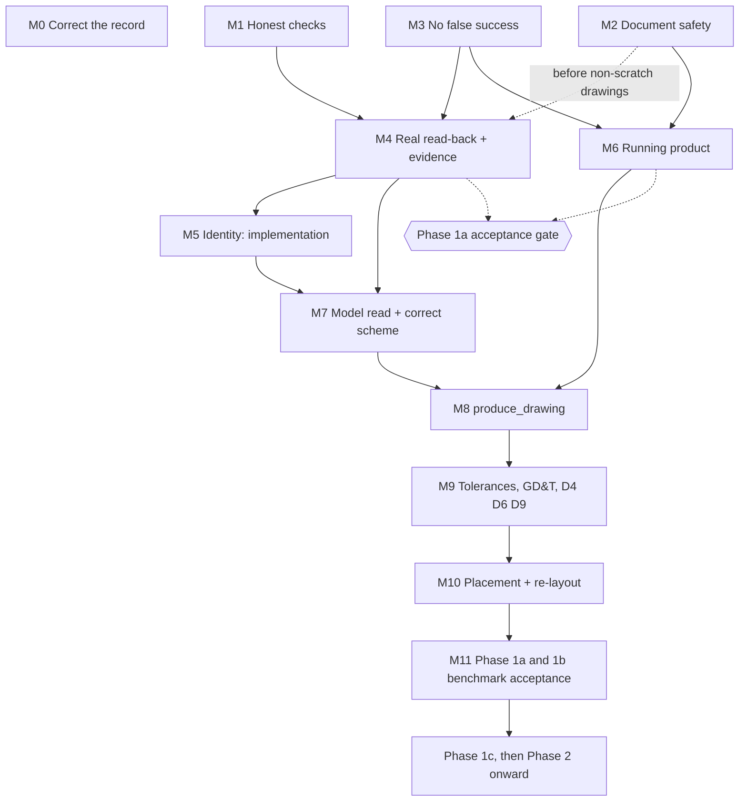

# sw-mcp Architecture Roadmap

**Date:** 2026-11-05
**Source:** [2026-11-05-architecture-review.md](2026-11-05-architecture-review.md). `F` and `P` numbers refer to its findings and proposals.
**Status:** Proposed. Awaiting the owner's decisions below. Its order and completion criteria are summarized in [section 18](../../specifications/roadmap.md) as of spec v1.28, which is the normative version. This file keeps the detailed work lists, tests and proposal mapping. **Paused by [ADR-057](../../adr/ADR-057-freeze-drawings-build-part-chain-first.md):** drawing work is frozen and the part chain comes first. O1, O3, O5 and O6 wait for the freeze to lift.
**Revision:** Revision 1, 2026-11-05: dependency and acceptance contradictions corrected, as listed in [section 10 of the review](2026-11-05-architecture-review.md#10-reconciliation-with-the-roadmap-added-in-revision-1). O2 was decided by the owner on 2026-11-05 (reverted); O1 and O3 to O6 remain open.

## Principle

Each milestone produces evidence the next one needs. **Nothing is built on data that has not been seen coming from real SOLIDWORKS.** Complexity is S, M or L; no calendar estimates are given because the assumption spikes could change them.

## Owner decisions needed first

| # | Decision | Recommendation | If declined |
| --- | --- | --- | --- |
| O1 | Hold ADR-056's M1 to M6 until M1 to M3 below finish? | Yes. Keep ADR-056 as Proposed | The runner and reconciliation loop are built on empty snapshots |
| O2 | **Decided 2026-11-05: reverted.** The uncommitted edits to spec 6.5.3 and 8.4 referenced ADR-056 without a version bump. Those sections match the last commit, and the gaps are logged as K8 to K10 in [open decisions](../../specifications/open-decisions.md) | Done | Not applicable |
| O3 | Change "Approved for Implementation" on the pipeline review? | Yes, unless the owner approved it | Agents treat it as binding |
| O4 | Use roadmap phase names, and treat the annotation work as partial Phase 1b? | Yes | Status stays ambiguous |
| O5 | Pause `check_drawing` on real drawings in shared sessions until M2? | Yes | Risk of closing an open drawing (F4) |
| O6 | `model_items.insert` should import marked items only, per 11.4, or everything then hide? | Decide from the A8 measurement in M4 | Current code contradicts 11.4 |

## Sequence

Solid arrows are mandatory dependencies. Dotted arrows are conditions or gate inputs. Acceptance gates are not milestones.

| Work | Mandatory before it | Can run in parallel with |
| --- | --- | --- |
| M0 | Nothing. No milestone depends on it technically | Everything |
| M1, M2, M3 | Nothing | Each other, coordinating edits to `SwAddin.cs` between M2 and M3 |
| Spikes A3 (identity), A14 (threading), A1, A4, A15 | Nothing; scratch copies only | Everything. Run A14 early, since a wrong thread invalidates other live results |
| M4 | M1, and M3's error handling. M2 before using non-scratch drawings | M2, M5 spike, M6 |
| M5 implementation | M4 | M6, and the M7 parts below |
| M6 | M2, M3 | M4, M5, M7 |
| M7 model read, typed IR | Model read needs M4 evidence for parameter names (A15). Typed IR has no dependency | M5, M6 |
| M7 scheme hide recording | M5 | M6 |
| M8 | M6, M7 | Nothing further |
| M9, M10, M11 | Strictly in order | |

**M8 has no dependency on speculative abstractions.** It needs no `StagePlan`, `StageExecution`, `vendor_extensions`, operation renames, reconciliation solver, or placement engine. If the owner's O1 decision adopts ADR-056 as written, this statement must be revisited; that conflict is recorded as U7 in the review.

### Proposal mapping

| Milestone | Proposals | Findings |
| --- | --- | --- |
| M0 | P6 | F17, F31 to F35 |
| M1 | P1 (fail-safe default) | F2 |
| M2 | P2 | F4, F5, F22, F23, F39 |
| M3 | P3 (stages 1 to 3, and direct read-back where available) | F6, F13, part of F24 |
| M4 | P4, P5 (recording, seeded tests), P1 and P3 (completion) | F1, F2, F3, F6, F16, F18, F21, F29, F40 |
| M5 | P7 | F9, F40 |
| M6 | P8 | F7, F8, F15, F25, F38 |
| M7 | P9, P10 | F10, F11, F14, F30, F36, F37 |
| M8 | P11 | F12 (part), F19, F20, F26, F28 |
| M9 | P12 | F12 (part) |
| M10 | P13 | F12 (part), F27 |
| M11 | P5 (automated CI) | F16, rest of F24 |
| After M11 | P15 | |

---

## Short term: restore trust

Required before any further feature development.

### M0. Correct the record (S)

- **Addresses:** F17, F31 to F35. Presents O1 to O4 to the owner; finishing M0 does not decide them.
- **Work:** Correct `HANDOFF.md` status. Create `docs/specifications/assumptions.md` with A1 to A17 and honest outcomes, most of them "not yet tested". Fix stale version strings. Resolve the K7 text.
- **Done when:** A reader of `HANDOFF.md` can tell what has been verified, and every assumption has a status.

### M1. Honest checks (S)

- **Addresses:** F2. **Depends on:** nothing.
- **Work:** Add one rule to 11.5: unread data is `not_evaluated`, and an empty collection is not evidence of a read (review F2). Define `PRESENT`, `EMPTY`, `UNAVAILABLE` and `UNSUPPORTED`, with no declared state meaning `UNAVAILABLE`. Implement in `run_geometry_checks` with a reason code such as `geometry_data_missing`. Bump the spec.
- **Done when:** A failing test comes first (test-first), then: a snapshot shaped like today's add-in output reports D1, D2, D3 and D7 as `not_evaluated`. Synthetic fixtures with complete data, once they declare their states, still pass, and a found failure still gives `fail`.
- **Limit:** The add-in declares no states until M4, so geometry checks stay `not_evaluated` on real drawings until then. That is correct.

### M2. Document safety (M)

- **Addresses:** F4, F5, F22, F23, F39. **Depends on:** nothing.
- **Work:**
  - Target the addressed document, never `ActiveDoc`.
  - Return true `owned`, and honour `read_only`.
  - Refuse `document.save` for non-drawings, and overwriting except under ADR-046.
  - Fail `drawing.snapshot` for a closed document.
  - Apply `SettingsGuard` per job.
  - Add regen, save and destroy events, and forget ledger entries on destroy. Destruction invalidates runtime state only; journal, reports and store records follow retention (F39).
  - Keep instance, path, ownership and journal layers separate (F39). Record dirty and read-only state with each read-back.
- **Live tests, on scratch copies only:** an already-open dirty drawing stays open and dirty after `check_drawing`; switching the active document mid-batch stops the job or leaves the other drawing unchanged; `document.save` on a part is refused; a document closed and reopened during a job is not treated as the same instance; `document.close` after a save-as reports the real outcome.
- **Done when:** All pass, and the recorded transcript matches `check_drawing_borrowed.jsonl`. This also answers the `CloseDoc` question.

### M3. No false success (M)

- **Addresses:** F6, F13, part of F24. **Depends on:** nothing.
- **Work:**
  - Table-driven dispatch that produces both behaviour and the `HelloResult.operations` list.
  - Unknown operation is an error, never recorded.
  - A missing target is a catalogued error.
  - Real counts and read-back positions, per the operation table in review F6. Results carry read-back values, not echoes.
  - Settle in 6.5.1 and 8.7 the stages (received, validated, executed, read back, verified), and what the ledger records when execution succeeds but read-back disagrees.
  - Add-in JSONL log with correlation; pass `onUnexpected`; pass `_meta` to the handler; narrow bare `catch` blocks; correct error codes.
- **Done when:** Tests in `ExecutionServer.Tests` cover unknown operations, and a live test confirms a hide on a missing annotation fails its batch. A `hidden: false` result can no longer appear as success. Each remaining bare `catch` has a stated reason.

---

## Medium term: real evidence, then a real pipeline

### M4. Real read-back and evidence (L)

- **Addresses:** F1, F2 (completion), F3, F16, F18, F21, F29, F40, X2, X3. **Depends on:** M1, and M3's error handling. M2 is required before using non-scratch drawings.
- **Purpose:** Real-data verification. This shows real SOLIDWORKS data reaches the checks. It may use `IpcBackend` directly or `check_drawing` in process, and does not need M6.
- **Spikes, each recorded in the register, which may start before M4:**
  - A1: read-back time on a dense drawing.
  - A4: text extents per annotation kind.
  - A14: which sync context path runs, and whether commands survive load and dialogs.
  - A15: parameter names, parentheses and dangling state.
  - X3: whether hidden annotations are enumerated.
  - A8: how often `MarkedForDrawing` leaves gaps.
  - G1: 1,000-command stress test.
- **Work:** `GetDisplayData`, `GetPolylines7`, real sheet size, format, border and title block, real version, SHA-256 keys with a defined duplicate-name rule (F40), no placeholders. Declared completeness states, and an end to overwriting by key. The `rebuild` object and title-block field read-back; D8 remains subject to K3, and D10's in-memory rebuild to A16.
- **Evidence:** Record snapshots and transcripts from real drawings as fixtures (15.5). Build the first benchmark drawings, with owner approval. Calibrate thresholds (11.5.2) and change `calibration.status`.
- **Done when:** A seeded crossing fails D1, a seeded overlap fails D2, text on an edge fails D3, a view past the border fails D7, and a clean reference drawing has no false positives. A forced read failure gives `not_evaluated`, and a genuinely empty sheet is reported as `EMPTY`. Two reads of one drawing give identical keys. **This does not by itself complete Phase 1a** (see the gate below).
- **Risk:** If A1 fails, use the register's fallback (partial read-back) or revise section 16 with the owner.

### M5. Identity (M)

- **Addresses:** F9, F40. **Depends on:** M4 for implementation. The spike may start any time.
- **Work:** Run the A3 spike, comparing attributes, pipeline names, document map and composite references across save and reopen, rename, hide and show, duplicate, delete and recreate, and reinsert (test table in review F9). **Write the ADR with the result.** Implement `annotation.tag`, and address by tag.
- **Done when:** The chosen identity behaves as the F9 table requires, live. A recreated annotation does not inherit a deleted one's identity, and a duplicate hide affects exactly the intended copy. Comparison across runs uses identity, not snapshot keys.

### M6. Running product (M)

- **Addresses:** F7, F8, F15, F25, F38. **Depends on:** M2, M3.
- **Purpose:** Product and runtime acceptance. This shows the real path runs. It does not show the checks are correct: without M4, its reports properly say `not_evaluated`. M4 and M6 can proceed in parallel.
- **Work:** Core and front-end entry points, launcher. Connection lifetime ADR and implementation. MCP on the official SDK, or an amended ADR-034. Correct protocol revision, `outputSchema`, annotations, summary and `structuredContent`, resources, error mapping. Core pipe ACL and constant-time token.
- **Done when:** An MCP client runs `check_drawing` twice in succession against live SOLIDWORKS and retrieves the report, and a core restart recovers. A contract test compares `tools/list` with contract files.

### Phase 1a acceptance gate (not a milestone)

Section 18's acceptance applies: the checks find every known seeded defect on reference drawings, with no false positives on owner-approved ones, and read-back meets section 16. It needs M4 and M6 together, plus D5, D8 and D10 on real drawings (K3, A16), and owner-approved references.

### M7. Model read and a correct scheme (L)

- **Addresses:** F10, F11, F14, F30, F36, F37. **Depends on:** M4 for parameter-name evidence. M5 only for recording hides against identified annotations. Typed IR (P10) depends on neither, and must finish before M8 ships Intent tools.
- **Work:**
  - `features.read` and the minimal read-only Part Feature Graph for Tier 1 (5.8, ADR-029), including extents.
  - Full-name to feature-ID conversion at intake.
  - Corrected scheme: stable IDs, hides recorded, `kind` from the API, revisions per 11.10.1.
  - Decide and apply the IR model approach (ADR).
  - Semantic validation for Intent and Layout.
  - Move SOLIDWORKS-specific cleanup to `cad_drawing/solidworks`.
- **Done when:** Entry IDs match across a rename and, per 15.2, a localized install. A critical dimension matches its annotation. A hide appears as `hidden` with a reason.

### M8. `produce_drawing` (L)

- **Addresses:** F12 (part), F19, F20, F26, F28. **Depends on:** M6, M7. **Open owner decision:** O1 decides whether this work follows this roadmap or ADR-056. M8 has no technical dependency on ADR-056's proposed types.
- **Work:** The job, using the existing engine, `JobHandle` and journal. Job-issued operation IDs. Reconcile operation schemas with 6.5.2. Real projected views. Save on COMMITTED, `.failed` on failure, per ADR-046. Tools for Intent and Layout. No reconciliation yet: a failed check ends FAILED with its conflict list.
- **Add new types only for a demonstrated need.** A `StagePlan`-style record should be introduced only if the journal cannot answer an audit question.
- **Done when:** A hand-modelled part produces a drawing or a FAIL through MCP, a crash mid-job recovers correctly, and D1, D2, D3, D5, D7 and D10 are genuinely evaluated.

---

## Long term

### M9. Tolerances, GD&T, D4, D6, D9 (L)

Gap filling, `dimension.set_tolerance`, `dimension.add_reference`, `gdt.add`, `datum.add`, `surface_finish.add`, centerlines, profiles. Depends on M8. A7 and A9 have fallbacks recorded in section 18. D8 needs K3, using the owner's formats already in `standards/iso/templates/`.

After M9, every check can evaluate, so an individual drawing can reach the `done` verdict. That is why M1 and M4 must already be complete. A `done` verdict on one drawing is not phase acceptance.

### M10. Placement and bounded re-layout (L)

`cad_drawing/placement`, 11.6 steps, 8-iteration limit, pins, predicted geometry, and removal of test-only `AnnotationPlacementMath` logic (F27). Depends on M5 and M9. The pure-solver separation proposed in ADR-056 fits here.

### M11. Benchmark acceptance for Phases 1a and 1b

Full hand-modelled drawing benchmark and owner's holdout set (11.8), token budgets, version matrix, self-hosted CI, coverage gates. This milestone is the evidence for acceptance, and the owner's acceptance remains a separate act. Phase 1 as a whole is not complete until Phase 1c below is.

### After M11, in existing roadmap order

| Phase | Content | Note |
| --- | --- | --- |
| 1c | Compiler and Create for IR-built benchmark parts; completes Phase 1 | Reuse 6.5.3 vocabulary, including `postconditions`. Prove A6 first |
| 2 | Semantic references, Tier 2, Assembly Graph, CAD benchmark, reference parity | Do the one-page second-backend exercise before freezing the Part Feature Graph schema |
| 3 | Design Intent, requirement checks | Unchanged |
| 4 | Incremental editing, recovery | Unchanged |
| 5 | Additional backends | Extract neutral interfaces only at this point |

---

## Priorities at a glance

| Priority | Milestones | Why |
| --- | --- | --- |
| **Short term** | M0, M1, M2, M3 | Stop false signals and protect engineers' work. Mostly small |
| **Medium term** | M4 to M8 | First real evidence, then the first real product |
| **Long term** | M9 to M11, then Phases 1c to 5 | Build toward the 11.1 bar on a verified base |

## Not on this roadmap, deliberately

`vendor_extensions`; renaming operations to `annotations.import_model`; rollback through undo for drawings; a new IR; a new service; a framework for reconciliation strategies; Blender work beyond the one-page exercise.

## Maintaining this roadmap

The specification stays the source of truth, and `HANDOFF.md` carries current status. When a spike changes a milestone, record the outcome in the assumption register and the relevant section, then update this file and the Phase 1 work order in section 18 together. Close this file once its remaining detail has moved into implementation plans.
