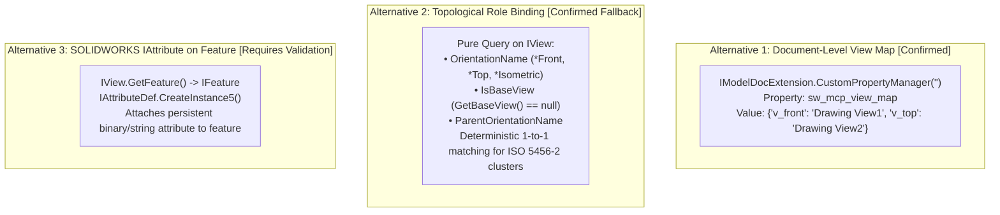
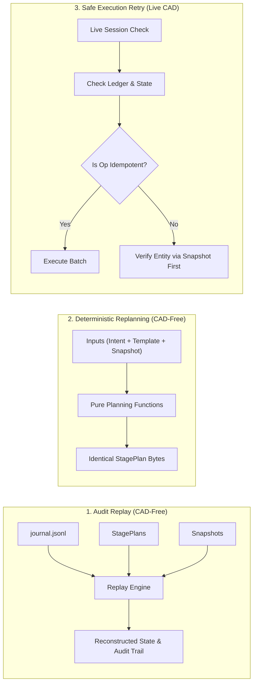
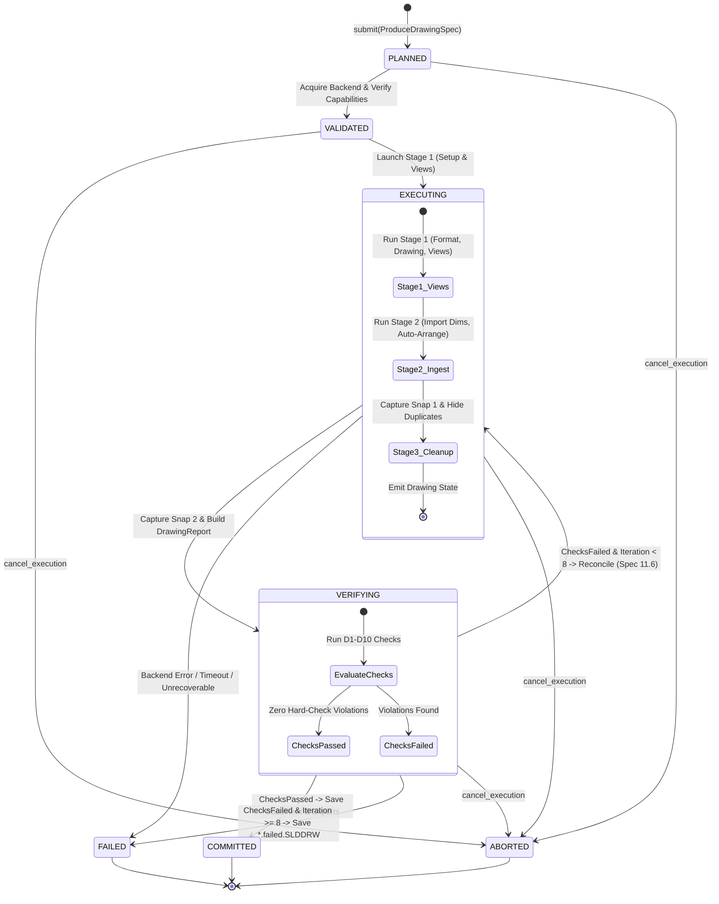

# Architecture Review and Evolution: Drawing Execution Pipeline

**System:** `sw-mcp` (SOLIDWORKS Model Context Protocol Integration)  
**Specification Version:** v1.27  
**Date:** 2026-11-05 (Revised — Principal Architecture Edition)  
**Status:** Approved for Implementation (Evolutionary Architecture)  
**Document Path:** `docs/superpowers/review/2026-11-05-drawing-execution-pipeline-review.md`  

---

## 1. Executive Summary and Architectural Decisions

This document establishes the verified architectural foundation for the Drawing Execution Pipeline in `sw-mcp`. It audits the existing implementation across [`packages/cad-ir/`](file:///d:/01_Data/code/sw-mcp/packages/cad-ir/), [`packages/cad-drawing/`](file:///d:/01_Data/code/sw-mcp/packages/cad-drawing/), [`packages/cad-application/`](file:///d:/01_Data/code/sw-mcp/packages/cad-application/), and [`apps/execution-server/`](file:///d:/01_Data/code/sw-mcp/apps/execution-server/), identifies concrete design and implementation gaps with source-code references, and specifies the target contracts for implementation.

### 1.1 Core Architectural Decisions Table

| Decision | Classification | Summary & Architectural Rationale |
| :--- | :---: | :--- |
| **No Monolithic Plan IR** | **Confirmed** | Drawing production is inherently an **iterative, feedback-driven process**. Dimensions are dynamically created by the CAD engine (`model_items.insert`), requiring intermediate CAD geometry snapshots before cleanup operations (`dimension.hide`) can be calculated. A static upfront execution plan is physically incompatible with CAD drawing generation. |
| **Multi-Stage Orchestration** | **Confirmed** | Introduce [`ProduceDrawingRunner`](#10-producedrawingrunner-lifecycle-and-state-machine) in `cad-application` as the application-level workflow orchestrator driving the Spec §8.4 `produce_drawing` job lifecycle. |
| **StagePlan / StageExecution Decoupling** | **Confirmed** | A stage plan must be strictly immutable and serializable. Runtime state, timestamps, outcomes, and snapshot references belong exclusively in `StageExecution`. |
| **Tri-Tier Identity Model** | **Confirmed** | Cleanly decouple **Deterministic Snapshot Keys** (canonical serialization hashes), **Semantic IDs** (CAD-neutral engineering references), and **Native CAD IDs** (ephemeral COM handles). |
| **View Persistence via Role & Doc Map** | **Confirmed** | Document-level custom property JSON mapping + topological role binding `(sheet, orientation, is_base, parent_orientation)` guarantee semantic view persistence across reopen without relying on mutable native names. |
| **View Attributes via `IFeature`** | **Requires Validation** | Direct attachment of `IAttribute` to the view's FeatureManager feature (`view.GetFeature()`) requires an API spike before adoption. |
| **CAD-Neutral Operation Contracts** | **Confirmed** | Normalize `model_items.insert` to `annotations.import_model`. Generalize all operation targets to semantic IDs. Move vendor-specific knobs to optional `vendor_extensions`. |
| **Strict Verification / Reconciliation Split** | **Confirmed** | Verification is a pure query emitting `DrawingReport` (zero side effects, no CAD calls). Reconciliation is a pure solver emitting typed `CorrectionAction`s (no CAD calls). |
| **Document Custody & Commit Rules** | **Confirmed** | The drawing is saved to its target path (`.SLDDRW` / `.PDF`) **only after all required checks pass**. Pre-existing user documents are never silently closed or modified without permission. |

---

## 2. Current Architecture and Source-Code Audit

### 2.1 Current Working Data Flow

The current implementation validated live in [`tests/live/test_live_annotation_pipeline.py`](file:///d:/01_Data/code/sw-mcp/tests/live/test_live_annotation_pipeline.py) operates as an ad-hoc, multi-turn conversation between the host test script and the CAD backend:

```mermaid
flowchart TD
    subgraph S1["1. Pure View Planning (cad-drawing)"]
        ext["Part Extents (dx, dy, dz)"] --> pov["plan_ortho_views()"]
        pov --> layout["DrawingLayout IR (v_front, v_top, v_right, v_iso)"]
    end

    subgraph S2["2. Layout Lowering (cad-application)"]
        layout --> lops["layout_to_create_ops()"]
        lops --> ops_v["view.create Operations (v:0..3)"]
    end

    subgraph S3["3. CAD Backend View Execution (C# Add-In)"]
        ops_v --> pipe1["Named Pipe IPC: ops.apply"]
        pipe1 --> csharp_v["ViewCreationAdapter.cs"]
        csharp_v --> sw_v["CreateDrawViewFromModelView3()"]
        sw_v --> v_res["ViewCreateResult (native_id: 'Drawing View1', ...)"]
    end

    subgraph S4["4. Annotation Insertion Planning"]
        v_res -.-> |"Caller manual mapping: vid -> nid"| ann_prep["view_names dict"]
        layout & ann_prep --> paio["plan_annotation_insertion_ops()"]
        paio --> ops_ann["model_items.insert, center_mark.add, dimensions.auto_arrange"]
    end

    subgraph S5["5. CAD Backend Annotation Execution"]
        ops_ann --> pipe2["Named Pipe IPC: ops.apply"]
        pipe2 --> csharp_ann["AnnotationPlacementAdapter.cs"]
        csharp_ann --> sw_ann["InsertModelAnnotations3, AlignDimensions, AutoInsertCenterMarks2"]
    end

    subgraph S6["6. Snapshot Read-Back & Deserialization"]
        sw_ann --> pipe3["Named Pipe IPC: drawing.snapshot"]
        pipe3 --> csharp_snap["DrawingSnapshotAdapter.cs + ViewExtractor.cs"]
        csharp_snap --> snap_json["Drawing Geometry Snapshot JSON"]
        snap_json --> snap_parse["parse_snapshot() -> Snapshot"]
    end

    subgraph S7["7. Pure Scheme Resolution & Duplicate Cleanup"]
        snap_parse --> rs["resolve_scheme_from_snapshot() -> ResolvedScheme"]
        snap_parse --> pdc["plan_duplicate_cleanup() -> DuplicatePlan"]
        pdc --> pdco["plan_dimension_cleanup_ops() -> dimension.hide Ops"]
    end

    subgraph S8["8. CAD Backend Cleanup & Verification"]
        pdco --> pipe4["Named Pipe IPC: ops.apply"]
        pipe4 --> csharp_hide["AnnotationPlacementAdapter.HideDimension()"]
        csharp_hide --> pipe5["Named Pipe IPC: drawing.snapshot (Re-read)"]
        pipe5 --> checks["run_geometry_checks() (D1, D2, D3, D7)<br/>+ build_report() (D5, D8, D10)"]
    end
```



### 2.2 Concrete Source Code Audit & Flaws

1. **Pure View Planning:**
   - [`plan_ortho_views()`](file:///d:/01_Data/code/sw-mcp/packages/cad-drawing/src/cad_drawing/view_planning/planner.py#L21-L171) in `packages/cad-drawing/src/cad_drawing/view_planning/planner.py`:
   - Pure, deterministic, CAD-free. Adheres strictly to ISO 5456-2 first-angle layout and ISO 5455 preferred scales. Outputs clean [`DrawingLayout`](file:///d:/01_Data/code/sw-mcp/packages/cad-ir/src/cad_ir/drawing_layout/model.py).

2. **Layout Lowering:**
   - [`layout_to_create_ops()`](file:///d:/01_Data/code/sw-mcp/packages/cad-application/src/cad_application/drawing/layout_ops.py#L19-L59) in `packages/cad-application/src/cad_application/drawing/layout_ops.py`:
   - Compiles `DrawingLayout` into IPC `view.create` operations. Correctly sets `view_name=view_id` (`v_front`).

3. **Annotation Planning & Semantic Leakage:**
   - [`plan_annotation_insertion_ops()`](file:///d:/01_Data/code/sw-mcp/packages/cad-application/src/cad_application/drawing/annotation_ops.py#L32-L104) in `packages/cad-application/src/cad_application/drawing/annotation_ops.py`:
   - **Architectural Flaw:** Line 71 requires a caller-provided runtime dictionary `view_names: dict[str, str]` mapping `v_front` to `"Drawing View1"`. This leaks volatile CAD session state into the caller.

4. **Dimension Cleanup & Transient Pointer Leakage:**
   - [`plan_dimension_cleanup_ops()`](file:///d:/01_Data/code/sw-mcp/packages/cad-application/src/cad_application/drawing/annotation_ops.py#L107-L148):
   - **Architectural Flaw:** Line 137 emits `dimension.hide` referencing `hide_action.native_id` (`"D1@Sketch1@adapter plate.SLDPRT"`). Native names are localized and mutable, breaking stability across sessions.

5. **Random GUID Snapshot Keys in C# Backend:**
   - [`ViewExtractor.cs#L86`](file:///d:/01_Data/code/sw-mcp/apps/execution-server/ExecutionServer.Adapters/Drawings/ViewExtractor.cs#L86): `viewKey = "v_" + Guid.NewGuid().ToString("N").Substring(0, 10);`
   - [`AnnotationExtractor.cs#L48`](file:///d:/01_Data/code/sw-mcp/apps/execution-server/ExecutionServer.Adapters/Drawings/AnnotationExtractor.cs#L48): `var key = "ann_" + Guid.NewGuid().ToString("N").Substring(0, 10);`
   - **Critical Bug:** Violates Spec §11.5.1. Every read-back yields random keys, breaking snapshot caching, offline diffing, and forcing [`layout_ops.py#L90-L100`](file:///d:/01_Data/code/sw-mcp/packages/cad-application/src/cad_application/drawing/layout_ops.py#L90-L100) into fragile string matching.

6. **In-Memory Ledger Limitations:**
   - [`OperationLedger.cs`](file:///d:/01_Data/code/sw-mcp/apps/execution-server/ExecutionServer.Core/Ledger/OperationLedger.cs#L30-L60):
   - In-memory dictionary only. Survives IPC disconnects if SOLIDWORKS stays alive, but is completely lost on SOLIDWORKS restart or document close/reopen.

7. **Missing Production Job Orchestrator:**
   - [`JobEngine.cs`](file:///d:/01_Data/code/sw-mcp/packages/cad-application/src/cad_application/jobs/engine.py#L63-L120):
   - Only implements `check_drawing`. The drawing creation workflow exists solely inside test files.

---

## 3. Identification and Identity Contract

To establish rigorous determinism and eliminate fragile runtime coupling, the system defines three distinct identification tiers:

```
┌────────────────────────────────────────────────────────────────────────────────────────┐
│ Tier 1: Deterministic Snapshot Keys                                                    │
│ Purpose: Canonical serialization keys in DrawingGeometrySnapshot JSON.                 │
│ Derivation: Pure function of canonical identity tuple per Spec §11.5.1.                │
│ Scope: Snapshot JSON document and offline verification checks (D1–D10).                │
│ Invariant: Identical CAD geometry on identical sheets produces bit-identical keys.     │
├────────────────────────────────────────────────────────────────────────────────────────┤
│ Tier 2: Semantic IDs                                                                   │
│ Purpose: Persistent engineering references defined in CAD-neutral IR.                  │
│ Syntax: v_front, v_top, crit_bore_dia, bore_1.diameter, ds_linear_a4f210...             │
│ Scope: DrawingLayout, DrawingIntent, ResolvedScheme, Application Operations.           │
│ Invariant: Invariant across CAD localizations (English, Chinese, German) and survives │
│            document save and reopen.                                                   │
├────────────────────────────────────────────────────────────────────────────────────────┤
│ Tier 3: Native CAD IDs                                                                 │
│ Purpose: Direct object handles used by the SOLIDWORKS COM API.                         │
│ Syntax: "Drawing View1", "D1@Sketch1@adapter plate.SLDPRT", IAnnotation pointer.       │
│ Scope: ExecutionServer.Adapters internal execution context only. Never leaks to IR.  │
│ Invariant: Ephemeral, mutable, localized, session-dependent.                            │
└────────────────────────────────────────────────────────────────────────────────────────┘
```

### 3.1 Canonical Identity Inputs for Deterministic Snapshot Keys

> **Rule:** Do not assume that hashing a native CAD name provides stable object identity.

A native name like `"Drawing View1"` is an ephemeral artifact of UI session history (e.g. if a previous user action deleted a view, the counter increments to `"Drawing View2"`). Canonical snapshot keys must be derived from a **canonical identity tuple**:

| Entity Type | Canonical Identity Tuple Inputs | Key Derivation Formula |
| :--- | :--- | :--- |
| **Sheet** | `(document_fingerprint, sheet_index, sheet_name)` | `s_` + SHA256(UTF8(tuple))[:10] |
| **View** | `(sheet_key, view_type, orientation, parent_role, scale_fraction)` | `v_` + SHA256(UTF8(tuple))[:10] |
| **Model Dimension** | `(view_key, "dim", sorted(parameter_names))` | `a_` + SHA256(UTF8(tuple))[:10] |
| **Reference Dimension** | `(view_key, "ref_dim", kind, attachment_anchor_hashes)` | `a_` + SHA256(UTF8(tuple))[:10] |
| **Center Mark** | `(view_key, "center_mark", feature_anchor_hash)` | `a_` + SHA256(UTF8(tuple))[:10] |
| **Note / Callout** | `(view_key, "note", normalized_text_content_hash)` | `a_` + SHA256(UTF8(tuple))[:10] |

*Collision Handling:* If two annotations within the same view share identical identity tuples, the hash length expands from 10 to 16 hex characters per Spec §11.5.1, using the native handle order as a deterministic secondary index.

### 3.2 View Persistence Mechanisms in SOLIDWORKS API

The previous review draft assumed `IModelDocExtension.CustomPropertyManager` could attach metadata directly to individual drawing views. **API verification confirms this is incorrect:** `CustomPropertyManager` in SOLIDWORKS operates at the document or configuration level, not on `IView`.

We evaluate the three technical alternatives:



1. **Document-Level Custom Property View Map (`sw_mcp_view_map`) — [Confirmed]:**
   - When views are created or renamed, `ViewCreationAdapter` serializes the semantic-to-native mapping into a JSON string stored in the document-level custom property `sw_mcp_view_map`.
   - *Advantage:* 100% verified COM API support, survives file save/reopen, human-inspectable in SOLIDWORKS File Properties dialog.
2. **Topological & Projection Role Binding — [Confirmed Fallback]:**
   - Single-part production drawings conforming to ISO 5456-2 have at most one primary view per orthogonal projection role per sheet.
   - The tuple `(sheet_name, orientation, is_base, parent_orientation)` uniquely resolves `v_front`, `v_top`, `v_right`, `v_iso` even if custom properties are cleared.
3. **SOLIDWORKS Attributes via `IView.GetFeature()` — [Requires Validation / Technical Spike]:**
   - In SOLIDWORKS, every drawing view is backed by an `IFeature` of type `"DrawingView"` in the FeatureManager tree. Features support third-party metadata via `IAttributeDef.CreateInstance5()`.
   - *Status:* Requires a technical spike (Spike S1) to evaluate COM registration requirements, stability across rebuilds, and silent serialization.

---

## 4. StagePlan, StageExecution, and ExecutionJournal Models

To guarantee complete separation of intent, runtime observation, and event audit, the data models are partitioned into three dedicated structures:

```
┌────────────────────────────────────────────────────────────────────────┐
│ StagePlan (cad_application.drawing.stage_plan)                         │
│ • Immutable, pure description of intended work. Zero runtime state.    │
│ • Defined before execution; validated and hashed via RFC 8785.         │
├────────────────────────────────────────────────────────────────────────┤
│ StageExecution (cad_application.drawing.stage_execution)               │
│ • Mutable runtime execution tracking.                                  │
│ • Holds execution timestamps, outcomes, snapshot references, errors.   │
├────────────────────────────────────────────────────────────────────────┤
│ ExecutionJournal (cad_application.store.journal_records)               │
│ • Append-only, chronological event stream in journal.jsonl.           │
│ • Crash-resilient audit log enabling historical replay.                │
└────────────────────────────────────────────────────────────────────────┘
```

### 4.1 StagePlan Model (Pure Intent)

```python
@dataclass(frozen=True, slots=True)
class Precondition:
    kind: Literal[
        "prerequisite_stage", "snapshot_hash_match", "capability_present", "document_open"
    ]
    target: str
    expected_value: str | None = None


@dataclass(frozen=True, slots=True)
class Postcondition:
    kind: Literal[
        "views_exist", "snapshot_hash_changed", "annotations_hidden", "zero_d1_violations"
    ]
    parameters: Mapping[str, JsonValue]


@dataclass(frozen=True, slots=True)
class StagePlan:
    """Immutable, serializable description of an intended pipeline stage."""

    stage_id: str  # Unique identifier, e.g. "stg_01_views_job123"
    stage_type: str  # "setup_and_views" | "annotation_ingest" | "reconciliation" | "finalize"
    sequence: int  # Linear order (1, 2, 3...)
    target_document: str  # Target document path
    preconditions: tuple[Precondition, ...]
    operation_batches: tuple[OperationGroup, ...]  # Immutable IPC payloads
    postconditions: tuple[Postcondition, ...]
    plan_hash: str  # RFC 8785 canonical hash of above fields
```

### 4.2 StageExecution Model (Runtime Tracking)

```python
type StageStatus = Literal["PENDING", "EXECUTING", "COMPLETED", "FAILED", "ROLLED_BACK"]


@dataclass(frozen=True, slots=True)
class StageExecution:
    """Runtime tracking of a StagePlan execution attempt."""

    execution_id: str  # e.g., "sexec_01_a8b9c0"
    stage_id: str  # Foreign key to StagePlan.stage_id
    plan_hash: str  # Validates execution against intended plan
    job_id: str  # Foreign key to ExecutionContext.job_id
    status: StageStatus
    started_at: str  # ISO 8601 timestamp
    ended_at: str | None
    snapshot_before_hash: str | None  # Hash of snapshot captured prior to stage
    snapshot_after_hash: str | None  # Hash of snapshot captured following stage
    outcomes: tuple[OperationOutcome, ...]  # Direct results from OpsBatchRunner
    postcondition_results: tuple[bool, ...]
    error: dict[str, JsonValue] | None
    retry_count: int
```

### 4.3 ExecutionJournal Event Records

The append-only journal (`journal.jsonl`) records stage transitions as durable JSON Lines:

1. **`StagePlannedRecord`:** Emitted when `ProduceDrawingRunner` constructs and stores a `StagePlan`.
   ```json
   {"type": "stage_planned", "ts": "2026-11-05T09:30:00Z", "job_id": "job_01JC...", "stage_id": "stg_01_views", "plan_hash": "e3b0c44..."}
   ```
2. **`StageStartedRecord`:** Emitted immediately before dispatching the stage's first batch.
   ```json
   {"type": "stage_started", "ts": "2026-11-05T09:30:01Z", "job_id": "job_01JC...", "stage_id": "stg_01_views", "execution_id": "sexec_01_a8"}
   ```
3. **`BatchSentRecord` (Existing):** Emitted before sending each batch to named pipe IPC.
4. **`OpResultRecord` (Existing):** Emitted as each operation completes.
5. **`SnapshotRecord` (Existing):** Records intermediate snapshot hashes.
6. **`StageCompletedRecord` / `StageFailedRecord`:** Emitted when all batches and postconditions evaluate.

---

## 5. ExecutionContext

The `ExecutionContext` represents the complete runtime environment, inputs, and cross-stage correlation anchor for a `ProduceDrawingJob`. It eliminates duplicate metadata across stage plans:

```python
@dataclass(frozen=True, slots=True)
class ExecutionContext:
    """The runtime context and correlation anchor for a drawing production job."""

    job_id: str  # ULID formatted job identifier, e.g. "job_01JCYZ..."
    request_id: str  # Upstream MCP client request ID
    project_root: str  # Authorized workspace path
    document_path: str  # Final output drawing path (.SLDDRW)
    document_ownership: Literal["OWNED", "PRE_EXISTING"]
    source_model_path: str  # Referenced 3D model (.SLDPRT / .SLDASM)
    source_model_fingerprint: str  # SHA-256 of 3D part file at intake
    drawing_intent_id: str  # ID of input DrawingIntent IR
    drawing_template_id: str  # ID of input DrawingTemplate IR
    backend_session_id: str  # PID and token of connected SOLIDWORKS session
    solidworks_version: str  # e.g. "SOLIDWORKS 2025 SP0.1"
    capability_profile_hash: str  # Hash of connected backend capability profile (Spec §6.6)
    input_spec_hash: str  # Canonical hash of (model_fingerprint, intent, template)
    journal_path: str  # Absolute path to journal.jsonl
    scratch_dir: str  # Temporary working directory for sheet formats / drafts
    reconcile_iteration: int  # Current closed-loop iteration count (0 to 8)
    active_stage_id: str | None  # Currently executing stage ID
```

### Reproducibility & Safe Retry Guarantees
- If `capability_profile_hash` or `source_model_fingerprint` changes between attempts, cached plans are immediately invalidated.
- `ExecutionContext` ensures that all stage plans, snapshots, and report artifacts share the exact same correlation keys across logs and storage records.

---

## 6. Replay, Retry, Idempotency, and Recovery Semantics

> **Rule:** Do not treat replayability as unconditional operation re-execution.



### 6.1 The Three Execution Capabilities

1. **Audit Replay (Offline, CAD-Free):**
   - Reconstructs the exact sequence of historical decisions and verified states by reading `journal.jsonl`, stored `StagePlan`s, and `Snapshot`s.
   - Requires zero CAD connection. Verifies that transitions followed the Spec §8.4 lifecycle.
2. **Deterministic Replanning (Pure Python):**
   - Re-runs pure planners (`plan_ortho_views`, `resolve_scheme_from_snapshot`, `plan_duplicate_cleanup`) using recorded inputs and snapshot fixtures.
   - Verifies that planning logic produces identical StagePlan bytes without side effects.
3. **Safe Execution Retry (Live CAD):**
   - Resuming or retrying an interrupted job against an active SOLIDWORKS session.
   - Evaluates operation idempotency classifications before dispatching commands.

### 6.2 Operation Idempotency Classification Matrix

| Operation | Classification | Idempotent Re-execution Behavior | Safe Retry Action |
| :--- | :---: | :--- | :--- |
| **`sheet_format.generate`** | **Idempotent** | Overwrites the destination `.slddrt` file with identical vector graphics. | Safe to re-execute unconditionally. |
| **`drawing.create`** | **Non-Idempotent** | Creates a new unsaved drawing document in memory. Repeating creates a second orphaned document. | Check if document title/path exists in session first. |
| **`view.create`** | **Non-Idempotent** | Inserts a new view on the sheet. Repeating creates overlapping duplicate views. | Verify whether view semantic ID exists via snapshot before dispatching. |
| **`annotations.import_model`** | **State-Dependent** | Re-inserts dimensions into the drawing. If `allow_duplicates=false`, CAD may ignore; if `true`, it creates duplicates. | Check if view already contains imported annotations via snapshot. |
| **`center_mark.add`** | **Idempotent** | SolidWorks centers marks API ignores holes that already possess a center mark. | Safe to re-execute. |
| **`dimensions.auto_arrange`**| **Idempotent** | Re-computes alignment offsets on active dimensions. | Safe to re-execute. |
| **`dimension.hide`** | **Idempotent** | Sets `ann.Visible = swAnnotationHidden`. Hiding an already hidden dimension is a clean no-op. | Safe to re-execute. |
| **`dimension.move`** | **Idempotent** | Calls `ann.SetPosition2(x, y, 0)`. Setting to identical coordinates is an idempotent move. | Safe to re-execute. |
| **`document.save`** | **Idempotent** | Writes active drawing state to target path. | Safe to re-execute. |

### 6.3 Limitations of `OperationLedger`
The existing `OperationLedger` (`ExecutionServer.Core/Ledger/OperationLedger.cs`) is an in-memory dictionary living in the C# add-in process.
- **Vulnerability:** It is wiped if SOLIDWORKS crashes, is closed, or if the document is closed and reopened.
- **Architectural Requirement:** The `ProduceDrawingRunner` **must never rely solely on the in-memory ledger across stages**. Before resuming an interrupted stage, it must capture a fresh `drawing.snapshot` to verify whether target entities already exist on the sheet.

---

## 7. Cancellation and Rollback Semantics

> **Rule:** SOLIDWORKS does not provide ACID transactional rollback. Do not assume arbitrary API actions can be undone automatically.

### 7.1 Recovery Mechanism Hierarchy

```
┌────────────────────────────────────────────────────────────────────────┐
│ 1. Compensating Actions (Application Level)                            │
│ • Pure inverse operations emitted by ProduceDrawingRunner.             │
│ • Examples: dimension.show to reverse dimension.hide;                  │
│   view.delete to reverse view.create.                                  │
├────────────────────────────────────────────────────────────────────────┤
│ 2. Document Undo Recording (Native CAD Level)                          │
│ • Using IModelDocExtension.StartRecordingUndoObject() and              │
│   FinishRecordingUndoObject2().                                        │
│ • Bounded by undo memory depth; destroyed on document save or close.   │
├────────────────────────────────────────────────────────────────────────┤
│ 3. Checkpoint Recovery (File System Level)                             │
│ • For pre-existing drawings: Save Copy As to <doc>.checkpoint.SLDDRW.  │
│ • If unrecoverable failure occurs, restore file from checkpoint.       │
├────────────────────────────────────────────────────────────────────────┤
│ 4. Best-Effort Cleanup (Custody & Scratch)                             │
│ • For owned drawings: CloseDoc without saving (discard).               │
│ • Unlink all generated scratch files (.slddrt, temp exports).          │
└────────────────────────────────────────────────────────────────────────┘
```

### 7.2 Document Ownership and Custody Rules (ADR-022, ADR-046)

1. **Owned Document (`document_ownership: OWNED`):**
   - The drawing document was created by this job (`drawing.create`).
   - If the job fails, is cancelled, or aborts, the runner sends `document.close` with discard and purges scratch files.
   - **Zero user data loss is possible.**
2. **Pre-Existing Document (`document_ownership: PRE_EXISTING`):**
   - The drawing was opened from an existing file path owned by the user.
   - The runner **never silently saves, overwrites, or closes the file**.
   - If user interaction is detected (`EXEC_INTERRUPTED_BY_USER`), the runner halts immediately and leaves the document untouched in the user's custody.

### 7.3 Cancellation Boundaries (`cancel_execution`)

- A cancellation request sets `entry.cancel_requested = true`.
- **In-Flight Batch Execution:** The C# STA queue allows the single currently running API call to finish (preventing memory corruption), then aborts the remainder of the batch.
- The runner marks the active `StageExecution` as `ABORTED`, logs `stage_aborted` to `journal.jsonl`, executes compensating cleanup actions, and transitions the job to `ABORTED`.

---

## 8. CAD-Neutral Operation Contracts

All Application Operations are audited and normalized to eliminate CAD vendor leakage while supporting vendor-specific extensions cleanly:

### 8.1 Contract Normalization Matrix

| Current Operation | Issues / Vendor Leakage | Normalized Contract | Extension Policy |
| :--- | :--- | :--- | :--- |
| **`view.create`** | Relies on backend view naming; `tangent_edges` enum matches SOLIDWORKS flags. | Retain `view.create`. Ensure `view_name` parameter is formally the semantic `view_id` (`v_front`). | Standardized ISO line display modes. |
| **`model_items.insert`** | Directly copies `InsertModelAnnotations3` bitmask flags (`marked_for_drawing`, `not_marked_for_drawing`, `use_placement_in_sketch`, `hidden_feature_dims`). | **Normalize to `annotations.import_model`** (aliased to `model_items.insert` for backward compatibility). Clean parameters: `scope` (`entire_model` \| `features`), `filter` (`dimensions`, `hole_callouts`), `marked_only` (bool), `allow_duplicates` (bool). | Move CAD-specific knobs (`use_placement_in_sketch`, `hidden_feature_dims`) to optional `vendor_extensions` block. |
| **`dimensions.auto_arrange`** | `view` parameter requires native CAD view name (`"Drawing View1"`). | `view` parameter accepts semantic `view_id` (`v_front`). C# adapter resolves semantic view. | Spacing in standard millimeters (`spacing_mm`). |
| **`center_mark.add`** | `view` parameter requires native CAD view name. | `view` parameter accepts semantic `view_id` (`v_front`). | Standard ISO 128 center mark parameters. |
| **`dimension.hide` / `dimension.show`** | `annotation` parameter passes raw SOLIDWORKS string (`"D1@Sketch1@part.SLDPRT"`). | `annotation` accepts **semantic reference** (`param:<name>`, `tag:<tag>`, or native ID fallback). | Adapter resolves semantic reference before calling CAD API. |
| **`dimension.move`** | `annotation` passes native ID. | `annotation` accepts semantic reference or tag; `position`: `[x, y]` in sheet mm. | CAD-neutral Cartesian sheet coordinates. |

### 8.2 Vendor Extensions Pattern

If a CAD backend provides proprietary capabilities not present in the standard engineering vocabulary, they are declared under `vendor_extensions`:

```json
{
  "op": "annotations.import_model",
  "params": {
    "view": "v_front",
    "scope": "entire_model",
    "marked_only": true,
    "allow_duplicates": true,
    "vendor_extensions": {
      "solidworks": {
        "use_placement_in_sketch": false,
        "hidden_feature_dims": false
      }
    }
  }
}
```

Core application logic never relies on `vendor_extensions` for correctness; they serve strictly as optimization hints for the specific execution adapter.

---

## 9. Verification and Reconciliation Architecture

### 9.1 Verification Engine vs. Reconciliation Engine Boundaries

```mermaid
flowchart LR
    subgraph CAD["CAD Runtime (STA Thread)"]
        doc["SOLIDWORKS Drawing Document"]
    end

    subgraph Snap["Observation Layer"]
        csharp_snap["DrawingSnapshotAdapter"]
        raw_snap["Snapshot (Deterministic JSON)"]
    end

    subgraph Verif["Verification Engine (cad-drawing/checks)"]
        direction TB
        v_geo["Geometric Checks (D1, D2, D3, D7)"]
        v_struct["Structural Checks (D5 Part 2, D8, D10)"]
        v_sem["Semantic Checks (D4, D5 Part 1, D6, D9)"]
        v_rep["build_report() -> DrawingReport"]
        v_geo & v_struct & v_sem --> v_rep
    end

    subgraph Recon["Reconciliation Engine (cad-drawing/reconciliation)"]
        r_solve["Reconciliation Solver (Spec §11.6 Priority Rules)"]
        r_plan["CorrectionPlan (Typed CorrectionActions)"]
        r_solve --> r_plan
    end

    subgraph Planning["Application Planning Layer (cad-application)"]
        p_lower["Lower CorrectionPlan to StagePlan"]
        p_stage["New Reconciliation StagePlan"]
        p_lower --> p_stage
    end

    subgraph Exec["Execution Backend (ExecutionServer.Adapters)"]
        e_run["OpsBatchRunner.cs"]
    end

    doc -->|drawing.snapshot| csharp_snap --> raw_snap
    raw_snap --> Verif
    v_rep -->|Failures + Conflicts| Recon
    Recon --> Planning
    p_stage -->|ops.apply| Exec -->|Apply via COM| doc

    style Verif fill:#e1f5fe,stroke:#0288d1,stroke-width:2px
    style Recon fill:#f3e5f5,stroke:#7b1fa2,stroke-width:2px
    style CAD fill:#ffebee,stroke:#c62828,stroke-width:2px
```



### 9.2 Complete Audit and Classification of Hard Checks D1–D10

> **Rule:** Preserve `NOT_EVALUATED` as distinct from `PASS`. Never invent check definitions; adhere strictly to Spec §11.5 and [`cad_drawing/checks/report.py`](file:///d:/01_Data/code/sw-mcp/packages/cad-drawing/src/cad_drawing/checks/report.py).

| Check | Category | Evaluation Rule & Invariants | Required Inputs | Possible Outcomes |
| :--- | :---: | :--- | :--- | :--- |
| **D1** | **Geometric** | Zero intersections between dimension lines; zero dimension lines crossing extension lines of another dimension (excluding shared extension lines in baseline/chain arrangements). | Snapshot dimension lines & extension lines. | `pass`, `fail` |
| **D2** | **Geometric** | Zero overlaps: text-to-text clearance ≥ 0.5 mm; text-to-line clearance ≥ 0.25 mm across different annotations. | Snapshot text boxes, dimension lines, leaders. | `pass`, `fail` |
| **D3** | **Geometric** | Zero text over visible model edges: text box clearance to visible edge polylines ≥ 0.25 mm. | Snapshot text boxes & visible model polylines. | `pass`, `fail` |
| **D4** | **Semantic** | Complete functional dimensioning: (a) Every driving parameter shown once or covered by reference dimension; (b) Geometric determinacy: size and position dimensioned from datums. | `DrawingIntent`, 3D feature tree parameters, `ResolvedScheme`. | `pass`, `fail`, `not_evaluated` (`drawing_intent_required`) |
| **D5** | **Structural & Semantic** | **Part 1 (Semantic):** Parentheses appear on exactly the dimensions marked `auxiliary` in scheme.<br/>**Part 2 (Structural):** Zero duplicate parameters across views; zero closed dimension cycles without auxiliary opening. | Snapshot parameters & parentheses; `ResolvedScheme`. | `pass`, `fail`, `not_evaluated` (`drawing_intent_required` on Part 1) |
| **D6** | **Semantic** | Every critical dimension in `DrawingIntent` is shown with tolerance; every GD&T frame is shown with correct datums. | `DrawingIntent.critical_dimensions`, `DrawingIntent.gdt`, `ResolvedScheme`. | `pass`, `fail`, `not_evaluated` (`drawing_intent_required`) |
| **D7** | **Geometric** | All view outlines and annotation primitives lie inside drawing border and clear of title-block zone. | Sheet border & title block zones, view outlines, annotation primitives. | `pass`, `fail` |
| **D8** | **Structural** | Required title-block fields filled, non-empty, no unresolved `$PRP` links; latest revision table entry matches revision field. | Snapshot `title_block_fields`, `revision_table`, template mapping. | `pass`, `fail`, `not_evaluated` (`title_block_mapping_missing`) |
| **D9** | **Semantic** | Profile completeness: all mandatory profile items (center marks, centerlines, surface finish, flat pattern) present. | Profile type (`machined` \| `molded` \| `sheet_metal`), `DrawingIntent`, snapshot annotations. | `pass`, `fail`, `not_evaluated` (`drawing_intent_required`) |
| **D10** | **Structural** | Drawing rebuilds cleanly: `rebuild.completed == true`, zero dangling dimensions, zero annotation errors; reopen verified. | Snapshot `rebuild` object & error list. | `pass`, `fail`, `not_evaluated` (`rebuild_data_missing`) |

### 9.3 Polymorphic CorrectionAction Model

The Reconciliation Engine calculates corrections expressed as a strongly-typed polymorphic union:

```python
@dataclass(frozen=True, slots=True)
class MoveDimensionAction:
    target_semantic_id: str
    current_position: tuple[float, float]
    desired_position: tuple[float, float]
    clearance_delta_mm: float
    failure_ref: str  # e.g., "D2:sheet1:a_12:a_34"


@dataclass(frozen=True, slots=True)
class HideDimensionAction:
    target_semantic_id: str
    parameter_name: str
    reason: Literal["duplicate", "redundant_chain", "non_functional"]
    failure_ref: str


@dataclass(frozen=True, slots=True)
class RepositionAnnotationAction:
    target_semantic_id: str
    current_box: tuple[float, float, float, float]
    desired_box: tuple[float, float, float, float]
    failure_ref: str


@dataclass(frozen=True, slots=True)
class UpdateViewScaleAction:
    view_id: str
    current_scale: str  # e.g. "1:2"
    desired_scale: str  # e.g. "1:5" (must be ISO 5455 preferred)
    reason: str


@dataclass(frozen=True, slots=True)
class UpdateViewPositionAction:
    view_id: str
    current_position: tuple[float, float]
    desired_position: tuple[float, float]
    reason: str


@dataclass(frozen=True, slots=True)
class ReassignAnnotationAction:
    annotation_id: str
    from_view_id: str
    to_view_id: str
    reason: str


@dataclass(frozen=True, slots=True)
class RestyleAnnotationAction:
    annotation_id: str
    property_name: str
    new_value: JsonValue
    reason: str


type CorrectionAction = (
    MoveDimensionAction
    | HideDimensionAction
    | RepositionAnnotationAction
    | UpdateViewScaleAction
    | UpdateViewPositionAction
    | ReassignAnnotationAction
    | RestyleAnnotationAction
)


@dataclass(frozen=True, slots=True)
class CorrectionPlan:
    """Pure calculation of layout corrections to resolve verification failures."""

    iteration: int
    actions: tuple[CorrectionAction, ...]
    predicted_improvement: Mapping[str, int]
```

> **Engineering Intent Invariant:** Reconciliation may adjust visual layout, view scale/spacing, and annotation visibility, but **MUST NEVER silently alter driving dimension values, engineering tolerances, fit classes, or GD&T datum references.**

---

## 10. ProduceDrawingRunner Lifecycle and State Machine

The workflow is governed by an explicit state machine implementing the Spec §8.4 lifecycle:



### 10.1 Lifecycle Transitions and Guarantees

1. **Commit Invariant:** The drawing document is saved to its final target path (`.SLDDRW` and `.PDF`) **only after the job enters `COMMITTED`** (all required checks D1–D10 pass).
2. **Failure Quarantine (Spec §11.6, ADR-046):** If verification fails after 8 reconciliation iterations, the job transitions to `FAILED`. The document is saved beside the target as `<name>.failed.SLDDRW` for engineer inspection, and is never reported as done.
3. **Cancellation Boundaries:** `cancel_execution` is respected at stage boundaries. When cancelled, the job transitions to `ABORTED`, rolls back uncommitted changes, closes any owned documents, and cleans up scratch files.
4. **Idempotency:** Every operation within a Stage Plan carries an ID formatted `<job_id>:<stage_seq>:<op_seq>`. Repeated operations are identified by `OperationLedger.cs` and return original results without re-executing.

---

## 11. Revised Implementation Roadmap

The implementation is structured into 6 sequential milestones strictly adhering to architectural dependencies:

```
┌────────────────────────────────────────────────────────────────────────┐
│ M1 — Identity Contract and Persistent Semantic References              │
│ • Deterministic SHA-256 snapshot keys in C# (ViewExtractor, AnnExtractor)│
│ • Document-level custom property view map (sw_mcp_view_map) in C#     │
│ • ViewCreationAdapter & AnnotationPlacementAdapter semantic resolution │
├────────────────────────────────────────────────────────────────────────┤
│ M2 — CAD-Neutral Operation Contracts                                   │
│ • Normalize schemas in schemas/ipc/ops/ (annotations.import_model)     │
│ • Implement vendor_extensions pattern in contracts                     │
│ • Regenerate Python and C# types via scripts/generate_contracts.py     │
├────────────────────────────────────────────────────────────────────────┤
│ M3 — ExecutionContext, StagePlan, and ExecutionJournal                 │
│ • Implement ExecutionContext, StagePlan, and StageExecution dataclasses│
│ • Extend journal_records.py with StageStartedRecord / CompletedRecord  │
│ • Unit test serialization, hashing, and audit replay without CAD       │
├────────────────────────────────────────────────────────────────────────┤
│ M4 — ProduceDrawingRunner and Lifecycle                                │
│ • Implement ProduceDrawingRunner state machine (Spec §8.4)             │
│ • Register ProduceDrawingSpec in JobEngine                             │
│ • Validate stage transitions, cancellation, and document custody rules │
├────────────────────────────────────────────────────────────────────────┤
│ M5 — Verification and Reconciliation Loop                              │
│ • Implement cad_drawing.reconciliation solver for Spec §11.6 priority  │
│ • Wire typed CorrectionAction dispatch into ProduceDrawingRunner       │
│ • Unit test bounded 8-iteration reconciliation on synthetic snapshots  │
├────────────────────────────────────────────────────────────────────────┤
│ M6 — MCP Integration and Live Validation                               │
│ • Expose produce_drawing tool in apps/mcp-server/                      │
│ • Refactor tests/live/test_live_annotation_pipeline.py to use runner   │
│ • Validate end-to-end against live SOLIDWORKS 2025 SP0.1               │
│ • Commit ADR-056 and update HANDOFF.md                                 │
└────────────────────────────────────────────────────────────────────────┘
```

### Detailed Milestone Specifications

#### Milestone 1: Identity Contract & Semantic References
- **Scope:** C# `ExecutionServer.Adapters` snapshot key generation and semantic view mapping.
- **Affected Files:**
  - `apps/execution-server/ExecutionServer.Adapters/Drawings/ViewExtractor.cs`
  - `apps/execution-server/ExecutionServer.Adapters/Drawings/AnnotationExtractor.cs`
  - `apps/execution-server/ExecutionServer.Adapters/Drawings/ViewCreationAdapter.cs`
  - `apps/execution-server/ExecutionServer.Adapters/Drawings/AnnotationPlacementAdapter.cs`
- **Deliverables:** Bit-identical deterministic snapshot keys across repeated reads; native resolution of semantic IDs (`v_front`) in C#.
- **Validation Criteria:** `SnapshotSchemaSerializationTests.cs` and C# unit tests pass; 0 random GUIDs in snapshots.
- **Out of Scope:** Python stage planning or job runner logic.

#### Milestone 2: CAD-Neutral Operation Contracts
- **Scope:** Normalizing IPC operation schemas and code generators.
- **Affected Files:**
  - `schemas/ipc/ops/model_items.insert.json` (normalized to `annotations.import_model.json`)
  - `schemas/ipc/ops/view.create.json`, `dimensions.auto_arrange.json`, `center_mark.add.json`
  - `scripts/generate_contracts.py`
  - `packages/cad-ir/src/cad_ir/generated/ipc.py`
  - `apps/execution-server/ExecutionServer.Core/Ipc/Generated/Messages.g.cs`
- **Deliverables:** Clean JSON schemas accepting semantic view targets and `vendor_extensions`.
- **Validation Criteria:** `generate_contracts.py --check` passes; contract tests in `tests/contract/` validate cleanly against schema fixtures.
- **Out of Scope:** Workflow state machine.

#### Milestone 3: ExecutionContext, StagePlan, and ExecutionJournal
- **Scope:** Application data models and journal persistence.
- **Affected Files:**
  - `packages/cad-application/src/cad_application/drawing/context.py`
  - `packages/cad-application/src/cad_application/drawing/stage_plan.py`
  - `packages/cad-application/src/cad_application/drawing/stage_execution.py`
  - `packages/cad-application/src/cad_application/store/journal_records.py`
  - `packages/cad-application/src/cad_application/store/journal.py`
- **Deliverables:** Immutable `StagePlan` models with RFC 8785 canonical hashing; `StageExecution` runtime records; stage events in `journal.jsonl`.
- **Validation Criteria:** Offline unit tests verify serialization, hashing, and audit replay.
- **Out of Scope:** Live SOLIDWORKS interaction.

#### Milestone 4: ProduceDrawingRunner and Lifecycle
- **Scope:** Orchestrator state machine in `cad-application`.
- **Affected Files:**
  - `packages/cad-application/src/cad_application/jobs/produce_drawing.py`
  - `packages/cad-application/src/cad_application/jobs/model.py`
  - `packages/cad-application/src/cad_application/jobs/engine.py`
- **Deliverables:** Complete Spec §8.4 state machine (`PLANNED` → `VALIDATED` → `EXECUTING` → `VERIFYING` → `COMMITTED`), stage-level cancellation, and document ownership enforcement.
- **Validation Criteria:** Unit tests using `RecordingBackend` and fake providers assert correct state progression and zero orphaned documents on failure.
- **Out of Scope:** Closed-loop reconciliation solver.

#### Milestone 5: Verification and Reconciliation Loop
- **Scope:** Pure reconciliation solver and iterative re-layout loop.
- **Affected Files:**
  - `packages/cad-drawing/src/cad_drawing/reconciliation/solver.py`
  - `packages/cad-drawing/src/cad_drawing/reconciliation/actions.py`
  - `packages/cad-application/src/cad_application/drawing/annotation_ops.py`
  - `packages/cad-drawing/tests/test_reconciliation.py`
- **Deliverables:** Solver calculating `MoveDimension`, `HideDimension`, and `RepositionAnnotation` actions from `DrawingReport` conflicts; bounded 8-pass reconciliation loop.
- **Validation Criteria:** Pure Python tests verify conflict resolution on synthetic fixture snapshots.
- **Out of Scope:** MCP server tools.

#### Milestone 6: MCP Integration and Live Validation
- **Scope:** Front-end tool registration, live verification, and documentation wrap-up.
- **Affected Files:**
  - `apps/mcp-server/src/mcp_server/tools/produce_drawing.py`
  - `packages/cad-application/src/cad_application/tools/registry.py`
  - `tests/live/test_live_annotation_pipeline.py` (migrated to `test_live_produce_drawing.py`)
  - `docs/adr/ADR-056-multi-stage-drawing-pipeline.md`
  - `HANDOFF.md`
- **Deliverables:** Working `produce_drawing` MCP tool; verified live execution in SOLIDWORKS 2025 SP0.1 passing Checks D1, D2, D3, D5, D7.
- **Validation Criteria:** Full test suite passes: `generate_contracts.py --check`, `ruff`, `pyright`, `lint-imports`, `pytest`, `dotnet test`, and `pytest tests/live/ -m live`.

---

## 12. Open Technical Questions and Required Spikes

| ID | Topic | Technical Question | Investigation & Resolution Strategy | Impact if Failed |
| :--- | :--- | :--- | :--- | :--- |
| **Spike S1** | **View Attributes via `IFeature`** | Can `IAttributeDef.CreateInstance5()` attach a persistent custom attribute to the `DrawingView` feature (`view.GetFeature()`) without third-party COM registry conflicts? | Create a small C# test fixture calling `GetFeature()` on an active drawing view and test attribute persistence across save/reopen. | Fall back to Confirmed Alternative 1 (`sw_mcp_view_map` document-level custom property JSON dictionary). Zero risk. |
| **Spike S2** | **Native Undo Recording** | Does `IModelDocExtension.StartRecordingUndoObject` reliably roll back multi-view creation and annotation placement without UI prompt modal locks? | Write a C# unit test executing `view.create` inside an undo block and calling `UndoObject(1)`. | Fall back to explicit compensating actions (`view.delete`, document discard). Zero risk. |
| **Spike S3** | **`AlignDimensions` Precision** | Does SOLIDWORKS `AlignDimensions(swAlignDimensionType_AutoArrange)` guarantee zero D2 text overlaps on dense hole patterns, or does it leave residual overlaps? | Analyze live output from `test_live_annotation_pipeline.py`. Initial evidence shows D2 passes on benchmark adapter plate. | The Reconciliation Solver (M5) provides automated secondary staggering if residual overlaps occur. |
