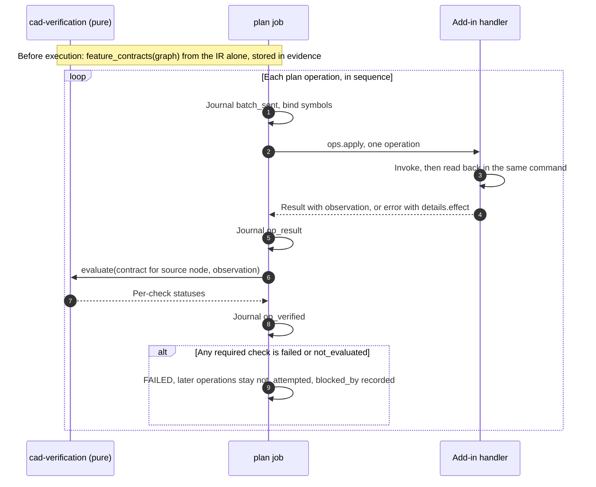

# Verifiable compilation: architecture gap analysis

Date: 2026-11-05. Reviewed at `0222b15` on `feat/part-chain-mvp`, against specification v1.31. This is a review only: no production code, schema, specification or ADR was changed. Every proposal below needs the owner's decision.

## 1. Conclusion

**The architecture can support contract-based, runtime-verifiable compilation with no redesign and no new package.** The hard structural decisions are already correct and accepted: a pure compiler, facts in C# and judgement in Python (ADR-063), three separate outcomes, a journal, and a working-file publish that only happens after verification.

**The code cannot do it yet.** The pure parts exist but nothing connects them. `cad-application` does not import `cad-compiler` or `cad-verification`, and the add-in has no part handler. A verified part cannot be produced today. That was known, and MVP Tasks 7a to 13 cover it.

**This review adds what those tasks would still leave open:**

1. **Incremental verification is specified only as a name.** Plans carry bare strings such as `rebuild_ok`, with no expected values and no evaluator. Operation results do not contain the data needed to evaluate them. The feature's actual definition is not read until phase A3, after the first milestone. If the MVP plan is built as written, the job learns a depth is wrong only at the final check, and cannot say from observation alone which feature caused it.
2. **The verification core has defects that produce wrong verdicts,** including one false pass on empty data and one case where expected geometry ignores a cut the design allows (V5, V6). These are cheap to fix now and hard to find later.
3. **Result vocabulary and failure classes are not yet complete.** `CheckResult` has only `passed: bool`. Warning, Not Applicable, Not Executed and Unsupported cannot be expressed, and a failed postcondition has no error code.

**The minimum change,** detailed in sections 10 and 11:

- One additive contract, derived from the IR by `cad-verification`, never by the compiler.
- Additive observation fields on the existing operation results.
- One pure evaluator, gated in the `plan` job.
- One journal record.
- One ADR extending ADR-063.
- Five open-decision entries.

No accepted ADR needs to be reversed.

## 2. Method and evidence

| Level | Meaning |
| --- | --- |
| **Ran** | Observed in this review by running code at `0222b15` |
| **Code** | Read in the source, with `file:line` |
| **Spec** | Documented intention only; not implemented unless also marked Code or Ran |
| **Doc** | Read in the official SOLIDWORKS 2025 API help (section 13) |
| **Spike** | Measured in the [2026-11-05 spike](2026-11-05-part-chain-spike.md); not re-measured here |

Probes were scratch scripts outside the repository. **No live SOLIDWORKS run was made.** Live API behaviour here is either from the earlier spike or from documentation, and is labelled as such.

**Fresh baseline at this commit:** see section 14.

**Moving tree.** Task 7a work appeared in the same checkout during this review (`OperationRouter`, `Ownership/`, `failed_operations`, ledger and journal changes), and was committed afterwards as `995aee6`. **All findings and line references describe the commit `0222b15`, not that work.** It was not reviewed here. It appears to address parts of V4 and V10, and should be re-checked against them.

## 3. Capability status

| Capability | Status | Evidence | Remaining gap |
| --- | --- | --- | --- |
| Semantic IR and design intent | **Partial** | Part graph built: `cad_ir/part_feature_graph/model.py`, sketch, extrude and cut only. `cad_ir/design_intent/` and `assembly_graph/` are empty; `schemas/design-intent/` holds only `.gitkeep` | Design Intent is Phase 3 by ADR-027, so this is on plan. `realizes` is modelled but consumed by nothing |
| Semantic validation | **Implemented, with holes** | `cad_compiler/validator/semantic.py` | V6, V7 |
| Dependency graph resolution | **Implemented** | `cad_compiler/graph/analyze.py`: deterministic topological order, ties by ID (5.7.1) | Affected sets of 6.3 are not computed; needed only for section 9 |
| IR lowering | **Implemented for MVP** | `cad_compiler/lowering/lower.py` | V2, V12, V13 |
| Compilation planning | **Implemented, with drift** | `planner/plan.py`, `api.py`; plan validates against `schemas/execution-plan/v0.json` in tests | V14. Geometry Resolver is a plane check only (`api.py:207`) and `needs` is never used; both acceptable until references exist |
| Compilation lifecycle | **Specified, not implemented** | `compile_bundle` exists but has no caller outside tests | V3 |
| Execution orchestration | **Partial** | `jobs/engine.py` and `jobs/check_drawing.py` work for `check_drawing`. `engine.py:17` imports that one runner; there is no `plan` job | V3 (MVP Task 9b) |
| SOLIDWORKS API execution | **Partial** | Frozen drawing adapters only. `Adapters/{Documents,Features,Geometry,Sketches}` hold only `.gitkeep` | V4 (MVP Task 8) |
| Geometry introspection | **Specified, not implemented** | `part.measure` exists in the schema and Python client; `IpcSession.cs` has no such case, so the add-in answers unknown method | V4, V8, V17 |
| Semantic and persistent references | **Grammar only** | `cad_ir/core/refs.py` parses reference syntax. `cad_references/` is empty | On plan (A6, section 7, ADR-049). Do not bring forward |
| Incremental verification | **Named, not specified or implemented** | Strings in the plan (`lower.py:105`, `:133`); no evaluator; results lack the data | V1, V2 |
| Final model verification | **Pure half implemented** | `cad_verification/part.py`: `expected_geometry`, `compare`; no caller. No reopen stage, no evidence record | V3, V5, V6, V17 |
| Recovery and replay | **Partial** | `store/journal.py` recovers `check_drawing`. Transport replay works (`cad_protocol/replay.py`), but all 22 transcripts are synthetic and none covers a plan | V9, V18 |

## 4. Findings

Severity: **Blocker** stops reliable verification, **High** gives wrong verdicts or loses evidence, **Medium** is drift or weak enforcement, **Low** is cleanup.

"Planned" names the existing task that already covers it, so nothing is proposed twice.

### Verdict correctness (pure code; can be fixed now)

**Status: V5, V6 and V7 were fixed after this review, at the owner's request.** Their text below describes `0222b15`. `CheckResult` now has `status` of `passed`, `failed` or `not_evaluated`, as ADR-063 and 8.9.6 accept, with a `reason` for `not_evaluated`. `warning` and `not_applicable` wait for ADR-064. A present but empty cylinder list still passes on a part that expects none; `completeness` (A2) is what will separate those cases. The overlap test samples vertices, edge midpoints and one interior point, so an unusual non-convex pair could escape it. That would make a correct part fail verification, not pass a wrong one.

**V5. `compare` passes on absent data and cannot say "not evaluated". High.**
- **Evidence.** Ran: `compare(expected, {}, ids)` on a part with no cylinders returns `cylinders: passed=True` with no measurement at all (`part.py:665-695`). Malformed entries are also dropped silently before matching. Ran: a truncated `bbox_m` raises `IndexError` rather than producing a result (`part.py:576`). Other missing values default to zero (`part.py:560`, `:605`, `:643`), which reads as a failed measurement instead of missing data.
- **Why it matters.** ADR-063 and 8.8.9 rule 3: absence is not success, and a check without data is `not_evaluated`. The drawing side fixed this same error (architecture review F2). `cad_drawing/checks/outcome.py` shows the correct shape.
- **Mitigating.** `part.measure` is schema-required, so a schema-valid result cannot lack the field. But `compare` is the last gate, it does not validate its input, and `build_evidence` needs the distinction anyway.
- **Fix.** Replace `passed: bool` with the status of section 9. Missing or malformed input gives `not_evaluated` with a reason. Add tests for each.

**V6. `expected_geometry` is wrong for graphs the validator accepts. High.**

| Probe (Ran) | Validator | Expected value | Consequence |
| --- | --- | --- | --- |
| Plate with a rectangular through cut, 20 × 20 mm | Accepts | Volume 60000; truth 56000 (`part.py:337` only handles `Circle`) | A correct part fails. A cut feature that removes nothing passes geometry. The [design](../specs/2026-11-05-part-chain-mvp-design.md) section 5 explicitly allows this profile |
| Two cuts removing the same Ø10 hole | Accepts | Volume 58429; truth 59215 | A correct part fails. Overlap is checked only within one cut (`semantic.py:392`) |
| Circular base with a hole outside it | Accepts | Subtracts a hole that removes nothing | Same. `_check_cut_circles_inside` returns early with no line profile (`semantic.py:341`) |

The design says its rules are narrow *because* expected geometry can be computed exactly under them, so the two must agree.

**Fix,** either way, stated per rule: implement the line-loop cut, and reject cross-feature overlap and out-of-base holes in the validator (`IR_RULE_VIOLATED`). A loop cut that is not fully inside the base also needs rejecting.

**V7. A second part in a bundle is dropped silently. High.**
- **Evidence.** Ran: a manifest with two parts and an assembly compiles to a plan containing only the first (`api.py:142`), with no diagnostic. The bundle validator allows this shape (`bundle/manifest.py`).
- **Why it matters.** It breaks "unsupported produces explicit errors, never approximate" (5.3.6). The plan's `bundle` still lists both parts, so its provenance claims more than it did.
- **Fix.** `COMPILE_UNSUPPORTED_FEATURE` until assemblies exist.

### Incremental verification

**V1. Feature definitions are never read back. Blocker for the stated lifecycle.**
- **Evidence.** Code: `schemas/ipc/ops/feature.create.json:66-84` returns only `native_id`, `feature_id`, `status`, and `status` is an unconstrained string. Spec: reading definitions waits for roadmap phase A3 behind K15, and 8.9.4 marks suppression and parents unverified.
- **Effect.** A feature that exists with the wrong depth or end condition passes every operation-level check. The final geometry check may catch the error, but then nothing observed says which feature caused it, contrary to 10.4. Parameter errors with no effect on measured geometry are never caught at all.
- **API.** Doc: `IFeature.GetDefinition` returns the data object with no selection step stated, and `IExtrudeFeatureData2.GetDepth` and `GetEndCondition` are plain getters. `AccessSelections` puts the model into a rollback state until released, so **an observer must never call it**. This narrows K15. Whether `GetDefinition` alone changes the dirty flag is not documented and remains for the spike.
- **Fix.** Bring the K15 spike forward for extrude only, immediately after M1. Section 11, step R5.

**V2. Postconditions cannot be evaluated. Blocker.**
- **Evidence.**
  - Plans hold bare names: `["feature_exists", "feature_status_ok", "rebuild_ok"]` (`lower.py:133`), and the schema allows only strings (`schemas/execution-plan/v0.json:116`).
  - `entity_count` has no expected count, and `parameter_equals` (6.5.3) has nowhere to put a value and is never emitted.
  - `rebuild_ok` cannot be judged from the operation's result, which contains nothing about rebuild.
  - `op_1` (`part.create`) has no postconditions and `source: null`. `verification_points` lists IDs with no statement of what runs there.
  - No evaluator exists anywhere, although 8.8.6 assigns it to the core.
- **Fix.** Section 6. **Do not put expected values in the plan:** that would let a lowering error agree with itself. 8.9.10's own seeded defect ("plan depth 9 mm, graph 10 mm") could not be caught that way.

**V8. "Rebuild OK" is undefined, and the forced rebuild has no operation. High.**
- **Evidence.** Code: `document.rebuild` appears in 8.4.1 and 8.9.3 and in the vocabulary (6.5.2), but `schemas/ipc/ops/` has no file for it, the compiler emits none, and MVP Task 8 does not list it. `PartRebuildResult` has `ok` and `errors` with no stated source, and no warnings.
- **API.** Doc: `ForceRebuild3` returning true means the features were rebuilt; the page does not say they are free of errors. So `rebuild.ok` must not be that return value.
- **Conflict.** 8.7 measures a reopened file without rebuilding and ADR-063 forbids observers from rebuilding, so `part.measure.rebuild` can only report stored state. Whether error codes are populated on a reopened, unrebuilt document is unverified.
- **Fix.** Define `rebuild` as observed state: `IModelDocExtension.GetWhatsWrong` (features, codes, warning flags) plus `NeedsRebuild2` (0 means fully rebuilt). Keep the rebuild's own return as a separate field on the operation. Add the operation schema and a Task 8 test. Add a spike question, K19.

**V9. The journal keeps no observed results. High.**
- **Evidence.** Code: `OpResultRecord` holds `ok` and `error_code` only (`journal_records.py:68`), matching 13.2.3. `feature_ids` lives only in `part_result`, written at the end. The add-in ledger answers IDs only (`OperationLedger.CompletedIds`).
- **Conflict.** 8.9.6 says recovery writes evidence "from the journal alone". After a crash the node-to-feature map and every per-operation result would be gone. 8.8.9 calls the journal the authority, but it does not hold the fact.
- **Fix.** One additive journal record per operation (section 10.3), fsynced like the others. Holds measurements and IDs, not geometry dumps (G3).

**V10. Failure classes are incomplete. High.**
- **Evidence.** Code: `schemas/common/errors.json` has `COMPILE_FAILED`, `BACKEND_REBUILD_ERROR` and `PART_VERIFICATION_FAILED`, but no code for a failed postcondition, and `PROPOSED_OPERATION_FAILED` and `details.effect` are not added yet (planned A0). `failed_operations` appears nowhere in the schema, client or add-in (planned Task 7a). `OpsBatchRunner.cs:59` does not record failures (K17, planned Task 7a).
- **Fix.** Add one code, and `failure_class` in evidence (section 9).

### Wiring and false success

**V3. No `plan` job. Blocker; planned Task 9b.** Code: no module under `cad_application` or `core_service` imports `cad_compiler` or `cad_verification`. `compilation/`, `execution/`, `recovery/` and `synchronization/` are empty. `schemas/mcp/` has no `apply_part_graph`. `get_execution_status` does not yet have `part_result`.

**V4. Add-in cannot execute or measure parts, and unknown operations report success. Blocker; planned Tasks 7a and 8.** Code: `SwAddin.cs:544` answers `status: applied` for an unknown operation, which `OpsBatchRunner.cs:64` then records as completed. `SwAddin.cs:442` reports `closed: true` unchecked, and closes by file name, which the spike showed the lookup cannot verify. Python's compile-time capability check currently stops part operations reaching this path, but `:544` must go before any part handler lands.

**V13. Capability checks cover 3 of the operations a plan job needs. Medium.** Code: `lower.py:27-71` checks `part.create`, `sketch.create`, `feature.create`. It does not check `part.measure`, `document.save`, `document.rebuild`, `document.open` or `document.close`, which the job also needs, nor the variants of 8.9.7. So the plate compiles against a backend that cannot verify it, contrary to 6.6. Variants are planned in A2; the rest is not.

### Boundaries and enforcement

**V12. SOLIDWORKS terms in neutral packages. Medium.**
- `cad_verification/part.py:186`, `:196`, `:204`, `:501-503` hard-code `ProfileFeature`, `Extrusion`, `ICE`, `Boss-Extrude`, `Cut-Extrude`. `Boss-Extrude` is a display-style name, and ADR-021 forbids identifying features that way. Accepting both neutral and native strings also makes the contract ambiguous.
- `lower.py:123` emits `dir: True`, and `feature.create.json:58` accepts it. 8.9.3 rule 4 bans vendor terms in params, and 8.9.8's translator already sets `ReverseDirection`, so the rule would live in two places. 6.5.2 and 8.9.3 contradict each other here.
- `profile.py:43` reads `session.solidworks`. This is minor: the field is schema-named and only hashed.
- **API.** Doc: the `GetTypeName2` table lists `Boss`, `BossThin`, `Cut`, `CutThin`, `Extrusion` for `IExtrudeFeatureData2`, and a note treats `ICE` as an Instant3D type. Spike: a `FeatureCut4` cut reported `ICE`. So a correct cut could report a type the check rejects. See K21.
- **Fix.** The add-in maps native types to the neutral `type` in one pure Core table and reports raw `native_type` beside it, as 8.9.4 already illustrates. `cad-verification` compares only the neutral value. Remove `dir` from the plan and schema.

**V14. Plan determinism drifts from 6.7.4. Medium.**
- **Evidence.** Ran: identical content at revisions 1 and 2 gives different plan hashes, because `plan.py:26` keeps `str(m)` with its revision. 6.7.4 says the opposite, and `test_compile.py:153-163` asserts the code's behaviour under a name that sounds like the spec's. 6.5.3's `bundle` field reads closer to the code. The specification disagrees with itself, so this needs an owner choice, not a quiet fix.
- **Also.** `LoweringResult.defaults_applied` is always empty and dropped, and the plan copies the whole table (`plan.py:33`), against 6.5.3 "by node and parameter". `COMPILE_PLAN_INVALID` is never emitted, because plans are validated only in tests.
- **Effect.** Low today: only a cache miss. Fix it before Task 9a relies on reuse.

**V15. Import rules do not enforce what AGENTS.md says. Medium.**
- **Evidence.** Ran: `lint-imports` passes 5 of 5. But those contracts only forbid our own packages, so AGENTS.md's "zero I/O … enforced by `lint-imports`" is not what they do. Nothing forbids `os`, `pathlib`, `time` or `datetime` in pure packages. `tests/contract/test_application_io.py` covers only `cad_application`. A search found no such import today, so this is unprotected, not violated.
- **Independence is also unprotected.** No contract stops `cad_verification` importing `cad_compiler`, the import that would break "the two never share a calculation" (8.8.1, ADR-063).
- **Fix.** Extend the AST test to the pure packages. Add one `independence` contract between `cad_compiler` and `cad_verification`.

**V16. `cad-geometry` is empty and its job is done elsewhere. Medium.** Code: `cad_geometry/{measurements,signatures,topology}` are empty and imported by nothing. Polygon logic exists three times: `semantic.py:60` and `:301`, `part.py:133`, and `cad_drawing/checks/geometry2d.py:135`. `cad-compiler` and `cad-verification` declare dependencies they do not use. Sharing polygon maths between the validator and `expected_geometry` does not break independence, since it is lowering that must stay separate. Move it when a second real user appears (V6's loop cut is one), not as a cleanup project.

**V17. `part.measure` falls short of final verification. Medium.** Section 7 lists each gap. Most important: no surface body count, so a stray surface body goes unseen; no body validity check; no warnings; and `IModelDocExtension.CreateMassProperty` is marked obsolete in the 2025 docs. Its successor, `CreateMassProperty2`, documents pre-selection through `SelectByID2`, which `BannedSymbols.txt` bans. See K20. Tolerances are module constants (`part.py:18-20`), although 10.3 says configurable.

**V18. Replay has no real evidence. Medium; partly planned.** Ran: none of the 22 files in `tests/fixtures/ipc/` has `source: recorded`, and none covers a plan. `_masked` (`replay.py:127`) strips `_meta` only, so R1's "same commands apart from bound symbols" (8.8.7) needs masking for operation IDs, feature IDs and paths, which is not yet specified. Planned: `plan_*` transcripts in Task 9b, R1 in A2.

**V19. Plan operation keys are positional. Low.** Code: `op_<sequence>` (`lower.py:125`, `:168`). Inserting a node renumbers everything after it, which complicates diffing (section 9, P2). Keying by node ID costs almost nothing before any stored plan exists: `sequence` still gives `<job_id>:<seq>`, and `source` remains the trace.

**V20. Spec drift in the layout. Low.** `solidworks-adapter` (8.8.4) says to remove `Adapters/Verification`, while section 17 still lists verification under Adapters. Recovery lives in `store/journal.py`, although section 17 names `recovery/`. `cad_verification/{api,geometry,design_intent}` are empty beside `part.py`.

## 5. Dependencies and responsibilities

| Claim to verify | Verdict | Evidence |
| --- | --- | --- |
| `cad-compiler` stays backend-neutral | **Mostly.** No vendor import; `lint-imports` passes. Leaks `dir`, and reads one vendor-named field | V12 |
| `cad-application` owns compilation and execution orchestration | **By design, not yet in code.** Only `check_drawing` runs | V3 |
| `cad-protocol` owns IPC contracts and transport | **Yes for transport, by design for contracts.** Message types are generated into `cad_ir.generated`, as G2 requires so the application can import them. Contracts themselves are owned by `schemas/` (ADR-035, ADR-061). This is intended | `backend.py`, `ipc_client.py` |
| `ExecutionServer.Adapters` owns SOLIDWORKS operations | **Partly.** `SwAddin.cs:409-442` has `OpenDoc6` and `CloseDoc` in the AddIn. Already noted in 8.8.4, fixed by Task 7a | V4 |
| `cad-verification` owns verification logic and contracts | **Logic for final checks only.** Contracts, evaluator, evidence and reconciliation do not exist. Drawing checks in `cad-drawing` are intentional (section 17) and pure, but use a separate status vocabulary | V2, V11 in section 9 |
| `cad-geometry` owns reusable measurements and signatures | **No.** Empty | V16 |

**No dependency violations were found.** Fresh: 5 contracts kept, 0 broken. The gaps are unprotected rules (V15), duplicated polygon logic (V16), and these missing interfaces:

| Missing interface | Where | Status |
| --- | --- | --- |
| Contract from IR: `feature_contracts(graph)` | `cad_verification/api/` (empty folder, already in section 17) | New in this review |
| Evaluator: `evaluate(contract, observation)` | Same | New in this review |
| `build_evidence`, `reconcile` | `cad-verification` | Specified 8.9.6, 8.9.9 |
| Router, `IOperationHandler`, read handlers | `ExecutionServer.Core/Dispatch` | Specified 8.9.8 |
| `Backend.completed_operations` returning failures | `ports.py:72` returns IDs only | Specified 8.7 |
| Job dispatch by spec type | `engine.py:213` calls `run` directly | Planned Task 9b |

## 6. Incremental verification

### 6.1 Current support

| Criterion | Specified | Implemented | Gap |
| --- | --- | --- | --- |
| Feature existence | Yes: `feature_exists`, 8.9.3 | Field in schema only | Handler returns null-or-feature; no evaluator |
| Feature type | Only at final check (10.2.1) | `part.py:495`, final only | V12; no per-operation check |
| Definition and parameters | `parameter_equals` named only | **No** | V1 |
| API errors and warnings | `effect`, 8.9.5; `status` values, 8.9.3 | **No** | V10; warnings absent from every schema |
| Rebuild status | Named `rebuild_ok` | **No** | V8 |
| Reference validity | Plan pins references (ADR-049) | **No.** MVP uses plane roles only | Later (A6). `parents` is the cheap proxy now |
| Geometry validity | Final only | **No** | Deliberately light at this stage; see 6.3 |
| Operation and IR-node traceability | `source`, `node_id`, 8.9.6 | **Plan and wire: yes** (`lower.py:103`, `:131`). Evidence: no | V9; this is the strongest part of the design |
| Failure propagation and blocking | Batch stops at first failure, 6.5.1 | **Add-in: yes** (`OpsBatchRunner.cs:21`) | A failed *verification* has no gate, and no record of what it blocked |

### 6.2 Proposed lifecycle

This follows the requested seven steps, using only existing components.



**Key decisions, each with its reason:**

- **The contract comes from the graph, not the plan.** Expected values must stay independent of lowering (ADR-063, 10.2.1). The plan's existing `postconditions` keep naming what applies, and the job joins through `source`. This keeps the plan byte-identical and catches the "plan depth 9, graph 10" defect.
- **Observation returns in the same command.** A separate inspect command would add a round trip per feature and leave a gap for an engineer's edit. It stays coarse (ADR-032) and matches stage 4 of 8.8.6, which already reads back.
- **Fail fast, not partial continuation.** Plans are linear, the batch already stops, and working files are never repaired (8.8.8). `depends_on` is not needed to decide what runs next. It only explains in evidence why an operation was not attempted. No DAG scheduler is needed.
- **The evaluator stays in the core.** The adapter fails an operation only when it sees no effect (8.8.6).

### 6.3 Cost tiers

| Tier | When | Reads | Status of the facts |
| --- | --- | --- | --- |
| **T0, always** | Every operation | `GetID`, type, `GetErrorCode2`, `IsSuppressed2`, sketch entity count, `GetParents`, `IModelDoc2.GetUpdateStamp` | Doc, except `GetID` and type, which are Spike |
| **T1, cheap state** | Every solid feature | `GetDefinition` depth and end condition, `NeedsRebuild2`, solid body count | Doc; side effects unverified (K15) |
| **T2, optional** | Verification points, off by default | Volume delta against the IR | Spike for values; cost unmeasured (K18) |
| **T3, final** | Section 7 only | Full measurement, twice | Spike |

Full-model verification is never required after each feature. T2 exists because a feature can be healthy and still remove nothing. Enable it by default only if K18 shows the cost is small.

`GetUpdateStamp` is a useful signal for "something changed between my commands", but not proof that nothing did. Doc: the feature-level stamp's page says SOLIDWORKS does not track every interaction between features. It can supplement document events (8.3 rule 13), not replace them.

### 6.4 Contract shape

Illustrative only. `schemas/` becomes normative once written.

```json
{ "node": "extrude_base", "level": "exact", "checks": [
    { "check": "feature_exists", "required": true },
    { "check": "feature_type", "expected": "extrude", "required": true },
    { "check": "feature_healthy", "required": true },
    { "check": "not_suppressed", "required": true },
    { "check": "parents_include", "expected": ["sketch_base"], "required": true },
    { "check": "end_condition", "expected": "blind", "required": true },
    { "check": "parameter_equals", "parameter": "depth", "expected": 10, "unit": "mm",
      "tolerance": { "kind": "quantum" }, "required": false },
    { "check": "solid_body_count", "expected": 1, "required": true }
] }
```

- `required: false` on `parameter_equals` until the K15 spike passes. Its result is `not_evaluated` with reason `unsupported`, recorded honestly and non-blocking. It becomes required per feature type when its capability exists.
- `level` is K16's recommendation (`exact`, `bounded`, `declared`, `structural`). Reserving the field now is cheap and stops a later feature looking verified on weak checks. Only `exact` is used in the MVP.
- **Sketches** get `entity_count` from the IR. `fully_defined` via `ISketch.GetConstrainedStatus` arrives with relations (A4), and is `not_applicable` until then, since MVP sketches have fixed coordinates.

## 7. Final verification

| Check | Today | Belongs in | Add-in observer | Gap |
| --- | --- | --- | --- | --- |
| Feature tree and dependencies | Count, ID, type, status (`part.py:507`) | `cad-verification` | `part.measure.features` | Add `parents`, `tree_order`, `native_type`. Order is not checked |
| Full rebuild | Boolean, undefined source | `cad-verification` | `document.rebuild`, then What's Wrong | V8 |
| Solid body count | Yes, hard-coded expectation of 1 | `cad-verification` | `GetBodies2` Spike | Fine for MVP |
| Surface body count | **Missing** | `cad-verification` | `GetBodies2` with the sheet type | **Add.** Expected 0 |
| Bounding box | Yes | `cad-verification` | `GetBodyBox` Spike | K12 for curves; union for several bodies is unstated |
| Volume, area, center of mass | Yes | `cad-verification` | Mass property Spike | K20 |
| Body validity | **Missing** | `cad-verification` judges | `IBody2.Check3`, fault count (Doc) | **Add.** Final stage only; cost unmeasured |
| Geometric signature | **Missing** beyond cylinders | **`cad-geometry`** defines; `cad-verification` compares | Face, edge, vertex counts by surface type | Add counts with a cut-exact expectation; full 7.3 signature waits for references |
| Cylinders | Yes, bipartite match (`part.py:413`) | Matching in **`cad-geometry`** later | `CylinderParams` Spike | Keep |
| Topology and reference consistency | **Missing** | **`cad-references`** resolves; `cad-verification` reports | `geometry.candidates`, ADR-049 | A6. Not MVP |
| Design-intent constraints | **Missing** | `cad-verification/design_intent` | Measurements only | Phase 3, ADR-027. Existing folder is right |
| Dimensional tolerances | Fixed constants | `cad-verification`, per check | None | Move to per-check data, already in the 8.9.6 shape |
| Geometric tolerances | **Missing** | `cad-verification/design_intent`; values in Drawing Intent (ADR-013) | None | Later |
| Reopen stage | **Missing** in code | `plan` job calls `compare` twice | `document.open` read-only | Planned Task 9b |

**Allocation rule:**
- **`cad-geometry`:** pure calculations with no pass or fail: section properties, signatures, matching.
- **`cad-references`:** identity decisions: which entity is this.
- **`cad-verification`:** contracts and verdicts: is this right, within what tolerance, and on what evidence.

## 8. Determinism, traceability and recovery

**Deterministic planning does not imply deterministic geometry.** 8.8.7 already states this well with levels R0 to R4, and this review adopts it unchanged. R0 is evidenced here, apart from V14. R1 to R4 have no implementation. Native files, `f<GetID()>` values and fingerprints across builds are explicitly not claimed, and that remains correct.

| Concern | Status | Note |
| --- | --- | --- |
| Deterministic plans | **Implemented, Ran.** Fresh-process hash test passes | V14 |
| Stable IR node identity | **Implemented.** Keyed IDs (ADR-048), echoed as `node_id` | Sketch entity IDs are dropped in lowering (`lower.py:76`); harmless until partial sketch verification |
| Operation IDs and idempotency | **Implemented** in the ledger (`OperationLedger.cs`) | Lives in memory, as designed. Failure recording: V10 |
| Feature-to-IR traceability | **Partial.** Forward path exists; the join record does not | V9 |
| Native identity | Doc: `GetID` is unique within the document and persists across sessions. Spike: held across reopen | K14 remains for copies, rebuilt files and recreated features |
| Verification persistence | **Missing.** `evidence.json`, `part_result` not implemented | Planned A0, A2, Task 9a; V9 |
| Partial failure | **Designed well** (8.8.8): `.failed` file, target untouched. Not built | Preserve |
| Interrupted execution | **Implemented for `check_drawing`.** Never resumes, by design | V9 for evidence. Plan-specific: Task 9a |
| Replay | **Transport works; no real data** | V18 |
| Recompilation after IR change | **Missing; P2** (section 9). `part.create` refuses an existing path, so today's answer is a new build at a new target | State this in the `apply_part_graph` contract. V19 is the only preparation worth doing now |

## 9. Contracts and results

**IR.** The Part Feature Graph has no verification fields (a search of the schema finds none). For `exact` nodes none are needed, because the contract derives from the geometry. An optional per-node `expect` is needed only for K16's `declared` level. Do not add it yet.

**Result status: V11, High.** Three vocabularies exist today:

| Where | Values |
| --- | --- |
| `cad_verification/part.py:122` (Code) | `passed: bool` |
| 8.9.6 evidence (Spec) | `passed`, `failed`, `not_evaluated` with `reason` |
| `cad_drawing/checks/outcome.py` (Code) | `pass`, `fail`, `not_evaluated` with reason codes |

Proposed mapping of the six requested states, extending ADR-063 rather than replacing it:

| Requested | Representation | Counts as success? |
| --- | --- | --- |
| Passed | `status: passed` | Yes |
| Failed | `status: failed` | No |
| Warning | `status: warning` with the native warning | **Owner decision, K22.** Recommended: blocks COMMITTED in the MVP, as `part.py:530` effectively does now |
| Not Applicable | `status: not_applicable`, with `reason`, decided from the IR alone | Neither; ignored in rollup. A backend can never declare it, or a check could excuse itself |
| Not Executed | `status: not_evaluated`, `reason: not_executed` | No |
| Unsupported | `status: not_evaluated`, `reason: unsupported` | No, unless the contract marks the check `required: false` |

The existing `completeness` state `unavailable` maps to `reason: unavailable`. Keeping `not_evaluated` as the single non-verdict preserves ADR-063's rule that it never counts as passed.

**Failure classes.** Proposed additive evidence field `outcome.failure_class`:

| Class | Stage | Code | Job | Status |
| --- | --- | --- | --- | --- |
| `compilation` | VALIDATED | `COMPILE_FAILED`, with diagnostics | FAILED, nothing executed | Code exists |
| `execution` | EXECUTING, operation error | `BACKEND_REBUILD_ERROR`, `PROPOSED_OPERATION_FAILED` with `effect` | FAILED | Partly planned |
| `feature_verification` | EXECUTING, contract failed | `PROPOSED_FEATURE_VERIFICATION_FAILED` with `details.node` and `details.checks` | FAILED | **New** |
| `final_verification` | VERIFYING | `PART_VERIFICATION_FAILED` | FAILED | Exists, no caller |

**A successful API call never implies success.** The design holds this (8.8.9 rule 1, 8.9.6 COMMITTED rule). The code does not yet: `SwAddin.cs:544` is the direct counterexample (V4).

## 10. Required changes

All additive under ADR-042 unless stated.

### 10.1 Schemas

| File | Change |
| --- | --- |
| `schemas/execution-evidence/v0.json` (already planned A0) | Add `$defs/VerificationContract` and check results with expected, observed, tolerance, status, reason. Add `failure_class`, `blocked_by`. Extend the status enum. **No separate schema folder** |
| `schemas/ipc/ops/feature.create.json` | Result: constrain `status`; add `observation` (`native_type`, `error_code`, `is_warning`, `suppressed`, `parents`, `parameters`, `solid_body_count`, `needs_rebuild`, `update_stamp`, `completeness`). **Remove `dir`** (not additive, but no consumer exists yet) |
| `schemas/ipc/ops/sketch.create.json` | Result: same observation subset |
| `schemas/ipc/ops/document.rebuild.json` | **New file.** Named in 6.5.2 and 8.9.3 but absent |
| `schemas/ipc/v0.json` | `PartMeasureResult`: `surface_body_count`, `body_faults`, `topology`, `completeness` (planned). `PartFeatureInfo`: `native_type`, `parents`. `PartRebuildResult`: `warnings`, and a defined source |
| `schemas/store/v0.json` | `OpVerifiedRecord`; `part_result.evidence_ref` |
| `schemas/common/errors.json` | `PROPOSED_FEATURE_VERIFICATION_FAILED`, alongside A0's addition |
| `schemas/part-feature-graph/`, `schemas/execution-plan/` | **No change for contracts.** A plan fix only if the owner decides V14 |

### 10.2 Interfaces

| Interface | Change |
| --- | --- |
| `cad_verification` | `feature_contracts(graph)`, `evaluate(contract, observation)`, the new `CheckResult`. Same style as `expected_geometry`: pure, IR only |
| `cad_compiler.lower_graph` | Stop emitting `dir`. Extend the capability check (V13). Reject V6 and V7 cases |
| `Backend` | No new method. 8.9.2 is right to stay small |
| `IOperationHandler` | No change: `Execute` returns JSON, and stage 4 fills in `observation` |
| `ExecutionServer.Core/Parts` | One pure table from native type to neutral type |
| `ExecutionServer.Adapters/Native` | One small observer used by every feature handler |
| Import contracts | Add independence and the pure-package I/O test (V15) |

### 10.3 Journal (13.2.3)

Additive record `op_verified`: `operation_id`, `node`, `feature_id`, `observation`, `checks`, `status`. The rule from 13.2.3 applies: the reader's mapping and the schema change together. It makes "evidence is a projection of the journal" literally true.

### 10.4 ADRs

| ADR | Decision | Relation |
| --- | --- | --- |
| **ADR-064 (proposed)** | Per-operation verification contracts derived from the IR; tiers; fail fast; status vocabulary with `not_applicable` and `warning`; failure classes | **Extends ADR-063 explicitly.** Keeps its boundary, three outcomes and the `not_evaluated` rule. Also extends ADR-007 |

No accepted ADR is overturned. ADR-056 and the drawing freeze (ADR-057) are not touched. ADR-022 is strengthened: `AccessSelections` is ruled out for observers.

### 10.5 Open-decision entries to add

| ID | Question | Recommendation | Blocks |
| --- | --- | --- | --- |
| K18 | What does per-feature observation cost at each tier, on a part with many features? | Measure on the spike's 1,600-hole part; set the T2 default from data | T2 only |
| K19 | Are What's Wrong and `GetErrorCode2` valid on a reopened, unrebuilt document? Is a forced-error part reliably reported? | Spike. Seed failures with `AllowFailedFeatureCreation(true)` (Doc), which also answers 8.9.10's "if a repeatable way exists" | Reopen rebuild check |
| K20 | Mass property API, given `CreateMassProperty` is obsolete and its successor documents banned pre-selection | Spike `CreateMassProperty2` with no selection and with `SelectedItems`. Keep the spike-proven call until then, behind one method | Nothing today; 2026 admission |
| K21 | Which native type strings occur for extrude and cut, and does `GetDefinition` work on `ICE`? | Spike with `GetTypeName` and `GetTypeName2`; record in the Core table | Type check |
| K22 | Do feature warnings block COMMITTED? | Yes in the MVP. Allow a reviewed list later | ADR-064 |

Also narrow **K15** with the `AccessSelections` finding, and move its extrude subset earlier. **K16's** `level` field is reserved now; its decision stays before A6. `AllowFailedFeatureCreation` is process-wide, so tests must restore it, and the settings guard should treat it as guarded state.

### 10.6 Specification sections to update

Bump to v1.32 with a changelog entry when accepted:
- 6.5.3 postconditions.
- 6.7.4 or 6.5.3, whichever loses V14.
- 8.4.1 EXECUTING.
- 8.7 `part.measure` and rebuild meaning.
- 8.9.3 to 8.9.6.
- 10.2 and 10.2.1.
- 13.2.3.
- 17 (V20).

## 11. Roadmap

This extends the existing plans and adds no competing task list. Size: **S** a few files, **M** one component.

| Step | Work | Findings | Fits | Size | Needs SOLIDWORKS |
| --- | --- | --- | --- | --- | --- |
| **R0** | Owner decides ADR-064, K22, V14 | | Now | S | No |
| **R1** | Fix verdict bugs: status model in `compare`, V6 and V7 validator and expected-geometry fixes, seeded tests | V5, V6, V7, V11 | Before Task 7a; pure and independent | M | No |
| **R2** | Schemas and spec: contract, statuses, `document.rebuild`, observation, journal record; remove `dir`; capability check; import contracts | V2, V8, V10, V12, V13, V15 | Merges into **A0** | M | No |
| **R3** | `feature_contracts`, `evaluate`, with every check seeded to fail offline | V2 | Before Task 9b | S | No |
| **R4** | Observer on handlers; rebuild operation; measure additions, T0 and What's Wrong only | V1 partly, V8, V17 | Inside **Task 8** | M | Yes |
| | Gate, `op_verified`, failure classes, evidence | V3, V9, V10 | Inside **Tasks 9a, 9b** | M | No |
| | **Milestone M1: verified plate, per-feature evidence, seeded defects** | | Task 12, 13 | | Yes |
| **R5** | Spikes K15 (extrude), K18, K19, K20, K21 on a throwaway instance. Then T1 parameter checks become required | V1 | Directly after M1, ahead of the rest of **A3** | M | Yes |
| **R6** | Recorded transcripts and R1 masking; V19 key change if accepted | V18, V19 | A2, A3 | S | Yes, once |
| **R7** | Body validity, surface bodies, topology counts in `cad-geometry` | V16, V17 | A3 | M | Yes |
| **R8** | K16 levels used for real; references; design-intent checks; section 9 sync | | A5, A6, Phase 2, 3 | L | Yes |

**Why this order.** R1 to R3 are cheap, offline, and change contracts before add-in code consumes them. R4 stays minimal so M1 does not slip. Parameter read-back waits for R5 because its side effects are unproven and the owner's rule is no unverified API on a shared session. The plate's final checks catch those errors meanwhile, and evidence reports `not_evaluated` honestly.

**Not recommended:**
- Full measurement after each feature.
- A DAG scheduler.
- Resume after failure.
- A new verification package or schema folder.
- Building out `cad-references` early.
- Touching frozen drawing code.

## 12. Preserve without modification

| Keep | Why |
| --- | --- |
| Pure compiler stages and `StageResult`, `analyze_graph`, R0 tests | Sound, and tested in a fresh process |
| `<job_id>:<seq>`, ledger semantics, stop-at-first-failure in `OpsBatchRunner` | Correct idempotency. Only K17's additive failure recording changes |
| `Backend` port (`ports.py:56`) | Small and neutral; 8.9.2 is right |
| Named pipe, framing, handshake, chunks, `IpcClient`, `ReplayTransport` | The most mature part of the add-in side |
| Generator and the schema-first flow (ADR-035, ADR-051) | No drift at this commit |
| Job state machine, `TRANSITIONS`, journal ordering, `recover`, atomic store | Sound, and tested for crashes. Only additive records |
| Working-file rule, no-replace publish, `publish_intent` design (8.4.1, ADR-046) | Target safety does not depend on recovery being perfect |
| The 8.8 boundary and five-stage handler (ADR-058 to ADR-063) | This review extends it, and found nothing to overturn |
| `expected_geometry`'s independence from SOLIDWORKS, bipartite cylinder matching, run-all comparison | The correct core, once V5 and V6 are fixed |
| Determinism levels R0 to R4 (8.8.7) and stated limits (8.8.9) | Already honest about what is not claimed |
| Spike-verified call sequences | The only measured API facts in the project |
| `SettingsGuard`, session discovery | Built and tested |
| Drawing checks in `cad-drawing`, all frozen adapters | ADR-057 |

## 13. SOLIDWORKS API facts checked

Read from the official 2025 API help (site footer: API Help 2025 SP05). Documentation states behaviour, not that this project's calls work, so each **still needs a live check before use**.

| Member | What the documentation establishes | Use here |
| --- | --- | --- |
| [`IFeature.GetErrorCode2`](https://help.solidworks.com/2025/english/api/sldworksapi/SolidWorks.Interop.sldworks~SolidWorks.Interop.sldworks.IFeature~GetErrorCode2.html) | Returns `swFeatureError_e`, with an out flag for warning, valid only when the code is non-zero | Feature health |
| [`swFeatureError_e`](https://help.solidworks.com/2025/english/api/swconst/SolidWorks.Interop.swconst~SolidWorks.Interop.swconst.swFeatureError_e.html) | 0 is no error, 1 unknown; has extrude-specific values such as disjoint | Diagnostics only |
| [`IFeature.GetDefinition`](https://help.solidworks.com/2025/english/api/sldworksapi/SolidWorks.Interop.sldworks~SolidWorks.Interop.sldworks.IFeature~GetDefinition.html) | Query the feature data object; not all types supported; release when done. Side effects not stated | Definition read |
| [`IExtrudeFeatureData2.GetDepth`](https://help.solidworks.com/2025/english/api/sldworksapi/SolidWorks.Interop.sldworks~SolidWorks.Interop.sldworks.IExtrudeFeatureData2~GetDepth.html), [`GetEndCondition`](https://help.solidworks.com/2025/english/api/sldworksapi/SolidWorks.Interop.sldworks~SolidWorks.Interop.sldworks.IExtrudeFeatureData2~GetEndCondition.html) | Per direction; end condition as `swEndConditions_e` | Parameter checks |
| [`IExtrudeFeatureData2.AccessSelections`](https://help.solidworks.com/2025/english/api/sldworksapi/SolidWorks.Interop.sldworks~SolidWorks.Interop.sldworks.IExtrudeFeatureData2~AccessSelections.html) | Puts the model in a rollback state until modified or released | **Banned in observers** |
| [`IFeature.IsSuppressed2`](https://help.solidworks.com/2025/english/api/sldworksapi/SolidWorks.Interop.sldworks~SolidWorks.Interop.sldworks.IFeature~IsSuppressed2.html) | Per configuration, array of booleans | Suppression |
| [`IFeature.GetParents`](https://help.solidworks.com/2025/english/api/sldworksapi/SolidWorks.Interop.sldworks~SolidWorks.Interop.sldworks.IFeature~GetParents.html) | Direct parents only | Dependency check |
| [`IFeature.GetFaces`](https://help.solidworks.com/2025/english/api/sldworksapi/SolidWorks.Interop.sldworks~SolidWorks.Interop.sldworks.IFeature~GetFaces.html) | A face can be owned by several features; draft features return none | Not a general existence test |
| [`IFeature.GetID`](https://help.solidworks.com/2025/english/api/sldworksapi/SolidWorks.Interop.sldworks~SolidWorks.Interop.sldworks.IFeature~GetID.html) | Unique within the document, persists across sessions, unaffected by rename | Supports 5.3.6. Says nothing about copies or rebuilt files (K14) |
| [`IFeature.GetTypeName2`](https://help.solidworks.com/2025/english/api/sldworksapi/SolidWorks.Interop.sldworks~SolidWorks.Interop.sldworks.IFeature~GetTypeName2.html) | Type table; `IExtrudeFeatureData2` covers `Boss`, `BossThin`, `Cut`, `CutThin`, `Extrusion` and others; `ICE` is discussed as Instant3D | K21 |
| [`IModelDocExtension.GetWhatsWrong`](https://help.solidworks.com/2025/english/api/sldworksapi/SolidWorks.Interop.sldworks~SolidWorks.Interop.sldworks.IModelDocExtension~GetWhatsWrong.html) | Arrays of features, codes and warning flags | `rebuild` source |
| [`IModelDocExtension.NeedsRebuild2`](https://help.solidworks.com/2025/english/api/sldworksapi/SolidWorks.Interop.sldworks~SolidWorks.Interop.sldworks.IModelDocExtension~NeedsRebuild2.html), [`swModelRebuildStatus_e`](https://help.solidworks.com/2025/english/api/swconst/SolidWorks.Interop.swconst~SolidWorks.Interop.swconst.swModelRebuildStatus_e.html) | Bitmask; 0 is fully rebuilt | Rebuild state |
| [`IModelDoc2.ForceRebuild3`](https://help.solidworks.com/2025/english/api/sldworksapi/SolidWorks.Interop.sldworks~SolidWorks.Interop.sldworks.IModelDoc2~ForceRebuild3.html) | Active configuration; true means features were rebuilt | Not a health verdict (V8) |
| [`ISldWorks.AllowFailedFeatureCreation`](https://help.solidworks.com/2025/english/api/sldworksapi/SolidWorks.Interop.sldworks~SolidWorks.Interop.sldworks.ISldWorks~AllowFailedFeatureCreation.html) | Default: invalid geometry creates no feature. True: created with rebuild errors | Explains null returns; seeded defect; session state to guard |
| [`IModelDoc2.GetUpdateStamp`](https://help.solidworks.com/2025/english/api/sldworksapi/SolidWorks.Interop.sldworks~SolidWorks.Interop.sldworks.IModelDoc2~GetUpdateStamp.html), [`IFeature.GetUpdateStamp`](https://help.solidworks.com/2025/english/api/sldworksapi/SolidWorks.Interop.sldworks~SolidWorks.Interop.sldworks.IFeature~GetUpdateStamp.html) | Rises on state and geometry change, not on name or colour; feature tracking is incomplete | Change signal only |
| [`IBody2.Check3`](https://help.solidworks.com/2025/english/api/sldworksapi/SolidWorks.Interop.sldworks~SolidWorks.Interop.sldworks.IBody2~Check3.html) | Returns `IFaultEntity` | Body validity |
| [`CreateMassProperty`](https://help.solidworks.com/2025/english/api/sldworksapi/SolidWorks.Interop.sldworks~SolidWorks.Interop.sldworks.IModelDocExtension~CreateMassProperty.html), [`CreateMassProperty2`](https://help.solidworks.com/2025/english/api/sldworksapi/SolidWorks.Interop.sldworks~SolidWorks.Interop.sldworks.IModelDocExtension~CreateMassProperty2.html) | The first is obsolete; the second documents pre-selection or `SelectedItems` | K20 |
| [`ISketch.GetConstrainedStatus`](https://help.solidworks.com/2025/english/api/sldworksapi/SolidWorks.Interop.sldworks~SolidWorks.Interop.sldworks.ISketch~GetConstrainedStatus.html) | `swConstrainedStatus_e` | `fully_defined`, A4 |
| [`IDimension.GetSystemValue3`](https://help.solidworks.com/2025/english/api/sldworksapi/SolidWorks.Interop.sldworks~SolidWorks.Interop.sldworks.IDimension~GetSystemValue3.html) | System units, per configuration; linked example reads an extrusion's depth | Alternative depth read if `GetDefinition` fails K15 |
| [`IModelDocExtension.GetPersistReference3`](https://help.solidworks.com/2025/english/api/sldworksapi/SolidWorks.Interop.sldworks~SolidWorks.Interop.sldworks.IModelDocExtension~GetPersistReference3.html) | Incompatible with the obsolete older IDs | Supports 7.5, A6 |

## 14. Not verified

- **No live SOLIDWORKS run.** Every API row above is documentation, or the earlier spike on one prismatic plate, on 2025 SP0 with a Chinese UI.
- **Costs in 6.3 are unmeasured.** The tiers are ordered by expected cost, not measurement.
- **Other SOLIDWORKS versions.** K13 remains open.
- **Not read in full:** frozen drawing adapters beyond their dispatch (ADR-057 keeps them out of scope), and the MVP plan's tasks other than 8, 9a and 9b. A case-insensitive search of the whole plan for "rebuild" found nothing beyond what V8 says.
- **Add-in full build:** `ExecutionServer.sln` was not built. HANDOFF records that it fails while SOLIDWORKS holds the DLLs.
- **Task 7a work (`995aee6`):** not reviewed (section 2).

**Fresh baseline,** run on a clean `git archive` export of `0222b15`, outside the checkout, so the uncommitted work cannot affect it:

| Check | Result |
| --- | --- |
| `generate_contracts.py --check` | Exit 0 |
| `ruff check`, `ruff format --check` | Pass, 420 files |
| `pyright` | 0 errors, 0 warnings |
| `lint-imports` | 5 kept, 0 broken |
| `pytest -m "not live"` | 2,936 passed, 9 deselected |
| `dotnet test` on `ExecutionServer.Tests` | 271 passed, 0 failed |

The same suites on the working tree during the review showed 5 pyright errors, 2 ruff findings, one unformatted file and C# compile errors, all with that work in progress. They say nothing about the commit, and may no longer hold.
