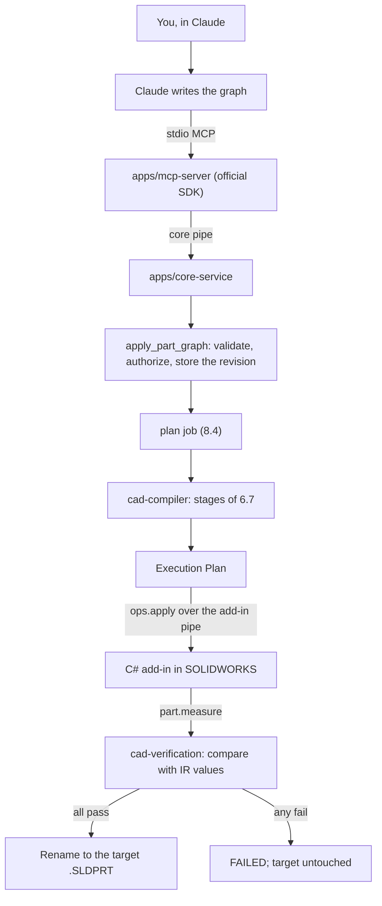

# Part Chain MVP Design

**Date:** 2026-11-05
**Status:** Awaiting owner approval of this document as a whole. Nothing is built until it is approved. Revised after the [pre-implementation review](../review/2026-11-05-part-chain-mvp-pre-implementation-review.md); the owner decided D1 to D5 on 2026-11-05 (section 14).
**Decision behind it:** [ADR-057](../../adr/ADR-057-freeze-drawings-build-part-chain-first.md)
**Implementation plan:** [2026-11-05-part-chain-mvp.md](../plans/2026-11-05-part-chain-mvp.md)

## 1. Intent

Prove the whole system once, end to end, on one simple part:

> You ask Claude for a part. Claude writes a Part Feature Graph and calls an MCP tool. The core validates and compiles it, the add-in builds it in SOLIDWORKS, and the system measures the result. A `.SLDPRT` appears at the target path only if the measurements match.

The point is evidence that the architecture works: IR first, deterministic compilation, verified execution and a real running product. Feature coverage comes later.

## 2. Goals, non-goals and failure conditions

**Goals**

1. Claude connects over MCP using the official SDK and can discover how to write a graph.
2. The Part Feature Graph IR has real schemas for `sketch`, `extrude` and `cut_extrude`.
3. The compiler follows the 6.7 stages and produces a byte-identical Execution Plan for the same input.
4. The add-in builds the part through real operations, addressing the document by path.
5. Verification measures the part in SOLIDWORKS and compares it with values computed from the IR, again after save and reopen.

**Non-goals**

- Hole Wizard, patterns, chamfers, fillets, revolves, sheet metal and materials.
- Sketch `relations` and `dimensions`. The first sketches are fixed coordinates.
- Faces or edges as sketch planes, the geometry reference system (section 7) and `geometry.candidates`.
- Editing a built part (`update_part_graph`), reading existing parts (`features.read`), overwriting any existing file.
- `.in` documents, configurations, assemblies, drawings of the result, Phase 1c acceptance.
- Interpreting plain language in the server. Claude does that.
- Rollback through undo (A6 stays unproven and unneeded).

**It has failed, even if it runs, if:**

- A file appears at the target path for a part that failed any check.
- A part with a misplaced hole or a wrong profile passes verification.
- An operation reports success without having worked.
- A job closes, saves or changes a document the engineer had open.
- Expected values are taken from SOLIDWORKS instead of the IR.
- A drawing test stops passing.

## 3. The first part

A 100 × 60 × 10 mm plate with four Ø8 mm through holes at (±40, ±20). This is the acceptance case; the chain accepts any graph inside the rules of section 5.

```json
{
  "module": "part", "id": "plate_4h", "schema_version": "0.1", "units": "mm", "origin": "built",
  "nodes": {
    "sketch_base": { "type": "sketch", "plane": "plane:front", "entities": {
      "l1": { "type": "line", "start": [-50, -30], "end": [50, -30] },
      "l2": { "type": "line", "start": [50, -30], "end": [50, 30] },
      "l3": { "type": "line", "start": [50, 30], "end": [-50, 30] },
      "l4": { "type": "line", "start": [-50, 30], "end": [-50, -30] } } },
    "extrude_base": { "type": "extrude", "dependencies": ["sketch_base"], "profile": "sketch_base",
      "end_condition": { "type": "blind", "depth": 10 } },
    "sketch_holes": { "type": "sketch", "plane": "plane:front", "entities": {
      "c1": { "type": "circle", "center": [-40, -20], "diameter": 8 },
      "c2": { "type": "circle", "center": [40, -20], "diameter": 8 },
      "c3": { "type": "circle", "center": [40, 20], "diameter": 8 },
      "c4": { "type": "circle", "center": [-40, 20], "diameter": 8 } } },
    "cut_holes": { "type": "cut_extrude", "dependencies": ["sketch_holes", "extrude_base"],
      "profile": "sketch_holes", "end_condition": { "type": "through_all_both" } }
  }
}
```

Expected: 1 solid body; size 100 × 60 × 10 mm; volume 60,000 − 4 × π × 4² × 10 ≈ 57,989.38 mm³; 4 healthy features; four Ø8 mm cylindrical faces with axes at (±40, ±20); center of mass at the plate's center.

The cut uses `through_all_both`, so it works whichever way the sketch normal points. The sketch shares the base sketch's plane because face references are out of scope.

## 4. The chain



**What already exists and is reused:** job engine and journal, store, tool registry, `get_execution_status`, `cancel_execution`, `PipeHost`, `CorePipeClient`, `NamedPipeBackendProvider`, add-in host, ledger and framing.

## 5. Part Feature Graph IR

**Files.** `schemas/part-feature-graph/v0.json` (document and shared objects) and `schemas/part-feature-graph/features/{sketch,extrude,cut_extrude}.json`, following 5.7. Each feature file has one minimal example of at most 400 tokens (12.3).

**Accepted fields.**

| Node type | Fields |
| --- | --- |
| All | `type`, `dependencies`, `display_name`, `realizes` (stored, not acted on) |
| `sketch` | `plane` (`plane:front`, `plane:top`, `plane:right`), `entities`: `line` (`start`, `end`), `circle` (`center`, `diameter`) |
| `extrude` | `profile`, `end_condition` `{type: blind, depth}` |
| `cut_extrude` | `profile`, `end_condition` `{type: blind, depth}` or `{type: through_all_both}` |

`additionalProperties: false` throughout. Later features and fields are additive (ADR-042). `suppressed`, `parameters` and `x_solidworks` are absent for now, so sending them is a schema error.

**Semantic rules (`IR_RULE_VIOLATED`, `IR_REFERENCE_UNRESOLVED`, `IR_CYCLE`).** Every issue is reported together (3.4.7).

- `units` is `mm` and `origin` is `built`.
- Every `profile` and dependency exists, and a profile is a sketch. Implied dependencies are added, and cycles are rejected.
- An extrude's profile is one closed loop of lines or exactly one circle. A cut's profile is either of those, or several circles. Loops may not self-intersect, and circles may not overlap.
- The first solid feature is exactly one `extrude`; every other solid feature is a `cut_extrude` that depends on it directly or through other features.
- A cut's profile lies strictly inside the extrude's profile, on the same plane, so that the expected values below stay exact and the part stays one body.
- `depth` and `diameter` are positive, and a blind cut's depth is below the extrude's depth.

These rules are deliberately narrow. Each exists because the expected geometry can be computed exactly under it.

**Model code.** Hand-written frozen dataclasses in `cad_ir/part_feature_graph/`, built after `validate_against_schema`, like `cad_ir/drawing_intent/`. The schema stays the source of truth (ADR-035). ADR-051's generator cannot express the per-type node variants and would stop with an error, and F14's wider question stays open. A contract test compares the dataclass fields with the schema's properties, so they cannot drift.

## 6. Compiler

`packages/cad-compiler` implements each 6.7 stage as a pure `run(input, context) → {output, diagnostics, needs}`.

**Input.** As 6.7.2 says, the compiler takes the stored documents of a pinned bundle: a manifest holding `part:<id>@<revision>`, and the documents by reference. The parser produces `PartGraph`, and later stages use only that. `revision` is left out of the content that feeds the plan and recorded as the pinned reference, so a new revision of identical content cannot change the plan's body by accident. The job loads the stored revision; it never carries a second copy of the graph.

| Stage | In the MVP |
| --- | --- |
| Parser, Schema Validator | Over the model above. `0.x` only |
| Semantic Validator | The rules of section 5, using a feature registry for the three types |
| Graph Analyzer | Topological order, with ties broken by node ID (5.7.1) |
| Geometry Resolver | Accepts the three standard planes and fails on anything else with `COMPILE_UNSUPPORTED_FEATURE`. Never returns `needs` |
| Feature Lowering | Sketch node → `sketch.create`; solid node → `feature.create`. Prepends one `part.create`. Checks operations against the capability profile. Records defaults |
| Execution Planner | The 6.5.3 plan, with postconditions and a verification point after each solid feature |

The defaults table is `packages/cad-compiler/defaults/0.1.0.json`. Lowering sends 2D sketch coordinates only and does not use the plane mapping that expected geometry uses, so the two cannot share a bug. The plan's schema is `schemas/execution-plan/v0.json`, covering all 6.5.3 fields.

**Plan storage.** Building the same graph again produces the same plan, so an existing plan at its key is reused, and the reuse is recorded in the job's journal (6.7.4). Task 2 settles the key, since 6.7.4 and 13.2.1 currently describe it differently.

**The plan stays static.** A plan must be byte-identical for the same input, but a working file path and SOLIDWORKS feature IDs exist only at run time. So the plan holds symbols, and the job binds them when it sends each operation:

- An operation's `document` is the symbol `$working`, which the job replaces with the working file path.
- `feature.create`'s `profile` is the sketch's node ID, which the job replaces with the `feature_id` returned for that node.
- The job sends each operation as its own batch, as `check_drawing` does, so an earlier result is always available. This satisfies 6.5.3's limit of 100 and cuts at every verification point.
- The job keeps the node ID → `feature_id` map in `part_result`. No resume exists, so it needs no journal record, though `batch_sent` and `op_result` still journal every operation.

**Capability profile.** One pure constructor in `cad-compiler`, `CapabilityProfile.from_session(HelloResult)`, combines the session with the compiler's feature coverage and computes the canonical hash itself (6.6). No caller supplies a hash. The add-in reports the real UI language, which `SwAddin.cs:129` currently hard-codes. Licensed modules can stay empty.

**Determinism test.** Compile twice, in one process and in a fresh one, and compare hashes (15.6).

## 7. Operations and add-in

| New contract | Params | Result |
| --- | --- | --- |
| `part.create` op | `template` (path of a `.prtdot`; see below). The batch's `document` is the working file path. Fails if the file exists | `native_id`, `path`, `instance_id`, `previous_active`, `template` (path and SHA-256) |
| `sketch.create` op | `node_id`, `plane`, `entities` (lengths in mm) | `native_id`, `feature_id`, `entity_count` |
| `feature.create` op | `node_id`, `type`, `profile` (bound `feature_id`), `end_condition` | `native_id`, `feature_id`, `status` |
| `part.measure` command | `document` | `path`, `instance_id`, `solid_body_count`, `bbox_m` `{min, max}`, `volume_m3`, `surface_area_m2`, `center_of_mass_m`, `cylinders_m` `[{point, direction, radius}]`, `rebuild` `{ok, errors}`, `features` `[{feature_id, native_id, type, status}]`, `dirty`, `read_only` |

`part.measure` is a read-back command like `drawing.snapshot`, not an operation. It returns raw SI values, and the core converts them, so one conversion cannot both build and measure a part wrongly and still agree with itself. The `Backend` port gains `measure_part`.

**`feature_id`** is `f<IFeature.GetID()>`, the form 5.3.6 defines. It is not persistent identity for later editing; K9 stays open and frozen. The Features check matches by `feature_id`, in-session and after reopen, with type checked as well. The spike confirmed on the plate that `GetID` is identical across close and reopen (A2 holds), so the `GetPersistReference3` fallback of 5.3.6 is not needed. It stays documented there, and tree position is never used.

**Template (owner decision, 2026-11-05).** The spike found that the install's default part template preference is `~BLANK_PART_TEMPLATE.prtdot`, which is not a file, and `NewDocument` returns null for it. So the system never relies on SOLIDWORKS's template preference. A new configuration key `part.template` (13.3) holds the full path of a `.prtdot`. The job gives `part.create` the caller's `template` if there is one, otherwise `part.template`. With neither set, or with the file missing, the job fails with a catalogued error that names the setting (`CONFIG_INVALID` when unset, `FILE_NOT_FOUND` when missing, with `details.setting: part.template`). There is no silent fallback to an installed template. The owner's own template is `D:\01_Data\ZZ_EPG Drawing templates\ISO-mm.prtdot`; live tests run with it and with the installed `gb_part.prtdot`. The template is only read, never written. **[Builder's call]** The plan stays static: it omits `template`, and the job fills it in when it sends the operation.

**`instance_id`** is issued by the add-in each time it creates or opens a document, and returned by `part.create` and `document.open`. It is not persisted. It lets the job tell a document it holds from one reopened under the same path (F39 of the architecture review).

**Rules for new adapters** in `ExecutionServer.Adapters/Parts/`:

- Find the document by the batch's full path (`GetOpenDocumentByName`), never `ActiveDoc` (F5). The spike showed this call returns null for a title, a name without a path, and an unsaved document, so the full path is the only key.
- A failure is a catalogued error, never a false result (F6). A feature the API returns null for fails with `BACKEND_REBUILD_ERROR`.
- Results are read back from SOLIDWORKS, not echoed from input.
- Convert mm to metres in one place. Follow G1 (COM release in `finally`).
- Follow 8.3 rule 11 in full: `AddToDB`, inference and snapping off, `EnableGraphicsUpdate` off while building, and selection through `IFeature.Select2(append, mark)` for planes and sketches and `Select4` for entities, with explicit marks, never `SelectByID2`. Each change is restored in `finally` within the operation, because `Execute` restores settings after every operation.
- Standard planes are found by their order among the document's `RefPlane` features, as 5.3.6 specifies, because their names are localized. The adapter then checks the plane's normal against its role and fails clearly on a mismatch, so a template with reordered or rotated planes is caught at once.
- Feature calls need no active document (spike: sketch, extrude, cut, measure, rebuild and save all worked on a document that was not active). So part operations neither check nor change the active document. The engineer-change detection of 8.3 rule 13 stays.
- A blind `cut_extrude` passes the cut direction argument `Dir=true`, so it goes into the body; `Flip` does not work. The plate's `through_all_both` cut is unaffected (5.7.4).
- `part.create` and the save rule refuse an existing path themselves, since `SaveAs4` with the silent option overwrites without warning.
- `IMassProperty` is used with `UseSystemUnits = true`, because `false` follows neither the document's linear unit nor metres.
- `solid` features are followed by a forced rebuild before the save. A read-only reopen is measured without a rebuild, so `dirty` must stay false.

**Why `part.create` saves at once.** An unsaved document has no path, so it cannot be addressed by path. Saving immediately to a uniquely named working file gives every later operation a path. It also means the target path is never touched during a build.

**Ownership is enforced in the add-in, not trusted from the core.** ADR-046 already says the add-in tracks which documents a job opened and the active document at the start. A core bug must not be able to save or close an engineer's part (ADR-022).

- A small table beside the ledger is keyed by path and job ID, and holds `owned`, `instance_id` and `previous_active`. `part.create` and `document.open` write it. A check only ever matches the requesting job, so a dead job's entry can't grant anything and no job-end signal is needed.
- The job ID comes from the operation's `_meta` or `operation_id`.
- **On a `.SLDPRT`:** `document.save` and `document.close` are refused with `AUTH_SOURCE_WRITE_NOT_ALLOWED` unless this job owns the document (D5). A `target_path` differing from the document's path is refused too, so a save can never overwrite another file.
- **On a drawing:** the frozen flow does not change. The live tests address unsaved drawings by title and use `target_path`, so that lookup stays. A drawing the requesting job recorded as borrowed still can't be closed.
- Closing an owned document restores `previous_active`.
- `DestroyNotify` is not subscribed today, and `ForgetDocument` has no caller. The spike showed that `FileCloseNotify` never fires for an API close, so the add-in does not rely on it. It subscribes `DestroyNotify2` on each part document it tracks and forgets the table and ledger entries there. Before trusting a table entry, it also checks `GetOpenDocumentByName(fullPath)` lazily and drops the entry if the document is gone (for example, closed by the engineer).

**Detecting the engineer (8.3 rule 13).** The add-in listens only for active-document changes and file close today. For the working part it also subscribes to regen (`RegenNotify`, `RegenPostNotify`), save (`FileSavePostNotify`; `FileSaveNotify` does not fire for an API save) and destroy (`DestroyNotify2`) events, so an edit, save or close the job did not cause fails the job with `EXEC_INTERRUPTED_BY_USER`. Rule 13's "AI job running" banner doesn't exist, and by decision D1 the MVP has a temporary exception for it.

ADR-032's "stateless apart from completed operation IDs" gains this exception, which ADR-046 already implied.

**Shared add-in fixes required by this chain**, each with a test:

| Finding | Fix |
| --- | --- |
| F4 | `document.open` reports true `owned`, and honours `read_only` |
| F4, F5 | `document.save` and `document.close` act on the addressed document, under the ownership rule above |
| F6 | An unknown operation is an error, not `status: applied` (`SwAddin.cs:544`) |
| F7 | Backends close at the end of a job, after the final state, and a close failure is only a logged warning. A failed handshake (`discovery.py:186`) or failed reconcile (`reconcile.py:26`) also closes. Connecting waits briefly if the add-in is between server instances |

Operation dispatch moves from `SwAddin.cs` into `ExecutionServer.Core` so it can be tested without COM (the test project references only `Core`). Drawing adapters stay as they are. If any change forces an edit to a frozen file, work stops and it goes back to the owner.

## 8. The `plan` job

`apply_part_graph` starts a job of type `plan` (8.4). The tool itself validates the IR, authorizes the path and stores the revision, so a bad graph or path fails the call and creates no job.

| State | What happens |
| --- | --- |
| PLANNED | Accepted, waiting |
| VALIDATED | Backend acquired and capabilities checked. Compile. Store the plan. Re-check the target does not exist |
| EXECUTING | Journal `document` `create`, then send `part.create` on `<name>.<job_id>.building.SLDPRT`. Then the plan's operations, journalled before sending (13.2.3), with postconditions checked. Forced rebuild, then `document.save` |
| VERIFYING | `part.measure` and compare. Take the fingerprint. Close, and confirm the document is no longer open. Reopen read-only, confirm a new `instance_id`, measure and compare again. Close. Publish (below) |
| COMMITTED | The target exists and passed everything |
| FAILED | See below |
| ABORTED | Cancelled between commands |

**Publishing.** In this order:

1. Re-run the 12.5 path checks on the target, so a folder swapped since authorization is caught.
2. Compare the working file's fingerprint with the one taken before reopen. A mismatch fails the job.
3. Journal `publish_intent` with path and fingerprint. This is the last cancel point.
4. Rename with no replace and write-through (`MoveFileExW`). If the target has appeared, the job fails with `AUTH_SOURCE_WRITE_NOT_ALLOWED`.
5. Journal `published`, store the part record, enter COMMITTED.

**Cancel boundaries.** A cancel takes effect between operations, between the two measurements, and before `publish_intent`. After `publish_intent`, the job finishes as COMMITTED or fails, and a cancel request has no effect.

**Crash recovery.** Recovery follows 13.2.3 and never resumes. The journal's `document` `create` means the working part is reported `unknown` even if the core died during `part.create`. If a job has `publish_intent` and no `published`, recovery compares the target's fingerprint: on a match the job stays FAILED with `EXEC_INTERRUPTED` and gains a `published_unconfirmed` warning naming the file. It never adopts the file silently. `_action` in `journal_records.py` and the store schema change together, because `_action` currently turns any unknown action into `open`.

**Ending without success.** The target is never touched.

| Case | Working file |
| --- | --- |
| Operation or verification failed | Best-effort save, close, renamed `<name>.<job_id>.failed.SLDPRT`, named in the error |
| Cancelled | Closed and removed. With `keep_partial`, renamed `<name>.<job_id>.partial.SLDPRT` |
| `BACKEND_LOST`, `BACKEND_UI_BLOCKED`, `EXEC_TIMEOUT`, `EXEC_INTERRUPTED_BY_USER` | Left alone and listed as `unknown` (8.4). Nothing is resent |

The job reuses `check_drawing`'s handling of notifications, journalling and stop rules through new code in `jobs/`. `jobs/check_drawing.py` is frozen and is not edited, apart from what its callers need to keep working.

## 9. Verification

`packages/cad-verification` (pure) has two functions:

- `expected_geometry(graph)`: body count, bounding box, volume, surface area, center of mass, cylinder list and feature list, computed from the IR alone. Base area and centroid by the shoelace formula, circles by π r², times depth. Cuts subtract their volume and moment. A through cut changes area by 2π r d − 2π r²; a blind cut by 2π r h.
- `compare(expected, measured, tolerances)`: one result per check, each with requirement, measured value, expected value, tolerance and pass or fail (10.2).

| Check | Pass condition |
| --- | --- |
| Operations | Every outcome succeeded, with postconditions met |
| Rebuild | `rebuild.ok`, no errors |
| Features | Exactly the expected solid features and sketches, each healthy. An extra feature fails |
| Bodies | Exactly the expected count |
| Bounding box | Within ±0.01 mm per axis |
| Volume | Within ±0.01% (about 5.8 mm³ on the plate, where one missing hole is about 503 mm³) |
| Surface area | Within ±0.01% |
| Center of mass | Within ±0.01 mm per axis |
| Cylinders | One-to-one with the IR's circles: axis position and radius within ±0.01 mm, axis direction parallel. Catches moved holes that the checks above would miss when placement is symmetric |
| Reopen | All of the above again, on a new `instance_id`, and `dirty` is false |

Any failure ends the job FAILED with a new code, `PART_VERIFICATION_FAILED`, whose `details` hold the failing checks. Every comparison runs, so all failures are reported at once.

**What verification cannot catch:** a graph that is valid but is not the part you meant. The final response therefore lists the measured size, volume and feature count, so the mismatch is visible to you and Claude.

## 10. MCP tools and runtime

| Tool | Kind | Input | `data` |
| --- | --- | --- | --- |
| `apply_part_graph` | job | `graph`, `target_path` (absolute, `.SLDPRT`), optional `expected_revision` | `execution_id`, `queued_position`, `document` (pinned ref) |
| `validate_part_graph` | store | `graph` | `valid`, `issues`, `build_order`, `expected` |
| `list_feature_types` | store | none | The three types, each with a one-line description and its support |
| `get_feature_schema` | store | `types` | Compact schema and example per type |
| `get_execution_status` (existing) | store | unchanged | Additive `part_result` for `plan` jobs: `path`, `fingerprint`, `checks`, `measured` |
| `cancel_execution` (existing) | store | unchanged | Unchanged. `changes` lists the working file |

Rows of 12.4.4 stay as they are. The MVP ships these four 1c tools early, per ADR-057, in the `core` toolset.

**Drawing tools are off by default.** This MVP is the first time Claude can actually reach the tools, and frozen `check_drawing` is unsafe outside scratch copies (F1 to F5, O5). So `mcp.toolsets` defaults to `["core"]` (`merge.py:198`, `settings.py:39`), and `check_drawing` and `get_drawing_report` are not in `tools/list` unless a user adds `drawing` to their configuration. A call to a disabled tool arriving through the core pipe is refused as an unknown tool, so hiding it is real. `CoreService.call_tool` in process stays unfiltered, so drawing tests keep passing. Tests that expect `check_drawing` over the pipe set the toolset explicitly.

**Target path rules.** It passes 12.5 checks, its parent folder exists, it is not in a PDM vault (`Authorized.in_vault`), no file exists there, and the working path stays under 260 characters. The working name adds about 44. Otherwise `AUTH_PATH_DENIED` or `AUTH_SOURCE_WRITE_NOT_ALLOWED`, with the reason in `details`.

**Store.** The graph is written to `modules/part/<id>/<revision>.json`. A new ID needs no `expected_revision` and gets revision 1. An existing ID with identical content reuses its revision. An existing ID with different content needs a matching optional `expected_revision`; without one, the call fails with `REV_CONFLICT`, so one agent can't silently replace another's graph (12.4.2). A committed part writes `parts/fp-<hash>.json` with `produced: true`, path, fingerprint, graph reference and job ID. Adding `parts/` records is additive to `schemas/store/v0.json`, as is the job's `part_result`.

**Runtime (F8, F15).**

- `sw-mcp-core`: a real entry point for `CoreService`, `PipeHost` and `NamedPipeBackendProvider`, single-instance per user.
- `sw-mcp-mcp`: the stdio front-end on the official `mcp` SDK (ADR-034), replacing the hand-written loop in `app.py`. It starts the core if it cannot reach one.
- Tool results map as 12.4.2 says: `summary` to text content, envelope to `structuredContent`, with `outputSchema` and annotations from contracts. A failed envelope sets `isError`.
- The core pipe is user-only and compares tokens in constant time (ADR-032).
- `docs/development/` gains a setup page: building and registering the add-in, `access.allowed_roots`, and the Claude MCP configuration.

## 11. Specification changes this requires

These go through the spec first (AGENTS.md section 3), in the plan's first task, as one version bump.

| Where | Change |
| --- | --- |
| 5.7.4 | Sketch axes, normal, and extrude and cut direction per standard plane, from the first spike; the blind-cut `Dir=true` rule |
| 6.5.2, `schemas/ipc/ops/` | `part.create`, the MVP subset of `sketch.create` and `feature.create`. `document.save` also covers a part the job created. Standard planes are role references, a stated exception to 6.5.1's pinned IDs |
| 6.5.3, 6.7.4 | Symbols in a plan (`$working`, node IDs), bound by the job at send time. One plan key, and reuse of an existing plan |
| ADR-032 | The add-in's ownership table and `instance_id` are stated exceptions to "stateless"; close tracking by `DestroyNotify2` and a lazy path check |
| 8.3 rule 13, ADR-050 | The banner's temporary exception for the MVP (D1) |
| 13.3, 12.3 | `mcp.toolsets` defaults to `["core"]` while drawings are frozen, and a disabled tool is refused over the pipe. New key `part.template` (owner decision, after the spike) |
| 3.4.5, 12.4.2 | The revision rules for `apply_part_graph` |
| 13.2.3 | `document` `create`, `publish_intent`, `published`, and the `published_unconfirmed` warning |
| 8.4 | The `plan` job's lifecycle, also started by `apply_part_graph`, with the table in section 8 |
| 8.7, `schemas/ipc/v0.json` | `part.measure` |
| 10.2 | The MVP checks and tolerances |
| 12.4.4, 12.4.5 | The four early tools, and the rule for shipping them. `test_tool_table.py`'s `SHIPPED_PHASES` gains those names only |
| 12.5 | "What may be written" gains new parts the system produced, never overwriting |
| ADR-046 | Part jobs use the working file rule instead of undo |
| ADR-037, `errors.json` | `PART_VERIFICATION_FAILED` |
| 13.2.1, `schemas/store/v0.json` | The `parts/` record and `part_result` |

## 12. Acceptance

**Offline, in CI**

1. Schema fixtures, valid and invalid, for all new schemas.
2. Compiling the plate twice gives identical plan hashes, and a golden plan matches.
3. Graphs with a cycle, an open loop, a hole outside the profile, an unknown type or inch units are rejected with the right code and pointer.
4. `expected_geometry` on the plate gives the values in section 3. Moved holes and a same-area, same-box profile fail `compare`.
5. The `plan` job against a recorded transcript reaches COMMITTED. Transcripts for a failed operation, wrong volume, cancel and lost backend reach the right state, and none produces the target file.
6. MCP contract tests compare `tools/list` with the contract files, and a disabled tool is refused over the pipe.
6a. A simulated crash at each point (before and after `part.create`, after each operation, after `publish_intent`, after the rename, before COMMITTED) recovers as section 8 says.
7. The full existing suite still passes, including every drawing test.

**Live, with a scratch folder (`pytest -m live`)**

8. The plate builds, and the target exists and passes all checks after a separate reopen.
9. A deliberately wrong plan (depth 9 mm with the graph saying 10) ends FAILED, the target is absent, and the `.failed` file is present.
10. A second job in the same core succeeds (F7).
11. An already open, unsaved document stays open, unsaved and active after a job (F4, F5).
12. An unknown operation fails its batch (F6).
12a. An engineer's switch, edit, save or close on the working part fails the job, with no target.
12b. Reopening gives a new instance, read from disk.
12c. A template with reordered planes or extra features fails clearly.
12d. Killing the core mid-job leaves the target absent, and the next job runs cleanly.
12e. A target under a Chinese folder name works through the whole chain.
12f. Every frozen drawing live test gives the same result as the baseline taken before any change.

**End to end, the MVP's finish line**

13. In Claude, you ask for the plate in plain language. Claude discovers the schema, writes the graph and applies it, and reports the measured values. You open the file in SOLIDWORKS and agree it is right. Your sign-off is recorded in `HANDOFF.md`.
14. A second, different part inside the rules builds the same way, so the plate has not been hard-coded.

## 13. Risks

| Risk | Response |
| --- | --- |
| SOLIDWORKS API signatures and behaviour here are unverified | The first task is a spike on scratch files that records them before anything depends on them |
| A14 (threading) fails under real load | Its register fallback. Run it in the spike |
| A2 fails: `GetID` changes on reopen | Held in the spike. `GetPersistReference3`, per 5.3.6, stays documented as the fallback |
| Feature calls need the document active, and the engineer can change it | Did not apply: calls work on a document that is not active (spike) |
| `SaveAs4` with the silent option overwrites existing files | Confirmed by the spike. `part.create` and the save rule refuse an existing path first |
| `CloseDoc` behaviour with unsaved changes is unknown (F4) | Answered: it discards without a prompt. The job saves before closing wherever it can |
| The default part template is unusable (`~BLANK_PART_TEMPLATE.prtdot`, not a file) | The `part.template` setting, with no fallback (section 7) |
| `FileCloseNotify` never fires for an API close | `DestroyNotify2` and a lazy `GetOpenDocumentByName` check (section 7) |
| The file stays locked briefly after close, so the rename fails | A bounded wait, then FAILED with the working file kept and named |
| `GetBodyBox` is looser than the true box | Equal to the true box on the plate (prismatic, planar). Still open for curved bodies; if it is looser there, use a tight method or widen only the box tolerance, recorded in 10.2 |
| A running SOLIDWORKS locks add-in DLLs, blocking `dotnet build` | Builds need SOLIDWORKS closed. Agents ask you before that, and never close it themselves |
| Scope grows into general feature work | Section 2 is the limit. New features come after sign-off |

## 14. Calls made while writing this

These were made while writing. The owner confirmed the plate, fixed-coordinate sketches, the tolerances and drawing tools being off by default through D3 below. The others were not explicitly decided; correct any of them.

- The plate is the first part, since no objection was raised.
- Expected values are computed from the IR rather than supplied by Claude, which forces the narrow rules in section 5.
- `part.create` saves immediately to a working file, and files are never overwritten.
- Failed builds keep a `.failed` file, and cancelled builds remove the working file.
- Sketches have fixed coordinates with no relations or dimensions, so the part is not yet parametric in SOLIDWORKS.
- Tolerances: ±0.01 mm and ±0.01%.
- Hand-written IR dataclasses, checked against the schema by a test.
- Four 1c tools ship early, and `compile_bundle` and `execute_plan` stay unbuilt, since 12.4.4 says `apply_part_graph` makes them unnecessary for the `core` toolset.
- The plan holds symbols that the job binds at send time, with one operation per batch.
- `feature_id` is `f<GetID()>`, used only for verification; persistent identity stays with K9.
- The add-in enforces part ownership through a small table, as an exception to ADR-032's "stateless".

**Owner decisions, 2026-11-05.** From the [pre-implementation review](../review/2026-11-05-part-chain-mvp-pre-implementation-review.md).

| # | Question | Decided |
| --- | --- | --- |
| D1 | Build rule 13's Stop banner in the MVP, or record a temporary exception (ADR-050 is an Accepted owner decision) | A temporary exception for the MVP, with `cancel_execution` as the way to stop. Event detection is still built. Recorded in 8.3 rule 13 and ADR-050 in plan Task 2 |
| D2 | Add the stronger checks, which enlarge `part.measure` | Added: cylinders, center of mass, surface area |
| D3 | Confirm the plate, fixed-coordinate sketches, the tolerances, and drawing tools hidden and refused by default | Confirmed |
| D4 | Keep working and failed files beside the target, or in `.cad` | Beside the target, so failures stay visible |
| D5 | Refuse to close any `.SLDPRT` the job doesn't own, though a part job then can't tidy up in an unknown state | Refused |
| D6 (after the spike) | Which part template `part.create` uses | The owner's `D:\01_Data\ZZ_EPG Drawing templates\ISO-mm.prtdot`, through the new setting `part.template`. No reliance on SOLIDWORKS's preference and no silent fallback |

## 15. Left to the builder

File and class layout within these packages, test helpers, batch boundaries inside the plan's rules, exact response wording, and the details of the core's single-instance check.
